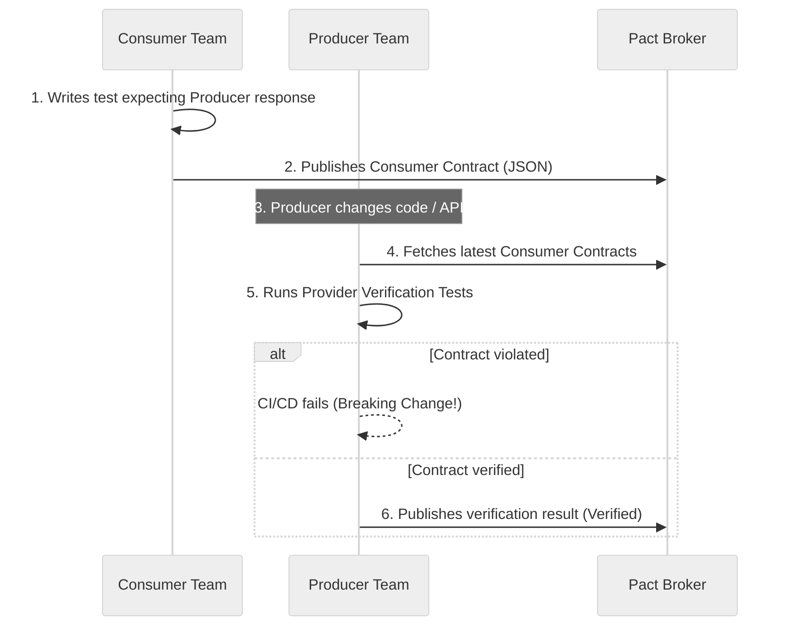

# API Design & Documentation

### 1. OpenAPI 3.1: структура спецификации, основные возможности
OpenAPI Specification (OAS) — стандартизированный формат описания REST API. Версия 3.1 (вышла в 2021) основана на JSON Schema draft 2020-12, в отличие от 3.0, которая использовала модификацию JSON Schema draft-04.

Ключевые компоненты спецификации:
- `openapi: 3.1.0` — версия спецификации
- `info` — метаданные (title, version, description, contact)
- `servers` — список базовых URL (dev, staging, prod)
- `paths` — маршруты с операциями (get, post, put, patch, delete)
- `components` — переиспользуемые схемы (schemas, parameters, responses, securitySchemes)
- `security` — глобальные security requirements

В 3.1 появились: поддержка JSON Schema 2020-12 (anyOf, not, $ref с $defs), `webhooks` для event-driven, `content-type` в параметрах, несколько body через oneOf.

Практическое применение: спецификация является источником правды для генерации клиентского кода, серверных stubs, документации (Swagger UI, Redoc, Stoplight), mock-серверов и contract tests.

### 2. Генерация кода из OpenAPI: инструменты и стратегии
**Серверные stubs (Java):**
- `openapi-generator` (OpenAPITools) — генерирует Spring controllers, DTO, exception handlers, config. Поддерживает 50+ target languages.
- `springdoc-openapi` — reverse direction: генерирует спецификацию из Spring-кода (annotations + reflection).
- `swagger-codegen` (legacy) — заменён openapi-generator.

**Клиентский код:**
- `openapi-generator` с target `java`, `typescript-axios`, `kotlin`, `go` и др.
- В Spring Cloud: `spring-cloud-openfeign` + генерация Feign clients.

**Стратегии:**
1. **Дизайн-сначала**: спецификация пишется первой (через Swagger Editor, Stoplight, Redocly), из неё генерируются и серверные, и клиентские артефакты. Подходит для публичных API, BFF.
2. **Код-сначала**: код пишется первым, спецификация генерируется из него (springdoc). Подходит для внутренних API.
3. **Гибрид**: спецификация вручную поддерживается как контракт, код проверяется через lint (spectral) и contract tests.

**CI/CD интеграция:** `openapi-generator-cli` в pipeline, diff спецификаций между версиями (oasdiff, oas-diff) для детекции ломающих изменений.

### 3. AsyncAPI: спецификация для event-driven API
AsyncAPI — «OpenAPI для асинхронных систем». Описывает каналы (канал = topic/queue), сообщения (message format), протоколы (Kafka, AMQP, MQTT, WebSocket, SSE).

Структура:
- `asyncapi: 3.0.0`
- `channels` — имена каналов (например, `order.created`)
- `operations` — publish/subscribe с привязкой к channel
- `message` — payload (JSON Schema), headers, correlation id
- `components` — переиспользуемые schemas, message traits, operation traits

Пример:
```yaml
channels:
  order.created:
    publish:
      operationId: publishOrderCreated
      message:
        $ref: '#/components/messages/OrderCreatedEvent'
components:
  messages:
    OrderCreatedEvent:
      payload:
        type: object
        properties:
          orderId: { type: string, format: uuid }
          totalAmount: { type: number }
```

Практическое применение: документация контракты событий, генерация потребители событий (Java, Node), mocking event-источников для разработки и тестирования, детекция ломающие изменения в event schemas.

### 4. gRPC + Protobuf: контракт, генерация кода, streaming
**Protocol Buffers (proto):**
```protobuf
syntax = "proto3";
package com.example.api;

service OrderService {
  rpc CreateOrder (CreateOrderRequest) returns (Order);
  rpc StreamOrders (StreamOrdersRequest) returns (stream Order);
  rpc GetOrder (GetOrderIdRequest) returns (Order);
}

message Order {
  string order_id = 1;
  int64 total_cents = 2;
  repeated LineItem items = 3;
  enum Status { PENDING = 0; PAID = 1; SHIPPED = 2; }
  Status status = 4;
}
```

**Code generation:**
- `protoc` + `protoc-gen-grpc-java` → Java interfaces + stubs
- В Maven: `protobuf-maven-plugin`, в Gradle: `com.google.protobuf` plugin
- Runtime: `grpc-netty-shaded` (server), `grpc-protobuf` (serialization)

**4 вида вызовов:**
1. Unary (request → response)
2. Server streaming (request → stream of responses)
3. Client streaming (stream of requests → response)
4. Bidirectional streaming (stream ↔ stream)

**gRPC vs REST:**
- gRPC: HTTP/2, бинарная сериализация (protobuf), сильная типизация, генерация кода, мультиплексирование
- REST: HTTP/1.1 (или 2), JSON, читаемый человеком, tooling, нативный для браузера

**Ограничения gRPC:**
- Нет CORS из коробки (нужен gRPC-Web proxy)
- Браузеры не поддерживают напрямую
- Debugging сложнее (не читаемый человеком)
- Нет нативного HATEOAS
- Versioning: package name или gRPC metadata

**Практика:** gRPC для внутренние межсервисные вызовы, REST для внешний API. Gateway (Envoy, Istio) конвертирует REST → gRPC.

> 🔗 Сравнение производительности и сценарии использования gRPC vs REST — см. `rest-http.md` § "gRPC vs REST".

### 5. GraphQL vs REST vs gRPC: trade-offs
**REST:**
- Преимущества: простой, кэшируемый (HTTP GET), широко поддерживаемый, читаемый человеком, tooling
- Недостатки: избыточное/недостаточное извлечение данных, N+1 при составных данных, versioning через URI
- Когда: публичные API, с преобладанием CRUD, когда клиенты разнообразны

**GraphQL:**
- Преимущества: точный запрос (нет избыточное/недостаточное извлечение данных), один эндпоинт, схема-сначала, интроспекция
- Недостатки: кэширование сложнее (POST), N+1 резолвинг (нужен DataLoader), сложность безопасности (ограничение глубины/сложности запросов), нет нативного пагинации
- Когда: BFF (бэкенд для фронтенда), клиенты с разными потребностями в данных (mobile, web, IoT)
- Стек: Spring for GraphQL (`spring-graphql`), DGS Framework (Netflix)

**gRPC:**
- Преимущества: производительность (binary, HTTP/2), сильная типизация, streaming, генерация кода
- Недостатки: нет поддержка в браузере, сложность debugging, ограниченные инструменты
- Когда: внутреннее общение микросервисов, с высокой пропускной способностью, streaming

**Критерии выбора:**
| Критерий | REST | GraphQL | gRPC |
|----------|------|---------|------|
| Производительность | Средн. | Средн. | Высокая |
| Кэширование | Native | Сложно | Н/Д |
| Браузер | Да | Да | Нет (нужен proxy) |
| Streaming | SSE/WebSocket | Subscriptions | Native |
| Versioning | URI/Header | Schema | Package |
| Tooling | Отличное | Хорошее | Среднее |

**Реализация в Spring (Spring for GraphQL):**
Главная проблема GraphQL — N+1 при резолвинге вложенных сущностей. В Java это решается через **DataLoader** (отложенная загрузка и батчинг).

```java
@Controller
public class OrderController {
    
    // Резолвер для Order
    @SchemaMapping(typeName = "Query", field = "order")
    public Order getOrder(String id) {
        return orderService.findById(id);
    }

    // Резолвер для вложенных Items (использует DataLoader для батчинга)
    @SchemaMapping(typeName = "Order", field = "items")
    public CompletableFuture<List<Item>> getItems(Order order, DataLoader<String, List<Item>> dataLoader) {
        return dataLoader.load(order.getId()); // Запрос уйдет батчем, а не N раз!
    }
}
```
**Компромиссы:** GraphQL даёт гибкость клиенту, но перекладывает сложность на сервер (валидация глубины запросов, защита от DoS через сложность, настройка DataLoader).

### 6. HATEOAS: принципы и реализация в Spring
**HATEOAS** (Hypermedia as the Engine of Application State) — репрезентация ресурса содержит ссылки на связанные ресурсы и допустимые переходы. Клиент не хардкодит URL, а следует ссылкам в ответах.

**Spring HATEOAS:**
```java
@GetMapping("/orders/{id}")
public ResponseEntity<RepresentationModel<?>> getOrder(@PathVariable Long id) {
    Order order = orderService.findById(id);
    RepresentationModel<?> resource = RepresentationModel.of(order);
    resource.add(linkTo(methodOn(OrderController.class).getOrder(id)).withSelfRel());
    resource.add(linkTo(methodOn(OrderController.class).getItems(id)).withRel("items"));
    resource.add(linkTo(methodOn(PaymentController.class).createPayment(id)).withRel("pay"));
    return ResponseEntity.ok(resource);
}
```

Ответ:
```json
{
  "orderId": "123",
  "total": 99.99,
  "_links": {
    "self": { "href": "/api/orders/123" },
    "items": { "href": "/api/orders/123/items" },
    "pay": { "href": "/api/orders/123/payments" }
  }
}
```

**Принципы:**
- Self-link (`rel=self`)
- Named relationships (`rel=items`, `rel=pay`)
- Клиент stateless: навигация только через гиперссылки
- Алгоритмы: HAL (Hypertext Application Language) — JSON с `_links`

**Реальность 2026:** HATEOAS редко применяется в production. Причины: сложность, низкая привязка (link generation на каждый запрос), большинство клиентов знают URL. Применяется в публичных API с высокой степенью автономности (Twitter API v1.1 использовал частично). В Spring: `spring-hateoas` + `hal`. Для BFF и внутренних API — обычный REST.

### 7. Шлюз API: маршрутизация, ограничение частоты, трансформация
**API Gateway** — единая точка входа для всех API запросов. Паттерны:

**Routing:**
- По пути: `/orders/*` → order-service, `/users/*` → user-service
- По заголовку: `X-Service: billing` → billing-service
- По методу: `POST /search` → search-service
- Взвешенная маршрутизация (канареечный): 90% → v1, 10% → v2

**Rate Limiting:**
- На потребителя (API key / аренд)
- На эндпоинт
- Algorithms: корзина с токенами, скользящее окно, фиксированное окно
- Response: `429 Too Many Requests` + `Retry-After` header

**Transformation:**
- JSON → gRPC (Envoy, Istio)
- Versioning: strip `/v1/` из path перед forward
- Обогащение: добавлять заголовки (токен авторизации, ID аренда)
- Агрегация: объединять несколько вызовов бэкенда в один ответ (паттерн BFF)

**Дополнительные функции gateway:**
- Аутентификация/авторизация (проверка JWT, OAuth2)
- Кэширование (кэширование ответов для GET)
- Логирование запросов/ответов
- Предохранитель (не переадресовать в перегруженный сервис)
- Завершение SSL
- Белый список IP

**Технологии:** Kong, APISIX, Envoy, AWS API Gateway, Azure API Management, Istio (Service Mesh как gateway), Spring Cloud Gateway (lightweight, в JVM).

**Spring Cloud Gateway:**
```java
@Bean
public RouteLocator customRoutes(RouteLocatorBuilder builder) {
    return builder.routes()
        .route("orders", r -> r.path("/api/orders/**")
            .filters(f -> f.rateLimit(conf))
            .uri("lb://order-service"))
        .build();
}
```

### 8. Contract Testing: Pact, Spring Cloud Contract
**Проблема:** в микросервисах продюсер и потребитель — разные команды/деплои. Как гарантировать, что producer не сломает consumer?

**Pact (consumer-driven contract testing):**
1. Consumer пишет тест: «я ожидаю, что GET /orders/123 вернёт JSON с полями orderId, total»
2. Pact записывает контракт потребителя (JSON-файл)
3. Contract публикуется в Pact Broker
4. CI producer: запускает provider verification — проверяет, что реальные ответы удовлетворяют все контракт потребителяs
5. Если нет → CI producer падает

```java
// Consumer test (Pact 4.x, Java)
@Provider("order-service")
@Consumer("billing-service")
class BillingPactTest {
    @Pact(consumer = "billing-service")
    public PactInteraction getOrderPact() {
        return new PactInteractionBuilder("/orders/ORD-123")
            .givenExtensions(new ConsumerDefinedMatchingRules())
            .withRequestMethod(GET)
            .withResponseBody(jsonBody -> jsonBody
                .stringType("orderId", "ORD-123")
                .numberType("total", 99.99))
            .withStatusCode(200)
            .toPactInteraction();
    }
}
```

**Spring Cloud Contract (Верификация):**
- Producer определяет contract (GROOVY DSL или YAML)
- Генерируется: stub для consumer, test для provider
- Интеграция с Spring Cloud Contract Stub Runner (consumer поднимает stubs provider'ов)

**Сравнение:**
| | Pact | Spring Cloud Contract |
|---|---|---|
| Direction | Со стороны потребителя | Со стороны провайдера |
| DSL | Java/Kotlin/JS | Groovy/YAML |
| Broker | Pact Broker (отдельный) | Нет встроенного |
| Ecosystem | Многоплатформенный | Spring-only |

**Визуализация Consumer-Driven Contract Testing (Pact):**



> 🔗 Подробнее про тестирование микросервисов — см. `testing.md` § "Тестирование микросервисов".

### 9. API versioning: стратегии и trade-offs
**Версионирование в URI:** `/api/v1/orders`, `/api/v2/orders`
- Плюсы: видимое, легко кэшировать, простой routing
- Минусы: «version in URL» против REST purism, много URL, HATEOAS-несовместимо

**Версионирование в заголовке:** `Accept: application/vnd.company.api.v1+json`
- Плюсы: чистый URI, один endpoint
- Минусы: скрытое, сложно debug, кэширование сложнее

**Параметр запроса:** `?version=1`
- Минусы: самый слабый вариант, не кэшируется отдельно

**Переговоры о формате (совместимый с RFC):**
- `Accept: application/vnd.company.orders.v2+json`
- Корректный HTTP-способ, но complex

**Со стороны потребителя versioning (рекомендуемый подход 2026):**
- Не versioning через URI, а:
  - Аддитивные изменения (новые поля) — не ломающие
  - Deprecation: `@Deprecated` header в ответах, sunset header (RFC 3298)
  - Ломающие изменения → новая major-версия
- Практика: большинство публичных API (Stripe, Twitter) — аддитивные сначала, ломающие только с v2+

**Sunset (RFC 3298):**
```
HTTP/1.1 200 OK
Sunset: Sat, 01 Jan 2028 00:00:00 GMT
Deprecation: /api/deprecation-policy
```

**Стратегия для микросервисов:**
- Internal: без versioning (сервисы деплоятся вместе)
- External: URI v1/v2, additive changes, sunset для deprecated

### 10. API evolution: обратная совместимость, deprecation
**Правила обратная совместимость:**
- Добавление полей в response — OK (consumer игнорирует неизвестные)
- Добавление необязательных параметров — OK
- Удаление/переименование полей — ЛОМАЮЩЕЕ
- Изменение типа поля — ЛОМАЮЩЕЕ
- Изменение кодов состояния — ЛОМАЮЩЕЕ
- Добавление обязательного параметра — ЛОМАЮЩЕЕ

**Процесс deprecation:**
1. **Announce**: `Deprecation` header, документация
2. **Dual-run**: старая и новая версия работают параллельно
3. **Warn**: логирование, alerting на использование deprecated
4. **Sunset**: RFC 3298 `Sunset` header с датой
5. **Remove**: удаление устаревший эндпоинт

**Практические инструменты:**
- `oasdiff` — diff OpenAPI спецификаций, детекция ломающие изменения
- `spectral` — lint API specs, custom rules
- Pact Broker — проверка совместимости при каждом деплое
- API analytics — мониторинг использования устаревший эндпоинтs

**Стратегия для микросервисов:**
- Контракт-сначала: изменения в спецификации проходят ревью
- CI: oasdiff между spec в main и PR — блокирует ломающие изменения
- Окно депрекации: минимум 6-12 месяцев для публичных API

### 11. REST best practices: Проектирование URL, HTTP methods, status codes
**Проектирование URL:**
- Ресурсно-ориентированное: `/orders`, `/orders/{id}`, `/orders/{id}/items`
- Множественное число: `/orders` (не `/order`)
- Без глаголов в URL: `POST /orders` (не `POST /createOrder`)
- Nesting: максимум 2 уровня (`/orders/{id}/items`), глубже — flat (`/items?orderId=123`)
- Pagination: `/orders?page=2&size=20` или cursor-based `?cursor=xxx&limit=20`
- Filtering: `?status=PAID&minAmount=100`
- Sorting: `?sort=-createdAt` (minus = desc)

**HTTP methods:**
- `GET` — идемпотентный, безопасный, кэшируемый
- `POST` — creation (не idempotent), или non-CRUD operations
- `PUT` — idempotent, полная замена
- `PATCH` — частичное обновление (JSON Patch RFC 6902, JSON Merge Patch RFC 7386)
- `DELETE` — idempotent
- `HEAD` — same as GET, без тела
- `OPTIONS` — CORS, поддерживаемые методы

**Status codes:**
- `200 OK` — success
- `201 Created` — resource created + `Location` header
- `202 Accepted` — асинхронная операция
- `204 No Content` — успешный DELETE, PATCH без тела
- `400 Bad Request` — некорректный запрос
- `401 Unauthorized` — не авторизован
- `403 Forbidden` — авторизован, но нет прав
- `404 Not Found`
- `409 Conflict` — конфликт ресурсов (дубликат)
- `422 Unprocessable Entity` — семантическая ошибка (корректный формат, неверное значение)
- `429 Too Many Requests` — rate limit + `Retry-After`
- `500 Внутренняя ошибка сервера`
- `503 Service Unavailable` — maintenance, overload + `Retry-After`

**Headers:**
- `ETag` / `If-None-Match` — условный GET, кэширование
- `Idempotency-Key` — идемпотентный POST
- `X-Request-Id` — корреляция
- `Retry-After` — rate limiting, 503
- `Sunset` — deprecation

### 12. API documentation: инструменты и стратегии
**Инструменты:**
- **Swagger UI** — интерактивная документация из OpenAPI (try-it-out)
- **Redoc** — красивая статическая документация (3-column layout)
- **Stoplight Studio** — дизайн-сначала, совместная работа, проверка, mock-серверы
- **Scalar** — современная альтернатива Swagger UI
- **GitBook / Confluence** — нарративная документация (туториалы, руководства)

**Стратегии:**
1. **OpenAPI-first**: спецификация в репозитории, doc генерируется автоматически
   - CI: build → generate docs → publish (GitHub Pages, S3, internal portal)
2. **Код-сначала**: springdoc генерирует spec из кода, doc из spec
   - Минус: нет контроля качества спецификации
3. **Hybrid**: спецификация вручную (источник правды), код проверяется lint против спецификации

**Контент документации:**
- Getting started (auth, first request)
- API reference (endpoints, params, responses, examples)
- Error reference (все error codes с examples)
- Rate limits и quotas
- Changelog (что изменилось между версиями)
- SDK/CLI reference
- Examples (cURL, Java, Python, JS)
- FAQ

**CI/CD для документации:**
- `redocly build-docs openapi.yaml -o docs.html`
- `openapi-generator` для SDK
- Публикация: GitHub Pages, internal portal (ReadMe, Stoplight)
- Diff спецификаций между release-ветками

### 13. gRPC metadata, interceptors и error handling
**gRPC Metadata (аналог HTTP headers):**
```java
// Клиент: настройка метаданных
ManagedChannel channel = ...;
Metadata metadata = new Metadata();
metadata.put(Metadata.Key.of("X-Request-Id", Metadata.ASCII_STRING_MARSHALLER), "req-123");
metadata.put(Metadata.Key.of("X-Tenant-Id", Metadata.ASCII_STRING_MARSHALLER), "tenant-42");
OrderGrpc.OrderBlockingStub stub = OrderGrpc.newBlockingStub(channel)
    .withInterceptors((call, next) -> {
        Metadata newMeta = new Metadata();
        newMeta.merge(metadata);
        return next.newClientCall(call.getDescriptor(), call.getDefaultCallOptions().withMetadata(newMeta));
    });
```

**Interceptors (аналог Spring interceptors / AOP):**
- Клиентский интерцептор: аутентификация, логирование, повтор
- Серверный интерцептор: проверка аутентификации, определение аренда, метрики

```java
ServerInterceptors.intercept(serverBuilder,
    new MetadataUtils.newCaptureServerInterceptor(),
    new ServerInterceptor() {
        @Override
        public <ReqT, RespT> ServerCall.Listener<ReqT> interceptCall(
                ServerCall<ReqT, RespT> call, Metadata headers,
                ServerCallHandler<ReqT, RespT> next) {
            // Извлечь токен авторизации, проверить, определить аренд
            ServerCall<ReqT, RespT> newCall = new MeteredServerCall<>(call);
            return next.callHandler(newCall, headers);
        }
    }
).build();
```

**Обработка ошибок (коды состояния gRPC):**
- `Status.OK` — success
- `Status.CANCELLED` — client cancelled
- `Status.NOT_FOUND` — resource not found
- `Status.ALREADY_EXISTS` — duplicate
- `Status.PERMISSION_DENIED` — 403
- `Status.UNAUTHENTICATED` — 401
- `Status.DEADLINE_EXCEEDED` — timeout
- `Status.RESOURCE_EXHAUSTED` — 429
- `Status.INTERNAL` — 500
- `Status.UNAVAILABLE` — 503

**Детали ошибок (расширение gRPC):**
```java
ErrorInfo errorInfo = ErrorInfo.newBuilder()
    .setReason("ORDER_NOT_FOUND")
    .setDomain("com.example.api")
    .setMessage("Order ORD-123 not found")
    .build();
Status status = Status.NOT_FOUND.withDescription("Order not found")
    .withCause(ExceptionWithErrorInfo.of(errorInfo));
```

### 14. REST error handling: problem details (RFC 9457)
**RFC 9457 (Problem Details for HTTP APIs)** — стандартный формат ошибок:

```json
{
  "type": "https://api.example.com/errors/order-not-found",
  "title": "Order Not Found",
  "status": 404,
  "detail": "Order with ID 'ORD-123' does not exist",
  "instance": "/api/orders/ORD-123",
  "errorCode": "ORDER_NOT_FOUND",
  "errors": [
    { "field": "orderDate", "message": "must be in past" }
  ]
}
```

**Content-Type:** `application/problem+json`

**Spring Boot 3 (RFC 9457 native):**
```java
// Поведение Spring Boot 3 по умолчанию: ProblemDetail
@GetMapping("/orders/{id}")
public ResponseEntity<?> getOrder(@PathVariable String id) {
    return orderService.findById(id)
        .map(o -> ResponseEntity.ok(o))
        .orElseThrow(() -> {
            ProblemDetail pd = ProblemDetail.forStatusAndDetail(
                HttpStatus.NOT_FOUND, "Order not found: " + id);
            pd.setType(URI.create("https://api.example.com/errors/order-not-found"));
            pd.setTitle("Order Not Found");
            pd.setProperty("errorCode", "ORDER_NOT_FOUND");
            return new ResponseStatusException(HttpStatus.NOT_FOUND, pd);
        });
}
```

**Пользовательский обработчик ошибок:**
```java
@RestControllerAdvice
public class GlobalExceptionHandler {
    @ExceptionHandler(OrderNotFoundException.class)
    public ProblemDetail handleNotFound(OrderNotFoundException e) {
        ProblemDetail pd = ProblemDetail.forStatusAndDetail(HttpStatus.NOT_FOUND, e.getMessage());
        pd.setType(URI.create("https://api.example.com/errors/" + e.getErrorCode()));
        pd.setProperty("requestId", RequestContextHolder.getRequestId());
        return pd;
    }
}
```

**Добавляемые поля:** `errorCode` (читаемая машиной), `errors[]` (полевая валидация), `requestId` (корреляция).

> 🔗 Про глобальную обработку исключений через `@ControllerAdvice` и `ProblemDetail` в Spring Boot 3 — см. `spring-boot.md` § "@ControllerAdvice и ProblemDetail".

### 15. API security: authentication, authorization, threat model
**Паттерны аутентификации:**
1. **API Key** — header `X-API-Key: xxx`, simple, для service-to-service
2. **OAuth2 Client Credentials** — service-to-service, `client_id` + `client_secret` → `access_token`
3. **OAuth2 Authorization Code + PKCE** — user-facing (SPA, mobile)
4. **JWT Bearer** — безсостоянная аутентификация, token в `Authorization: Bearer <jwt>`
5. **mTLS** — mutual TLS для service-to-service (Istio, Linkerd)

**Паттерны авторизации:**
- **RBAC** (Role-Based Access Control) — роли: admin, operator, viewer
- **ABAC** (Attribute-Based) — правила: `tenant == request.tenant && role in [admin, operator]`
- **OWASP API Security Top 10 2023:**
  - API1: Broken Object Level Authorization (BOLA)
  - API2: Broken Authentication
  - API3: Broken User Privacy
  - API4: Unrestricted Resource Consumption
  - API5: Broken Function Level Authorization
  - API6: Unrestricted Access to Sensitive HTTP Methods
  - API7: SSRF
  - API8: Security Misconfiguration
  - API9: Unsafe Consumption of APIs
  - API10: Information Exposure

**Модель угроз для API:**
- **Injection**: SQL, NoSQL, LDAP, command injection через параметры
- **BOLA**: user A получает resource user B через перебор ID
  - Защита: ownership check, scope token
- **Rate limiting bypass**: distributed attack
- **Data exposure**: verbose error messages, verbose logging
- **Supply chain**: compromised dependency, unpatched CVE
- **Replay attacks**: idempotency keys, timestamp validation

**Практические меры:**
- JWT: short TTL (15min), refresh tokens, `aud` claim validation
- Валидация ввода: белый список, ограничения размера, проверка схемы
- CORS: strict `Access-Control-Allow-Origin`
- HSTS, CSP, X-Content-Type-Options: nosniff
- Шлюз API: ограничение частоты, аутентификация, белый список IP
- Secrets: не в headers client-side, не в logs

> 🔗 Подробно про OAuth2, JWT и Resource Server в Spring — см. `spring-security.md` § "OAuth2/OIDC и Resource Server".

### 16. API design review: как провести ревью API-дизайна

API design review — формальная процедура оценки API-спецификации до реализации. Без ревью API накапливает несогласованные решения (разные имена полей, разные статус-коды для одной ошибки, отсутствие пагинации) — и через полгода становится «кашей».

**Checklist (10 пунктов):**
1. **Naming** — консистентные имена (camelCase для JSON, snake_case для query params; ресурсы во множественном числе: `/orders`, не `/order`).
2. **URL structure** — RESTful (resource-oriented): `GET /orders/{id}`, не `GET /getOrder?id=1`.
3. **HTTP methods** — правильные методы: GET (read), POST (create), PUT (full update), PATCH (частичное обновление), DELETE (remove).
4. **Status codes** — правильные коды: 200 (OK), 201 (Created), 204 (No Content), 400 (Bad Request), 401 (Unauthorized), 403 (Forbidden), 404 (Not Found), 409 (Conflict), 422 (Validation Error), 429 (Rate Limited), 500 (Внутренняя ошибка сервера).
5. **Error handling** — структурированные ошибки (RFC 9457 Problem Detail, см. Q14), не «500: something went wrong».
6. **Pagination** — для списков: `?page=1&size=20&sort=createdAt,desc` или cursor-based `?cursor=xxx&limit=20`.
7. **Versioning** — стратегия версионирования (URI v1/v2, см. Q9).
8. **Security** — auth (OAuth2, JWT), rate limiting, authorization (RBAC/ABAC).
9. **Documentation** — OpenAPI 3.1 (REST) или AsyncAPI (event-driven), генерация из кода или вручную.
10. **Testing** — contract tests (Pact, см. Q8), E2E tests для критичных сценариев.

**Процесс (5 шагов):**
1. **Design** — разработчик/архитектор пишет API-спецификацию (OpenAPI YAML).
2. **Review** — команда (2–3 ревьюера) оценивает по checklist. Ревью длится 30–60 мин.
3. **Iterate** — автор вносит правки по замечаниям.
4. **Approve** — архитектурный комитет / tech lead одобряет.
5. **Implement** — реализация + генерация кода из спецификации.

**Компромиссы:**
- Строгий ревью (5+ ревьюеров) — высокое качество, но медленно (1–2 недели до approval).
- Лёгкий ревью (1–2 ревьюера) — быстро (1–2 дня), но риск пропустить несогласованность.
- **Без ревью** — API становится «кашей» через 3–6 месяцев, миграция дороже.

**Вопросы интервьюера:**
- «Что делать, если ревьюеры не согласны?» — архитектурный комитет решает; если нет — tech lead принимает решение.
- «Как часто ревью?» — перед каждым major release (v1, v2), при добавлении нового ресурса.

### 17. API style guide: как написать стиль-гайд для API

Style guide — документ, который фиксирует правила проектирования API для всей команды. Без style guide каждый разработчик пишет API «по-своему» — и через полгода в системе 5 разных способов пагинации, 3 формата ошибок и 2 стиля именования.

**Структура style guide:**

```markdown
# API Style Guide

## 1. Naming
- Resource: `orders` (plural, lowercase, kebab-case для URL: `/order-items`)
- Field: `orderId` (camelCase для JSON), `order_id` (snake_case для query params)
- Enum: `PENDING`, `APPROVED` (UPPER_CASE)

## 2. URL Structure
- List: `GET /orders`
- Item: `GET /orders/{id}`
- Create: `POST /orders`
- Update (full): `PUT /orders/{id}`
- Update (partial): `PATCH /orders/{id}`
- Delete: `DELETE /orders/{id}`
- Sub-resource: `GET /orders/{id}/items`

## 3. HTTP Methods
- GET: read (idempotent, safe)
- POST: create (not idempotent)
- PUT: full update (idempotent)
- PATCH: частичное обновление (not idempotent)
- DELETE: delete (idempotent)

## 4. Status Codes
- 200: OK (GET, PUT, PATCH, DELETE)
- 201: Created (POST, с Location header)
- 204: No Content (DELETE, без body)
- 400: Bad Request (ошибка валидации)
- 401: Unauthorized (нет auth)
- 403: Forbidden (нет прав)
- 404: Not Found (ресурс не существует)
- 409: Conflict (дубликат, версия не совпадает)
- 422: Unprocessable Entity (валидация по бизнес-правилам)
- 429: Too Many Requests (rate limit, с Retry-After)
- 500: Внутренняя ошибка сервера

## 5. Error Handling
- Формат: RFC 9457 Problem Detail (application/problem+json)
- `{ "type": "...", "title": "...", "status": 404, "detail": "...", "errorCode": "NOT_FOUND" }`
- Каждый error имеет читаемая машиной `errorCode`

## 6. Pagination
- Offset-based: `?page=1&size=20&sort=createdAt,desc`
- Cursor-based: `?cursor=xxx&limit=20` (для больших списков)
- Response: `{ "data": [...], "page": 1, "size": 20, "total": 100, "next": "...", "prev": "..." }`

## 7. Versioning
- URI-based: `GET /v1/orders`
- Additive changes — без изменения версии
- Breaking changes — новая major версия (v2)
- Deprecated версии — Sunset header (RFC 3298)

## 8. Security
- Auth: OAuth2 Authorization Code + PKCE (user), Client Credentials (service)
- Token: JWT Bearer, TTL = 15 мин
- Rate limiting: per-user (100 req/min), per-IP (1000 req/min)
- CORS: strict allowlist

## 9. Documentation
- OpenAPI 3.1 (REST), AsyncAPI (event-driven)
- Генерация из кода: springdoc-openapi
- Публикация: Swagger UI, Redoc
- Примеры запросов/ответов в каждой операции
```

**Компромиссы:**
- Детальный style guide (100+ страниц) — полный контроль, но долго поддерживать (обновлять при каждом изменении).
- Лёгкий style guide (5–10 страниц) — быстро, но меньше контроля.
- **Без style guide** — API становится «кашей» через 3–6 месяцев.

**Вопросы интервьюера:**
- «Кто обновляет style guide?» — API architect / tech lead, при каждом major release.
- «Что делать, если style guide конфликтует с бизнес-требованием?» — exception с документацией (почему отклонение, на какой период).

### 18. API governance: как управлять API в организации

API governance — система управления API на уровне организации: кто владелец, какой lifecycle, какие стандарты, как мониторить. Без governance API «размножаются» — каждая команда создаёт свой API без учёта других, дублируются функциональности, нет единого каталога.

**Компоненты governance:**

1. **API catalog** — единый реестр всех API организации (внутренних и внешних). Для каждого API: название, владелец, версия, статус (active, deprecated, retired), документация, SLA.
   - Инструменты: Swagger Hub, ReadMe, Azure API Management, AWS API Catalog.

2. **API owner** — владелец API (команда или человек). Ответственность: качество, SLA, депрекация, документация. Без owner API «забывается» и деградирует.

3. **API lifecycle** — жизненный цикл API:
   - **Design** — проектирование (см. Q16).
   - **Deploy** — публикация (staging → production).
   - **Active** — нормальная работа, мониторинг.
   - **Deprecated** — объявление депрекации (см. Q20).
   - **Retired** — удаление.

4. **API standards** — стандарты проектирования (style guide, см. Q17). Проставление: все API соответствуют style guide, либо задокументировано отклонение.

5. **API testing** — тестирование: contract tests (Pact, см. Q8), E2E tests для критичных сценариев, load tests.

6. **API monitoring** — мониторинг: metrics (QPS, latency p95/p99, error rate), logs (structured, корреляция с trace_id), alerts (Prometheus → PagerDuty).

**Инструменты:**
- **API catalog** — Swagger Hub, ReadMe, Azure API Management.
- **API gateway** — Kong, AWS API Gateway, Apigee (routing, auth, rate limiting, logging).
- **API testing** — Pact, Spring Cloud Contract, Postman/Newman.
- **API monitoring** — Prometheus, Grafana, Jaeger (tracing).

**Компромиссы:**
- Строгий governance (все API в каталоге, все соответствуют style guide) — полный контроль, но медленно (approval 1–2 недели).
- Лёгкий governance (только каталог + owner) — быстро, но меньше контроля.
- **Без governance** — API «размножаются», дублируются функциональности, нет единого каталога.

**Вопросы интервьюера:**
- «Как заставить команды соблюдать style guide?» — API review (Q16) + автоматическая проверка (OpenAPI lint, Spectral).
- «Что делать с legacy API?» — deprecated → sunset (Q20) → retire. Не удалять «в лоб».

### 19. API monetization: как монетизировать API

API monetization — модели оплаты за использование API. Важно для публичных API (Stripe, Twilio, Google Maps) и B2B-платформ.

**Модели:**

1. **Freemium** — базовый функционал бесплатно, premium платно.
   - Пример: Free: 100 requests/day, Pro: 10,000 requests/day ($10/month), Enterprise: unlimited ($1000/month).
   - Плюс: низкий порог входа, conversion в paid. Минус: free-пользователи грузят инфраструктуру.

2. **Usage-based** — оплата по использованию (requests, data, compute).
   - Пример: AWS API Gateway: $1.00 per 1M requests + $0.0001 per GB data transfer.
   - Плюс: клиент платит только за то, что использует. Минус: непредсказуемый расход (bill shock).

3. **Subscription** — фиксированная плата за период (monthly, yearly).
   - Пример: $99/month за 1M requests.
   - Плюс: предсказуемый доход, simple billing. Минус: клиент может не использовать лимит.

4. **Enterprise** — enterprise-лицензия (custom contract, SLA, dedicated support).
   - Пример: $50K+/year за unlimited + 99.99% SLA + dedicated support.
   - Плюс: высокий revenue, long-term контракт. Минус: долгий sales cycle (3–6 месяцев).

**Инструменты:**
- **Rate limiting** — ограничение запросов по тарифу (Bucket4j + Redis, см. Q9 system-design).
- **Quota management** — управление квотами (per-plan limits: requests/day, data/month).
- **Billing** — биллинг (Stripe, AWS, custom).
- **Usage tracking** — трекинг использования (metrics per-tenant: requests, data, compute).
- **Metering** — сбор данных об использовании (Kafka → ClickHouse → billing report).

**Компромиссы:**
- Freemium — низкий порог входа, но free-пользователи грузят инфраструктуру.
- Usage-based — справедливо, но bill shock (клиент получает неожиданный счёт).
- Subscription — предсказуемо, но клиент может не использовать лимит.
- Enterprise — высокий revenue, но долгий sales cycle.

**Вопросы интервьюера:**
- «Как отследить использование?» — metrics per-tenant (requests, data, compute) → Kafka → ClickHouse → billing report.
- «Что делать при превышении лимита?» — 429 + `Retry-After` + notification клиенту. Для enterprise — мягкий exceed (grace period 24ч).

### 20. API deprecation: как корректно депрекатить API

Удаление API «в лоб» ломает клиентские приложения. Корректный процесс депрекации занимает месяцы и состоит из чётких этапов.

**Процесс (4 этапа):**

1. **Announce (Объявление)** — добавление заголовков в ответы старого эндпоинта и обновление документации.
   ```http
   HTTP/1.1 200 OK
   Deprecation: true
   Sunset: Sat, 01 Jan 2028 00:00:00 GMT
   Link: <https://api.example.com/v2/orders>; rel="successor-version"
   ```
   - `Deprecation: true` — признак, что API deprecated.
   - `Sunset` (RFC 3298) — дата, когда API перестанет работать.
   - `Link: rel="successor-version"` — ссылка на замену.

2. **Monitor & Warn (Мониторинг)** — настройка алертов в API Gateway или логах. Если трафик на устаревший эндпоинт не падает за 1–2 месяца, команда связывается с владельцами клиентов.
   - Metrics: QPS на устаревший эндпоинт (должен падать).
   - Alert: если QPS > threshold за 2 недели → notification клиентам.

3. **Soft Block (Опционально)** — возврат предупреждающих ошибок или искусственная задержка (latency) для стимуляции миграции.
   - Пример: `X-Deprecation-Warning: This API will be removed on 2028-01-01. Use /v2/orders instead.`
   - Для агрессивной миграции: +500 мс latency на устаревший эндпоинт.

4. **Retire (Удаление)** — эндпоинт начинает возвращать `410 Gone` с ссылкой на документацию по миграции.
   ```http
   HTTP/1.1 410 Gone
   Content-Type: application/problem+json

   {
     "type": "https://api.example.com/errors/deprecated",
     "title": "API Deprecated",
     "status": 410,
     "detail": "This API was deprecated on 2027-01-01 and will be removed on 2028-01-01.",
     "successor": "https://api.example.com/v2/orders"
   }
   ```

**Компромиссы:**
- **Длинный sunset period** (12+ месяцев): даёт клиентам время на миграцию, но увеличивает стоимость поддержки (нужно поддерживать две версии кода и тестов).
- **Короткий sunset period** (1–3 месяца): быстро очищает кодовую базу, но гарантирует поломку сторонних интеграций и репутационные риски.

**Лучшая практика:**
- Sunset = 6–12 месяцев для публичных API, 3–6 месяцев для internal.
- Всегда `Link: rel="successor-version"` — чтобы клиент знал, на что мигрировать.
- Мониторить QPS на устаревший эндпоинт — если не падает, активно связываться с клиентами.

> 🔗 Про версионирование и additive changes — см. Q9 "API versioning".

**Вопросы интервьюера:**
- «Что делать, если клиент не мигрирует?» — персональное письмо + call + (для enterprise) коммерческое давление (повышение тарифа на deprecated).
- «Как проверить, что все смигрировали?» — metrics: QPS на устаревший эндпоинт = 0 в течение 2 недель после sunset.
