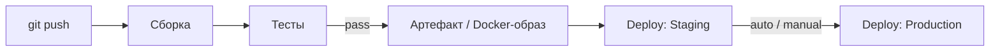
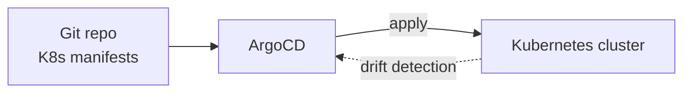
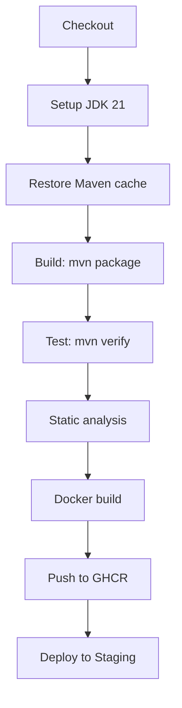
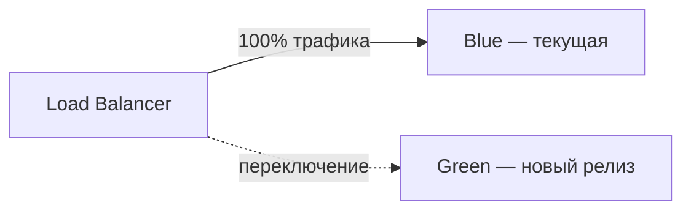
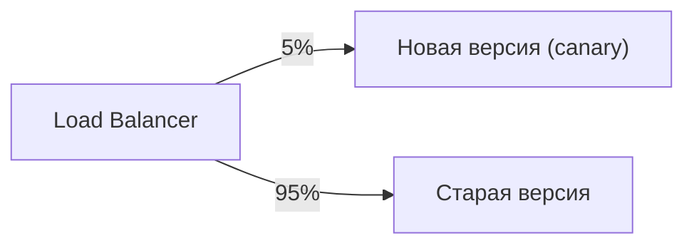
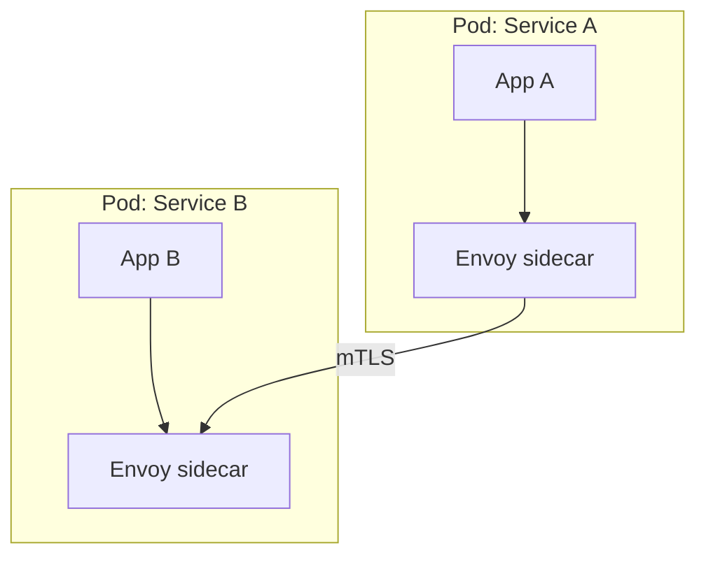

# CI/CD

### 1. Что такое CI и CD

**CI (Continuous Integration)** — практика, при которой разработчики **частично и часто** (много раз в день) сливают свой код в общий репозиторий, после чего автоматическая система **собирает** проект и **прогоняет тесты**. Цель — обнаруживать конфликты и ошибки как можно раньше, не давая им накапливаться.

**CD (Continuous Delivery / Continuous Deployment)** — следующий шаг: каждый успешный билд, прошедший все тесты, автоматически **разворачивается** в staging- (Delivery) или production- (Deployment) окружение.

Ключевые отличия:
- **CI** — «собрать и протестировать». Результат — артефакт (jar, docker-образ) и отчёт о тестах.
- **Continuous Delivery** — артефакт готов к **ручному** деплою в production.
- **Continuous Deployment** — артефакт **автоматически** попадает в production без участия человека.




### 2. Какие CI/CD системы используют чаще всего

- **GitHub Actions** — встроен в GitHub, конфигурация через `.github/workflows/*.yml`. Самый популярный в 2025–2026.
- **GitLab CI/CD** — встроен в GitLab, `.gitlab-ci.yml`.
- **Jenkins** — классический self-hosted CI/CD. Гибкий, огромное количество плагинов, но требует собственного обслуживания.
- **CircleCI** — cloud-платформа, быстрая настройка, популярна в стартапах.
- **Travis CI** — исторически популярна, сейчас менее актуальна.
- **Azure DevOps** — экосистема Microsoft, Pipelines + Azure.
- **Tekton / Argo Workflows** — Kubernetes-native CI/CD (обычно для платформ-команд).

Для Java-команд в 2025–2026 чаще всего используют **GitHub Actions** или **GitLab CI**. Jenkins встречается в крупных компаниях с legacy-инфраструктурой.


### 3. Как устроен GitHub Actions: workflow, job, step, runner

**GitHub Actions** — система CI/CD, встроенная в GitHub. Конфигурация хранится в репозитории в каталоге `.github/workflows/*.yml`.

**Ключевые концепции:**
- **Workflow** — файл YAML, определяющий набор связанных **jobs**, которые выполняются последовательно или параллельно.
- **Job** — группа **steps**, выполняющихся на одном **runner** (виртуальной машине). Каждый job запускается в чистой среде.
- **Step** — отдельная команда или вызов **action** (пакетной операции).
- **Runner** — среда выполнения: self-hosted (своя машина) или GitHub-hosted (облачная VM, `ubuntu-latest`, `macos-latest`, `windows-latest`).
- **Context** — данные, доступные в workflow: `github` (SHA, ref, actor), `env`, `secrets`, `steps`, `vars`.

**Триггеры (`on`):**
```yaml
on:
  push:
    branches: [main]
  pull_request:
    branches: [main]
  schedule:
    - cron: '0 2 * * *'  # nightly build
  workflow_dispatch:      # ручной запуск
```

**Пример workflow:**
```yaml
name: Build & Test
on:
  pull_request:
    branches: [main]

jobs:
  test:
    runs-on: ubuntu-latest
    steps:
      - uses: actions/checkout@v4
      - uses: actions/setup-java@v4
        with:
          java-version: '21'
          distribution: 'temurin'
          cache: maven
      - run: mvn clean verify
```


### 4. Что такое GitHub Actions matrix и strategy

**Matrix** — механизм, позволяющий запускать **одну и ту же job** с **разными комбинациями параметров** (OS, версия JDK, браузер). Это удобно для кросс-платформенного тестирования.

```yaml
strategy:
  matrix:
    os: [ubuntu-latest, macos-latest, windows-latest]
    java-version: ['17', '21']
```

Эта конфигурация создаст **6 job** (3 OS × 2 JDK), каждая с уникальным `os` и `java-version`.

**Дополнительные параметры `strategy`:**
- `fail-fast: false` — не отменять остальные job, если одна упала.
- `max-parallel: 4` — ограничить количество параллельных job.

**Практическое применение:**
- Тестирование на разных ОС и версиях Java.
- Сборка Docker-образов для разных архитектур (`linux/amd64`, `linux/arm64`).
- Тестирование фронтенда в разных браузерах (Chrome, Firefox, Safari).


### 5. Как настроить cache в GitHub Actions

**Cache** в GitHub Actions хранит файлы между запусками workflow, чтобы не скачивать/пересобирать зависимости каждый раз. Основной инструмент — action `actions/cache` или встроенный `cache` параметр в `setup-java`.

**Вариант 1: Встроенный cache в setup-java (Maven):**
```yaml
- uses: actions/setup-java@v4
  with:
    java-version: '21'
    distribution: 'temurin'
    cache: maven  # кэширует ~/.m2/repository
```

**Вариант 2: actions/cache (гибче, можно кэшировать что угодно):**
```yaml
- uses: actions/cache@v4
  with:
    path: ~/.m2/repository
    key: maven-${{ github.ref }}-${{ hashFiles('**/pom.xml') }}
    restore-keys: |
      maven-${{ github.ref }}-
      maven-
```

**Как работает:**
- **Key** — уникальный идентификатор кэша. Если key найден — кэш восстанавливается.
- **hashFiles** — хеш файлов конфигурации (pom.xml, build.gradle). Если файлы не изменились — key тот же, кэш валиден.
- **restore-keys** — fallback: если точный key не найден, пробуются префиксы.

**Что кэшировать:**
- Maven: `~/.m2/repository`
- Gradle: `~/.gradle/caches`
- npm: `~/.npm` или `node_modules`
- Docker-образы (через Docker BuildKit cache)


### 6. Что такое GitHub Actions secrets и где их хранить

**Secrets** — чувствительные данные (API-ключи, токены, пароли), которые не должны попадать в код. GitHub Actions шифрует и хранит их на стороне GitHub.

**Уровни хранения:**
- **Repository secrets** — привязаны к одному репозиторию.
- **Organization secrets** — доступны всем репозиториям в организации.
- **Environment secrets** — привязаны к окружению (staging, production).

**Настройка:**
- В GitHub: Settings → Secrets and variables → Actions.
- Или через GitHub CLI: `gh secret set SONAR_TOKEN --body "..."`.

**Использование в workflow:**
```yaml
env:
  SONAR_TOKEN: ${{ secrets.SONAR_TOKEN }}
  DB_PASSWORD: ${{ secrets.DB_PASSWORD }}
```

**Правила:**
- **Никогда** не хардкодите секреты в YAML.
- Секреты **не логируются** (GitHub маскирует их в логах).
- Используйте **отдельные секреты для каждого окружения** (dev, staging, prod).
- Для Kubernetes-кластеров используйте **Secrets Manager** (AWS SM, GCP Secret Manager, Azure Key Vault) вместо GitHub Secrets.


### 7. Как настроить GitLab CI/CD pipeline

**GitLab CI/CD** конфигурируется через файл `.gitlab-ci.yml` в корне репозитория. Pipeline — это цепочка **jobs**, которые выполняются на **runner**'ах.

**Базовая структура:**
```yaml
stages:
  - build
  - test
  - deploy

variables:
  MAVEN_OPTS: "-Dmaven.repo.local=.m2/repository"

build:
  stage: build
  script:
    - mvn clean package -DskipTests
  artifacts:
    paths:
      - target/*.jar
    expire_in: 1 day

test:
  stage: test
  script:
    - mvn verify
  dependencies:
    - build

deploy:
  stage: deploy
  script:
    - kubectl set image deployment/app app=$REGISTRY/app:$CI_COMMIT_SHA
  environment:
    name: production
  only:
    - main
```

**Ключевые концепции:**
- **Stage** — логический этап (build, test, deploy). Jobs в одном stage выполняются параллельно.
- **Job** — отдельная задача. Каждый job запускается в чистом контейнере.
- **Runner** — агент, выполняющий jobs. Бывает **shared** (GitLab) или **specific** (своя инфраструктура).
- **Artifacts** — файлы, передаваемые между jobs (например, jar из build → test).
- **Variables** — переменные окружения (глобальные, в CI/CD settings, или в job).

**Условия и правила:**
```yaml
deploy:
  stage: deploy
  rules:
    - if: $CI_COMMIT_BRANCH == "main"
      when: on_success
    - if: $CI_COMMIT_TAG
      when: on_success
    - when: never
```


### 8. Что такое GitLab CI runners

**Runner** — это агент, который **выполняет jobs** из `.gitlab-ci.yml`. Без runner'ов pipeline не запустится.

**Типы runner'ов:**
- **Shared runner** — предоставляется GitLab.com, доступен всем проектам на аккаунте. Ограничен по ресурсам.
- **Specific runner** — привязан к конкретному проекту или группе.
- **Group runner** — доступен всем проектам в группе.

**Транспорт (execution strategy):**
- **Shell executor** — выполняет команды через shell на машине, где установлен runner.
- **Docker executor** — каждый job запускается в отдельном Docker-контейнере (изолированно, воспроизводимо). **Рекомендуется для production**.
- **Kubernetes executor** — каждый job запускается как Pod в K8s-кластере. Масштабируемо, но сложнее в настройке.

**Установка и настройка (Docker executor):**
```bash
# Установить GitLab Runner
sudo curl -L --output /usr/local/bin/gitlab-runner \
  "https://packages.gitlab.com/install/repositories/runner/gitlab-runner/script.deb.sh" | sudo bash
sudo apt-get install gitlab-runner

# Зарегистрировать runner в GitLab
gitlab-runner register \
  --url https://gitlab.com \
  --registration-token <token> \
  --executor docker \
  --image alpine:latest
```

**Конфигурация (`/etc/gitlab-runner/config.toml`):**
```toml
[[runners]]
  name = "docker-runner"
  url = "https://gitlab.com"
  token = "..."
  executor = "docker"

  [runners.docker]
    image = "alpine:latest"
    privileged = false
    pulls_images = true
```


### 9. Как устроен Jenkins

**Jenkins** — классический self-hosted CI/CD. Отличается от GitHub Actions и GitLab CI:
- **Нет встроенной конфигурации** — все настройки через **plugins** и **Jenkinsfile** (для Pipeline).
- **Master-Worker архитектура** — Master (Jenkins Controller) раздаёт задачи, Workers (agents) их выполняют.
- **Plugin ecosystem** — огромное количество плагинов (Maven, Docker, Kubernetes, SonarQube и т.д.).
- **UI-first** — многое настраивается через веб-интерфейс, что может быть удобно для non-dev'ов.

**Jenkinsfile (Declarative Pipeline):**
```groovy
pipeline {
    agent {
        docker {
            image 'maven:3.9-eclipse-temurin-21'
        }
    }
    stages {
        stage('Build') {
            steps {
                sh 'mvn clean package -DskipTests'
            }
        }
        stage('Test') {
            steps {
                sh 'mvn verify'
            }
        }
        stage('Deploy') {
            when {
                branch 'main'
            }
            steps {
                sh 'kubectl set image deployment/app app=ghcr.io/org/app:${BUILD_NUMBER}'
            }
        }
    }
    post {
        always {
            archiveArtifacts 'target/*.jar'
        }
        failure {
            emailext(
                subject: "Build failed: ${JOB_NAME} #${BUILD_NUMBER}",
                body: "See console output",
                to: 'dev@example.com'
            )
        }
    }
}
```

**Агенты (Workers):**
- **Permanent agent** — постоянно подключённая машина.
- **Ephemeral agent** — создаётся на время job (Docker-контейнер, K8s Pod, облачный инстанс) и удаляется после.
- **Docker agent** — job выполняется в Docker-контейнере.

**Плюсы Jenkins:**
- Огромная экосистема плагинов.
- Можно настроить под любой процесс.
- Не зависит от Git-провайдера.

**Минусы:**
- Self-hosted — нужно обслуживать Master и Workers.
- UI может быть неочевидным для новичков.
- Нет встроенного кэширования (нужен plugin).


### 10. Что такое Jenkins Pipeline (Declarative vs Scripted)

**Jenkins Pipeline** — фреймворк для описания CI/CD процессов в коде. Есть два стиля:

**Declarative Pipeline** — структурированный, декларативный синтаксис:
```groovy
pipeline {
    agent any
    stages {
        stage('Build') {
            steps {
                sh 'mvn package'
            }
        }
    }
}
```
- Проще для новичков.
- Ограниченная гибкость (нет циклов, условных операторов вне `when`).
- Валидация синтаксиса.

**Scripted Pipeline** — императивный, на Groovy:
```groovy
node {
    stage('Build') {
        sh 'mvn package'
    }
    stage('Test') {
        if (env.BRANCH_NAME == 'main') {
            sh 'mvn verify'
        }
    }
}
```
- Полная гибкость (любой Groovy-код).
- Сложнее читать и поддерживать.
- Нет валидации синтаксиса.

**Когда что использовать:**
- **Declarative** — для стандартных CI/CD (build → test → deploy).
- **Scripted** — для сложных сценариев (циклы, условная логика, динамические параллельные job).

**Ключевые элементы Declarative Pipeline:**
- `agent` — где выполняется (any, docker, kubernetes, label).
- `stages` — последовательность этапов.
- `steps` — команды в каждом этапе.
- `post` — действия после (always, success, failure, cleanup).
- `environment` — переменные окружения.
- `when` — условия (branch, tag, changelog).


### 11. Что такое CircleCI и когда его используют

**CircleCI** — cloud-платформа CI/CD. Популярна в стартапах и командах, которые хотят **быстро** настроить CI без self-hosting.

**Особенности:**
- **Конфигурация** — `.circleci/config.yml`.
- **Jobs** выполняются в Docker-контейнерах или macOS (для мобильной разработки).
- **Workflows** — связывают jobs в зависимости (последовательные/параллельные).
- **Caching** — встроенный, настраивается через `key` и `paths`.
- **No-build** — возможность пропускать сборку, если код не изменился.

**Пример `.circleci/config.yml`:**
```yaml
version: 2.1

jobs:
  build:
    docker:
      - image: cimg/openjdk:21.0
    steps:
      - checkout
      - restore_cache:
          key: maven-{{ checksum "pom.xml" }}
      - run: mvn clean package -DskipTests
      - save_cache:
          key: maven-{{ checksum "pom.xml" }}
          paths:
            - ~/.m2/repository
      - run: mvn verify

workflows:
  main:
    jobs:
      - build
```

**Когда использовать:**
- Команда хочет **быстро** запустить CI без инфраструктуры.
- Нужна поддержка **macOS** (мобильная разработка).
- Нет желания обслуживать self-hosted CI.

**Минусы:**
- **Цена** — быстро дорожает при масштабировании (минуты билда).
- **Меньше гибкости** чем Jenkins (ограниченный набор features).
- **Vendor lock-in** — привязка к экосистеме CircleCI.


### 12. Что такое ArgoCD и GitOps

**GitOps** — практика, при которой **желаемое состояние** системы (что должно быть задеплоено) описано в git-репозитории, а система **автоматически** синхронизирует фактическое состояние с желаемым.

**ArgoCD** — инструмент GitOps для Kubernetes. Он:
- Следит за git-репозиторием с манифестами K8s.
- Сравнивает желаемое состояние (git) с фактическим (K8s).
- **Автоматически** применяет изменения (или показывает диф в UI).
- Поддерживает **HELM** и **Kustomize**.

**Как работает:**


**Установка:**
```bash
kubectl create namespace argocd
kubectl apply -n argocd -f https://raw.githubusercontent.com/argoproj/argo-cd/stable/manifests/install.yaml
```

**Настройка репозитория:**
```bash
argocd repo add git@github.com:org/k8s-manifests.git
```

**Создание Application:**
```yaml
apiVersion: argoproj.io/v1alpha1
kind: Application
metadata:
  name: my-app
  namespace: argocd
spec:
  project: default
  source:
    repoURL: git@github.com:org/k8s-manifests.git
    targetRevision: main
    path: production/my-app
  destination:
    server: https://kubernetes.default.svc
    namespace: production
```

**Плюсы:**
- **Аудит** — вся история деплой'ов в git.
- **Откат** — `git revert` + ArgoCD автоматически применит.
- **Дрифт-детекция** — если кто-то вручную изменил K8s, ArgoCD покажет расхождение.
- **UI** — удобный дашборд для просмотра статусов.


### 13. Как выбрать CI/CD платформу

Выбор зависит от **контекста** команды:

| Критерий | GitHub Actions | GitLab CI | Jenkins | CircleCI |
|---|---|---|---|---|
| **Где код** | GitHub | GitLab | Любой Git | Любой Git |
| **Self-hosted** | Нет (только GitHub-hosted runners) | Можно (shared/specific runners) | Да (полностью) | Нет |
| **Установка** | Встроено | Встроено | Нужно устанавливать | Cloud |
| **Кэширование** | Встроенное | Встроенное | Через plugin | Встроенное |
| **K8s-интеграция** | Хорошая | Хорошая | Отличная (plugins) | Умеренная |
| **Стоимость** | Минуты билда | Минуты билда | Бесплатно (но нужно обслуживать) | Минуты билда |
| **Гибкость** | Высокая | Высокая | Очень высокая | Умеренная |
| **Учреждения** | Легко | Легко | Средне | Легко |

**Рекомендации:**
- **GitHub** → **GitHub Actions** (встроен, нет vendor lock-in).
- **GitLab** → **GitLab CI/CD** (встроен, unified pipeline).
- **Legacy / нужна максимальная гибкость** → **Jenkins**.
- **Стартап, быстро нужен CI** → **CircleCI** (или GitHub Actions, если код в GitHub).
- **K8s-heavy, GitOps** → **ArgoCD** + любой CI (GitHub Actions / GitLab CI).


### 14. Как устроен CI pipeline (этапы)

Типичный CI pipeline для Java Spring Boot приложения:

1. **Checkout** — скачивание кода из репозитория.
2. **Setup JDK** — установка нужной версии Java (например, 21).
3. **Restore cache** — восстановление кэша зависимостей (Maven `~/.m2/repository`), чтобы не скачивать артефакты каждый раз.
4. **Build** — `mvn clean package -DskipTests` или `./gradlew build -x test`.
5. **Test** — `mvn test` (юнит-тесты) + `mvn verify` (интеграционные тесты с Testcontainers).
6. **Static analysis** — SonarQube / SpotBugs / Checkstyle.
7. **Docker build** — сборка Docker-образа приложения.
8. **Push image** — публикация образа в регистр (GHCR, ECR, Docker Hub).
9. **Deploy to staging** — деплой в staging (если настроен).




### 15. Что такое Docker-образ и зачем он нужен в CI

**Docker-образ** — это **независимый, переносимый пакет**, содержащий код приложения, его зависимости (JRE, библиотеки) и конфигурацию. Он работает одинаково на любой машине, где установлен Docker.

Зачем нужен в CI/CD:
- **Окружение предсказуемо**: в CI, staging и production используется **один и тот же** образ (same artifact). Исключается проблема «у меня на машине работает».
- **Изоляция зависимостей**: в образе уже есть JDK, все библиотеки — не нужно ничего устанавливать на целевой машине.
- **Версионирование**: каждый билд получает **тег** (например, `app:1.0.0-abc123`), что позволяет откатиться к любой предыдущей версии.
- **Быстрый деплой**: «поднять» новое окружение = «запустить контейнер».

Пример `Dockerfile` для Spring Boot приложения:
```dockerfile
# Multi-stage: сначала сборка, потом только JRE в финальном образе
FROM maven:3.9-eclipse-temurin-21 AS build
WORKDIR /app
COPY pom.xml .
RUN mvn dependency:go-offline
COPY src ./src
RUN mvn clean package -DskipTests

FROM eclipse-temurin:21-jre-alpine
WORKDIR /app
COPY --from=build /app/target/*.jar app.jar
EXPOSE 8080
ENTRYPOINT ["java", "-jar", "app.jar"]
```


### 16. Что такое Docker Compose и когда он используется

**Docker Compose** — инструмент для определения и запуска **многосервисных** Docker-приложений (несколько контейнеров) с помощью одного YAML-файла (`docker-compose.yml`).

Когда используется:
- **Локальная разработка**: запустить приложение + БД + Kafka + Redis одной командой `docker compose up`.
- **Интеграционные тесты**: поднимать временные контейнеры для тестов (хотя чаще для этого используют **Testcontainers**).
- **Staging-окружение**: быстрый деплой полного набора сервисов.

Пример `docker-compose.yml`:
```yaml
services:
  app:
    build: .
    ports:
      - "8080:8080"
    environment:
      SPRING_DATASOURCE_URL: jdbc:postgresql://db:5432/mydb
      SPRING_DATASOURCE_PASSWORD: secret
    depends_on:
      db:
        condition: service_healthy

  db:
    image: postgres:16-alpine
    environment:
      POSTGRES_DB: mydb
      POSTGRES_PASSWORD: secret
    ports:
      - "5432:5432"
    healthcheck:
      test: ["CMD-SHELL", "pg_isready -U postgres"]
      interval: 5s
      timeout: 3s
      retries: 5
```


### 17. Что такое Deployment strategies

**Deployment strategies** — это способы, которыми новый релиз приложения попадает в production. Выбор стратегии влияет на **доступность**, **откат** и **сложность**.

Основные стратегии:

| Стратегия | Описание | Доступность | Сложность |
|---|---|---|---|
| **Rolling update** | По одному (или по группе) заменяются инстансы до полного обновления | Высокая (все время есть работающие) | Средняя |
| **Blue-Green** | Две идентичные среды (A и B); трафик переключается с A на B после деплоя | Высокая (переключение почти мгновенное) | Высокая (нужно 2x ресурсов) |
| **Canary** | Новая версия получает **небольшой % трафика** (5–10%), остальные — старая. Если всё ок — процент растёт | Высокая | Высокая |
| **Recreate** | Старые инстансы полностью останавливаются, потом запускаются новые | **Низкая** (есть downtime) | Низкая |

**Rolling update** — самая распространённая стратегия в Kubernetes (дефолт для `Deployment`). **Blue-Green** и **Canary** часто используются с Istio / Service Mesh для точного управления трафиком.


### 18. Как работает Blue-Green deployment

**Blue-Green** — стратегия, при которой существует **две идентичные** среды (назовём их «синяя» и «зелёная»). В любой момент одна среда обслуживает **100% реального трафика**, а другая — простаивает или используется для тестирования.

Как работает:
1. **Синяя** среда — текущая production.
2. Новый релиз **деплоится в зелёную** среду.
3. Прогоняются **smoke-тесты** и, при необходимости, **ручная проверка**.
4. **Переключение**: load balancer направляет 100% трафика на зелёную среду.
5. Синяя среда становится «резервной». При необходимости можно **откатиться** мгновенно, переключив трафик обратно.



**Плюсы:**
- **Откат мгновенный** — просто переключаем трафик обратно.
- **Нет downtime** (кроме момента переключения, который занимает секунды).

**Минусы:**
- Нужно **двойное** количество ресурсов (две среды одновременно).
- База данных должна быть **совместима** с обеими версиями (или миграция должна быть backwards-compatible).


### 19. Что такое Canary deployment

**Canary deployment** — стратегия, при которой новая версия приложения **постепенно** получает реальный трафик:

1. Новая версия («канарейка») получает **маленький % трафика** (например, 5%).
2. Остальные 95% — старая версия.
3. Если **метрики** (ошибки, latency, CPU) в норме — процент трафика к канарейке **растёт** (20%, 50%, 100%).
4. Если метрики **ухудшаются** — трафик **откатывается** к старой версии (автоматически или вручную).



**В Kubernetes** canary реализовывается через:
- **Istio / Linkerd** (Service Mesh) — управление traffic split на уровне mTLS.
- **Argo Rollouts** — декларативные canary и blue-green деплой с автоматическим анализом метрик.
- **Flagger** — оператор, который управляет Argo Rollouts / Istio и автоматически масштабирует canary на основе метрик.

**Плюсы:**
- Минимальный риск: даже если новая версия сломана, пострадали лишь 5% пользователей.
- Автоматический откат на основе метрик.

**Минусы:**
- Сложная настройка (нужен Service Mesh или специальный оператор).
- Две версии кода работают параллельно — БД-миграции должны быть совместимы.


### 20. Что такое rollback и как его настроить

**Rollback** — откат к предыдущей рабочей версии приложения. Критичная функция production-инфраструктуры: если новый релиз сломал что-то, нужно **быстро вернуть** стабильную версию.

**Как настроить в разных системах:**

**Kubernetes:**
```bash
# Посмотреть историю реплиaset'ов
kubectl rollout history deployment/app

# Откатить на предыдущую ревизию
kubectl rollout undo deployment/app

# Откатить на конкретную ревизию
kubectl rollout undo deployment/app --to-revision=3

# Проверить статус
kubectl rollout status deployment/app
```
Kubernetes автоматически хранит последние 10 ReplicaSets (настраивается через `revisionHistoryLimit`).

**GitHub Actions:**
```yaml
# В workflow: если тесты на staging падают — не деплоить в production
# Откат = деплой предыдущего Docker-образа
- name: Deploy previous version on failure
  if: failure()
  run: |
    kubectl set image deployment/app app=ghcr.io/org/app:previous-tag
```

**Spring Boot (без kubectl):**
- **Actuator endpoint** `/actuator/info` — показывает git commit, из которого собран образ.
- **Docker-образ** с тегом — достаточно переключить image в `deployment.yaml`.

**Ключевой принцип:** rollback должен быть **быстрым** (секунды–минуты) и **предсказуемым**. Blue-Green и Canary дают **мгновенный** откат. Rolling update — быстрее, чем полный redeploy, но дольше.


### 21. Что такое infrastructure as code (IaC)

**Infrastructure as Code (IaC)** — практика описания инфраструктуры (серверы, сети, БД, load balancer) **в виде кода** (декларативных конфигураций), который хранится в git-репозитории и **применяется автоматизированно**.

Почему это важно:
- **Воспроизводимость**: инфраструктура создаётся одинаково в dev, staging, production.
- **Версионирование**: изменение инфраструктуры — это git commit, который можно review'нуть и откатить.
- **Автоматизация**: нет ручного «кликания в консоли AWS» — всё через `terraform apply` / `kubectl apply`.
- **Peer review**: изменение инфраструктуры проходит code review, как обычный код.

**Главные инструменты:**
- **Terraform** (HashiCorp) — мульти-облачный, декларативный, HCL-синтаксис. Самый популярный.
- **Pulumi** — то же самое, но на обычных языках (Python, TypeScript, Go, Java).
- **Ansible** — конфигурационный менеджер, императивный (плейбуки YAML).
- **Kubernetes YAML** — декларативное описание workload'ов.

Пример Terraform (AWS RDS PostgreSQL):
```hcl
resource "aws_db_instance" "main" {
  identifier     = "app-db"
  engine         = "postgres"
  engine_version = "16"
  instance_class = "db.t3.micro"
  allocated_storage = 20
  username        = "app"
  password        = var.db_password
  db_name         = "appdb"
}
```


### 22. Что такое Terraform

**Terraform** — самый популярный инструмент **Infrastructure as Code**. Он позволяет описывать инфраструктуру в декларативном формате (HCL — HashiCorp Configuration Language) и **автоматически** создавать, изменять и удалять ресурсы в облаке.

**Ключевые концепции:**
- **Resource** — описание одного облачного ресурса (инстанс, БД, S3-бакет, VPC).
- **State** — файл (`.terraform` / remote state в S3), который хранит **текущее состояние** всех ресурсов. Terraform сравнивает state с желаемым состоянием (из `.tf`-файлов) и применяет диф.
- **Provider** — плагин для конкретного облака (AWS, GCP, Azure, Kubernetes).
- **Module** — переиспользуемый блок конфигурации.

**Жизненный цикл:**
```bash
terraform init        # скачать провайдеры, инициализировать state
terraform plan        # показать, что будет изменено (dry run)
terraform apply       # применить изменения
terraform destroy     # удалить все ресурсы
```

**Пример:**
```hcl
# main.tf
provider "aws" {
  region = "eu-west-1"
}

resource "aws_instance" "web" {
  ami           = "ami-0c54b84e19f0f18e3"  # Ubuntu 22.04
  instance_type = "t2.micro"
  tags = {
    Name = "web-server"
    Environment = "staging"
  }
}
```

**State management** — критичная часть. В production state хранится **в удалённом** (S3 + DynamoDB locking или Terraform Cloud), чтобы несколько разработчиков могли работать параллельно.


### 23. Что такое Kubernetes Deployment

**`Deployment`** — основной ресурс Kubernetes для управления **stateless** (без государственными) приложениями. Он управляет **ReplicaSet** (который управляет **Pod'ами**) и обеспечивает:
- **Желаемое количество реплик** — если Pod падает, Deployment создаёт новый.
- **Rolling update** — при изменении `spec` Deployment постепенно заменяет старые Pod'ы на новые.
- **Rollback** — возможность откатиться на предыдущую ревизию.

Пример `deployment.yaml`:
```yaml
apiVersion: apps/v1
kind: Deployment
metadata:
  name: my-app
  labels:
    app: my-app
spec:
  replicas: 3
  selector:
    matchLabels:
      app: my-app
  strategy:
    type: RollingUpdate
    rollingUpdate:
      maxUnavailable: 1
      maxSurge: 1
  template:
    metadata:
      labels:
        app: my-app
    spec:
      containers:
      - name: app
        image: ghcr.io/org/my-app:1.0.0
        ports:
        - containerPort: 8080
        resources:
          requests:
            memory: "256Mi"
            cpu: "250m"
          limits:
            memory: "512Mi"
            cpu: "500m"
        readinessProbe:
          httpGet:
            path: /actuator/health/readiness
            port: 8080
          initialDelaySeconds: 10
          periodSeconds: 5
        livenessProbe:
          httpGet:
            path: /actuator/health/liveness
            port: 8080
          initialDelaySeconds: 15
          periodSeconds: 10
```

**Ключевые параметры:**
- `replicas` — сколько Pod'ов должно быть запущено.
- `strategy.type` — `RollingUpdate` (по умолчанию) или `Recreate`.
- `maxUnavailable` / `maxSurge` — управление темпом rolling update.
- `readinessProbe` — когда Pod готов принимать трафик.
- `livenessProbe` — когда Pod «не здоров» и нужно его перезапустить.


### 24. Что такое Health Checks в Kubernetes

**Health Checks** — механизмы, которые позволяют Kubernetes отслеживать **состояние** каждого контейнера в Pod. Есть два типа:

**`readinessProbe`** — отвечает на вопрос: «Готов ли контейнер **принимать трафик**?»
- Если probe **падает** — Pod **не получает** трафик (выключается из Service), но **не перезапускается**.
- Если probe **проходит** — Pod включается в балансировку.
- Используются для **Traffic routing**.

**`livenessProbe`** — отвечает на вопрос: «Работает ли контейнер **корректно**?»
- Если probe **падает** — контейнер **перезапускается** (Kubernetes убивает и создаёт новый).
- Используется для **восстановления** зависших процессов.

Пример (Spring Boot Actuator):
```yaml
containers:
- name: app
  readinessProbe:
    httpGet:
      path: /actuator/health/readiness
      port: 8080
    initialDelaySeconds: 10
    periodSeconds: 5
    failureThreshold: 3
  livenessProbe:
    httpGet:
      path: /actuator/health/liveness
      port: 8080
    initialDelaySeconds: 15
    periodSeconds: 10
    failureThreshold: 3
```

**Важно:**
- **Не делите** readiness и liveness на один endpoint: если приложение «не готово» (например, ещё не подключилось к БД), liveness не должен убивать Pod.
- `initialDelaySeconds` — время на запуск JVM + Spring Boot (обычно 10–30 секунд).
- `failureThreshold` — сколько раз probe может упасть до принятия действия.


### 25. Что такое Service Mesh

**Service Mesh** — это слой **сетевой инфраструктуры**, который **проксирует** весь межсервисный трафик (service-to-service) и предоставляет **поперечные** (cross-cutting) возможности, не требуя изменений в коде приложения:

- **mTLS** — автоматическое шифрование трафика между сервисами.
- **Service Discovery** — динамическое разрешение имён сервисов.
- **Traffic management** — canary, blue-green, A/B testing, rate limiting, circuit breaking.
- **Observability** — автоматический трассировочный заголовок (trace propagation), метрики, логи.
- **Retry / Timeout** — автоматические повторные попытки и таймауты на уровне сети.

**Главные реализации:**
- **Istio** — самый популярный, богатый функционал, но тяжёлый (CNI + Envoy sidecar + control plane).
- **Linkerd** — более лёгкий, нативный Kubernetes, меньше ресурсов.
- **Cilium** — eBPF-based, может работать как Service Mesh и как CNI.



**Как работает:** каждый Pod получает **sidecar-прокси** (например, Envoy), который перехватывает весь исходящий и входящий трафик. Приложение не знает о его существовании. Control Plane (Pilot в Istio) раздаёт конфигурацию прокси.

**Когда нужен:**
- Микросервисная архитектура с **десятками** сервисов.
- Нужен **mTLS** на уровне инфраструктуры.
- Нужен **canary / traffic split** без изменения кода.
- Нужна **наблюдаемость** (distributed tracing) без instrumentации каждого сервиса.

**Когда не нужен:**
- Мало сервисов (2–5).
- Простая архитектура.
- Уже есть достаточно observability через Micrometer / OpenTelemetry.


### 26. Что такое OpenTelemetry

**OpenTelemetry (OTel)** — стандарт и набор инструментов для **наблюдаемости** (observability) распределённых систем. Он объединяет три столпа:

1. **Traces** — трассировка запроса по всем сервисам (distributed tracing).
2. **Metrics** — количественные метрики (latency, error rate, throughput).
3. **Logs** — структурированные логи, связанные с trace.

**Архитектура:**


**Как работает в Java (Spring Boot):**
```xml
<!-- pom.xml -->
<dependency>
    <groupId>io.opentelemetry.instrumentation</groupId>
    <artifactId>opentelemetry-spring-boot-starter</artifactId>
</dependency>
<dependency>
    <groupId>io.opentelemetry</groupId>
    <artifactId>opentelemetry-exporter-otlp</artifactId>
</dependency>
```

**Ключевые преимущества:**
- **Vendor-neutral** — можно переключить backend (Jaeger → Datadog → Grafana Tempo) без изменения кода.
- **Автоинструментация** — Spring, JDBC, HTTP клиент, gRPC трассируются автоматически.
- **Единый стандарт** — traces, metrics и logs связаны через **trace ID**.

**Практика:**
- Каждый запрос получает **TraceID**, который передаётся через HTTP-заголовки (`traceparent`).
- Каждый сервис **добавляет span** в trace.
- Metrics агрегируются и отправляются в **Prometheus** (или аналог).
- Logs получают **traceId** в структурированном виде (JSON), что позволяет найти все логи конкретного запроса.


### 27. Как настроить CI/CD pipeline для Spring Boot приложения

Полный пример **GitHub Actions workflow** для Spring Boot приложения:

```yaml
# .github/workflows/ci-cd.yml
name: CI/CD Pipeline

on:
  push:
    branches: [main]
  pull_request:
    branches: [main]

env:
  REGISTRY: ghcr.io
  IMAGE_NAME: ${{ github.repository }}

jobs:
  test:
    runs-on: ubuntu-latest
    steps:
      - uses: actions/checkout@v4

      - name: Set up JDK 21
        uses: actions/setup-java@v4
        with:
          java-version: '21'
          distribution: 'temurin'
          cache: maven

      - name: Run tests
        run: mvn clean verify

      - name: Run SonarQube
        uses: sonarsource/sonarqube-scan-action@v4
        env:
          SONAR_TOKEN: ${{ secrets.SONAR_TOKEN }}
        with:
          args: |
            --sonar.projectKey=my-app
            --sonar.qualitygate.wait=true

  docker:
    needs: test
    runs-on: ubuntu-latest
    if: github.ref == 'refs/heads/main'
    steps:
      - uses: actions/checkout@v4

      - name: Set up Docker Buildx
        uses: docker/setup-buildx-action@v3

      - name: Login to GHCR
        uses: docker/login-action@v3
        with:
          registry: ${{ env.REGISTRY }}
          username: ${{ github.actor }}
          password: ${{ secrets.GITHUB_TOKEN }}

      - name: Build and push
        uses: docker/build-push-action@v6
        with:
          context: .
          push: true
          tags: |
            ${{ env.REGISTRY }}/${{ env.IMAGE_NAME }}:${{ github.sha }}
            ${{ env.REGISTRY }}/${{ env.IMAGE_NAME }}:latest

  deploy-staging:
    needs: docker
    runs-on: ubuntu-latest
    if: github.ref == 'refs/heads/main'
    steps:
      - name: Deploy to Staging
        uses: kubernetes/set-context@v1
        with:
          context: staging-cluster

      - name: Update image
        run: |
          kubectl set image deployment/my-app \
            app=${{ env.REGISTRY }}/${{ env.IMAGE_NAME }}:${{ github.sha }} \
            -n staging

      - name: Wait for rollout
        run: kubectl rollout status deployment/my-app -n staging --timeout=300s

  deploy-production:
    needs: deploy-staging
    runs-on: ubuntu-latest
    if: github.ref == 'refs/heads/main'
    steps:
      - name: Deploy to Production
        uses: kubernetes/set-context@v1
        with:
          context: production-cluster

      - name: Update image
        run: |
          kubectl set image deployment/my-app \
            app=${{ env.REGISTRY }}/${{ env.IMAGE_NAME }}:${{ github.sha }} \
            -n production

      - name: Wait for rollout
        run: kubectl rollout status deployment/my-app -n production --timeout=300s
```

**Ключевые моменты:**
- **Cache Maven-зависимости** — ускоряет каждый билд в разы.
- **Job dependencies** (`needs`) — docker не запускается, если тесты упали.
- **Conditional deploy** (`if: github.ref == 'refs/heads/main'`) — деплой только с main.
- **SHA-based tagging** — каждый образ уникален, откат = деплой предыдущего SHA.
- **Staging → Production** — сначала staging, потом production (можно добавить ручной approval step).

---

