# Многопоточность

## Обзор многопоточности в Java

Многопоточность в Java строится на трёх уровнях: **потоки** (основная единица выполнения), **синхронизация** (взаимное исключение и видимость) и **конкурентные структуры** (очереди, блокировки, latch).

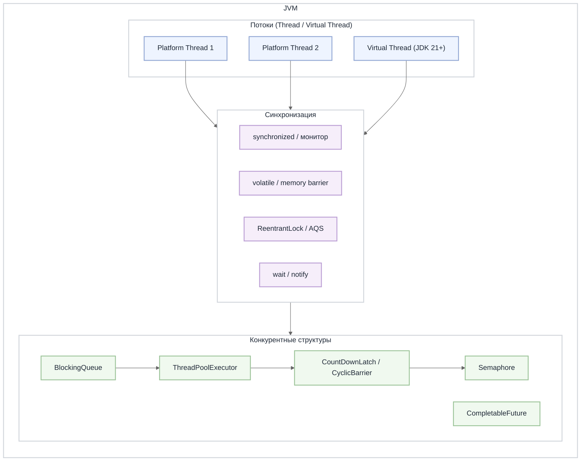

### 1. В чём разница между synchronized и volatile

`volatile` и `synchronized` решают разные задачи в модели памяти Java (JMM):
- **`volatile`** обеспечивает только **видимость** и **упорядоченность** (запрет переупорядочивания инструкций вокруг volatile-переменной), но **не обеспечивает атомарность** составных операций (например, `count++` не будет потокобезопасным) и **не использует взаимную блокировку**.
- **`synchronized`** обеспечивает и **взаимное исключение** (только один поток одновременно выполняет блок), и **видимость** (все записи, сделанные до выхода из synchronized-блока, становятся видимыми потоку, который войдёт в блок с тем же монитором позже).


### 2. Что такое happens-before relationship

**Happens-before** — это фундаментальное отношение в JMM, которое гарантирует, что результат записи, сделанной в одном действии, будет виден в другом действии, если первое **happens-before** второго. Без этого отношения JVM и процессор могут переупорядочивать инструкции, что приводит к неожиданным результатам. Ключевые правила:
- **Program order**: каждое действие в потоке happens-before последующего действия в том же потоке.
- **Monitor lock**: выход из synchronized-блока (unlock) happens-before входа в synchronized-блок (lock) на **том же мониторе**.
- **Volatile**: запись в volatile-переменную happens-before последующего чтения этой же переменной.
- **Thread start**: вызов `Thread.start()` happens-before любого действия в запущенном потоке.
- **Thread join**: все действия в потоке happen-before успешного возврата из `join()` этого потока в другом потоке.
- **Transitivity**: если A happens-before B, и B happens-before C, то A happens-before C.

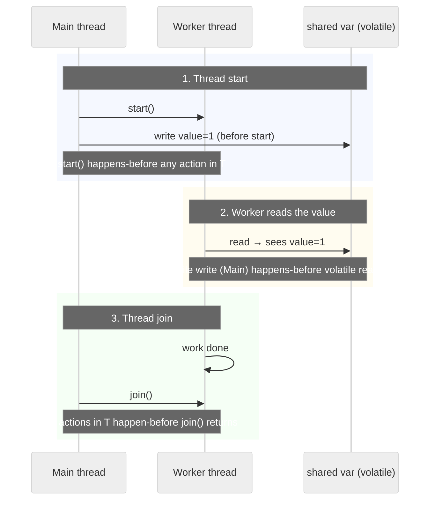


### 3. Что такое visibility problem

**Visibility problem (проблема видимости)** — это ситуация, при которой изменение переменной, сделанное одним потоком, **не видно** другому потоку. Это происходит из-за того, что каждый поток может кэшировать значения переменных в локальном кэше процессора или в регистрах. Без правильной синхронизации (например, без `volatile` или `synchronized`) поток может бесконечно читать устаревшее значение из своего кэша, даже если другой поток уже записал новое значение в основную память.


### 4. Что такое монитор (monitor) в Java

**Монитор** — это встроенный в каждый объект Java механизм синхронизации, который используется ключевым словом `synchronized`. У каждого объекта есть связанный с ним монитор (внутренняя блокировка). Когда поток входит в `synchronized`-блок или метод, он **захватывает монитор** этого объекта. Другие потоки, пытающиеся захватить тот же монитор, блокируются до тех пор, пока он не будет освобождён. Монитор также обеспечивает отношения happens-before между разблокировкой и последующей блокировкой.


### 5. Как работает synchronized на уровне монитора

`Synchronized` работает на уровне **монитора объекта**. При входе в `synchronized`-блок JVM выполняет инструкцию `monitorenter`, которая пытается захватить монитор. Если монитор свободен, поток захватывает его и продолжает выполнение. Если монитор занят другим потоком, текущий поток блокируется до освобождения монитора. При выходе из блока (нормальном или через исключение) выполняется `monitorexit`, освобождающий монитор. JVM отслеживает **hold-count (счётчик удержаний)** для поддержки реентерабельности: если поток, уже владеющий монитором, снова входит в synchronized-блок на том же объекте, он не блокируется, а счётчик увеличивается; монитор освобождается только когда счётчик достигает нуля.

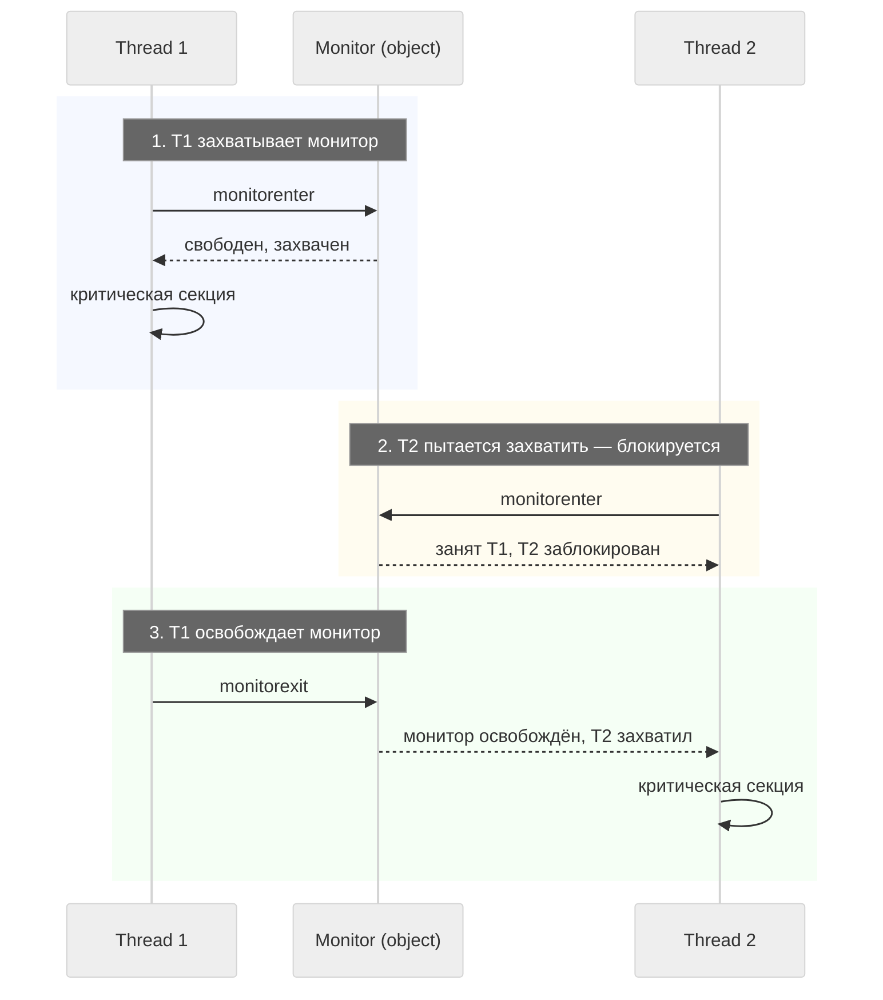


### 6. В чём разница между synchronized методом и synchronized блоком

- **`synchronized` метод**: блокировка захватывается на **весь метод**. Для статического метода блокируется монитор класса (`Class`-объект), для экземплярного — монитор `this`.
- **`synchronized` блок**: блокировка захватывается на **указанный объект** (`synchronized(lock) { ... }`) и действует только внутри блока. Это даёт более **тонкий контроль** над гранулярностью блокировки: вы можете синхронизировать только критическую секцию, а не весь метод, снижая время удержания блокировки и повышая параллелизм.


### 7. Что такое reentrant lock

**Reentrant lock (реентерабельная блокировка)** — это блокировка, которую поток, уже владеющий ею, может **повторно захватить без блокировки**. В Java все встроенные мониторы (`synchronized`) являются реентерабельными: если поток вошёл в synchronized-метод, а внутри него вызывает другой synchronized-метод на том же объекте, он не блокируется. Это реализуется через **hold-count**: JVM увеличивает счётчик при повторном входе и уменьшает при выходе; блокировка освобождается, когда счётчик достигает нуля. Класс `ReentrantLock` из `java.util.concurrent.locks` также поддерживает реентерабельность.

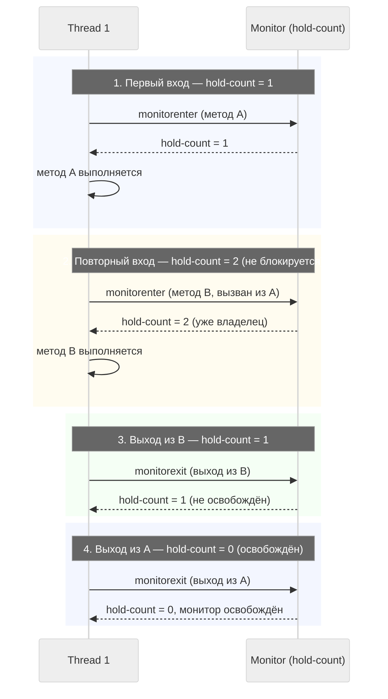


### 8. Что такое Atomic классы

**Atomic классы** — это классы из пакета `java.util.concurrent.atomic` (например, `AtomicInteger`, `AtomicLong`, `AtomicBoolean`, `AtomicReference`), которые предоставляют **потокобезопасные операции над одиночными переменными без использования блокировок**. Они основаны на аппаратной инструкции **CAS (Compare-And-Swap)** и гарантируют атомарность, видимость и упорядоченность для поддерживаемых операций (`get`, `set`, `incrementAndGet`, `compareAndSet` и др.).


### 9. Что такое CAS (Compare-And-Swap)

**CAS (Compare-And-Swap)** — это аппаратная атомарная инструкция, которая работает по принципу **оптимистичной блокировки**. Она принимает три операнда: **ячейку памяти (V)**, **ожидаемое старое значение (A)** и **новое значение (B)**. CAS атомарно проверяет, равно ли текущее значение в V ожидаемому A: если да, то записывает B в V и возвращает успех; если нет, операция завершается неудачей (обычно с последующим повторным чтением и повторной попыткой). В Java CAS доступен через методы `compareAndSet()` в Atomic-классах.

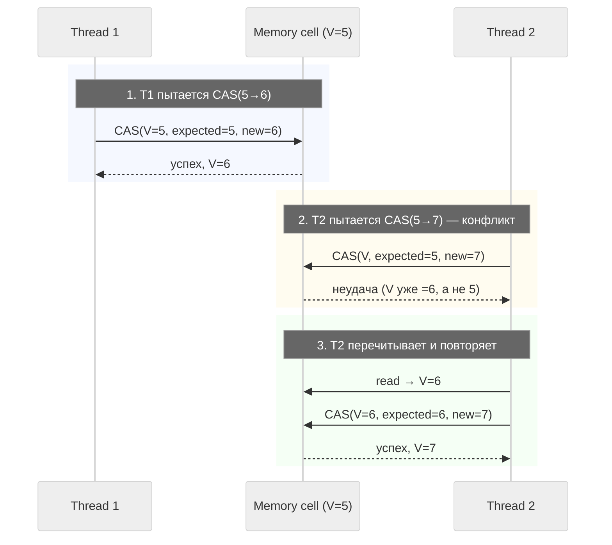


### 10. Как работают AtomicInteger, AtomicLong

`AtomicInteger` и `AtomicLong` внутри содержат поле `volatile`-переменной (например, `volatile int value`). Все модифицирующие операции (`incrementAndGet`, `addAndGet`, `compareAndSet`) реализованы через **цикл CAS (spin loop)**: поток читает текущее значение, вычисляет новое и пытается заменить старое на новое с помощью `compareAndSet`. Если CAS не удаётся (потому что другой поток успел изменить значение), цикл повторяется с новым прочитанным значением. Чтение (`get`) и запись (`set`) просто работают с `volatile`-полем, обеспечивая видимость.

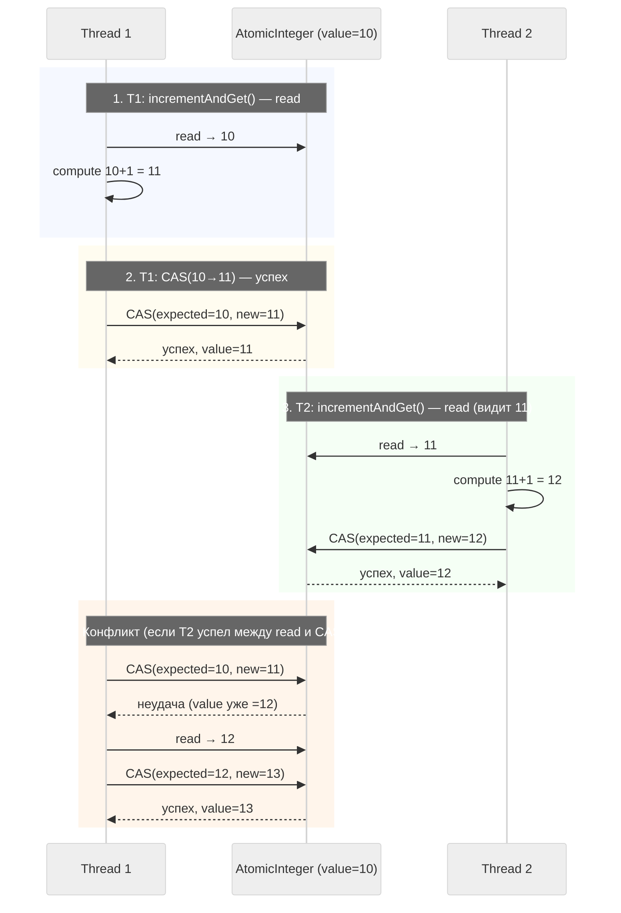


### 11. В чём преимущество Atomic классов перед synchronized

Основное преимущество — **производительность при низком и среднем уровне конкуренции**. Atomic-классы используют **неблокирующий CAS** вместо пессимистичной блокировки, что позволяет избежать накладных расходов на блокировку, парковку и пробуждение потоков, а также переключение контекста. В бенчмарках Atomic-операции часто показывают **в 2–3 раза более высокую пропускную способность**, чем `synchronized` для простых операций над одной переменной. Однако при **высокой конкуренции** CAS-циклы могут приводить к CPU-спиннингу и падению производительности; в таких случаях `LongAdder` или блокировки могут быть лучше.


### 12. Что такое пул потоков (Thread Pool)

**Пул потоков** — это паттерн и механизм, при котором заранее создаётся набор **переиспользуемых рабочих потоков**. Задачи помещаются в очередь, и свободные потоки забирают их оттуда и выполняют. Это позволяет:
- **Сократить накладные расходы** на создание и уничтожение потоков для каждой задачи.
- **Контролировать количество потоков**, предотвращая перегрузку системы при большом числе одновременных задач.
- **Управлять очередью задач** и политикой отказа при переполнении.


### 13. Какие типы Thread Pool существуют в Java

Через фабрику `Executors` можно создать несколько типов пулов:
- **`newFixedThreadPool(n)`**: пул с **фиксированным** числом потоков; задачи ждут в неограниченной очереди.
- **`newCachedThreadPool()`**: пул, создающий **новые потоки по мере необходимости** и переиспользующий свободные; потоки, простаивающие 60 секунд, завершаются.
- **`newSingleThreadExecutor()`**: пул с **одним потоком**, задачи выполняются последовательно.
- **`newScheduledThreadPool(n)`**: пул для **отложенного или периодического** выполнения задач.
- **`newWorkStealingPool()`** (Java 8+): пул на основе `ForkJoinPool` с **work-stealing** алгоритмом.
- **`newVirtualThreadPerTaskExecutor()`** (Java 21+): создаёт **виртуальный поток на каждую задачу**.


### 14. Что делает ExecutorService

`ExecutorService` — это интерфейс, представляющий **асинхронный механизм выполнения задач**. Он расширяет базовый `Executor` и предоставляет:
- **`submit()`**: принимает `Runnable` или `Callable` и возвращает `Future` для получения результата или отмены задачи.
- **`execute()`**: принимает только `Runnable`, ничего не возвращает.
- **Управление жизненным циклом**: `shutdown()` (плавное завершение, дожидается выполнения всех задач) и `shutdownNow()` (немедленная попытка остановки).
- **Проверку состояния**: `isShutdown()`, `isTerminated()`.


### 15. В чём разница между Executors.newFixedThreadPool() и newCachedThreadPool()

- **`newFixedThreadPool(n)`**: количество потоков **фиксировано** (`n`). Если все потоки заняты, новые задачи ожидают в **неограниченной очереди**. Неиспользуемые потоки не завершаются. Подходит для **CPU-bound** задач, где нужно ограничить параллелизм.
- **`newCachedThreadPool()`**: количество потоков **не ограничено** (фактически до `Integer.MAX_VALUE`). Если есть свободный поток, задача выполняется в нём; если нет — создаётся новый. Потоки, простаивающие 60 секунд, завершаются. Подходит для **короткоживущих I/O-bound** задач с пиковой нагрузкой, но при неконтролируемом притоке задач может привести к исчерпанию ресурсов.


### 16. Что такое ForkJoinPool

`ForkJoinPool` — это специализированный пул потоков для выполнения задач, которые можно **рекурсивно разбивать на более мелкие подзадачи (fork)** и затем **объединять их результаты (join)**. Он реализует алгоритм **work-stealing**: каждый рабочий поток имеет свою двустороннюю очередь задач; когда поток завершает свои задачи, он «крадёт» задачи из хвоста очереди другого потока. Это обеспечивает эффективную загрузку всех ядер. `ForkJoinPool` лежит в основе параллельных стримов Java и `CompletableFuture` (по умолчанию async-операции выполняются в `ForkJoinPool.commonPool()`).

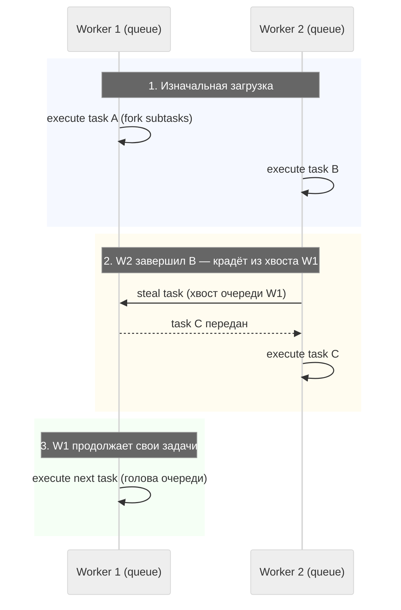


### 17. Что такое deadlock (взаимная блокировка)

**Deadlock** — это ситуация, при которой **два или более потоков навсегда заблокированы**, ожидая ресурсы (например, блокировки), удерживаемые друг другом. Например, поток T1 удерживает блокировку A и ждёт блокировку B, а поток T2 удерживает B и ждёт A. Ни один из них не может продолжить выполнение, и система «зависает» в этой части.

```java
// Классический deadlock
class DeadlockExample {
    private final Object lockA = new Object();
    private final Object lockB = new Object();

    public void method1() {
        synchronized (lockA) {
            // Удерживает lockA
            try { Thread.sleep(100); } catch (InterruptedException e) {}
            synchronized (lockB) {
                // Ждёт lockB — DEADLOCK!
            }
        }
    }

    public void method2() {
        synchronized (lockB) {
            // Удерживает lockB
            try { Thread.sleep(100); } catch (InterruptedException e) {}
            synchronized (lockA) {
                // Ждёт lockA — DEADLOCK!
            }
        }
    }
}

// Запуск: поток 1 вызывает method1(), поток 2 — method2()
```

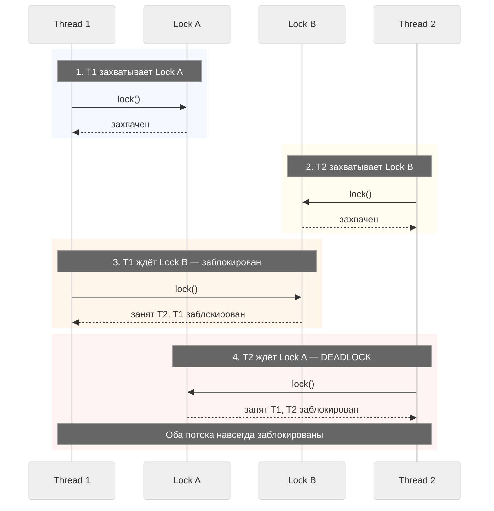


### 18. Какие условия необходимы для возникновения deadlock

Для возникновения deadlock должны одновременно выполняться **четыре условия (условия Коффмана)**:
1.  **Взаимное исключение (Mutual Exclusion)**: ресурс может быть занят только одним потоком.
2.  **Удержание и ожидание (Hold and Wait)**: поток удерживает хотя бы один ресурс и ожидает другие.
3.  **Отсутствие принудительного освобождения (No Preemption)**: ресурс не может быть отобран у потока; он освобождается только добровольно.
4.  **Циклическое ожидание (Circular Wait)**: существует замкнутая цепочка потоков, каждый из которых ожидает ресурс, удерживаемый следующим в цепочке.


### 19. Как предотвратить deadlock

Самый распространённый и надёжный способ — **упорядочивание захвата блокировок (lock ordering)**. Если все потоки захватывают несколько блокировок **в одном и том же глобальном порядке**, циклическое ожидание становится невозможным. Другие подходы:
- **Таймауты**: использовать `tryLock()` с таймаутом; если блокировку не удалось получить за отведённое время, отказаться от удержания уже захваченных блокировок и повторить попытку позже.
- **Минимизация блокировок**: уменьшить количество одновременно удерживаемых блокировок (например, захватывать одну блокировку на критическую секцию).
- **Обнаружение (deadlock detection)**: использовать инструменты (например, `jstack`, ThreadMXBean) для диагностики, но это не предотвращает, а лишь помогает найти проблему.


### 20. Что такое race condition

**Race condition (состояние гонки)** — это ситуация, когда корректность программы зависит от **непредсказуемого порядка** доступа нескольких потоков к общим данным. Классический пример — операция `count++` (чтение-изменение-запись): два потока могут одновременно прочитать одно и то же значение, оба увеличить его на 1 и записать обратно, в результате чего одно из обновлений будет потеряно, и итоговое значение окажется меньше ожидаемого.

```java
// Race condition с count++
class Counter {
    private int count = 0; // Не атомарно!

    // ❌ Не потокобезопасно
    public void increment() {
        count++; // Читает count, увеличивает на 1, записывает обратно
                 // Два потока могут одновременно прочитать одно значение
    }

    public int get() {
        return count;
    }
}

// ✅ Исправление: AtomicInteger
class SafeCounter {
    private final AtomicInteger count = new AtomicInteger(0);

    public void increment() {
        count.incrementAndGet(); // Атомарная операция
    }

    public int get() {
        return count.get();
    }
}
```

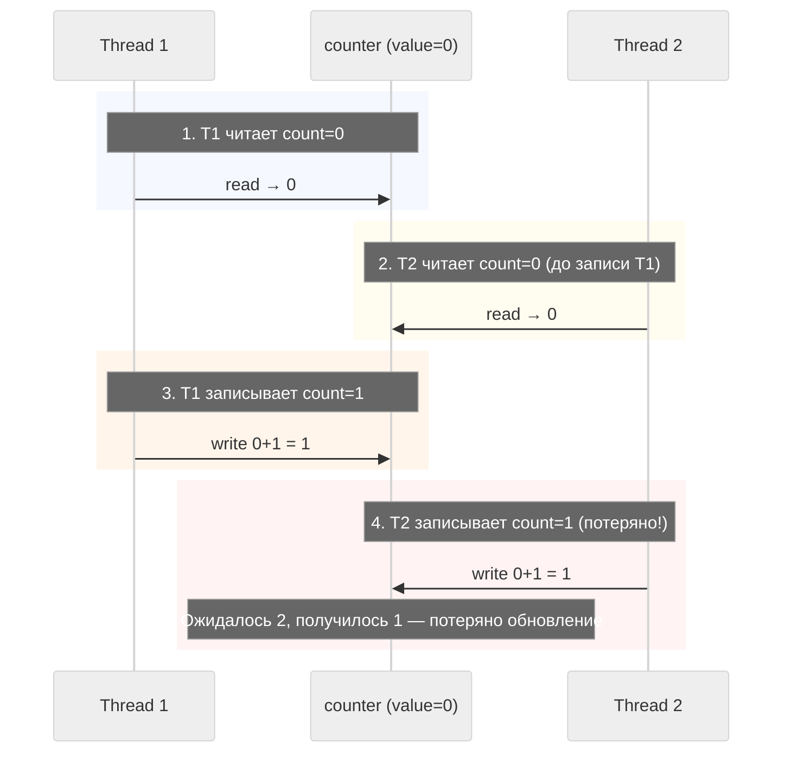


### 21. Как избежать race condition

- **Синхронизация**: использовать `synchronized` или `ReentrantLock` для защиты критических секций, где происходит доступ к общим изменяемым данным.
- **Атомарные классы**: использовать `AtomicInteger`, `AtomicLong` и др. для операций над одной переменной.
- **Иммутабельность**: делать объекты неизменяемыми, чтобы их состояние не могло быть изменено конкурентно.
- **Локальные переменные и ThreadLocal**: избегать совместного использования изменяемого состояния между потоками, передавая данные через локальные переменные или используя `ThreadLocal`.
- **Проектирование без общего состояния (stateless design)**: строить сервисы так, чтобы они не хранили изменяемое состояние между вызовами.


### 22. Что такое Virtual Threads в Java 21

**Virtual Threads (виртуальные потоки)** — это лёгкие потоки, представленные в **Java 21** (JEP 444) как стабильная функция. В отличие от традиционных **platform threads**, которые являются тонкой обёрткой над потоками операционной системы (и потому дорогими и ограниченными по количеству), виртуальные потоки **управляются JVM**, а не ОС. Они монтируются на небольшое число platform-потоков (carrier threads) и размонтируются при блокировке, позволяя JVM эффективно планировать миллионы виртуальных потоков на ограниченном числе реальных потоков.

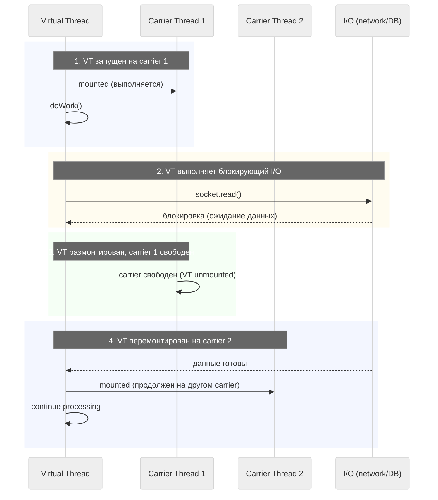


### 23. В чём преимущества Virtual Threads перед обычными потоками

- **Масштабируемость**: можно создать **миллионы** виртуальных потоков, тогда как platform threads ограничены тысячами из-за ресурсов ОС. Это позволяет использовать простую модель «поток на запрос» для высоконагруженных I/O-приложений.
- **Простота кода**: виртуальные потоки позволяют писать **последовательный, блокирующий код**, который легко читать и отлаживать, вместо сложных асинхронных/реактивных цепочек.
- **Снижение накладных расходов**: создание и переключение виртуальных потоков значительно дешевле, чем platform threads.


### 24. Когда стоит использовать Virtual Threads

Виртуальные потоки идеально подходят для **I/O-интенсивных задач (I/O-bound)**, где потоки большую часть времени проводят в ожидании (сетевые вызовы, запросы к базе данных, чтение файлов, ожидание в очередях). В таких сценариях традиционные пулы потоков быстро исчерпываются, а виртуальные потоки позволяют достичь высокой пропускной способности с простым блокирующим кодом.

**Не рекомендуется** использовать виртуальные потоки для **CPU-интенсивных задач (CPU-bound)**: они не дают выигрыша в производительности, так как реальная вычислительная работа всё равно выполняется на ограниченном числе ядер. Для CPU-bound задач лучше подходят традиционные пулы фиксированного размера, равного числу ядер.


### 25. Что такое structured concurrency

**Structured concurrency (структурированная конкурентность)** — это подход к конкурентному программированию, при котором группа связанных задач (подзадач) рассматривается как **единая единица работы**. Основные принципы:
- Подзадачи **не могут пережить** свою родительскую задачу: если родительская задача завершается (успешно или с ошибкой), все её подзадачи автоматически отменяются.
- Ошибки в подзадачах **распространяются** на родительскую задачу предсказуемым образом.
- Жизненный цикл подзадач **вложен** в жизненный цикл родителя, что упрощает отмену, обработку ошибок и наблюдаемость, устраняя утечки потоков.

В Java structured concurrency реализуется через API `StructuredTaskScope` (в preview в JDK 21+), который хорошо сочетается с виртуальными потоками.


### 26. В чём разница между Thread и Runnable

- **`Runnable`** — это **функциональный интерфейс** с единственным методом `run()`, который описывает **задачу** (что нужно выполнить). Он не управляет жизненным циклом потока и не возвращает результат.
- **`Thread`** — это **класс**, представляющий **сам поток** (единицу выполнения). Он реализует `Runnable` и содержит методы управления потоком (`start()`, `join()`, `interrupt()` и др.). Вы можете либо расширить `Thread` и переопределить `run()`, либо передать `Runnable` в конструктор `Thread`.

**Рекомендация**: предпочитать `Runnable` (или `Callable`), так как это отделяет **задачу** от **механизма её выполнения**, позволяет повторно использовать задачу и не связывает вас с наследованием от `Thread` (что важно, учитывая **одиночное** наследование в Java).


### 27. Что такое Callable и Future

- **`Callable<V>`** — это функциональный интерфейс, похожий на `Runnable`, но его метод `call()` **возвращает результат** типа `V` и **может выбрасывать проверяемые исключения**. Он используется для задач, результат которых нужно получить.
- **`Future<V>`** — это интерфейс, представляющий **результат асинхронного вычисления**. Он предоставляет методы:
  - **`get()`**: блокируется до завершения задачи и возвращает результат (или выбрасывает `ExecutionException`, если задача завершилась с ошибкой).
  - **`get(timeout, unit)`**: то же, но с таймаутом.
  - **`cancel()`**: пытается отменить выполнение задачи.
  - **`isDone()`**, **`isCancelled()`**: проверка состояния.

`Callable` обычно передаётся в `ExecutorService.submit()`, который возвращает `Future` для последующего получения результата.


### 28. Как работает wait/notify

`wait()`, `notify()` и `notifyAll()` — это методы класса `Object`, которые работают через **монитор** объекта. Вызов можно делать только из **`synchronized`-блока** на этом же объекте (иначе выбрасывается `IllegalMonitorStateException`). Механика:
- **`wait()`**: поток **освобождает** монитор объекта и блокируется, переходя в состояние **wait set (набор ожидания)** монитора. Поток остаётся заблокированным, пока другой поток не вызовет `notify()`/`notifyAll()`.
- **`notify()`**: пробуждает **один** произвольно выбранный поток из wait set. Пробуждённый поток **не продолжает выполнение немедленно** — он должен заново захватить монитор (перейти в **entry set**), что произойдёт только после освобождения монитора.
- **`notifyAll()`**: пробуждает **все** потоки из wait set; только один из них сможет продолжить первым.

Ключевая тонкость: после `wait()` значение условия может измениться «ложным пробуждением» (spurious wakeup) или другим потоком, поэтому **всегда** проверяют условие в цикле: `while (!condition) lock.wait();` — не в `if`.

```java
// Producer-consumer через wait/notify
class BoundedBuffer {
    private final int[] data;
    private int count = 0, in = 0, out = 0;

    BoundedBuffer(int size) { data = new int[size]; }

    synchronized void put(int v) throws InterruptedException {
        while (count == data.length) wait();   // буфер полон — ждём
        data[in] = v; in = (in + 1) % data.length; count++;
        notifyAll();                            // разбудили потребителя
    }

    synchronized int take() throws InterruptedException {
        while (count == 0) wait();             // буфер пуст — ждём
        int v = data[out]; out = (out + 1) % data.length; count--;
        notifyAll();                            // разбудили производителя
        return v;
    }
}
```

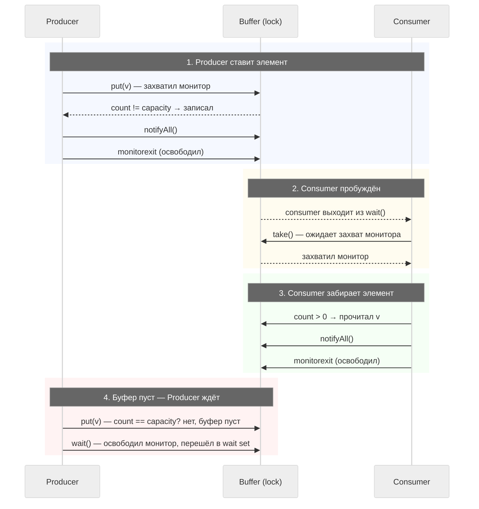


### 29. Что такое BlockingQueue

**`BlockingQueue`** — это очередь, реализующая **producer-consumer (производитель-потребитель)** модель с блокирующими операциями. Основные реализации: `ArrayBlockingQueue` (фиксированный размер), `LinkedBlockingQueue` (по умолчанию неограниченная), `PriorityBlockingQueue` (с приоритетом), `SynchronousQueue` (без буферизации — каждая вставка ждёт соответствующего извлечения). Методы:
- **`put(e)`**: блокируется, пока очередь **полна**.
- **`take()`**: блокируется, пока очередь **пуста**.
- **`offer(e, timeout, unit)` / `poll(timeout, unit)`**: то же, но с таймаутом (возвращают `true`/`null`).

Блокировка реализована на `Lock` + `Condition` (на основе `AQS`), поэтому `BlockingQueue` потокобезопасен и эффективнее ручного `wait/notify`: нет ложных пробуждений, есть таймауты.

```java
// Producer
executor.submit(() -> {
    for (int i = 0; i < 100; i++) {
        queue.put(task(i));          // блокируется, если очередь полна
    }
});

// Consumer
executor.submit(() -> {
    while (true) {
        Task t = queue.take();       // блокируется, если очередь пуста
        process(t);
    }
});
```

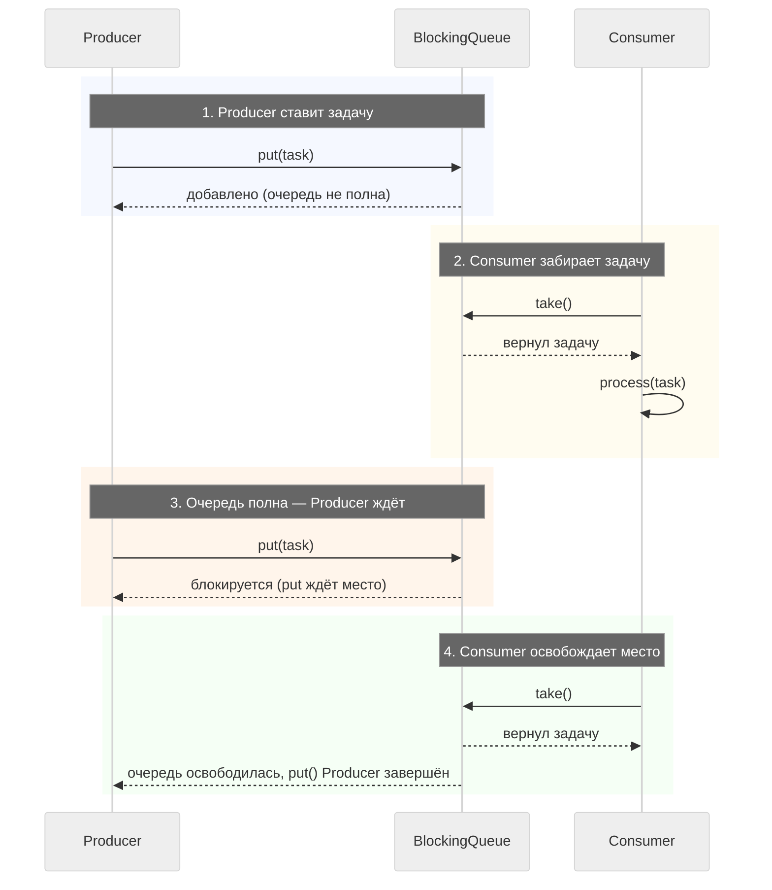


### 30. Что такое Executor и его иерархия

Иерархия интерфейсов `java.util.concurrent`:
- **`Executor`**: базовый интерфейс с одним методом `execute(Runnable)` — просто запускает задачу.
- **`ExecutorService`** (расширяет `Executor`): добавляет `submit()` (с `Future`), `invokeAll()`, `invokeAny()`, управление жизненным циклом (`shutdown`, `shutdownNow`).
- **`AbstractExecutorService`**: частично реализует `ExecutorService` через `execute()`.
- **`ThreadPoolExecutor`**: основная реализация, использующая пул потоков и очередь задач.
- **`ScheduledExecutorService`**: добавляет планирование отложенных и периодических задач (`schedule`, `scheduleAtFixedRate`, `scheduleWithFixedDelay`).
- **`ForkJoinPool`**: пул для разбиваемых задач с work-stealing.

**`ExecutorService` vs `ScheduledExecutorService`**: первый — для однократного асинхронного выполнения; второй — для **отложенного** (`schedule`) или **периодического** (`scheduleAtFixedRate` / `scheduleWithFixedDelay`) выполнения. `scheduleAtFixedRate` планирует задачи **с фиксированной частотой** (может «догонять» пропущенные), `scheduleWithFixedDelay` — **с фиксированной задержкой** после завершения предыдущей (пропуски не догоняются).


### 31. Как устроен ThreadPoolExecutor

`ThreadPoolExecutor` — это основной движок всех пулов потоков. Его ключевые параметры:
- **`corePoolSize`**: число постоянных (ядерных) потоков, создаваемых **наперёд**.
- **`maximumPoolSize`**: максимальное число потоков (ядро + временные).
- **`keepAliveTime`**: время жизни **лишних** (неядерных) потоков, после которого они завершаются.
- **`workQueue`**: очередь задач, если все core-потоки заняты.
- **`threadFactory`**: фабрика создания потоков (можно задать имена).
- **`handler`**: **RejectionPolicy** — что делать при переполнении (очередь полна и потоков `maximumPoolSize`).

**Алгоритм принятия задачи:**
1. Если активных потоков **меньше `corePoolSize`** — создаётся **новый core-поток**.
2. Если core-потоки заняты — задача ставится в **`workQueue`**.
3. Если очередь **полна** и активных потоков **меньше `maximumPoolSize`** — создаётся **временный (non-core) поток**.
4. Если очередь полна и потоков **`maximumPoolSize`** — вызывается **`RejectionHandler`** (по умолчанию `AbortPolicy` — бросает `RejectedExecutionException`; есть `CallerRunsPolicy`, `DiscardPolicy`, `DiscardOldestPolicy`).

**Почему пул не всегда `corePoolSize`**: если очередь переполнена и потоков меньше `maximumPoolSize`, пул создаёт дополнительные потоки. Это позволяет временно увеличить параллелизм при пиковой нагрузке.

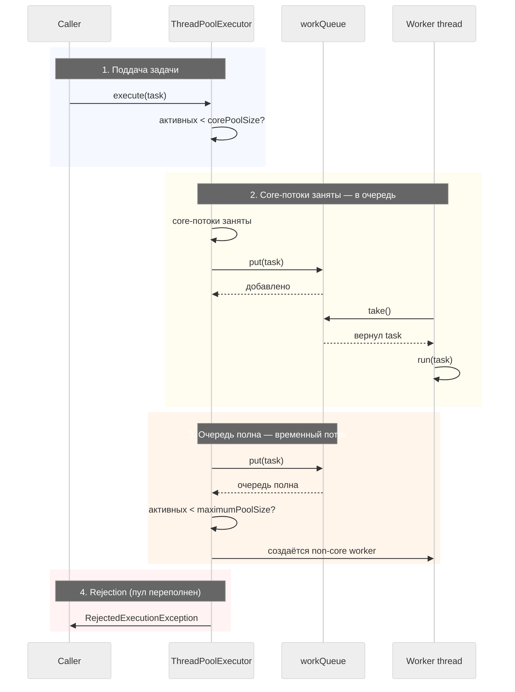


### 32. Как работает interrupt

**`interrupt()`** — это **коллаборативный (сообщающийся)** механизм остановки потока, основанный на **флаге прерывания**, а не на принудительном убийстве. Вызов `thread.interrupt()`:
1. Устанавливает во внутреннем поле `Thread` **флаг прерывания** (`interrupted` flag).
2. Если поток **в данный момент заблокирован** в `sleep()`, `wait()`, `join()` или `Lock.lockInterruptibly()`, то он **немедленно** пробуждается с `InterruptedException`.

Важно: `interrupt()` **не прерывает выполнение** кода в `run()`. Поток обязан **сам** проверять флаг (`Thread.currentThread().isInterrupted()`) или **обрабатывать** `InterruptedException`, чтобы остановиться корректно.

```java
public class Worker implements Runnable {
    public void run() {
        while (!Thread.currentThread().isInterrupted()) {
            doWork();
            try {
                Thread.sleep(1000);
            } catch (InterruptedException e) {
                // Потоку сказали остановиться — выходим корректно
                Thread.currentThread().interrupt(); // восстанавливаем флаг
                return;
            }
        }
    }
}
```

**Ключевые правила:**
- **Не глотайте** `InterruptedException`: если вы его поймали, либо завершите поток, либо **восстановите** флаг через `Thread.currentThread().interrupt()` (важно, если метод вызывает ещё блокирующие операции выше).
- **`Thread.stop()`** — устарел и опасен (может привести к неконсистентному состоянию), **не использовать**.
- `interrupt()` — единственный безопасный способ попросить поток остановиться.

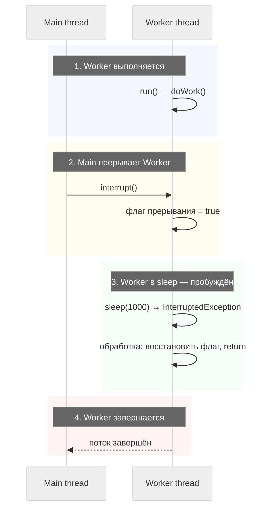


### 33. Что такое ThreadLocal

**`ThreadLocal<T>`** — это механизм, позволяющий хранить **раздельные значения переменной для каждого потока** (в отличие от обычной переменной, где все потоки разделяют одно значение). Внутри `ThreadLocal` хранит для каждого потока **отдельное** значение в `ThreadLocalMap`, привязанном к `Thread`. Это часто используется для хранения **контекста запроса** (аутентификация, локаль, транзакция) в веб-фреймворках.

```java
private static final ThreadLocal<RequestContext> context = new ThreadLocal<>();

public void handler() {
    context.set(new RequestContext("user-123"));  // только для ЭТОГО потока
    doWork();  // внутри можно получить context.get()
}
```

**Проблема утечек (memory leak) в пулах потоков**: в `ThreadPoolExecutor` потоки **переиспользываются**, поэтому `ThreadLocal`-значения **не очищаются** автоматически после завершения задачи. Если задача завершается, а значение не вызвано `remove()`, оно остаётся в `ThreadLocalMap` потока и будет переиспользоваться следующей задачей в этом же потоке → утечка памяти и **перекрёстное загрязнение данных**.

**Решение**: всегда вызывать `context.remove()` в `finally` блока, когда контекст больше не нужен.

```java
public void handler() {
    try {
        context.set(new RequestContext("user-123"));
        doWork();
    } finally {
        context.remove();  // обязательно в пуле потоков!
    }
}
```


### 34. Что такое CountDownLatch

**`CountDownLatch`** — это **одноразовый** механизм синхронизации, представляющий **счётчик**, от которого потоки **блокируются до его обнуления**. Создаётся с начальным значением `N`:
- **`countDown()`**: уменьшает счётчик на 1 (вызывается, когда задача завершена).
- **`await()`**: блокирует поток, пока счётчик **не станет 0**.
- **`await(timeout, unit)`**: то же, но с таймаутом (возвращает `false` при таймауте).

**Типичное применение**: один поток ждёт завершения **N параллельных задач** (например, загрузки N ресурсов) перед продолжением.

```java
int N = 3;
CountDownLatch latch = new CountDownLatch(N);
ExecutorService pool = Executors.newFixedThreadPool(N);

for (int i = 0; i < N; i++) {
    pool.submit(() -> {
        try {
            loadResource(i);
        } finally {
            latch.countDown();  // уменьшаем счётчик
        }
    });
}

latch.await();  // ждём, пока все 3 задачи завершатся
pool.shutdown();
```

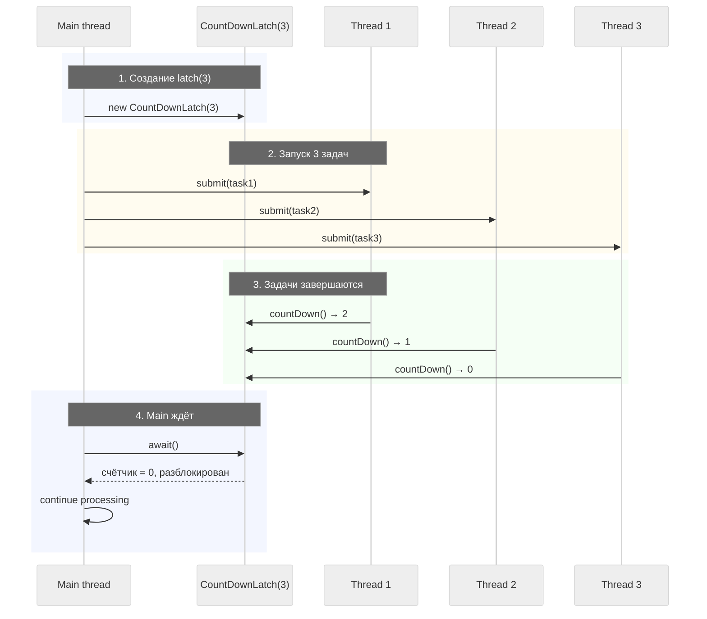


### 35. Что такое CyclicBarrier

**`CyclicBarrier`** — это механизм **синхронизации N потоков на «барьере»**: все потоки **встречаются** в одной точке, и когда **все N** потоков достигают барьера, они **все одновременно** разблокируются и продолжают выполнение. В отличие от `CountDownLatch`, `CyclicBarrier` **циклический** (можно использовать многократно) и **взаимный** (все потоки ждут друг друга, а не один ждёт N).

**Методы:**
- **`await()`**: блокирует поток, пока **все N** потоков не достигнут барьера. Когда все собрались, барьер **сбрасывается** (count = N), и все потоки продолжают.
- **`await(timeout, unit)`**: с таймаутом.
- Можно задать **barrierAction** — задача, выполняемая **один раз** при каждом сбросе барьера (например, логирование или сбор результатов).

```java
int N = 3;
CyclicBarrier barrier = new CyclicBarrier(N, () ->
    System.out.println("Все 3 потока достигли барьера"));

ExecutorService pool = Executors.newFixedThreadPool(N);
for (int i = 0; i < N; i++) {
    pool.submit(() -> {
        phase1();
        try {
            barrier.await();  // ждём, пока все 3 достигнут барьера
        } catch (Exception e) { /* ... */ }
        phase2();  // все 3 потока продолжают одновременно
    });
}
pool.shutdown();
```

**`CountDownLatch` vs `CyclicBarrier`:**

| Критерий | CountDownLatch | CyclicBarrier |
|----------|---------------|---------------|
| Одноразовый / циклический | **Одноразовый** (count не сбрасывается) | **Циклический** (можно переиспользовать) |
| Кто ждёт | **Один** поток ждёт N событий | **Все N** потоков ждут друг друга |
| Счётчик | Уменьшается до 0 | Увеличивается до N, затем сбрасывается |
| Типичный кейс | «Подождать завершения N задач» | «Синхронизировать N потоков на фазе» |


### 36. Что такое Semaphore (семафор)

**`Semaphore`** — это **счётчиковая блокировка**, управляющая **доступом к ограниченному ресурсу** через фиксированное число **разрешений (permits)**. Поток вызывает `acquire()` для получения разрешения; если разрешений нет, поток блокируется. После завершения работы поток вызывает `release()`, чтобы вернуть разрешение.

```java
Semaphore sem = new Semaphore(3);  // максимум 3 потока одновременно

ExecutorService pool = Executors.newFixedThreadPool(10);
for (int i = 0; i < 10; i++) {
    pool.submit(() -> {
        try {
            sem.acquire();  // блокируется, если заняты все 3 разрешения
            accessSharedResource();
        } catch (InterruptedException e) {
            Thread.currentThread().interrupt();
        } finally {
            sem.release();  // возвращаем разрешение
        }
    });
}
pool.shutdown();
```

**Типичные применения:**
- **Ограничение одновременных соединений** к базе данных или внешнему API (например, максимум 10 параллельных HTTP-запросов).
- **Ограничение размера пула** в `ThreadPoolExecutor` (через `SynchronousQueue` + `Semaphore`).
- **Бинарный семафор** (`new Semaphore(1)`) — эквивалент mutex (взаимного исключения) через `acquire`/`release`.


### 37. Что такое CompletableFuture

**`CompletableFuture<T>`** — это мощная реализация `Future`, добавляющая возможности **асинхронного**, **цепочного** и **композируемого** выполнения. В отличие от `Future`, он поддерживает:
- **`thenApply(fn)`**: асинхронное преобразование результата.
- **`thenAccept(fn)`**: асинхронная обработка результата (без возврата).
- **`thenCombine(other, fn)`**: объединение результатов двух `CompletableFuture`.
- **`exceptionally(fn)`**: обработка исключения.
- **`allOf(cf1, cf2, ...)`**: будущее, завершающееся когда **все** входящие завершены.
- **`anyOf(cf1, cf2, ...)`**: будущее, завершающееся когда **хотя бы одно** завершено.

**Async-варианты** (`thenApplyAsync`, `thenAcceptAsync`) позволяют выполнять следующий этап **в другом потоке** (по умолчанию в `ForkJoinPool.commonPool()` или в переданном `Executor`).

```java
CompletableFuture<String> future =
    fetchDataAsync()                          // асинхронная загрузка
        .thenApplyAsync(data -> transform(data), executor)  // преобразование
        .thenCombine(getUserAsync(), (data, user) -> enrich(data, user))  // комбинация
        .exceptionally(ex -> "fallback");    // обработка ошибок

String result = future.join();  // или get()
```

**`Future` vs `CompletableFuture`:**

| Критерий | Future | CompletableFuture |
|----------|--------|-------------------|
| Блокирующий get() | Да | Да |
| Цепочные операции | Нет | Да (`thenApply`, `thenAccept`, ...) |
| Обработка исключений | Только через `get()` (ExecutionException) | `exceptionally`, `handle` |
| Комбинация | Нет | `thenCombine`, `allOf`, `anyOf` |
| Async-выполнение этапов | Нет | Да (`thenApplyAsync`, ...) |


### 38. Как работает Join (метод Thread.join)

**`thread.join()`** — это метод, который **блокирует текущий поток** до тех пор, пока **цельный поток** не **завершится**. То есть вызов `t.join()` в потоке A означает: «подожди, пока поток t не завершится, прежде чем продолжить выполнение в A».

**Варианты:**
- **`join()`**: ждать бесконечно.
- **`join(timeout)`**: ждать не более `timeout` мс.
- **`join(timeout, millis)`**: ждать не более `timeout` секунд + `millis` мс.

**Внутренняя реализация**: `join()` использует **`wait()`** на объекте `Thread` (мониторе потока). Когда поток завершается, JVM вызывает `notifyAll()` на этом объекте, что пробуждает все потоки, ожидающие в `join()`.

**Отношение happens-before**: все действия в потоке T happen-before успешного возврата из `T.join()` в другом потоке (п. 2).

```java
Thread t1 = new Thread(() -> {
    doWork();  // какая-то работа
});
t1.start();

t1.join();  // текущий поток ждёт, пока t1 завершится
System.out.println("t1 завершён, можно продолжать");
```

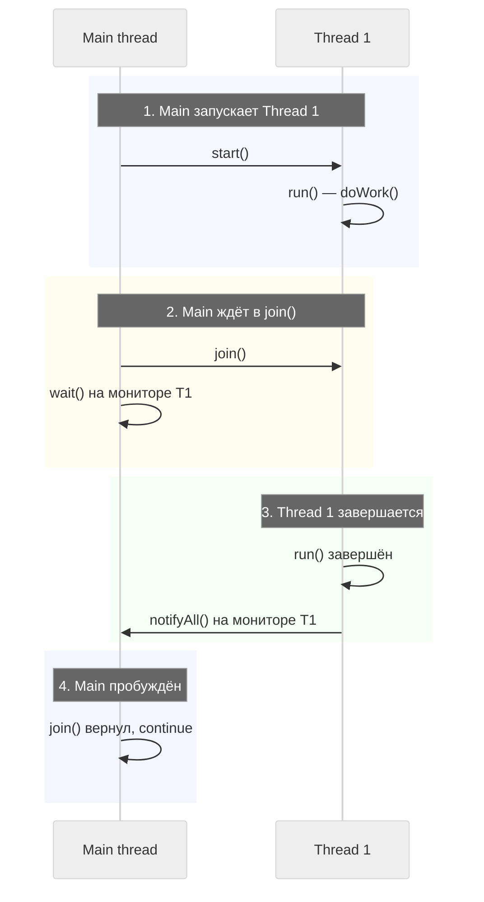


### 39. Что такое AQS (AbstractQueuedSynchronizer)

**`AQS`** — это абстрактный класс из `java.util.concurrent.locks`, лежащий в основе большинства **блокирующих** конкурентных примитивов в Java: `ReentrantLock`, `Semaphore`, `CountDownLatch`, `ThreadPoolExecutor.Worker`, `ForkJoinPool`.

**Как работает AQS:**
- Внутри хранится одно **`volatile int state`** (счётчик: например, число потоков, удерживающих блокировку, число permits семафора, счётчик latch).
- Также есть **FIFO-очередь** (CLH-вариант) **узлов**, каждый из которых представляет **заблокированный поток**, ожидающий изменения `state`.
- Методы **`tryAcquire()`** и **`tryRelease()`** — **абстрактные**: конкретная реализация определяет логику (например, `ReentrantLock` проверяет, равен ли `state == 0` и кто владеет блокировкой).
- Когда `tryAcquire` возвращает `false` (не удалось), поток **добавляется в очередь** и **паркится** (`LockSupport.park()`).
- Когда `tryRelease` возвращает `true` (успешно освобождено), **следующий узел в очереди** **разпаркится** (`LockSupport.unpark()`) и попробует захватить.

**Почему это важно**: AQS — это **единый механизм**, на котором построены все блокирующие конкурентные классы Java. Понимание AQS = понимание того, как работают `ReentrantLock`, `Semaphore`, `CountDownLatch` и другие под капотом.

```java
// Упрощённая логика ReentrantLock поверх AQS
static final class Sync extends AQS {
    protected boolean tryAcquire(int acquires) {
        Thread current = Thread.currentThread();
        int c = getState();
        if (c == 0) {
            if (compareAndSetState(0, acquires)) {  // CAS
                setExclusiveOwnerThread(current);
                return true;
            }
        } else if (current == getExclusiveOwnerThread()) {
            setState(c + acquires);  // reentrant
            return true;
        }
        return false;  // блокировка занята другим — AQS поставит поток в очередь
    }

    protected boolean tryRelease(int releases) {
        int c = getState() - releases;
        if (Thread.currentThread() != getExclusiveOwnerThread())
            throw new IllegalMonitorStateException();
        boolean free = c == 0;
        if (free) setExclusiveOwnerThread(null);
        setState(c);
        return free;  // true → AQS разбудит следующий в очереди
    }
}
```


### 40. Как работает volatile (внутренняя механика)

**`volatile`** — это модификатор поля, который гарантирует **видимость** изменений между потоками и **запрещает переупорядочивание** инструкций вокруг volatile-переменной. Внутренняя механика:
- При **записи** в volatile-переменную JVM выпускает **memory barrier (StoreLoad)**: все предыдущие записи становятся видимыми другим потокам **до** этой записи.
- При **чтении** volatile-переменной JVM выпускает **memory barrier (LoadLoad)**: последующие чтения не будут упорядочены **до** этой загрузки.

**Что volatile НЕ даёт:**
- **Не атомарность** составных операций: `volatile int count; count++` — **не** потокобезопасно (чтение-изменение-запись — три инструкции, между которыми другой поток может вмешаться).
- **Не взаимное исключение**: два потока могут одновременно читать и писать (без блокировки).

**Типичные применения:**
- **Флаг-состояние**: `volatile boolean running = true;` — один поток устанавливает в `false`, другие читают и останавливаются.
- **Лениная инициализация (lazy initialization)**: double-checked locking (п. 41).

```java
// Флаг остановки
public class Service {
    private volatile boolean running = true;

    public void stop() {
        running = false;  // видим всем потокам немедленно
    }

    public void run() {
        while (running) {  // каждый поток видит актуальное значение
            doWork();
        }
    }
}
```


### 41. Что такое Double-Checked Locking

**Double-Checked Locking (DCL)** — это оптимизация **ленивой инициализации (lazy initialization)** синглтона, которая позволяет избежать синхронизации на **каждом** вызове, синхронизируясь только при **первой** инициализации.

```java
public class Singleton {
    // volatile обязателен! (см. ниже почему)
    private static volatile Singleton instance;

    public static Singleton getInstance() {
        if (instance == null) {              // 1-я проверка — без блокировки
            synchronized (Singleton.class) { // блокировка только при инициализации
                if (instance == null) {      // 2-я проверка — с блокировкой
                    instance = new Singleton();
                }
            }
        }
        return instance;
    }
}
```

**Почему `volatile` обязателен**: без `volatile` операция `new Singleton()` состоит из трёх шагов: (1) выделить память, (2) инициализировать объект, (3) присвоить ссылку. Без `volatile` JVM/процессор могут **переупорядочить** шаги 2 и 3: сначала присвоить ссылку, потом инициализировать. Тогда другой поток может прочитать **не-нулевую**, но **не инициализированную** ссылку. `volatile` запрещает такое переупорядочивание (см. п. 40).

**Почему две проверки:**
- **1-я (без блокировки)**: если объект уже инициализирован, возвращаем его без захвата монитора — это быстрый путь (fast path), без накладных расходов на синхронизацию.
- **2-я (с блокировкой)**: проверяем ещё раз **внутри** synchronized-блока, потому что между первой проверкой и захватом блокировки другой поток мог уже инициализировать объект.


### 42. Что такое ReadWriteLock

**`ReadWriteLock`** — это интерфейс, предоставляющий **две блокировки** на один объект:
- **Read lock (разделяемая)**: может быть захвачена **многими** потоками **одновременно** (readers не блокируют друг друга).
- **Write lock (исключительная)**: захватывается **только одним** потоком; блокирует всех readers и других writers.

**Реализация `ReentrantReadWriteLock`:**
- **Reader**: может читать данные одновременно с другими readers.
- **Writer**: эксклюзивный доступ; если writer работает, все новые readers и writers блокируются.
- **Репентерабельность**: поток, удерживающий read lock, может **повысить его до write lock** (read-to-write upgrade), но **не может понизить** (write-to-read downgrade) — это может привести к deadlock.

```java
private final ReadWriteLock rwLock = new ReentrantReadWriteLock();
private final Map<String, Object> cache = new HashMap<>();

public Object read(String key) {
    rwLock.readLock().lock();
    try {
        return cache.get(key);
    } finally {
        rwLock.readLock().unlock();
    }
}

public void write(String key, Object value) {
    rwLock.writeLock().lock();
    try {
        cache.put(key, value);
    } finally {
        rwLock.writeLock().unlock();
    }
}
```

**Когда использовать**: когда **чтений значительно больше, чем записей** (например, кэш конфигурации, справочные данные). Если записей много или данные изменяются часто, обычный `synchronized` или `ReentrantLock` может быть эффективнее (меньше накладных расходов на управление двумя блокировками).


