# Паттерны проектирования

### 1. Что такое паттерны проектирования

Паттерны проектирования (design patterns) — это **повторно используемые, проверенные решения** типичных проблем, возникающих при проектировании программного обеспечения. Паттерн не является готовым кодом — это **шаблон, описание подхода**, который можно адаптировать к конкретной задаче. Паттерны помогают разработчикам общаться на общем языке («здесь нужен Strategy»), делают архитектуру более понятной, гибкой и поддерживаемой. Впервые систематизированы «бандой четырёх» (GoF — Gamma, Helm, Johnson, Vlissides) в книге 1994 года.

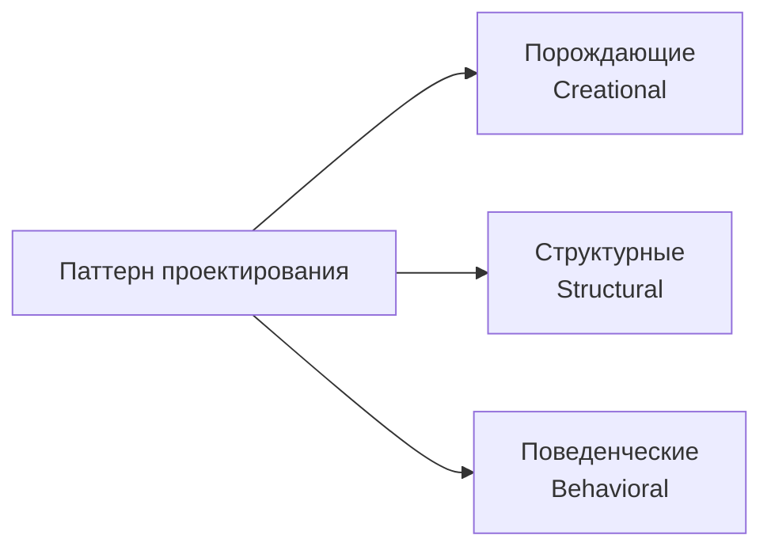

### 2. Какие категории паттернов существуют

Классическая классификация GoF делит паттерны на три категории:
- **Порождающие (Creational)**: отвечают за механизмы создания объектов, скрывая логику инстанцирования. Примеры: Singleton, Factory Method, Abstract Factory, Builder, Prototype.
- **Структурные (Structural)**: описывают способы композиции классов и объектов для образования более крупных структур. Примеры: Adapter, Decorator, Facade, Composite, Proxy, Bridge, Flyweight.
- **Поведенческие (Behavioral)**: определяют взаимодействие между объектами и распределение обязанностей. Примеры: Strategy, Observer, Command, State, Template Method, Iterator, Chain of Responsibility, Mediator, Visitor, Memento.

Отдельно выделяют **архитектурные паттерны** (MVC, CQRS, Event Sourcing, Saga) и **антипаттерны**.

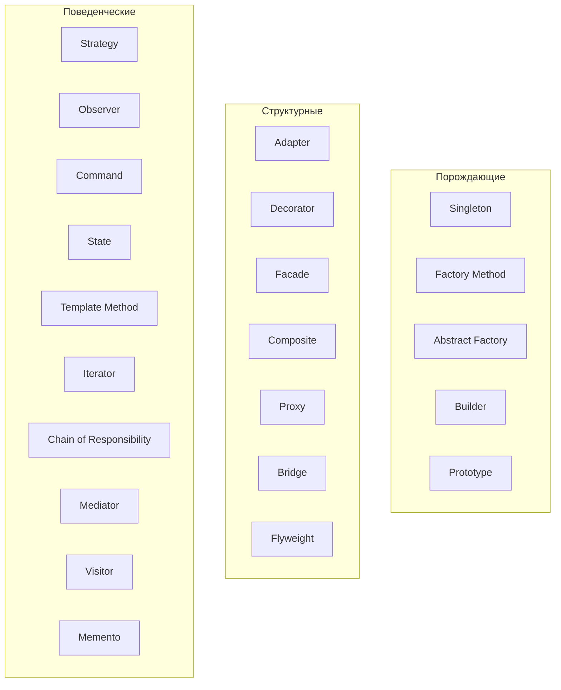

### 3. Что такое Singleton

**Singleton (Одиночка)** — порождающий паттерн, гарантирующий, что у класса есть **ровно один экземпляр**, и предоставляющий **глобальную точку доступа** к нему. Реализуется через приватный конструктор, статическое поле для хранения экземпляра и статический метод `getInstance()`. Используется для ресурсов, которые должны быть единственными в системе: конфигурации, пулы соединений, кэши, логгеры.

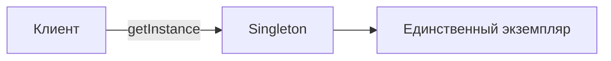

### 4. Как реализовать потокобезопасный Singleton

Несколько способов:
- **Eager initialization** (жадная инициализация): статическое `final`-поле инициализируется при загрузке класса. Потокобезопасно, но экземпляр создаётся даже если не нужен.
- **Synchronized `getInstance()`**: просто, но синхронизация на каждом вызове — накладно.
- **Double-checked locking** с `volatile`: эффективно, но требует аккуратности.
- **Bill Pugh (holder class)**: статический вложенный класс-держатель — ленивая и потокобезопасная инициализация за счёт гарантий загрузки классов JVM. Один из лучших подходов.
- **Enum Singleton**: самый надёжный — защищён от рефлексии, сериализации, потокобезопасен «из коробки». Рекомендуется Джошуа Блохом.

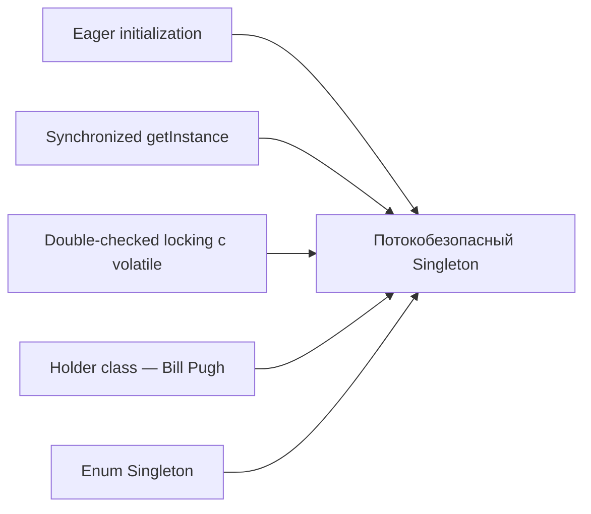

### 5. Что такое double-checked locking

**Double-checked locking (DCL)** — идиома для ленивой потокобезопасной инициализации Singleton с минимальными накладными расходами:
```java
private static volatile Singleton instance;
public static Singleton getInstance() {
    if (instance == null) {              // первая проверка (без блокировки)
        synchronized (Singleton.class) {
            if (instance == null) {      // вторая проверка (под блокировкой)
                instance = new Singleton();
            }
        }
    }
    return instance;
}
```
Первая проверка избегает синхронизации в «горячем» пути, вторая — гонки при инициализации. **Критически важно** поле `volatile`: без него возможна публикация частично сконструированного объекта из-за переупорядочивания инструкций (до Java 5 DCL был сломан).

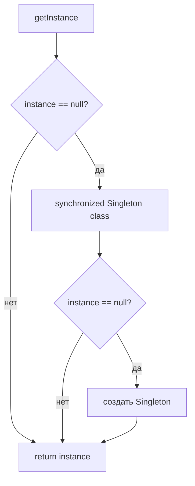

### 6. Каковы проблемы с Singleton

- **Глобальное состояние**: Singleton — это по сути глобальная переменная, что усложняет понимание зависимостей и приводит к скрытой связанности.
- **Сложность тестирования**: из-за глобального состояния и приватного конструктора трудно подменить реализацию моком; тесты могут влиять друг на друга через общее состояние.
- **Нарушение SRP**: класс отвечает и за свою бизнес-логику, и за управление своим единственным экземпляром.
- **Проблемы в многопоточности и распределённых системах**: «единственный» экземпляр — только в рамках одной JVM; в кластере их будет несколько.
- **Скрытые зависимости**: классы, использующие Singleton, не декларируют зависимость в конструкторе, что затрудняет понимание архитектуры.
- **Проблемы с сериализацией и рефлексией**: обычный Singleton можно «взломать» через рефлексию или десериализацию (кроме enum-реализации).

Современная рекомендация: вместо Singleton использовать **Dependency Injection** — контейнер сам управляет единственным экземпляром, а зависимости явно декларируются.

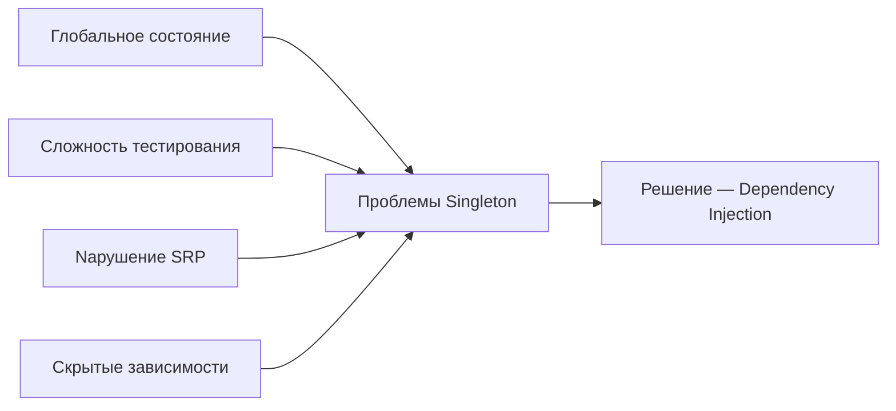

### 7. В чём разница между Factory Method и Abstract Factory

- **Factory Method** — порождающий паттерн, определяющий **интерфейс для создания объекта**, но позволяющий **подклассам** решать, какой конкретный класс инстанцировать. Один метод создаёт **один продукт**; выбор реализации — через наследование.
- **Abstract Factory** — порождающий паттерн, предоставляющий **интерфейс для создания целого семейства связанных объектов** без указания их конкретных классов. Одна фабрика создаёт **несколько взаимосвязанных продуктов** (например, `Button` и `Checkbox` для одной ОС); выбор семейства — через композицию (передачу конкретной фабрики).

Кратко: Factory Method — «один продукт, наследование», Abstract Factory — «семейство продуктов, композиция». Abstract Factory часто реализуется через несколько Factory Method.

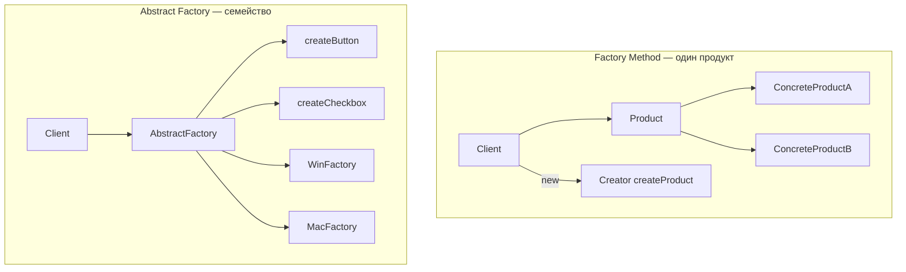

### 8. Когда использовать Builder

Паттерн **Builder** стоит использовать, когда:
- У объекта **много параметров** (особенно опциональных), и телескопические конструкторы становятся нечитаемыми.
- Нужно строить объект **пошагово**, с возможностью проверить инварианты перед созданием.
- Требуется создавать **неизменяемые (immutable)** объекты со множеством полей: Builder накапливает значения, а `build()` создаёт финальный объект.
- Один и тот же процесс конструирования должен порождать **разные представления** объекта.
- Нужна **читаемость** кода создания: `new Pizza.Builder().size(LARGE).cheese(true).build()`.

Не стоит использовать Builder для простых объектов с 1–3 полями — это избыточно.

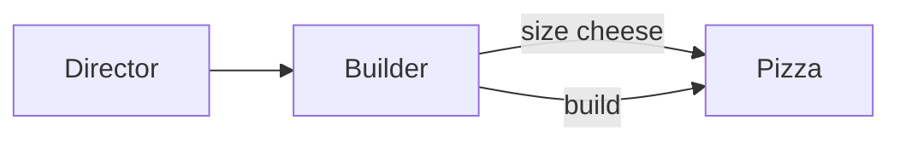

### 9. Что такое Prototype pattern

**Prototype (Прототип)** — порождающий паттерн, при котором создание новых объектов происходит **путём клонирования существующего экземпляра (прототипа)**, а не через `new`. В Java реализуется через интерфейс `Cloneable` и метод `clone()` (или через конструктор копирования / фабрику копий). Полезен, когда:
- Создание объекта «с нуля» дорого (много вычислений, обращений к БД).
- Нужно создать объект, повторяющий состояние существующего, с небольшими изменениями.
- Система должна быть независима от способа создания своих объектов.

Важно различать **shallow copy** (по умолчанию `Object.clone()`) и **deep copy** (требует ручной реализации для вложенных объектов).

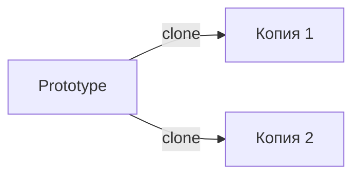

### 10. Когда использовать Strategy

Паттерн **Strategy** стоит использовать, когда:
- Есть **несколько взаимозаменяемых алгоритмов** решения одной задачи, и нужно выбирать один во время выполнения.
- Нужно избавиться от большого `if/else` или `switch` по типу поведения.
- Требуется **инкапсулировать** алгоритмы в отдельные классы, чтобы их можно было независимо тестировать и развивать.
- Нужно менять поведение объекта **динамически** без изменения его класса.

Пример: различные стратегии скидок, алгоритмы сортировки, способы оплаты. В Java часто реализуется через интерфейс + несколько реализаций, которые внедряются через конструктор (композиция).

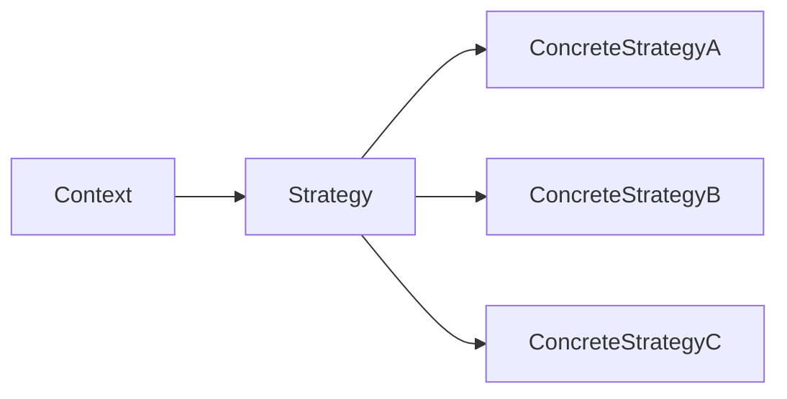

### 11. Как реализован Observer в Java

Паттерн **Observer** реализован в Java несколькими способами:
- **Классический (устаревший)**: класс `java.util.Observable` и интерфейс `java.util.Observer` (deprecated с Java 9).
- **События и слушатели (Listener)**: стандартный подход в Swing/AWT (`ActionListener`, `MouseListener` и т.д.) — субъект хранит список слушателей и вызывает их методы при событии.
- **`java.beans.PropertyChangeListener` / `PropertyChangeSupport`**: для уведомления об изменении свойств бина.
- **Реактивные библиотеки**: RxJava (`Observable`, `Flowable`), Project Reactor (`Flux`, `Mono`), `java.util.concurrent.Flow` (Java 9+, Reactive Streams) — современные реализации с поддержкой backpressure.

Суть одна: субъект (subject) хранит коллекцию наблюдателей (observers) и при изменении состояния уведомляет их, вызывая общий метод.

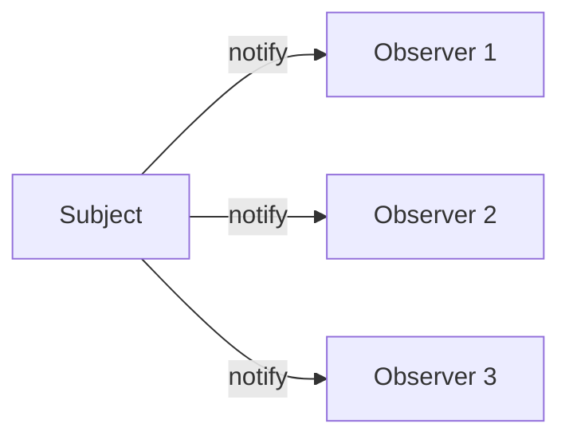

### 12. В чём преимущество Decorator перед наследованием

**Decorator** оборачивает объект в другой объект того же интерфейса, добавляя поведение **динамически, во время выполнения**, путём композиции. Преимущества перед наследованием:
- **Гибкость во время выполнения**: можно комбинировать декораторы в любом порядке и количестве, а наследование фиксируется на этапе компиляции.
- **Избежание «взрыва классов»**: для N независимых расширений наследование требует до 2^N подклассов; декораторы комбинируются.
- **Соблюдение SRP и OCP**: каждое расширение — отдельный класс, не затрагивающий другие.
- **Отсутствие жёсткой связи** с конкретным родителем.

Классический пример в Java — потоки ввода-вывода: `new BufferedReader(new InputStreamReader(new FileInputStream(...)))`.

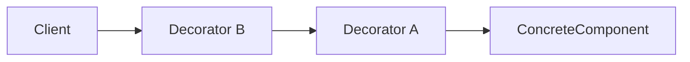

### 13. В чём разница между State и Strategy

Структурно паттерны очень похожи (интерфейс + несколько реализаций, делегирование), но **намерения разные**:
- **Strategy**: клиент **явно выбирает** алгоритм и передаёт его объекту. Стратегии **не знают друг о друге** и обычно **не меняют себя** — выбор делает внешний код. Цель — взаимозаменяемость алгоритмов.
- **State**: объект **сам меняет своё поведение** при изменении внутреннего состояния, переключаясь между реализациями. Состояния **знают друг о друге** и могут инициировать переходы (`context.setState(new NextState())`). Цель — моделирование конечного автомата.

Кратко: в Strategy переходы управляются извне, в State — изнутри (самими состояниями).

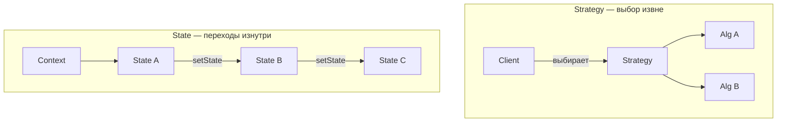

### 14. Какие типы Proxy существуют

**Proxy (Заместитель)** — структурный паттерн, предоставляющий объект-заместитель, контролирующий доступ к исходному объекту. Типы:
- **Virtual Proxy (виртуальный)**: откладывает создание «тяжёлого» объекта до первого обращения (ленивая инициализация).
- **Remote Proxy (удалённый)**: представляет объект, находящийся в другом адресном пространстве (RMI, gRPC-стабы).
- **Protection Proxy (защитный)**: контролирует доступ на основе прав (проверка авторизации перед вызовом).
- **Smart Reference / Caching Proxy**: добавляет дополнительную логику при обращении (кэширование, подсчёт ссылок, логирование).
- **Copy-on-Write Proxy**: откладывает копирование до момента записи.
- **Logging Proxy**: логирует вызовы.
- **Firewall Proxy**: фильтрует запросы.

В Java Proxy реализуется через **JDK Dynamic Proxy** (для интерфейсов) или **CGLIB** (для классов); Spring AOP использует оба механизма.

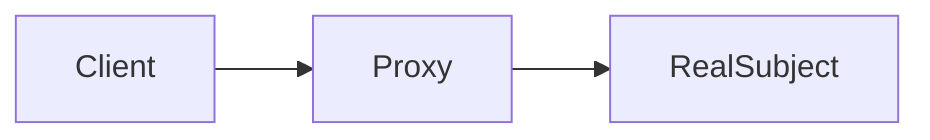

### 15. Что такое Iterator pattern

**Iterator (Итератор)** — поведенческий паттерн, предоставляющий **способ последовательного обхода элементов коллекции** без раскрытия её внутреннего представления. Выносит логику обхода в отдельный объект-итератор с методами `hasNext()` и `next()` (и опционально `remove()`). Позволяет:
- Обходить разные структуры данных единообразно.
- Иметь **несколько независимых итераторов** для одной коллекции.
- Менять внутреннюю реализацию коллекции, не затрагивая клиентский код.

В Java это интерфейсы `java.util.Iterator` и `java.lang.Iterable`; все коллекции Collection Framework поддерживают итерацию, в том числе через `for-each`.

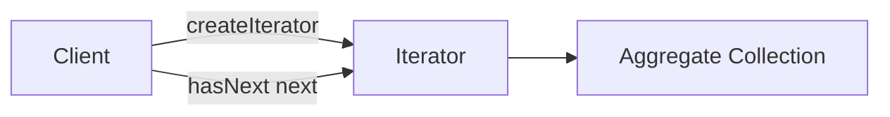

### 16. Какие антипаттерны вы знаете

**Антипаттерн** — это распространённое, но **ошибочное** решение, которое выглядит как паттерн, но приводит к проблемам. Основные:
- **God Object (Божественный объект)**: класс, который «знает и делает всё», нарушает SRP.
- **Spaghetti Code**: запутанный код без структуры, с запутанными переходами и зависимостями.
- **Copy-Paste Programming**: дублирование кода вместо переиспользования; нарушает DRY.
- **Magic Numbers / Strings**: «магические» константы без объяснения.
- **Anemic Domain Model**: классы данных без логики, вся логика вынесена в сервисы — нарушает инкапсуляцию.
- **Singleton (как антипаттерн)**: при чрезмерном использовании превращается в глобальное состояние.
- **Golden Hammer**: применение одного любимого инструмента/подхода ко всем задачам.
- **Premature Optimization**: оптимизация до профилирования, в ущерб читаемости.
- **Big Ball of Mud**: система без чёткой архитектуры, всё связано со всем.
- **Lava Flow**: мёртвый/устаревший код, который боятся удалить.
- **Cargo Cult Programming**: копирование кода/ритуалов без понимания, зачем они нужны.
- **Shotgun Surgery**: одно изменение требует правок во множестве мест (признак плохой связанности).
- **Feature Envy**: метод больше интересуется данными другого класса, чем своего.

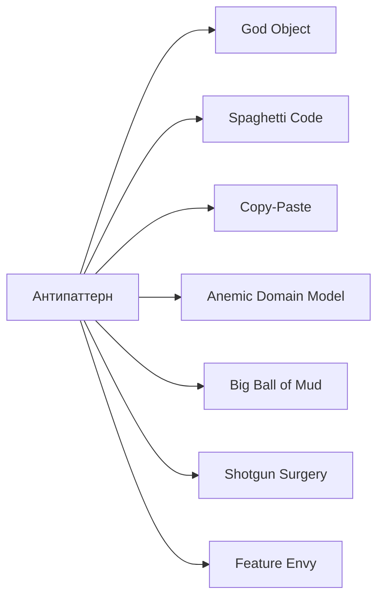


