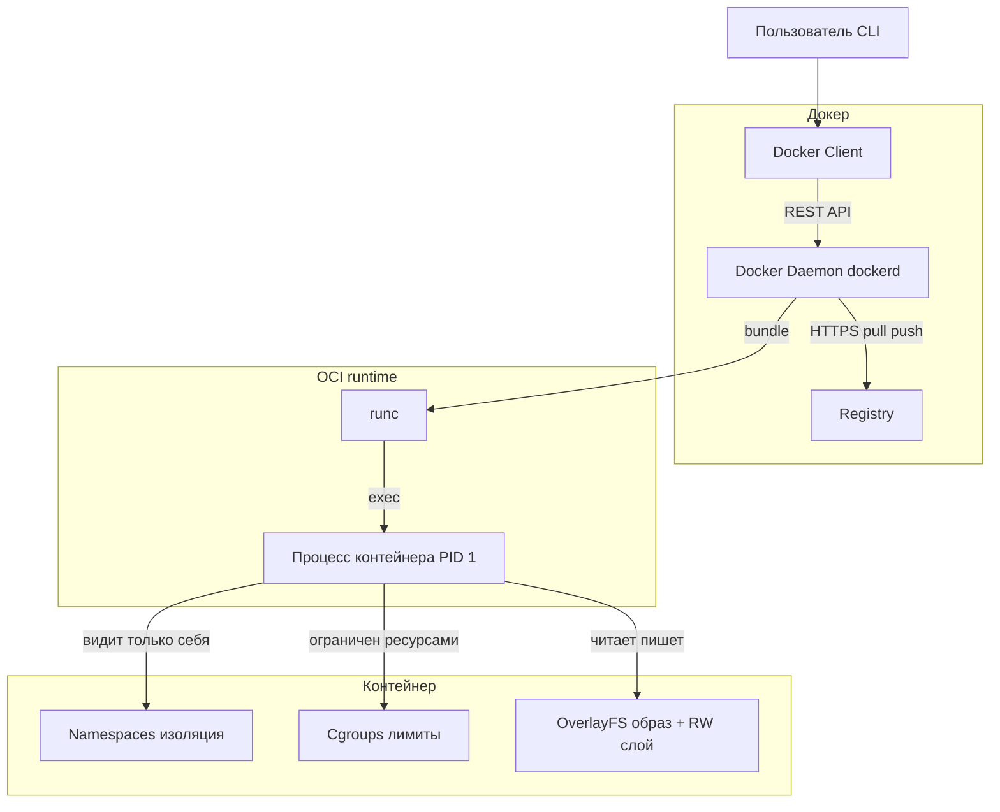
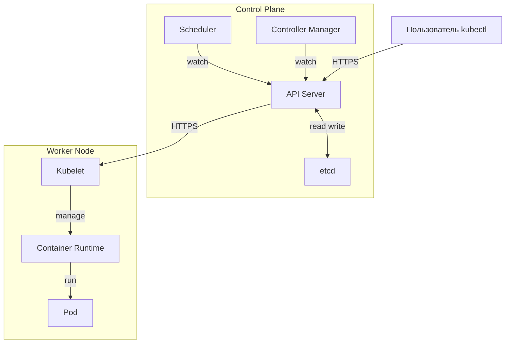
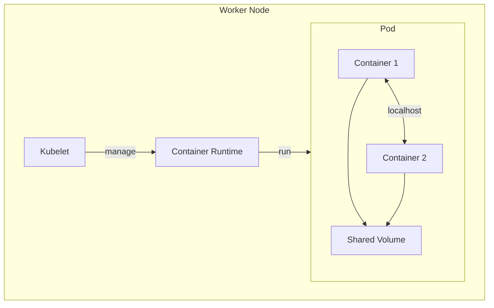

# Docker / Kubernetes

### 1. Что такое контейнеризация и зачем она нужна

Контейнеризация — это технология упаковки приложения и всех его зависимостей (библиотек, среды выполнения, конфигурации) в изолированный, переносимый контейнер. Такой контейнер содержит всё необходимое для запуска приложения и работает одинаково на любой машине, где установлен движок контейнеров (например, Docker).

Основные задачи, которые решает контейнеризация:
- **Переносимость и воспроизводимость**: решает проблему «у меня работает» — контейнер ведёт себя одинаково в среде разработки, тестирования и на продакшене.
- **Изоляция**: каждый контейнер работает как изолированный процесс, не влияя на другие приложения на том же хосте.
- **Эффективность**: контейнеры легковесны, запускаются за миллисекунды и потребляют значительно меньше ресурсов, чем виртуальные машины.
- **Упрощение CI/CD**: контейнеры становятся стандартной единицей доставки, что упрощает автоматизацию развёртывания и масштабирования.




### 2. В чём отличие контейнера от виртуальной машины

Ключевое отличие — в уровне изоляции. Виртуальная машина (VM) включает в себя **полноценную операционную систему** и работает поверх гипервизора, который эмулирует аппаратное обеспечение. Контейнер же **делит ядро хост-ОС** с другими контейнерами и изолируется на уровне процессов с помощью механизмов Linux (namespaces, cgroups).

Следствия этого различия:
- **Размер**: образы VM — гигабайты, образы контейнеров — мегабайты.
- **Скорость запуска**: VM загружаются минуты, контейнеры — миллисекунды.
- **Потребление ресурсов**: VM требуют значительных накладных расходов на гостевую ОС, контейнеры практически не имеют их.
- **Изоляция**: у VM она сильнее (на уровне железа), у контейнеров — на уровне процессов, что считается достаточным для большинства задач.


### 3. Что такое Dockerfile

Dockerfile — это текстовый файл-инструкция, содержащий набор команд для сборки образа Docker. Каждая инструкция создаёт новый слой образа, который кэшируется и может быть переиспользован при последующих сборках. Dockerfile описывает, какая базовая ОС используется, какие зависимости и файлы копируются в образ, какие команды выполняются при сборке и что запускается при старте контейнера.

```dockerfile
# Базовый образ
FROM eclipse-temurin:17-jre-alpine

# Рабочая директория
WORKDIR /app

# Копирование артефакта
COPY target/app.jar app.jar

# Переменные окружения
ENV JAVA_OPTS="-Xms512m -Xmx512m"

# Порт для приложения
EXPOSE 8080

# Команда запуска
ENTRYPOINT ["java", "-jar", "app.jar"]
CMD ["--spring.profiles.active=prod"]
```


### 4. Какие основные инструкции используются в Dockerfile

Основные инструкции Dockerfile включают:
- `FROM` — задаёт базовый образ, от которого начинается сборка.
- `WORKDIR` — устанавливает рабочую директорию для последующих инструкций.
- `COPY` / `ADD` — копируют файлы из контекста сборки в образ.
- `RUN` — выполняет команду в новом слое поверх текущего образа (например, установка пакетов).
- `ENV` — задаёт переменные окружения.
- `EXPOSE` — документирует порт, который будет слушать контейнер.
- `CMD` — задаёт команду по умолчанию для запуска контейнера.
- `ENTRYPOINT` — задаёт исполняемый файл, который всегда запускается при старте контейнера.


### 5. В чём разница между CMD и ENTRYPOINT

- **`CMD`** задаёт **команду или аргументы по умолчанию**, которые могут быть **полностью переопределены** аргументами, переданными в `docker run`. Если в Dockerfile есть и `ENTRYPOINT`, и `CMD`, то `CMD` становится набором аргументов по умолчанию для `ENTRYPOINT`.
- **`ENTRYPOINT`** задаёт **фиксированный исполняемый файл**, который запускается всегда. Аргументы, переданные в `docker run`, **добавляются** к `ENTRYPOINT`, а не заменяют его (если не указан флаг `--entrypoint`).

Практическое правило: `ENTRYPOINT` используется для самого исполняемого файла, а `CMD` — для аргументов по умолчанию, которые можно легко изменить при запуске.


### 6. Что такое multi-stage build

Multi-stage build — это функция Docker, позволяющая использовать **несколько инструкций `FROM`** в одном Dockerfile. Каждый `FROM` начинает новый этап сборки. Это позволяет использовать один образ (например, с полным SDK и инструментами сборки) для компиляции приложения, а затем скопировать только скомпилированный артефакт в **финальный, минимальный образ** (например, на основе `alpine` или `distroless`).

Преимущества: итоговый образ получается значительно меньше и безопаснее, так как не содержит инструментов сборки, исходного кода и зависимостей, ненужных для выполнения.

```dockerfile
# Stage 1: Сборка
FROM maven:3.9-eclipse-temurin-17 AS builder
WORKDIR /build
COPY pom.xml .
COPY src ./src
RUN mvn clean package -DskipTests

# Stage 2: Финальный минимальный образ
FROM eclipse-temurin:17-jre-alpine
WORKDIR /app
COPY --from=builder /build/target/app.jar app.jar
EXPOSE 8080
ENTRYPOINT ["java", "-jar", "app.jar"]
```


### 7. Что такое Docker Compose

Docker Compose — это инструмент для **определения и запуска многоконтейнерных приложений**. С помощью YAML-файла (`docker-compose.yml`) вы описываете все сервисы вашего приложения (например, веб-сервер, базу данных, кэш), их конфигурацию, сети и тома. Затем одной командой (`docker compose up`) Compose создаёт и запускает все контейнеры в правильном порядке, а также настраивает между ними сеть, включая DNS, чтобы контейнеры могли обращаться друг к другу по именам сервисов.

```yaml
# docker-compose.yml
version: '3.8'

services:
  app:
    image: myapp:latest
    ports:
      - "8080:8080"
    environment:
      - DB_HOST=postgres
      - DB_PORT=5432
    depends_on:
      - postgres
      - redis

  postgres:
    image: postgres:15
    environment:
      - POSTGRES_DB=mydb
      - POSTGRES_USER=user
      - POSTGRES_PASSWORD=pass
    volumes:
      - pgdata:/var/lib/postgresql/data

  redis:
    image: redis:7

volumes:
  pgdata:
```


### 8. Что такое Kubernetes и зачем он нужен

Kubernetes (K8s) — это открытая платформа для **оркестрации контейнеризированных приложений**. Если Docker решает задачу упаковки и запуска отдельного контейнера, то Kubernetes управляет **кластером** из множества машин (узлов) и запущенных на них контейнеров.

Kubernetes автоматизирует:
- **Развёртывание** и **масштабирование** приложений.
- **Self-healing**: перезапуск упавших контейнеров, замену неисправных узлов.
- **Service discovery** и **балансировку нагрузки**.
- **Управление конфигурацией** и **секретами**.
- **Выполнение обновлений** без простоя (rolling update).

Состав:



### 9. Что такое Pod в Kubernetes

Pod — это **наименьшая и основная единица развёртывания** в Kubernetes. Pod представляет собой группу из одного или нескольких тесно связанных контейнеров, которые:
- Работают на одном узле (Node).
- Разделяют общее сетевое пространство (имеют один IP-адрес).
- Могут разделять общие тома хранилища.

Контейнеры внутри пода всегда планируются и запускаются вместе. На практике чаще всего один под содержит один контейнер, но multi-container поды используются для вспомогательных задач (например, сайдкар-контейнер с прокси или сборщиком логов).

```yaml
# Pod манифест
apiVersion: v1
kind: Pod
metadata:
  name: my-app-pod
  labels:
    app: my-app
spec:
  containers:
    - name: app
      image: myapp:latest
      ports:
        - containerPort: 8080
      env:
        - name: LOG_LEVEL
          value: "INFO"
      resources:
        requests:
          memory: "256Mi"
          cpu: "250m"
        limits:
          memory: "512Mi"
          cpu: "500m"
```




### 10. Что такое Node в Kubernetes

Node (узел) — это **рабочая машина** (физическая или виртуальная) в кластере Kubernetes, на которой фактически запускаются поды. Каждый узел управляется control plane (мастер-компонентами) и содержит сервисы, необходимые для запуска контейнеров, такие как container runtime (например, containerd), kubelet (агент, управляющий подом на узле) и kube-proxy (сетевой прокси).


### 11. Что такое Service в Kubernetes

Service — это абстракция, которая определяет **стабильный сетевой endpoint** для доступа к группе подов. Поскольку поды эфемерны (их IP-адреса меняются при пересоздании), Service предоставляет постоянный IP-адрес и DNS-имя, а также выполняет балансировку нагрузки между всеми здоровыми подами, которые соответствуют его селектору меток. Это позволяет клиентам обращаться к приложению, не отслеживая изменения в подах.

```yaml
# Service манифест
apiVersion: v1
kind: Service
metadata:
  name: my-app-service
spec:
  type: ClusterIP
  selector:
    app: my-app  # Метки подов
  ports:
    - protocol: TCP
      port: 80
      targetPort: 8080  # Порт контейнера
```


### 12. Какие типы Service существуют (ClusterIP, NodePort, LoadBalancer)

Основные типы Service в Kubernetes:
- **`ClusterIP`** (по умолчанию): предоставляет стабильный внутренний IP-адрес, доступный **только изнутри кластера**. Используется для коммуникации между сервисами.
- **`NodePort`**: открывает доступ к сервису на **определённом порту каждого узла** кластера (диапазон 30000–32767). Это позволяет обращаться к сервису снаружи по адресу `IP-узла:NodePort`. `NodePort` является надмножеством `ClusterIP`.
- **`LoadBalancer`**: создаёт **внешний балансировщик нагрузки** в облачной инфраструктуре (если она поддерживается) и назначает сервису внешний IP-адрес. Это надмножество `NodePort`.


### 13. Что такое ReplicaSet

ReplicaSet — это контроллер Kubernetes, который гарантирует, что **заданное количество реплик (экземпляров) пода** всегда запущено в кластере. Если под падает или удаляется, ReplicaSet создаёт новый, чтобы поддерживать желаемое состояние. Обычно ReplicaSet не используется напрямую, а управляется через более высокоуровневый контроллер — **Deployment**, который добавляет возможности обновления и отката.

```yaml
# Deployment манифест
apiVersion: apps/v1
kind: Deployment
metadata:
  name: my-app-deployment
spec:
  replicas: 3  # Количество реплик
  selector:
    matchLabels:
      app: my-app
  template:
    metadata:
      labels:
        app: my-app
    spec:
      containers:
        - name: app
          image: myapp:latest
          ports:
            - containerPort: 8080
```


### 14. Как происходит масштабирование в Kubernetes

Масштабирование может быть **ручным** и **автоматическим**:
- **Ручное**: изменение количества реплик (replicas) в манифесте Deployment или ReplicaSet (например, `kubectl scale deployment my-app --replicas=5`).
- **Автоматическое (Horizontal Pod Autoscaler, HPA)**: HPA автоматически увеличивает или уменьшает количество подов на основе наблюдаемых метрик (например, загрузки CPU или памяти) или кастомных метрик.
- **Cluster Autoscaler**: автоматически добавляет или удаляет узлы (Nodes) в кластере, если поды не могут быть запланированы из-за нехватки ресурсов.


### 15. Что такое HorizontalPodAutoscaler

HorizontalPodAutoscaler (HPA) — это ресурс Kubernetes, который **автоматически масштабирует количество реплик пода** (горизонтально) в зависимости от текущей нагрузки. HPA периодически получает метрики (например, среднюю загрузку CPU) для подов, управляемых Deployment или ReplicaSet, и сравнивает их с целевыми значениями. Если нагрузка превышает порог, HPA увеличивает количество реплик (в пределах заданного максимума), если падает — уменьшает (в пределах минимума).


### 16. В чём разница между ConfigMap и Secret

- **ConfigMap** предназначен для хранения **неконфиденциальных** данных конфигурации в виде пар «ключ-значение» (например, URL-адреса, уровни логирования, параметры приложения).
- **Secret** предназначен для хранения **конфиденциальных** данных (пароли, API-токены, TLS-ключи). Данные в Secret по умолчанию кодируются в **base64**, но не шифруются. Для реальной защиты требуется включение шифрования в etcd и использование RBAC для ограничения доступа.

Оба объекта могут быть смонтированы в под как файлы или переданы как переменные окружения.

```yaml
# ConfigMap
apiVersion: v1
kind: ConfigMap
metadata:
  name: app-config
data:
  LOG_LEVEL: "INFO"
  DB_HOST: "postgres"
  DB_PORT: "5432"

# Secret
apiVersion: v1
kind: Secret
metadata:
  name: app-secret
type: Opaque
stringData:
  DB_USER: "admin"
  DB_PASSWORD: "secret123"
  API_KEY: "abc123xyz"
```


### 17. Что такое liveness probe

Liveness probe (проверка жизнеспособности) — это механизм, с помощью которого Kubernetes определяет, **жив ли контейнер**. Если liveness probe завершается неудачей (например, приложение зависло или попало в deadlock), Kubernetes **перезапускает контейнер** в соответствии с политикой перезапуска пода. Это помогает автоматически восстанавливать приложение из неисправимых состояний.


### 18. Что такое readiness probe

Readiness probe (проверка готовности) — это механизм, который определяет, **готов ли контейнер принимать трафик**. Если readiness probe не проходит, под **исключается из endpoints сервиса**, и трафик на него не направляется. Это отличается от liveness probe: под не перезапускается, а просто временно перестаёт получать запросы, пока снова не станет готовым (например, во время прогрева, загрузки данных или временной перегрузки).


### 19. Зачем нужны health checks

Health checks (проверки здоровья) — это общее название для liveness, readiness и startup-проб. Они позволяют Kubernetes **автоматически обнаруживать и реагировать** на проблемы с приложением без вмешательства человека. Это ключевой элемент self-healing:
- Liveness гарантирует, что «зависшие» приложения перезапускаются.
- Readiness гарантирует, что трафик получают только полностью функциональные экземпляры.
- Startup (вспомогательная проба) даёт медленно стартующим приложениям время на инициализацию, не позволяя liveness-пробе убить их раньше времени.


| Probe         | Что проверяет                 | Что делает при провале                                                                |
|:--------------|:------------------------------|:--------------------------------------------------------------------------------------|
| **Startup**   | Приложение запустилось?       | Ничего не делает, ждёт дальше. Liveness/readiness не стартуют, пока эта не пройдёт.   |
| **Liveness**  | Приложение живо? (не зависло) | Перезапускает контейнер (kill + restart).                                             |
| **Readiness** | Готов принимать трафик?       | Убирает под из Service endpoints — трафик на него не идёт, но под НЕ перезапускается. |


### 20. Что такое Ingress в Kubernetes

Ingress — это API-объект, который предоставляет **HTTP и HTTPS маршрутизацию** к сервисам внутри кластера. В отличие от Service типа `LoadBalancer` или `NodePort`, которые работают на L4 (TCP/UDP), Ingress работает на L7 (уровень приложения) и позволяет:
- Маршрутизировать запросы на основе **пути** (path-based routing).
- Маршрутизировать на основе **хоста** (host-based routing).
- Выполнять **терминацию TLS**.

Для работы Ingress требуется **Ingress Controller** — реализация (например, NGINX Ingress Controller, Traefik), которая фактически обрабатывает трафик.


### 21. Что такое namespace

Namespace — это механизм **логического разделения ресурсов** внутри одного кластера Kubernetes. Он позволяет организовать ресурсы по средам (dev, staging, prod), командам или проектам. Имена ресурсов должны быть уникальными в пределах одного namespace, но могут повторяться в разных namespace. Также namespace используется для применения квот ресурсов (ResourceQuota) и политик доступа (RBAC) на уровне группы ресурсов.


### 22. Как организовать rolling update в Kubernetes

Rolling update (поэтапное обновление) — это стратегия обновления по умолчанию для Deployment. Она заключается в **постепенной замене старых подов новыми**:
1.  Создаётся новый ReplicaSet с обновлённым шаблоном пода.
2.  Количество реплик в новом ReplicaSet постепенно увеличивается, а в старом — уменьшается, с соблюдением параметров `maxSurge` (сколько дополнительных подов можно создать) и `maxUnavailable` (сколько подов может быть недоступно в процессе).
3.  Обновление продолжается до тех пор, пока все поды не будут заменены, при этом сервис остаётся доступным благодаря тому, что в каждый момент времени есть работающие поды.

Deployment также поддерживает откат (`rollback`) к предыдущей версии в случае проблем.


### 23. Что такое StatefulSet и когда его использовать

StatefulSet — это контроллер для управления **stateful (с состоянием)** приложениями. В отличие от Deployment, который не гарантирует стабильности идентичности подов, StatefulSet обеспечивает:
- **Стабильные сетевые идентификаторы**: каждый под получает предсказуемое DNS-имя на основе порядкового номера (например, `app-0`, `app-1`).
- **Стабильное хранилище**: каждый под может быть связан со своим PersistentVolume, который сохраняется при пересоздании пода.
- **Упорядоченное развёртывание и масштабирование**: поды создаются, обновляются и удаляются **строго по порядку** (от `0` до `N-1` и наоборот).

StatefulSet используется для баз данных (PostgreSQL, MongoDB, Elasticsearch), кластерных приложений (Kafka, ZooKeeper) и любых систем, где важна стабильная идентичность узла и его диска.


### 24. Как мониторить приложения в Kubernetes

Мониторинг в Kubernetes обычно строится на **стеке Prometheus + Grafana**:
- **Prometheus** — де-факто стандарт для сбора метрик в Kubernetes. Он собирает метрики с подов и узлов через pull-модель, используя service discovery Kubernetes.
- **Grafana** — используется для визуализации метрик из Prometheus через настраиваемые дашборды.

Дополнительные уровни мониторинга:
- **Логи**: собираются с помощью стеков ELK (Elasticsearch, Logstash, Kibana) или Loki.
- **Трассировки**: распределённая трассировка с помощью Jaeger, Tempo или Zipkin.
- **Метрики состояния кластера и рабочих нагрузок**: kube-state-metrics предоставляет метрики о состоянии объектов Kubernetes (Deployment, Pod, StatefulSet и т.д.).
- **Алертинг**: Alertmanager (в составе Prometheus) или Grafana Alerting для уведомления о проблемах.

Также полезно использовать `kubectl top` для быстрого просмотра потребления ресурсов подами и узлами.


