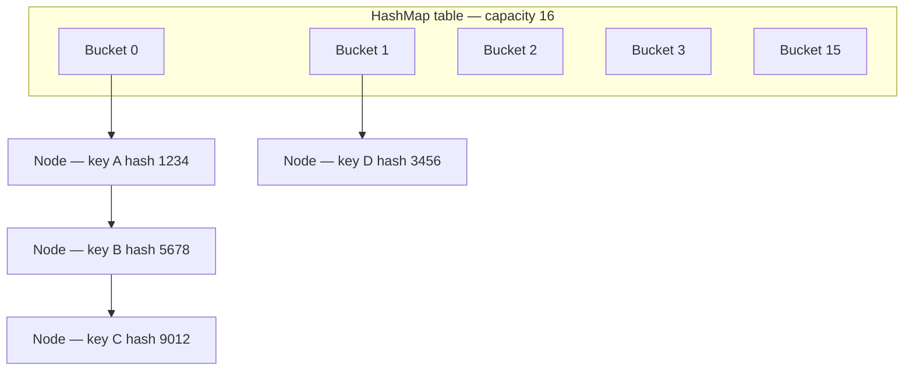

# HashMap / equals / hashCode

### 1. Как устроена HashMap внутри

`HashMap` внутри представляет собой **массив bucket'ов** (корзин), где каждый элемент массива — это ссылка на связный список (или красно-чёрное дерево) узлов `Node<K,V>`. Каждый узел хранит хеш, ключ, значение и ссылку на следующий узел. При `put()` вычисляется хеш ключа, по нему определяется индекс в массиве, и элемент добавляется в соответствующую корзину. При достижении порога заполнения (`capacity × loadFactor`) происходит **resize (rehashing)** — создается новый массив вдвое большего размера, и все элементы перераспределяются.




### 2. Что такое bucket (корзина) в HashMap

Bucket — это ячейка внутреннего массива `HashMap` (таблица `Node<K,V>[] table`). Каждый bucket хранит ссылку на первый узел связного списка (или дерева) элементов, чьи ключи дают одинаковый индекс при вычислении `(n - 1) & hash`. Количество bucket'ов равно `capacity` таблицы.


### 3. Как HashMap определяет, в какой bucket положить элемент

Индекс bucket'а вычисляется по формуле:
```
index = (n - 1) & hash(key)
```
где `n` — текущая `capacity` (всегда степень двойки), а `hash(key)` — «перемешанный» хеш ключа. Внутри `HashMap` хеш дополнительно обрабатывается (`h ^ (h >>> 16)`), чтобы старшие биты участвовали в вычислении индекса и уменьшалась вероятность коллизий. Использование побитового `&` вместо `%` возможно именно потому, что `n` — степень двойки: это быстрее.


### 4. Что такое коллизия в HashMap

Коллизия — это ситуация, когда **два разных ключа** дают одинаковый индекс bucket'а (одинаковый результат `(n - 1) & hash`). Это может произойти как из-за совпадения хеш-кодов, так и из-за совпадения только младших битов после вычисления индекса. Коллизии неизбежны, так как количество возможных ключей потенциально бесконечно, а количество bucket'ов конечно.


### 5. Как HashMap обрабатывает коллизии

HashMap использует метод **цепочки (chaining)**: все элементы, попавшие в один bucket, хранятся в связном списке. При `put()` новый элемент добавляется в конец (в Java 8+) или начало списка. При `get()` HashMap проходит по списку и сравнивает ключи через `equals()` (сначала сравнивая хеши, затем ключи). Начиная с **Java 8**, если количество элементов в одном bucket'е превышает порог `TREEIFY_THRESHOLD` (8), связный список **преобразуется в красно-чёрное дерево**, что снижает сложность поиска с O(n) до O(log n).


### 6. Что происходит при достижении 8 элементов в одном bucket

Когда количество элементов в одном bucket'е достигает **8** (`TREEIFY_THRESHOLD`), и при этом `capacity` таблицы не меньше `MIN_TREEIFY_CAPACITY` (64), связный список в этом bucket'е **преобразуется в красно-чёрное дерево**. Это ускоряет поиск в «горячей» корзине с O(n) до O(log n). Если `capacity` меньше 64, вместо treeify выполняется **resize** таблицы, так как увеличение количества bucket'ов, скорее всего, само по себе разредит коллизии.


### 7. Что такое контракт equals() и hashCode()

Контракт `equals()` и `hashCode()` — это набор правил, которым должны удовлетворять реализации этих методов:
- **Рефлексивность**: `x.equals(x)` всегда `true`.
- **Симметричность**: `x.equals(y)` ⇔ `y.equals(x)`.
- **Транзитивность**: если `x.equals(y)` и `y.equals(z)`, то `x.equals(z)`.
- **Согласованность**: повторные вызовы `equals()` возвращают тот же результат, пока объект не изменен.
- **`x.equals(null)` всегда `false`**.
- **Для `hashCode()`**: если `x.equals(y)`, то `x.hashCode() == y.hashCode()`. Обратное не требуется: одинаковый хеш-код не гарантирует равенства.


### 8. Если два объекта равны по equals(), что можно сказать об их hashCode()

Они **обязательно** должны иметь **одинаковый** `hashCode()`. Это прямое требование контракта. Нарушение этого правила (равные объекты с разными хеш-кодами) ломает работу `HashMap`, `HashSet` и других хеш-коллекций: они не смогут найти объект в правильной корзине.


### 9. Если два объекта имеют одинаковый hashCode(), обязательно ли они равны по equals()

**Нет, не обязательно**. Одинаковый `hashCode()` — это лишь признак потенциального равенства (коллизия хешей). `HashMap` при поиске сначала находит bucket по хешу, а затем внутри bucket'а сравнивает ключи через `equals()`. Поэтому разные объекты с одинаковым хешем — это нормальная ситуация (коллизия), которая корректно обрабатывается цепочкой.


### 10. Что произойдёт, если переопределить equals() но не переопределить hashCode()

Это **нарушает контракт**. Два объекта, которые по вашему `equals()` равны, но имеют разные `hashCode()` (унаследованный от `Object`, основанный на идентичности), попадут в **разные bucket'ы** и никогда не будут найдены как «равные» в `HashMap`/`HashSet`. В результате `get(key)` вернет `null`, а `Set` может содержать «дубликаты», которые с точки зрения `equals()` равны. Это классическая ошибка.

```java
// ❌ Нарушение контракта: equals() переопределён, hashCode() — нет
class User {
    private final String email;

    @Override
    public boolean equals(Object o) {
        if (this == o) return true;
        if (!(o instanceof User)) return false;
        return email.equals(((User) o).email);
    }
    // hashCode() унаследован от Object — основан на identity!

    public User(String email) {
        this.email = email;
    }
}

// Результат:
Map<User, String> map = new HashMap<>();
map.put(new User("a@b.com"), "Alice");

// get() не найдёт объект — разные hash-коды → разные bucket'ы
System.out.println(map.get(new User("a@b.com"))); // null!

// ✅ Исправление: переопределить и equals(), и hashCode()
class FixedUser {
    private final String email;

    @Override
    public boolean equals(Object o) {
        if (this == o) return true;
        if (!(o instanceof FixedUser)) return false;
        return email.equals(((FixedUser) o).email);
    }

    @Override
    public int hashCode() {
        return email.hashCode(); // Согласовано с equals()
    }
}
```


### 11. Что произойдёт, если переопределить hashCode() но не переопределить equals()

`equals()` унаследован от `Object` и сравнивает ссылки (идентичность). Даже если два объекта имеют одинаковый `hashCode()` (и попадут в один bucket), `equals()` вернет `false`, так как это разные объекты. В результате `HashMap` будет хранить их как разные ключи, а `HashSet` — как разные элементы. Контракт формально не нарушен (одинаковый хеш при разных equals — допустимо), но такое поведение редко бывает полезным: вы просто заставляете все объекты с одинаковым хешем выстраиваться в цепочку и всегда сравниваться через `equals()`, что неэффективно, а семантически объекты остаются «разными».


### 12. Можно ли использовать изменяемый объект как ключ в HashMap

Технически можно, но **крайне не рекомендуется**. Если после добавления ключа в `HashMap` изменить его состояние таким образом, что изменится `hashCode()` или результат `equals()`, то запись станет недоступной: `HashMap` не сможет найти её, так как новый хеш укажет на другой bucket. Правило: **ключи в `HashMap` должны быть иммутабельными** или, как минимум, их хеш и равенство не должны меняться, пока они находятся в коллекции.


### 13. Что случится, если изменить ключ после добавления в HashMap

Запись станет **«потерянной»** для `HashMap`. При добавлении хеш ключа определил bucket, в котором хранится запись. После изменения ключа его `hashCode()` может измениться, и при последующем `get()` HashMap будет искать уже в **другом** bucket'е, не найдёт запись и вернёт `null`. При этом сама запись физически остаётся в коллекции, продолжает занимать память и участвовать в resize, но получить к ней доступ обычными способами невозможно.


### 14. Какие требования к ключу HashMap

- **Иммутабельность (или стабильность хеша)**: состояние ключа не должно меняться, пока он находится в `HashMap`.
- **Корректный контракт `equals()`/`hashCode()`**: согласованность, рефлексивность, симметричность, транзитивность.
- **Эффективные `equals()` и `hashCode()`**: они будут вызываться часто.
- Ключ может быть `null` (хранится в отдельной нулевой корзине).
- Ключ не обязан реализовывать `Comparable` (нужно только для treeify — при преобразовании в дерево используется `compareTo()` для упорядочивания, а при его отсутствии — `System.identityHashCode()` и другие механизмы).


### 15. Почему String часто используется как ключ в HashMap

`String` — идеальный ключ, потому что:
- **Иммутабелен**: его хеш-код не может измениться после добавления в `HashMap`.
- **Хеш-код кешируется**: вычисляется один раз при первом вызове `hashCode()` и хранится в поле `hash`. Повторные вызовы бесплатны.
- **Корректные `equals()` и `hashCode()`**: реализованы по контракту (посимвольное сравнение и вычисление хеша по содержимому).
- **Удобен и читаем** в бизнес-коде (имена, ID, ключи конфигураций).

```java
// String как ключ в HashMap
Map<String, Integer> wordCount = new HashMap<>();
String[] words = {"apple", "banana", "apple", "cherry", "banana", "apple"};

for (String word : words) {
    wordCount.put(word, wordCount.getOrDefault(word, 0) + 1);
}

// Результат: {apple=3, banana=2, cherry=1}
// String иммутабелен → хеш-код стабилен → ключи всегда находятся
```


### 16. Что такое load factor в HashMap

`loadFactor` (коэффициент загрузки) — это число от 0 до 1 (по умолчанию **0.75**), которое определяет, насколько заполненной может быть таблица до того, как произойдет **resize**. Порог (`threshold`) вычисляется как `capacity × loadFactor`. Когда количество элементов превышает этот порог, HashMap увеличивает capacity и выполняет rehashing. Меньший load factor → меньше коллизий, но больше памяти; больший → экономия памяти, но больше коллизий.


### 17. Что такое capacity в HashMap

`capacity` — это количество bucket'ов во внутреннем массиве таблицы. Она **всегда является степенью двойки** (по умолчанию 16). При создании можно указать начальную capacity, но HashMap округлит её вверх до ближайшей степени двойки. При resize capacity удваивается.


### 18. Когда происходит rehashing в HashMap

Rehashing (resize) происходит, когда количество элементов в HashMap **превышает порог** `threshold = capacity × loadFactor`. Например, при capacity 16 и loadFactor 0.75 порог равен 12; при добавлении 13-го элемента произойдет resize. Также resize может инициироваться при treeify, если `capacity < MIN_TREEIFY_CAPACITY` (64).


### 19. Что происходит при rehashing

При resize HashMap:
1.  Создает **новый массив bucket'ов** удвоенной capacity (`newCap = oldCap << 1`).
2.  Пересчитывает новый порог (`threshold = newCap × loadFactor`).
3.  **Переносит все существующие узлы** в новый массив. В Java 8+ это оптимизировано: для каждого узла проверяется, изменился ли его индекс. Если `(e.hash & oldCap) == 0`, элемент остается на том же индексе; иначе переходит на индекс `oldIndex + oldCap`. Это позволяет избежать полного пересчета хеша и переиспользовать старые цепочки.
4.  Старый массив отбрасывается.


### 20. Какова временная сложность операций get() и put() в HashMap

В **среднем случае** — **O(1)**. Благодаря равномерному распределению хешей и load factor 0.75 большинство bucket'ов содержат 0 или 1 элемент, и поиск/вставка выполняются за константное время. В **худшем случае** — **O(log n)** в Java 8+ (если bucket превратился в дерево) или **O(n)** (если bucket — связный список, что возможно при неудачных хешах или в старых версиях).


### 21. Когда временная сложность может стать O(n)

- **Плохая хеш-функция**: если все ключи дают одинаковый хеш, все элементы попадут в один bucket. В Java 7 и ранее bucket — это связный список, и поиск станет **O(n)**. В Java 8+ такой bucket превращается в дерево, давая **O(log n)**, но только если ключи упорядочиваемы или есть `Comparable`; иначе treeify может деградировать.
- **Атака хеш-коллизиями**: злоумышленник может подобрать ключи с одинаковым хешем (например, для `String` до Java 8u20, где был баг с хеш-коллизиями), вызвав деградацию до O(n).
- **Множественные resize**: если capacity мала, а элементов много, цепочки становятся длиннее.


### 22. Как работает HashMap в многопоточной среде

`HashMap` **не является потокобезопасным**. При конкурентном доступе без синхронизации возможны:
- **Потеря данных**: два потока одновременно делают `put()` в один bucket, и один перезаписывает другой.
- **Бесконечный цикл** (в Java 7 и ранее): при одновременном `resize()` из нескольких потоков связные списки могли зацикливаться, приводя к зависанию CPU.
- **Некорректное состояние**: `size`, `modCount` и другие поля могут быть рассогласованы, что приведет к `ConcurrentModificationException` или неверным результатам.

Для многопоточного использования нужен `ConcurrentHashMap` (или `Collections.synchronizedMap()` для грубой синхронизации).


### 23. Что такое ConcurrentHashMap и чем он отличается от HashMap

`ConcurrentHashMap` — потокобезопасная реализация `Map`:
- **Сегментированная блокировка**: в Java 7 использовались сегменты (по умолчанию 16), каждый со своей блокировкой; в Java 8+ используются **CAS-операции** и **synchronized на уровне bucket'а** (bin lock), что дает гораздо большую степень параллелизма.
- **Не блокирует всю таблицу** при операциях записи (кроме resize), позволяя множеству потоков работать одновременно.
- **Не допускает `null` ключей и значений** (чтобы избежать неоднозначности при `get()`).
- **Слабо согласованные итераторы**: не бросают `ConcurrentModificationException`, но могут не отражать изменения, произошедшие после создания итератора.
- **Атомарные операции**: `putIfAbsent`, `computeIfAbsent`, `merge` и др.


### 24. Можно ли хранить null ключ в HashMap

**Да**, `HashMap` допускает **один** `null` ключ. Он хранится в специальной нулевой корзине (bucket с индексом 0). При вычислении хеша для `null` используется `hash = 0`.


### 25. Можно ли хранить null значение в HashMap

**Да**, `HashMap` допускает любое количество `null` значений. Это одна из причин, почему `get()` может вернуть `null` — нужно проверять `containsKey()`, чтобы отличить «значение отсутствует» от «значение равно null».

```java
Map<String, String> map = new HashMap<>();
map.put("key1", "value1");
map.put("key2", null); // Допускается

// get() возвращает null в двух случаях:
System.out.println(map.get("key2"));   // null (значение = null)
System.out.println(map.get("key3"));   // null (ключ отсутствует)

// Как отличить:
System.out.println(map.containsKey("key2")); // true (ключ есть, значение = null)
System.out.println(map.containsKey("key3")); // false (ключа нет)
```


### 26. В чём разница между HashMap и Hashtable

| Аспект | HashMap | Hashtable |
|---|---|---|
| Потокобезопасность | Нет | Да (все методы synchronized) |
| Производительность | Выше | Ниже из-за синхронизации |
| `null` ключи/значения | Разрешены | **Запрещены** (бросает `NullPointerException`) |
| Итераторы | Fail-fast (`ConcurrentModificationException`) | Fail-fast |
| Наследование | `AbstractMap` | `Dictionary` (устаревший) |
| Появился | Java 1.2 | Java 1.0 |

`Hashtable` считается устаревшим; для потокобезопасности лучше использовать `ConcurrentHashMap`.


### 27. Что такое WeakHashMap

`WeakHashMap` — реализация `Map`, где **ключи хранятся через слабые ссылки (`WeakReference`)**. Если на ключ больше нет сильных ссылок извне, сборщик мусора может его удалить, и соответствующая запись автоматически исчезнет из map. Это полезно для кэшей, где нужно автоматически освобождать память, когда ключ больше не используется. Значения хранятся через обычные (сильные) ссылки, поэтому важно, чтобы значение не ссылалось на ключ (иначе цикл слабая-сильная ссылка не даст ключу быть собранным).

```java
// WeakHashMap как кэш
Map<Key, Value> cache = new WeakHashMap<>();

Key key = new Key("data");
cache.put(key, new Value("cached"));

System.out.println(cache.get(key)); // cached

// Убираем сильную ссылку на ключ
key = null;

// После GC запись исчезнет автоматически
System.gc();
System.out.println(cache.isEmpty()); // true (после сборки мусора)
```


### 28. Как правильно выбрать начальный capacity для HashMap

Если вы заранее знаете примерное количество элементов `n`, задайте начальную capacity так, чтобы избежать resize:
```
initialCapacity = (int) Math.ceil(n / loadFactor)
```
Например, для 100 элементов при loadFactor 0.75: `100 / 0.75 ≈ 133`, ближайшая степень двойки — **256**. Однако в Java 8+ конструктор `HashMap(int initialCapacity)` сам округляет до степени двойки и корректирует порог, поэтому можно передавать `(int)(n / 0.75f) + 1`. Это уменьшает количество resize и повышает производительность.


### 29. Что лучше: ArrayList или HashMap для хранения пар ключ-значение

Зависит от задачи:
- **`HashMap`** лучше, если нужен **быстрый поиск по ключу** (O(1) в среднем), уникальные ключи, частые операции `get()`/`put()` по ключу. Это стандартный выбор для ассоциативных структур.
- **`ArrayList`** (например, `List<Map.Entry<K,V>>` или `List<Pair<K,V>>`) лучше, если:
  - Порядок элементов важен и должен сохраняться (HashMap не гарантирует порядок; для порядка нужен `LinkedHashMap`).
  - Элементов мало (например, < 10) — линейный поиск по списку может быть быстрее из-за отсутствия хеширования и меньших накладных расходов.
  - Допускаются дубликаты ключей (HashMap — нет).
  - Нужен доступ по индексу.

В большинстве случаев для пар «ключ-значение» с уникальными ключами и потребностью в поиске выбирают `HashMap` (или `LinkedHashMap`, если важен порядок вставки).


