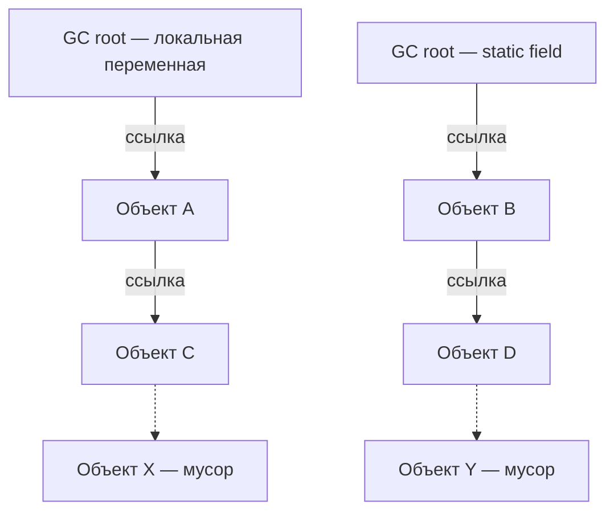
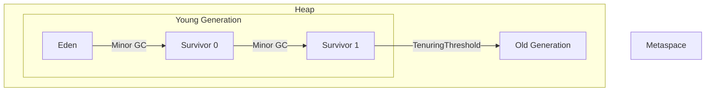
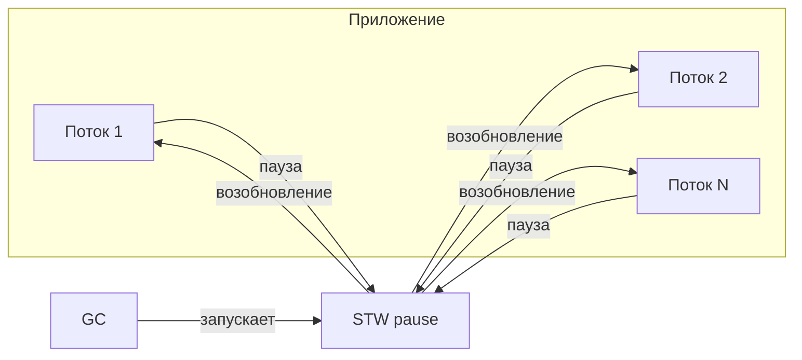

# Память и Garbage Collection

### 1. В чём разница между Heap и Stack

**Stack** и **Heap** — это две ключевые области памяти в JVM, которые используются для разных целей и управляются по-разному.

- **Stack (стек)**: используется для хранения **локальных переменных** и **фреймов методов**. Когда вызывается метод, в стеке создаётся фрейм для этого метода, содержащий его локальные переменные и служебную информацию. Когда метод завершается, его фрейм уничтожается. Память стека организована как LIFO (Last-In-First-Out) и управляется автоматически при входе в метод и выходе из него. У каждого потока есть свой собственный стек.
- **Heap (куча)**: используется для хранения **всех объектов** (создаваемых через `new`) и **массивов**. Это общая область памяти для всех потоков. Объекты в куче живут до тех пор, пока на них есть достижимые ссылки (из стека, статических полей и т.д.). Когда объект становится недостижимым, он может быть удалён сборщиком мусора (Garbage Collector). Память в куче не освобождается автоматически при выходе из метода — для этого нужен GC.

**Ключевое отличие**: стек — это быстрая, автоматически управляемая память для локальных переменных с временем жизни, ограниченным вызовом метода. Куча — это более медленная, но более гибкая память для объектов с временем жизни, определяемым достижимостью ссылок.


### 2. Что хранится в Heap

В куче (Heap) хранятся **все экземпляры классов (объекты)** и **массивы**. Это включает в себя объекты, созданные с помощью ключевого слова `new`, а также массивы любого типа. Куча является общей для всех потоков JVM, и память в ней управляется сборщиком мусора. Любой объект, на который есть хотя бы одна достижимая ссылка (из стека, статического поля, JNI и т.д.), считается живым и хранится в куче.


### 3. Что хранится в Stack

В стеке (Stack) хранятся **фреймы методов** и **локальные переменные**. Каждый поток имеет свой собственный стек. При вызове метода в стек помещается новый фрейм, содержащий:
- Локальные переменные (примитивы и ссылки на объекты в куче).
- Параметры метода.
- Служебную информацию (например, адрес возврата).

Когда метод завершается, его фрейм автоматически удаляется из стека. Время жизни данных в стеке ограничено временем выполнения метода.


### 4. Что такое Garbage Collection

**Garbage Collection (GC, сборка мусора)** — это автоматический процесс управления памятью в Java, который освобождает память в куче, занятую объектами, которые больше **недостижимы** из корневых ссылок (GC roots) программы. JVM периодически запускает GC, чтобы найти такие «мёртвые» объекты и вернуть занимаемую ими память для будущих аллокаций. Это избавляет разработчика от необходимости вручную управлять памятью (как в C/C++) и предотвращает утечки, связанные с забытыми `free`/`delete`.


### 5. Когда объект становится кандидатом на удаление GC

Объект становится кандидатом на удаление сборщиком мусора, когда он **больше не достижим** ни по одной цепочке ссылок от **GC roots**. Другими словами, если ни один поток, ни одно статическое поле, ни один JNI-хэндл и т.д. не ссылаются на объект (прямо или косвенно), объект считается «мусором» и может быть собран. Важно, что GC не удаляет объект сразу — он помечает его как недостижимый, и память освобождается при следующем цикле сборки.



Объекты A, B, C, D — достижимы и живы. X и Y — недостижимы, кандидаты на сборку.


### 6. Что такое утечка памяти в Java

**Утечка памяти (memory leak)** в Java — это ситуация, когда объект, который **больше не нужен** приложению, остаётся **достижимым** из GC roots и поэтому не может быть удалён сборщиком мусора. В отличие от C/C++, где утечка — это забытый `free`, в Java утечка происходит из-за **сохранения ненужных ссылок** на объекты. Со временем такие объекты накапливаются, потребление памяти растёт, что приводит к деградации производительности и, в конечном итоге, к `OutOfMemoryError`.


### 7. Как может возникнуть утечка памяти в Java

Утечка памяти в Java может возникнуть по нескольким причинам:
- **Статические поля**: ссылки на объекты в статических полях живут всё время жизни приложения (или класса).
- **Долгоживущие коллекции**: например, `static Map` или `List`, в которые добавляются объекты и которые никогда не очищаются.
- **Незакрытые ресурсы**: открытые потоки, соединения с БД, сокеты, которые не закрываются и удерживают ссылки.
- **Внутренние классы (non-static inner classes)**: они неявно содержат ссылку на внешний объект, что может удерживать его в памяти.
- **`ThreadLocal` без очистки**: в пулах потоков `ThreadLocal` может удерживать объекты после завершения запроса, если не вызывать `remove()`.
- **Слушатели и колбэки**: зарегистрированные слушатели, которые не удаляются, когда становятся ненужными.
- **Переопределение `equals()`/`hashCode()` без переопределения `finalize()`** (для кэшей на основе `WeakHashMap`).

```java
// ❌ Утечка: static-коллекция, в которую добавляют объекты и никогда не удаляют
public class UserCache {
    private static final Map<String, User> cache = new HashMap<>();
    public static void put(String key, User user) { cache.put(key, user); }
    // нет метода remove, нет ограничения размера
}

// ❌ Утечка: ThreadLocal в пуле потоков, remove() не вызывается
public class RequestContext {
    private static final ThreadLocal<User> current = new ThreadLocal<>();
    public static void set(User u) { current.set(u); }
    public static User get() { return current.get(); }
    // забыли: current.remove() после обработки запроса
}

// ❌ Утечка: слушатель, который не удаляется
public class EventService {
    private final List<Listener> listeners = new ArrayList<>();
    public void register(Listener l) { listeners.add(l); }
    // нет unregister — слушатели накапливаются
}

// ✅ Исправление: WeakHashMap для кэша
private static final Map<String, User> cache = new WeakHashMap<>();
// ✅ ThreadLocal: вызывать remove() в finally
try {
    current.set(user);
    // обработка
} finally {
    current.remove();
}
// ✅ Слушатели: удалять после использования
listeners.remove(l);
```

### 8. Что такое поколения в GC (young, old, metaspace)

**Поколения** — это способ организации памяти в куче, основанный на гипотезе о том, что большинство объектов умирают молодыми (infant mortality). Куча делится на два основных поколения:
- **Young Generation (молодое поколение)**: где создаются все новые объекты. Оно делится на **Eden** и два **Survivor** пространства (S0, S1). Объекты, пережившие несколько сборок в young generation, **продвигаются (promoted)** в old generation.
- **Old Generation (Tenured, старое поколение)**: где хранятся долгоживущие объекты, пережившие несколько циклов young GC.

**Metaspace** — это область памяти (вне кучи, в native memory с Java 8), где хранятся **метаданные классов** (определения классов, методы, константы). До Java 8 эту роль выполнял **PermGen** (Permanent Generation), который был частью кучи.




### 9. Что такое Young Generation

**Young Generation** — это часть кучи, где **выделяются все новые объекты**. Она оптимизирована для быстрой аллокации и частой сборки мусора. Состоит из:
- **Eden**: основное пространство для новых объектов.
- **Survivor spaces (S0 и S1)**: два пространства, куда копируются объекты, пережившие одну сборку.

Сборка мусора в young generation называется **Minor GC**. Она работает по **copying-алгоритму**: живые объекты из Eden и одного Survivor-пространства копируются в другое Survivor-пространство. Объекты, пережившие несколько Minor GC (порог `TenuringThreshold`), продвигаются в Old Generation. Minor GC обычно быстрый и вызывает короткие паузы.


### 10. Что такое Old Generation (Tenured)

**Old Generation (Tenured, старое поколение)** — это часть кучи, где хранятся **долгоживущие объекты**, которые пережили несколько циклов сборки в young generation (достигли порога `TenuringThreshold`, по умолчанию 15). Сборка мусора в old generation называется **Major GC** (или Full GC). Она обычно происходит реже, но занимает больше времени и может вызывать длительные паузы `stop-the-world`.


### 11. Что такое Metaspace (или PermGen)

**Metaspace** — это область памяти в JVM (начиная с Java 8), предназначенная для хранения **метаданных классов**, загруженных загрузчиками классов (определения классов, методы, константы, аннотации и т.д.). В отличие от **PermGen** (Permanent Generation), который был частью кучи до Java 8 и имел фиксированный размер, Metaspace располагается в **native memory** (вне кучи) и по умолчанию может расти динамически, ограничиваясь лишь доступной памятью системы (или параметром `-XX:MaxMetaspaceSize`). Замена PermGen на Metaspace решила многие проблемы с `OutOfMemoryError: PermGen space`.


### 12. Какие алгоритмы GC существуют

В JVM существует несколько сборщиков мусора (Garbage Collectors), каждый со своими алгоритмами и стратегиями. Основные из них:
- **Serial GC**: простой, однопоточный, с полным `stop-the-world`. Подходит для небольших приложений и сред с одним CPU.
- **Parallel GC**: многопоточная версия Serial GC, также с полным `stop-the-world`, но использует несколько потоков для сборки. Был GC по умолчанию в Java 8. Ориентирован на пропускную способность.
- **CMS (Concurrent Mark Sweep)**: преимущественно конкурентный сборщик, минимизирующий паузы, но не выполняющий компактизацию. Удалён в Java 14.
- **G1 (Garbage-First)**: поколенческий, инкрементальный, параллельный, преимущественно конкурентный сборщик с ограниченными паузами. GC по умолчанию с Java 9. Хорошо подходит для серверных приложений с кучей 4–64 ГБ.
- **ZGC**: масштабируемый сборщик с низкими задержками (паузы <1 мс), способный работать с очень большими кучами (терабайты). Доступен в production с Java 15.
- **Shenandoah**: сборщик с низкими паузами (цель <10 мс), выполняющий конкурентную компактизацию. Доступен в OpenJDK.


### 13. Что такое G1 GC

**G1 (Garbage-First) GC** — это сборщик мусора, представленный в Java 7 и ставший стандартным в Java 9. Он предназначен для **серверных приложений** с большими объёмами памяти (4–64 ГБ) и требованием к предсказуемым паузам. G1 делит кучу на множество **регионов** (regions) одинакового размера и собирает в первую очередь те регионы, которые содержат больше всего мусора (отсюда «Garbage-First»). Он является **поколенческим**, **параллельным** и **преимущественно конкурентным** сборщиком с **ограниченными паузами** (`-XX:MaxGCPauseMillis`). Критические фазы (например, initial mark, remark) выполняются с короткими паузами `stop-the-world`.


### 14. Что такое ZGC

**ZGC (Z Garbage Collector)** — это масштабируемый сборщик мусора с **низкой задержкой**, представленный в Java 11 (экспериментально) и стабильный в Java 15. Его главная особенность — **паузы `stop-the-world` менее 1 миллисекунды**, которые **не зависят от размера кучи** (даже для кучи в несколько терабайт). ZGC выполняет почти всю работу (маркировку, перемещение объектов, компактизацию) **конкурентно**, пока приложение продолжает работать. Он использует **цветные указатели (colored pointers)** и **барьеры загрузки (load barriers)** для отслеживания ссылок. ZGC идеален для приложений с экстремально низкими требованиями к задержкам и очень большими кучами.


### 15. Что такое Shenandoah GC

**Shenandoah GC** — это сборщик мусора с **низкой задержкой**, разработанный в Red Hat (OpenJDK). Его цель — обеспечить **паузы `stop-the-world` менее 10 миллисекунд**, при этом паузы также **не зависят от размера кучи**. Shenandoah выполняет **конкурентную компактизацию** (перемещение объектов) во время работы приложения, используя **forwarding pointers** и **barrier-механизмы**. Он хорошо подходит для приложений, чувствительных к задержкам, в средах OpenJDK. В отличие от ZGC, Shenandoah в некоторых версиях не является поколенческим сборщиком.


### 16. Что такое stop-the-world

**Stop-the-world (STW)** — это событие в работе JVM, когда **все потоки приложения временно приостанавливаются** для выполнения критических операций сборщика мусора, которые не могут быть выполнены конкурентно (например, начальная маркировка корневых объектов, финальная remark-фаза, перемещение объектов в некоторых сборщиках). Во время STW-паузы приложение «замирает», что напрямую влияет на **задержку (latency)** и **пользовательский опыт**. Цель современных сборщиков (G1, ZGC, Shenandoah) — **минимизировать длительность и частоту STW-пауз**.




### 17. Какие GC минимизируют stop-the-world паузы

Современные сборщики мусора, специально разработанные для минимизации STW-пауз:
- **ZGC**: паузы **менее 1 мс**, не зависят от размера кучи. Лучший выбор для экстремально низких задержек.
- **Shenandoah**: паузы **менее 10 мс**, также не зависят от размера кучи. Хорошая альтернатива для OpenJDK-сред.
- **G1 GC**: обеспечивает **ограниченные паузы** (настраиваются через `-XX:MaxGCPauseMillis`, по умолчанию ~200 мс), но всё же имеет STW-фазы для некоторых операций.

Для сравнения, Serial и Parallel GC имеют полные STW-паузы, которые могут быть длительными для больших куч.


### 18. Что такое параметры -Xms и -Xmx

- **`-Xms`** задаёт **начальный размер кучи** (initial heap size), который JVM выделяет при запуске.
- **`-Xmx`** задаёт **максимальный размер кучи** (maximum heap size), до которого куча может расти.

Рекомендуется устанавливать `-Xms` и `-Xmx` **равными**, чтобы избежать динамического изменения размера кучи во время работы приложения, которое может вызывать дополнительные паузы и снижать предсказуемость производительности. Например: `-Xms4g -Xmx4g`.

```bash
# Пример запуска JVM с фиксированным размером кучи
java -Xms4g -Xmx4g -XX:+UseG1GC -jar app.jar

# -Xms4g — начальный размер кучи 4 ГБ
# -Xmx4g — максимальный размер кучи 4 ГБ
# -XX:+UseG1GC — использовать G1 GC
```


### 19. Что произойдёт при OutOfMemoryError

**`OutOfMemoryError`** — это `Error` (наследник `Throwable`), который выбрасывается JVM, когда она **не может выделить память** для нового объекта или для выполнения операции, и сборщик мусора уже не может освободить достаточно памяти. Это **фатальная ошибка** для приложения: обычно после неё приложение не может продолжать нормальную работу. В зависимости от типа ошибки, JVM может завершиться. Для диагностики важно включить автоматическое создание heap dump при OOM с помощью флага `-XX:+HeapDumpOnOutOfMemoryError`.


### 20. Какие типы OutOfMemoryError существуют

Основные типы `OutOfMemoryError`:
- **`Java heap space`**: куча заполнена, и GC не может освободить память. Самая распространённая форма.
- **`GC overhead limit exceeded`**: GC тратит слишком много времени (более 98%), но освобождает очень мало памяти (менее 2%). JVM выбрасывает эту ошибку, чтобы приложение не «зависло» в бесконечных попытках GC.
- **`Metaspace`**: исчерпано пространство Metaspace (метаданные классов). Возникает при утечке классов или неограниченном создании классов (например, через динамические прокси).
- **`Unable to create native thread`**: ОС не может создать новый поток (достигнут лимит потоков в системе). Часто возникает при неограниченном создании потоков без пула.
- **`Direct buffer memory`**: исчерпана память, выделенная для прямых (`DirectByteBuffer`) буферов вне кучи (`-XX:MaxDirectMemorySize`).


### 21. Что такое memory leak и как его обнаружить

**Memory leak (утечка памяти)** — это ситуация, когда объекты, которые больше не нужны приложению, остаются достижимыми и не могут быть собраны GC, что приводит к постепенному росту потребления памяти.

**Обнаружение**:
1.  **Мониторинг**: отслеживание потребления памяти с течением времени (через VisualVM, JConsole, метрики Prometheus/Grafana). Устойчивый рост потребления памяти без снижения после GC — тревожный признак.
2.  **Анализ GC-логов**: если после Full GC занятая память не уменьшается, это указывает на утечку.
3.  **Heap dump**: снятие снимка кучи (heap dump) в момент подозрения на утечку.
4.  **Анализ heap dump**: использование инструментов (Eclipse MAT, VisualVM) для поиска объектов, которые занимают много памяти и имеют длинные цепочки ссылок до GC roots. Отчёт **Leak Suspects** в MAT и **Dominator Tree** помогают быстро выявить проблемные объекты.

```bash
# 1. Получить PID приложения
jps -l

# 2. Создать heap dump
jcmd <pid> GC.heap_dump /path/to/heap.hprof

# 3. Анализировать в Eclipse MAT:
#    - Leak Suspects Report
#    - Dominator Tree
#    - Path to GC Roots
```


### 22. Какие инструменты помогают анализировать память

Основные инструменты:
- **VisualVM**: входит в JDK (до Java 8) или доступен отдельно. Многофункциональный инструмент для мониторинга, профилирования и создания heap dump в реальном времени.
- **Eclipse Memory Analyzer (MAT)**: мощный **офлайн-анализатор** heap dump. Специализируется на поиске утечек: отчёт Leak Suspects, Dominator Tree, Path to GC Roots, OQL-запросы. Стандарт де-факто для глубокого анализа больших дампов.
- **JProfiler / YourKit**: коммерческие профайлеры с расширенными возможностями анализа памяти и CPU.
- **`jmap` / `jcmd`**: утилиты командной строки для создания heap dump и получения статистики памяти.
- **`jstat`**: для мониторинга GC в реальном времени.


### 23. Что такое heap dump

**Heap dump (дамп кучи)** — это **снимок (snapshot)** всех объектов в куче JVM на определённый момент времени. Он содержит информацию о классах, полях, ссылках между объектами, а также о том, какие объекты являются достижимыми (live). Heap dump используется для **посмертного анализа** проблем с памятью: утечек, `OutOfMemoryError`, неэффективного использования памяти. Он может быть большим (размером с кучу), но содержит всю необходимую информацию для диагностики.


### 24. Как получить heap dump

Способы получения heap dump:
- **Автоматически при OOM**: флаг `-XX:+HeapDumpOnOutOfMemoryError` вместе с `-XX:HeapDumpPath=/path/to/dumps/` создаст дамп при возникновении `OutOfMemoryError`.
- **Вручную через `jmap`**: `jmap -dump:format=b,file=heap.hprof <pid>` (или `jmap -dump:live,format=b,file=heap.hprof <pid>` — только живые объекты, с предварительным GC).
- **Вручную через `jcmd`** (предпочтительно для Java 9+): `jcmd <pid> GC.heap_dump /path/to/heap.hprof`.
- **Через VisualVM / JConsole / другие инструменты**: в их UI есть кнопка для создания heap dump.

```bash
# Автоматически при OOM (в командной строке JVM)
java -XX:+HeapDumpOnOutOfMemoryError -XX:HeapDumpPath=/path/to/dumps/ -jar app.jar

# Вручную через jcmd (предпочтительно для Java 9+)
jcmd <pid> GC.heap_dump /path/to/heap.hprof

# Вручную через jmap (устаревший способ)
jmap -dump:format=b,file=heap.hprof <pid>
# или только живые объекты (с предварительным GC):
jmap -dump:live,format=b,file=heap.hprof <pid>
```


### 25. Что такое GC roots

**GC roots** — это **корневые объекты**, от которых начинается обход достижимости при сборке мусора. Любой объект, до которого можно добраться по цепочке ссылок от GC root, считается **живым** и не подлежит сборке. Если объект недостижим ни от одного GC root, он может быть собран. К GC roots относятся:
- Локальные переменные в стеках потоков.
- Параметры методов.
- Статические поля классов.
- JNI-ссылки (нативные ссылки).
- Объекты, используемые в качестве мониторов для синхронизации.
- Классы, загруженные системным загрузчиком классов.


### 26. Что такое reachability в контексте GC

**Reachability (достижимость)** — это свойство объекта, определяющее, можно ли до него «добраться» от GC roots по цепочке ссылок. Объект считается **достижимым (reachable)**, если существует хотя бы один путь от GC root к этому объекту. Все достижимые объекты являются **живыми** и не могут быть собраны. Объекты, которые **недостижимы (unreachable)**, считаются мусором и могут быть удалены сборщиком. Таким образом, GC решает, что удалять, анализируя граф достижимости объектов от корней.


### 27. Можно ли вручную вызвать GC

**Да, технически можно** вызвать `System.gc()` или `Runtime.getRuntime().gc()`. Однако это **не гарантирует** немедленного выполнения сборки. JVM может **проигнорировать** вызов или выполнить его не сразу. Спецификация Java не обязывает JVM реагировать на `System.gc()`. Некоторые реализации (например, с флагом `-XX:+DisableExplicitGC`) полностью игнорируют явные вызовы GC.

```java
// Явный вызов GC (не гарантирует немедленное выполнение)
System.gc();
// или
Runtime.getRuntime().gc();

// Отключить явные вызовы GC
// java -XX:+DisableExplicitGC -jar app.jar
```


### 28. Почему не стоит вызывать System.gc()

Вызов `System.gc()` считается **плохой практикой** по нескольким причинам:
- **Непредсказуемость**: JVM может проигнорировать вызов или выполнить его в неподходящий момент.
- **Производительность**: явный вызов часто инициирует **Full GC** — длительную `stop-the-world` паузу, которая «замораживает» приложение. Частые вызовы могут серьёзно снизить производительность.
- **Нарушение работы GC**: современные сборщики (G1, ZGC) сами оптимально планируют сборку. Вмешательство извне сбивает их эвристики и может привести к неоптимальному поведению.
- **Скрытие проблем**: если приложению требуется явный вызов GC, это часто указывает на **утечку памяти** или проблему с дизайном, которую нужно исправлять, а не «лечить» вызовом GC.

Единственные допустимые случаи — некоторые сценарии бенчмаркинга или работа с `DirectByteBuffer` (для принудительного освобождения off-heap памяти), но и там это не рекомендуется как постоянная практика. Вместо вызова `System.gc()` следует полагаться на автоматическую работу сборщика мусора и правильно управлять ссылками.


