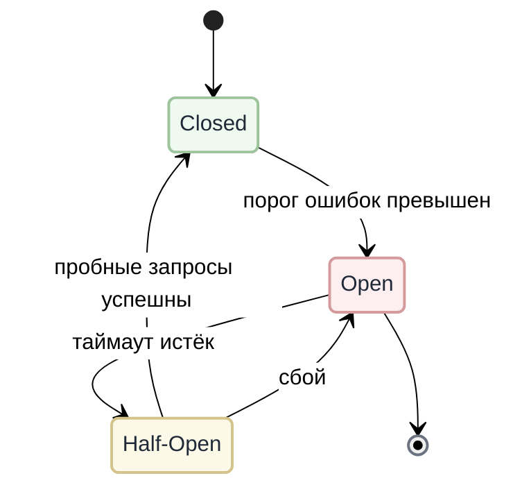

# Микросервисы


### 1. Что такое паттерн Saga и когда его использовать?

Saga — это паттерн управления распределёнными транзакциями в микросервисах. Он представляет бизнес-операцию как последовательность локальных транзакций, каждая в своём сервисе. При сбое на любом шаге выполняются компенсирующие транзакции, отменяющие эффекты предыдущих шагов. Используется, когда одна бизнес-операция затрагивает несколько сервисов с отдельными базами данных, а ACID-транзакции или 2PC неприменимы из-за плохой масштабируемости и связанности.


### 2. В чём разница между хореографией и оркестрацией в Saga

- **Хореография** — децентрализованный подход: каждый сервис после своего шага публикует событие, другие сервисы на него реагируют. Нет центрального управляющего компонента, слабая связанность, но сложнее отслеживать общий поток и отлаживать.
- **Оркестрация** — централизованный подход: специальный оркестратор явно командует сервисами, решает, какой шаг следующий, и запускает компенсации. Проще понимать и мониторить сложные сценарии, но оркестратор становится дополнительной точкой отказа и потенциальной связанности.


### 3. Как реализовать распределённые транзакции в микросервисах

Основной способ — паттерн Saga. Вместо блокирующего 2PC строится цепочка локальных транзакций с компенсациями. Каждый сервис выполняет свою операцию и публикует событие или получает команду; при ошибке запускаются компенсирующие действия. Обеспечивается конечная согласованность (eventual consistency), а не строгая атомарность.


### 4. Что такое компенсирующие транзакции

Это операции, которые семантически отменяют эффект уже выполненной локальной транзакции в рамках Saga. Например, если списание средств прошло, а следующий шаг провалился, компенсация вернёт средства. Компенсации должны быть идемпотентными, чтобы их можно было безопасно повторять при сбоях.


### 5. Что такое паттерн Circuit Breaker

Circuit Breaker (предохранитель) — паттерн отказоустойчивости, который прекращает вызовы неисправного сервиса, чтобы не тратить ресурсы на заведомо неуспешные запросы и дать сбойному сервису время восстановиться. Предотвращает каскадные сбои в распределённой системе (когда один упавший сервис тянет за собой цепочку зависимых).


### 6. Как работает Circuit Breaker и какие у него состояния

У Circuit Breaker три основных состояния:
- **Closed** (закрытый) — запросы проходят к сервису; если доля ошибок превышает порог (например, 50% за 10 запросов), предохранитель срабатывает.
- **Open** (открытый) — запросы немедленно отклоняются без вызова сервиса (fail fast — быстрая ошибка); по истечении таймаута происходит переход в Half-Open.
- **Half-Open** (полуоткрытый) — пропускается ограниченное число пробных запросов (например, 5); при успехе возврат в Closed, при сбое — снова в Open.



**Реализация с аннотациями Resilience4j (Spring Boot):**
```java
// CircuitBreaker + TimeLimiter + Retry + Fallback
@Service
public class OrderService {

    @CircuitBreaker(name = "orderService", fallbackMethod = "getOrderFallback")
    @TimeLimiter(name = "orderService", timeoutDuration = 3, timeUnit = TimeUnit.SECONDS)
    @Retry(name = "orderService")
    public Mono<OrderDto> getOrder(Long id) {
        return orderClient.getOrder(id);  // WebClient → другой сервис
    }

    // Fallback: вызывается, когда CB open, timeout или retry исчерпан
    private Mono<OrderDto> getOrderFallback(Long id, Throwable t) {
        return Mono.just(OrderDto.cached(id)); // кэш или дефолт
    }
}
```
```yaml
resilience4j:
  circuitbreaker:
    instances:
      orderService:
        slidingWindowSize: 10          # окно из 10 запросов
        failureRateThreshold: 50       # 50% ошибок → open
        waitDurationInOpenState: 5000  # 5 сек в open
        permittedNumberOfCallsInHalfOpenState: 3  # 3 пробных запроса
  timelimiter:
    instances:
      orderService:
        timeoutDuration: 3000  # 3 сек
  retry:
    instances:
      orderService:
        maxAttempts: 3
        waitDuration: 500
```

**Реализация без аннотаций (ручной Circuit Breaker):**
```java
public class CircuitBreaker {
    private final int failureThreshold;       // порог ошибок
    private final long resetTimeoutMs;         // таймаут на восстановление
    private final AtomicInteger failureCount = new AtomicInteger(0);
    private volatile State state = State.CLOSED;
    private volatile long lastFailureTime = 0;

    public <T> T execute(Supplier<T> action, Supplier<T> fallback) {
        if (state == State.OPEN && System.currentTimeMillis() - lastFailureTime > resetTimeoutMs) {
            state = State.HALF_OPEN;
        }
        if (state == State.OPEN) {
            return fallback.get();  // fail fast
        }
        try {
            T result = action.get();
            onSuccess();
            return result;
        } catch (Exception e) {
            onFailure();
            return fallback.get();
        }
    }

    private void onSuccess() {
        failureCount.set(0);
        if (state == State.HALF_OPEN) state = State.CLOSED;
    }
    private void onFailure() {
        lastFailureTime = System.currentTimeMillis();
        if (failureCount.incrementAndGet() >= failureThreshold) state = State.OPEN;
    }
}
```


### 7. Что такое Service Discovery и зачем он нужен

Service Discovery — механизм, позволяющий сервисам находить друг друга в динамической среде, где экземпляры появляются, исчезают и меняют адреса. Используется реестр (Service Registry), где сервисы регистрируются при старте, а клиенты или промежуточные компоненты получают оттуда актуальные адреса. Без этого ручное прописывание хостов и портов стало бы неработоспособным при автомасштабировании и частых деплоях.


### 8. В чём разница между client-side и server-side discovery

- **Client-side discovery** — клиент сам обращается к реестру сервисов, получает список экземпляров и выбирает нужный (например, по алгоритму балансировки).
- **Server-side discovery** — клиент обращается к промежуточному компоненту (балансировщику, API Gateway), который сам запрашивает реестр, выбирает экземпляр и перенаправляет запрос.


### 9. Что такое API Gateway и какие задачи он решает

API Gateway — единая точка входа для клиентских запросов к микросервисам. Решает задачи маршрутизации, аутентификации и авторизации, ограничения скорости (rate limiting), терминации SSL/TLS, кэширования, логирования, мониторинга и балансировки нагрузки. Упрощает клиентов и централизует сквозные функции.


### 10. Что такое шардирование (sharding)

Шардирование — горизонтальное масштабирование базы данных путём разделения данных на независимые части (шарды), размещаемые на разных серверах. Каждый шард содержит уникальный набор данных и может масштабироваться независимо, что повышает производительность и ёмкость системы.


### 11. В чём разница между шардированием и партиционированием

- **Партиционирование** — разделение данных внутри одной базы данных на логические части (партиции) для производительности и управления; все части обычно на одном сервере или в одном кластере СУБД.
- **Шардирование** — распределение данных по нескольким независимым серверам баз данных; каждый шард — отдельная база, и система в целом масштабируется горизонтально.


### 12. Как реализовать горизонтальное масштабирование микросервисов

Нужно сделать сервисы stateless, чтобы любой экземпляр мог обработать любой запрос. Затем добавить реплики (экземпляры) и распределять нагрузку через балансировщик или API Gateway. В Kubernetes использовать Horizontal Pod Autoscaler для автоматического добавления реплик по метрикам (CPU, память, кастомные метрики). Базы данных при необходимости шардировать или реплицировать.


### 13. Что такое паттерн Database per Service

Паттерн, при котором каждый микросервис имеет собственную изолированную базу данных. Другие сервисы не обращаются к ней напрямую, а только через API владельца. Это обеспечивает слабую связанность, независимость схемы и возможность отдельного масштабирования.


### 14. Какие проблемы возникают при использовании общей базы данных

- Жёсткая связанность: изменение схемы затрагивает все сервисы.
- Потеря автономности: сервисы могут непреднамеренно влиять на данные друг друга.
- Сложность масштабирования: нельзя масштабировать БД отдельно под каждый сервис.
- Риск неявных зависимостей и общих блокировок, снижающих отказоустойчивость.


### 15. Как организовать коммуникацию между микросервисами

Двумя основными способами: синхронно (HTTP/REST, gRPC) и асинхронно (брокеры сообщений: Kafka, RabbitMQ). Синхронные вызовы просты, но создают связанность и требуют таймаутов, retry, circuit breaker. Асинхронные события снижают связанность, буферизуют нагрузку и повышают устойчивость, но усложняют отладку и требуют идемпотентности обработчиков.


### 16. В чём разница между синхронной и асинхронной коммуникацией

- **Синхронная** — отправитель блокируется в ожидании ответа; просто, но зависимость от доступности получателя и риск каскадных сбоев.
- **Асинхронная** — отправитель публикует сообщение и не ждёт немедленного ответа; слабая связанность, устойчивость к сбоям и возможность буферизации, но сложнее гарантировать порядок, идемпотентность и наблюдаемость.


### 17. Как обеспечить отказоустойчивость микросервисов

Применять набор паттернов: таймауты, повторные попытки с экспоненциальной задержкой и джиттером, Circuit Breaker, Bulkhead для изоляции ресурсов, fallback-ответы (кэш, значения по умолчанию), асинхронную коммуникацию через брокеры, репликацию и health checks. Также важны мониторинг, алертинг и хаос-тестирование.


### 18. Что такое паттерн Bulkhead

Bulkhead (переборка) — изоляция ресурсов (например, пулов потоков или соединений) для разных зависимостей или типов запросов. Если одна зависимость начинает тормозить и исчерпывает свой пул, другие части системы, использующие отдельные пулы, продолжают работать. Название по аналогии с водонепроницаемыми переборками корабля (если одна переборка затоплена — остальные держат корабль на плаву).

**Реализация с аннотациями Resilience4j:**
```java
// Bulkhead: изоляция пула потоков для каждой зависимости
@Service
public class OrderService {

    @Bulkhead(name = "paymentBulkhead", fallbackMethod = "paymentFallback")
    public PaymentResult callPaymentService(Order order) {
        return paymentClient.charge(order);
    }

    @Bulkhead(name = "inventoryBulkhead", fallbackMethod = "inventoryFallback")
    public InventoryResult callInventory(Order order) {
        return inventoryClient.reserve(order);
    }

    private PaymentResult paymentFallback(Order o, Throwable t) { return PaymentResult.pending(); }
    private InventoryResult inventoryFallback(Order o, Throwable t) { return InventoryResult.hold(); }
}
```
```yaml
resilience4j:
  bulkhead:
    instances:
      paymentBulkhead:
        maxConcurrentCalls: 5        # максимум 5 одновременных вызовов
        maxWaitDuration: 1000        # ждать в очереди до 1 сек
      inventoryBulkhead:
        maxConcurrentCalls: 10
        maxWaitDuration: 500
```

**Реализация без аннотаций (Semaphore):**
```java
public class Bulkhead {
    private final Semaphore semaphore;
    private final Supplier<Object> fallback;

    public Bulkhead(int maxConcurrent, Supplier<Object> fallback) {
        this.semaphore = new Semaphore(maxConcurrent);
        this.fallback = fallback;
    }

    public Object execute(Supplier<Object> action) throws InterruptedException {
        if (!semaphore.tryAcquire(1, TimeUnit.SECONDS)) {
            return fallback.get();  // пул исчерпан → fallback
        }
        try {
            return action.get();
        } finally {
            semaphore.release();
        }
    }
}
```


### 19. Что такое паттерн Retry и как его правильно использовать

Retry — повторение неудачного вызова в расчёте на временный сбой. Правильно использовать только для идемпотентных операций и временных ошибок (сетевые сбои, таймауты, 5xx). Нужно ограничивать число попыток, применять экспоненциальную задержку с джиттером, не повторять при бизнес-ошибках (4xx) и сочетать с Circuit Breaker, чтобы не устраивать «шторм» повторов.

**Реализация с аннотациями Resilience4j:**
```java
@Service
public class PaymentService {

    @Retry(name = "paymentRetry", fallbackMethod = "chargeFallback")
    public PaymentResult charge(Order order) {
        return paymentClient.charge(order);
    }

    private PaymentResult chargeFallback(Order order, Throwable t) {
        return PaymentResult.retryLater(); // отложить на очередь
    }
}
```
```yaml
resilience4j:
  retry:
    instances:
      paymentRetry:
        maxAttempts: 3
        waitDuration: 500
        enableExponentialBackoff: true
        exponentialBackoffMultiplier: 2   # 500 → 1000 → 2000
        enableRandomizedWait: true
        retryOnExceptions:
          - java.io.IOException           # только сетевые
          - org.springframework.web.client.ResourceAccessException
        ignoreExceptions:
          - com.example.InvalidPaymentException  # 4xx — не повторять
```

❌ Повтор без задержки, при любой ошибке, с большим числом попыток:
```java
for (int attempt = 0; attempt < 10; attempt++) {
    try {
        return paymentService.charge(order);
    } catch (Exception e) {
        // повтор немедленно и даже при 4xx (некорректный платёж)
    }
}
```

✅ Ограничение числа попыток, только сетевые/5xx ошибки, экспоненциальная задержка + джиттер:
```java
int maxAttempts = 3;
long baseDelayMs = 200;
for (int attempt = 0; attempt < maxAttempts; attempt++) {
    try {
        return paymentService.charge(order);
    } catch (IOException | ServiceUnavailableException e) {
        long delay = baseDelayMs * (1L << attempt)          // 200, 400, 800
                   + ThreadLocalRandom.current().nextLong(baseDelayMs);
        Thread.sleep(delay);
    }
}
throw new ServiceException("Все попытки исчерпаны");
```


### 20. Что такое exponential backoff

Exponential backoff — стратегия увеличения интервала между повторными попытками экспоненциально (например, 100 мс, 200 мс, 400 мс, 800 мс). Даёт сбойной системе время восстановиться и снижает нагрузку. Часто добавляют джиттер (случайный разброс), чтобы множество клиентов не повторяли запросы синхронно (иначе все одновременно «долбят» сбойный сервис).

**Реализация с аннотациями (Resilience4j — см. §19, `enableExponentialBackoff: true`).**

**Реализация без аннотаций:**
```java
public <T> T retryWithBackoff(Supplier<T> action, int maxAttempts, long baseDelayMs) {
    for (int attempt = 0; attempt < maxAttempts; attempt++) {
        try {
            return action.get();
        } catch (TransientException e) {
            if (attempt == maxAttempts - 1) throw e;
            long delay = baseDelayMs * (1L << attempt)
                       + ThreadLocalRandom.current().nextLong(baseDelayMs); // джиттер
            Thread.sleep(delay);
        }
    }
    throw new IllegalStateException("unreachable");
}
```


### 21. Как мониторить распределённую систему микросервисов

Собирать три вида телеметрии: метрики (задержки, ошибки, насыщение, количество запросов), логи (структурированные, с корреляционными ID) и трассировки. Использовать централизованные системы: Prometheus + Grafana для метрик, ELK/Loki для логов, Jaeger/Tempo/Zipkin для трассировок. Настраивать алерты по SLO/SLI и дашборды по ключевым бизнес- и техническим показателям.


### 22. Что такое distributed tracing

Distributed tracing — техника наблюдаемости, при которой каждому запросу присваивается уникальный trace ID, передаваемый между всеми сервисами. Это позволяет собрать полный путь запроса через распределённую систему, увидеть время на каждом участке, выявить узкие места и источник ошибок. Стандарт де-факто — OpenTelemetry.


### 23. Как реализовать аутентификацию и авторизацию в микросервисах

Обычно используют OAuth 2.0/OpenID Connect и токены JWT. Клиент аутентифицируется на сервере авторизации, получает JWT, передаёт его в запросах. API Gateway или каждый сервис проверяет подпись и срок действия токена, извлекает роли/scopes и выполняет авторизацию. Подход stateless и хорошо масштабируется; для внутренних вызовов можно использовать mTLS или сервисные токены.


### 24. Что такое паттерн Strangler Fig

Strangler Fig — постепенная миграция монолита на микросервисы. Новая функциональность реализуется в микросервисах, а фасад (например, API Gateway) постепенно перенаправляет трафик от старых частей монолита к новым. Монолит со временем «удушается», и его функции полностью заменяются сервисами. Позволяет избежать рискованного «big-bang» переписывания.


### 25. Как тестировать микросервисы

На нескольких уровнях: модульные тесты (изоляция компонентов), интеграционные (взаимодействие с БД, брокерами, внешними API; часто через Testcontainers), контрактные (Pact) для проверки совместимости API, компонентные (сервис как чёрный ящик с заглушками зависимостей), end-to-end для сквозных сценариев, а также хаос-тестирование для проверки отказоустойчивости. Важна автоматизация в CI/CD.


### 26. Какие инструменты используются для оркестрации микросервисов

Основной инструмент — Kubernetes: автоматизирует развёртывание, масштабирование, self-healing и управление контейнерами. Также используются Docker Swarm (проще, встроен в Docker), HashiCorp Nomad (лёгкий оркестратор), Apache Mesos/Marathon. Для управления развёртываниями и пайплайнами в Kubernetes применяют Argo CD/Argo Workflows, Helm, а для локальной разработки — Tye, Telepresence, Skaffold.


### 27. DDD стратегически: Bounded Contexts, Context Mapping

**Bounded Context** (ограниченный контекст) — граница, внутри которой доменная модель имеет однозначное определение. Вне этой границы то же слово может означать другое.

**Пример**: «Заказ» в контексте E-Commerce — это корзина + оплата + доставка. В контексте Бухгалтерия — это проводка + налоги + отчётность. Одна и та же сущность, но разные модели.

**Почему Bounded Contexts важны:**
- Микросервис ≈ Bounded Context (не всегда, но часто).
- Границы контекстов определяют границы сервисов.
- Интеграция между контекстами — через Context Mapping.

**Context Mapping** — паттерны взаимодействия между контекстами:

| Паттерн | Описание | Пример |
|---|---|---|
| **Partnership** | Два контекста развивают модель вместе, согласовывая изменения. | E-Commerce + Delivery (оба меняют модель «Заказ» синхронно). |
| **Shared Kernel** | Общий фрагмент модели, который разделяют два контекста. Риск: изменения в общем ядре ломают обоих. | Общий модуль «Адрес» (страна, город, улица). |
| **Customer-Supplier** | «Поставщик» (upstream) предоставляет API, «Клиент» (downstream) потребляет. Клиент может просить изменения, но поставщик решает. | Billing (поставщик) → Invoice (клиент). |
| **Conformist** | Клиент полностью принимает модель поставщика (без изменений). | Legacy API → новый сервис (принимает как есть). |
| **Open Host Service** | Поставщик предоставляет стабильный API (контракт), клиенты могут использовать его без прямых отношений. | Публичное API (GitHub, Stripe). |
| **Published Language** | Общий формат данных (JSON, XML, Avro), который понимают все контексты. | Webhook payload (стандартизированный JSON). |
| **Anti-Corruption Layer (ACL)** | «Переводчик» между моделями: клиент не видит модель поставщика, а работает со своей. | Интеграция с legacy-системой (ACL трансформирует legacy-формат в свою модель). |
| **Separate Ways** | Контексты не взаимодействуют (нет общей модели). | CRM и ERP (разные области). |

**Как находить Bounded Contexts:**
1. **Event Storming** (буря событий): наклеить события на стену, сгруппировать по смыслу → каждая группа = потенциальный контекст.
2. **Ubiquitous Language** (универсальный язык — общий словарь домена): где один термин имеет разные определения → граница контекста.
3. **Доменные правила**: где правила меняются → граница контекста.

**В микросервисах:**
- Один сервис = один контекст (ideally — в идеале).
- API Gateway = Shared Kernel или Open Host Service.
- Event Bus (Kafka) = Published Language (события в общем формате).
- ACL = adapter (например, Spring Integration, MapStruct).

**Типовые ошибки:**
- Один сервис = весь домен (God Service) → нет границ.
- Shared Kernel между 5+ сервисами → каждое изменение ломает всех.
- Нет ACL → legacy-модель «протекла» в новый сервис.

### 28. Distributed locks: Redis/ZooKeeper/etcd, алгоритмы, fencing tokens

Distributed lock (распределённый замок) — механизм взаимного исключения (mutual exclusion, гарантия что одновременно одну критическую секцию выполняет только один процесс) между разными нодами — сервисами, репликами, инстансами приложения на разных машинах.

Зачем:
- Единственный процесс выполняет критическую операцию (пересчёт инвентаря, перевод денег) — параллельные запуска не должны дублировать действие.
- Выбор лидера (leader election, определение единственного «главного» узла в кластере).
- Одноразовая обработка события (idempotency, идемпотентность — повторная доставка не должна дублировать эффект).

Реализации:

1. Redis (SET NX + TTL):
```java
// Поставить замок: setIfAbsent (SET NX) + TTL — замок сам сгорит через 30 с,
// даже если владелец завис и не освободил его вручную.
String lockKey = "lock:inventory:recompute";
boolean acquired = redis.opsForValue()
    .setIfAbsent(lockKey, requestId, Duration.ofSeconds(30));

// Освободить (только если мы держим): Lua-скрипт атомарен —
// GET и DEL выполняются атомарно, чужой замок не удалим.
String script = "if redis.call('get', KEYS[1]) == ARGV[1] then " +
                "return redis.call('del', KEYS[1]) else return 0 end";
redis.execute(script, List.of(lockKey), requestId);
```
- Плюс: простота, скорость (одна сетевая операция).
- Минус: нет fencing (см. ниже) — если владелец завис (GC pause), замок «завис» вместе с ним до истечения TTL, и другие участники могут одновременно оказаться в критической секции.

2. ZooKeeper (ephemeral nodes, эфемерные узлы):
```java
// Создать ephemeral node (исчезает при обрыве соединения):
String path = "/locks/inventory-recompute/" + requestId;
Stat stat = zk.create(path, requestId.getBytes(),
    ZooDefs.Ids.OPEN_ACL_UNSAFE, CreateMode.EPHEMERAL);
```
- Плюс: ephemeral — замок автоматически освобождается при обрыве соединения; ZAB-протокол гарантирует consistency (консистентность).
- Минус: ZooKeeper — отдельная инфраструктура (свой кластер), медленнее Redis.

3. etcd (Lease + Watch):
```go
// Создать lease (TTL):
leaseID, _ := client.Grant(ctx, 30) // 30 sec
// Создать key с lease:
client.Put(ctx, "/locks/inventory-recompute", requestId, client.WithLease(leaseID))
// Watch для leader election:
watchChan := client.Watch(ctx, "/locks/")
```
- Плюс: Lease (TTL), Watch (подписка на изменения — основа leader election), Raft-консенсус гарантирует consistency.
- Минус: etcd — отдельная инфраструктура.

Fencing token (защитный токен):
- Проблема: владелец завис (GC pause, network partition, сетевой разрыв) → не освободил замок → по истечении TTL другие получили замок → два узла одновременно в критической секции.
- Решение: монотонно возрастающий token (timestamp или счётчик). Ресурс (БД, файловая система) отклоняет операции со старым token — даже «зависший» узел, вернувшись, не сможет выполнить операцию: его token устарел.

```java
// Поставить замок с token:
long token = System.currentTimeMillis(); // или atomic counter
redis.opsForValue().set("lock:inventory", token + ":" + requestId, Duration.ofSeconds(30));

// В БД (если поддерживает):
// UPDATE inventory SET version = :token WHERE version < :token;
// Если затронуто 0 строк → token устарел → операция отклонена.
```

Сравнение:
| | Redis | ZooKeeper | etcd |
|---|---|---|---|
| Скорость | Высокая | Средняя | Средняя |
| Consistency (консистентность) | AP (eventual) | CP (ZAB) | CP (Raft) |
| Ephemeral (автоосвобождение) | Нет (только TTL) | Да | Да (Lease) |
| Fencing (защитный токен) | Нет (вручную) | Да (zxid) | Да (revision) |
| Инфраструктура | Простая | Сложная | Сложная |
| Основное использование | Rate limiting, idempotency | Leader election, distributed lock | Leader election, config |

Best practice:
- Redis — для простых замков (rate limiting, idempotency).
- ZooKeeper/etcd — для leader election и критичных замков (с fencing).
- Всегда использовать TTL — замок не должен висеть вечно.
- Fencing token — для критичных операций (деньги, инвентарь).

### 29. API Composition pattern

API Composition (составление API) — паттерн, при котором один API-запрос собирает данные из нескольких микросервисов и возвращает единый ответ. Клиент получает один запрос вместо N.

Проблема: клиент (браузер, мобильное приложение) делает N запросов к N сервисам → N round-trips (сетевых обращений туда-обратно) — медленно, сложно на клиенте (нужно самостоятельно собирать ответ из N отдельных JSON).

Решение: BFF (Backend For Frontend, бэкенд для фронтенда) или отдельный API Composition сервис:
1. Клиент делает один запрос к BFF.
2. BFF параллельно вызывает N микросервисов (не последовательно — это главное для скорости).
3. BFF составляет единый ответ и возвращает клиенту.

Пример:
```
Клиент: GET /orders/123
BFF:
  1. GET /api/orders/123        → { id: 123, status: "SHIPPED" }
  2. GET /api/items?orderId=123 → [ { product: "Laptop", qty: 1 }, ... ]
  3. GET /api/shipping/123      → { carrier: "UPS", tracking: "1Z999..." }
  4. GET /api/payments/123      → { method: "card", amount: 999 }
Ответ: { order: {...}, items: [...], shipping: {...}, payment: {...} }
```

Реализация в Spring (Reactor — реактивное программирование, параллельные вызовы через Mono.zip):
```java
@GetMapping("/orders/{id}")
public Mono<OrderCompositeDto> getOrder(@PathVariable Long id) {
    return Mono.zip(
        orderService.getById(id),
        itemService.getByOrderId(id),
        shippingService.getByOrderId(id),
        paymentService.getByOrderId(id)
    ).map((tuple) -> new OrderCompositeDto(
        tuple.getT1(), tuple.getT2(), tuple.getT3(), tuple.getT4()
    ));
}
```

Когда BFF, когда API Gateway:
- API Gateway — маршрутизация, auth, rate limiting; не знает о бизнес-логике, не знает о форме ответа.
- BFF — составление данных, адаптация под конкретный клиент (веб, мобильное, TV); ответ оптимизирован под нужды конкретного клиента.
- Один BFF на каждый тип клиента (веб-BFF, mobile-BFF) — чтобы не превращать в «белый дом для всех» (God Service).

Типовые ошибки:
- Синхронные последовательные вызовы → медленно (N * latency каждого сервиса). Нужно параллельно (Reactor, CompletableFuture).
- Нет fallback (откатного поведения) → если один сервис упал, весь ответ 500. Нужно graceful degradation (плавная деградация) — вернуть часть данных + пометку об ошибке в недостающей части.
- BFF = God Service — собирает данные для всех клиентов → сложно поддерживать, каждое изменение затрагивает всех.

### 30. Materialized views для CQRS

CQRS (Command Query Responsibility Segregation, разделение команд и запросов) — паттерн, при котором write-модель (на которую пишут команды: создание, изменение, удаление) и read-модель (на которую читают запросы) — разные схемы данных, оптимизированные под свои задачи.

Materialized view (материализованный вид) — предвычисленная таблица: результат сложного запроса (JOIN, GROUP BY) хранится как физическая таблица, обновляется асинхронно при изменении исходных данных.

Зачем в CQRS:
- Write модель: нормализованная (3NF — третья нормальная форма, минимальное дублирование; транзакции, инварианты домена).
- Read модель: денормализованная (оптимизирована под скорость чтения, материализованные виды).
- Обновление read модели: асинхронно — через события (Kafka) или outbox (построенный как очередь событий).

Пример:
```sql
-- Write модель (нормализованная):
-- orders (id, user_id, status, created_at)
-- order_items (id, order_id, product_id, qty, price)
-- products (id, name, category)

-- Read модель (материализованный вид):
CREATE MATERIALIZED VIEW order_summary AS
SELECT
    o.id,
    o.user_id,
    o.status,
    o.created_at,
    SUM(oi.qty * oi.price) AS total,
    COUNT(oi.id) AS item_count,
    p.category
FROM orders o
JOIN order_items oi ON o.id = oi.order_id
JOIN products p ON oi.product_id = p.id
GROUP BY o.id, o.user_id, o.status, o.created_at, p.category;

-- Обновление (асинхронно):
REFRESH MATERIALIZED VIEW CONCURRENTLY order_summary;
```

В PostgreSQL:
- `CREATE MATERIALIZED VIEW` — создаёт предвычисленную таблицу.
- `REFRESH MATERIALIZED VIEW CONCURRENTLY` — обновляет без блокировки чтения (нужен уникальный индекс); обычный REFRESH блокирует чтение.
- Автоматическое обновление: триггеры или расширение (pg_materialized_view), либо app-level (outbox + Kafka).

В Spring Boot:
```java
// Outbox pattern: при изменении orders → событие в outbox → Kafka → consumer обновляет materialized view
@Service
public class OrderService {
    @Transactional
    public void createOrder(OrderDto dto) {
        orderRepo.save(dto);
        outboxRepo.save(new OutboxEvent("ORDER_CREATED", dto.getId()));
    }
}

// Consumer (Kafka):
@KafkaListener(topics = "order-events")
public void onOrderCreated(OrderCreatedEvent event) {
    orderSummaryView.refresh(event.getOrderId()); // обновить materialized view
}
```

Проблемы:
- Consistency (консистентность): materialized view не всегда актуален — есть lag (задержка) между write и read; это eventual consistency (консистентность «в конечном счёте»).
- Обновление: REFRESH может быть долгим на больших данных; CONCURRENTLY помогает, но не мгновенно.
- Хранение: materialized view занимает место в БД — дублирование данных.

Когда materialized views, когда denormalization (денормализация — намеренное дублирование полей):
- Materialized views — PostgreSQL (встроенная поддержка), сложные запросы (JOIN, GROUP BY).
- Denormalization — MySQL (нет MV), простые запросы (достаточно добавить колонку в основную таблицу).

### 31. Eventual consistency vs causal consistency, CRDT

Eventual consistency (консистентность «в конечном счёте») — если новых записей нет, то все реплики в конечном счёте станут одинаковыми. Никакой гарантии когда именно.

Causal consistency (причинно-следственная консистентность) — если операция A причинно предшествовала B (A → B), то все реплики, увидевшие B, должны увидеть и A. Гарантия только для причинно-связанных операций, для независимых — нет.

Пример:
- Eventual: пользователь меняет имя (A), затем публикует пост (B). На одной реплике пост уже виден, но имя ещё старое — событие A не доставлено.
- Causal: если пост виден (B), то имя обязательно новое (A доставлено) — B «видит» A, значит A уже применился.

CRDT (Conflict-free Replicated Data Type, конфликт-свободная реплицируемая структура данных) — структуры данных, которые автоматически разрешают конфликты при слиянии (merge) реплик без координации — без лидера, без consensus (консенсуса, общего решения).

Типы CRDT:
- G-Counter (только инкремент): каждая реплика ведёт свой локальный счётчик; merge = максимум по каждой реплике.
- PN-Counter (инкремент + декремент): P (плюс) + N (минус); merge = разница (сумма P − сумма N).
- OR-Set (Observed-Remove Set, множество с «наблюдаемыми» удалениями): добавление и удаление элементов; merge = объединение, при этом удаление «побеждает» добавление того же элемента.
- LWW-Register (Last-Writer-Wins, последний писавший побеждает): последнее значение побеждает по логическому времени (logical clock, логические часы).

Пример (G-Counter):
```
Реплика A: {A: 3}
Реплика B: {B: 2}
Merge: {A: 3, B: 2} → total = 5
```

Когда CRDT:
- Offline-first приложения (синхронизация при появлении сети — изменения накапливаются локально, потом сливаются).
- P2P (peer-to-peer) системы (нет централизованного сервера — каждая реплика равна другой).
- Совместное редактирование (co-editing — документы, whiteboard, как Figma, Google Docs).

Когда НЕ CRDT:
- Строгая консистентность (финансы, инвентарь) — CRDT не даёт «состояние в любой момент».
- Сложные бизнес-инварианты — CRDT разрешает только конфликты структуры данных, бизнес-правила он не гарантирует.

Сравнение:
| | Eventual | Causal | CRDT |
|---|---|---|---|
| Гарантия | Реплики в конечном счёте одинаковы | Причинно-следственная последовательность | Конфликты решаются автоматически |
| Координация | Нет | Нет (vector clocks — векторные часы) | Нет |
| Конфликты | Могут быть (без автоматического разрешения) | Нет (для причинно-связанных операций) | Решаются автоматически |
| Пример | DNS, CDN | Kafka (порядок в partition) | Figma, Google Docs |

### 32. SLO/SLI/SLA в микросервисах: error budgets

SLI (Service Level Indicator, индикатор уровня сервиса) — измеримая метрика качества сервиса: uptime (доля успешных запросов), p95 latency (95-й перцентиль задержки — время, за которое выполняется 95% запросов), error rate (доля ошибок).

SLO (Service Level Objective, цель по уровню сервиса) — целевое значение по SLI. Например, «uptime ≥ 99.9% в месяц».

SLA (Service Level Agreement, соглашение об уровне сервиса) — контракт с клиентом/бизнесом: при нарушении SLO — штраф, компенсация. SLA строится на основе SLO.

Примеры:
| SLI | SLO | Период | Error Budget |
|---|---|---|---|
| Uptime | 99.9% | Месяц | 43.8 мин (43.2 мин простоя допустимо) |
| p95 latency | < 500 ms | Месяц | 5% запросов могут быть > 500 ms |
| Error rate | < 0.1% | Час | 0.1% ошибок допустимо |

Error budget (бюджет ошибок) = 100% − SLO. Допустимый объём ошибок (или простоя) за период — «бюджет» который можно «потратить» на риски и релизы.

Как использовать:
- Error budget > 50% — можно рисковать с релизами: быстрый rollout (поступательный вывод), canary (канареечный деплой — сначала на часть трафика).
- Error budget < 50% — осторожно: медленный rollout, rollback (откат) при ошибках.
- Error budget = 0% — заморозка релизов, только bugfix (исправление критичных багов).

Alerting по SLO (burn rate — скорость «сжигания» бюджета ошибок):
```promql
# Быстрый burn (14.4x): error budget исчерпается за день — тревога сразу
sum(rate(http_requests_total{status=~"5.."}[5m]))
  /
sum(rate(http_requests_total[5m])) > 0.0144  # 1.44% (14.4x от базового 0.1%)

# Медленный burn (1x): error budget исчерпается за месяц — тревога в фоне
sum(rate(http_requests_total{status=~"5.."}[1h]))
  /
sum(rate(http_requests_total[1h])) > 0.001  # 0.1%
```

В микросервисах:
- Каждый сервис — свои SLO, не один общий на всю систему.
- SLO зависят от важности сервиса: критичный (заказ, оплата) — 99.95%; фоновый (отчёты, аналитика) — 99%.
- Error budget учитывается при релизах: CI/CD проверяет canary (канареечную) фазу + SLO до полного rollout.

### 33. OpenTelemetry в микросервисах: traces, metrics, logs correlation

OpenTelemetry (OTel) — открытый стандарт (CNCF — Cloud Native Computing Foundation, консорциум open-source проектов) для телеметрии: единый API и SDK для трёх типов данных — метрики (metrics), логи (logs), трассировки (traces).

Компоненты:
- OTel SDK — в каждом микросервисе (Java, Go, Python, и т.д.); собирает данные.
- OTel Collector — агент/демон, который собирает телеметрию из SDK и экспортирует в бэкенды (Jaeger, Prometheus, Elasticsearch).
- W3C Trace Context — стандартная схема пропагации (передачи) trace id и span id между сервисами через HTTP-заголовки `traceparent` и `tracestate`.

Traces (трассировки):
- Trace (трассировка) = полный путь одного запроса от клиента до последнего сервиса.
- Span = отдельный участок: HTTP-запрос, SQL-запрос, Kafka-сообщение; span содержит timestamp, duration, attributes.
- Propagator (пропагатор) — механизм передачи trace context: W3C Trace Context (стандарт), B3 (Zipkin), Jaeger (унаследован).

Metrics (метрики):
- Counter (счётчик) — монотонно возрастающий (запросы, ошибки); растёт, не уменьшается.
- Gauge (шкала) — мгновенное значение (CPU, память, queue size); может расти и падать.
- Histogram (гистограмма) — распределение (задержки, размеры); позволяет строить перцентили (p95, p99).
- Экспорт: Prometheus (pull — сам опрашивает сервис), OTLP (push — сервис отправляет в Collector).

Logs (логи):
- Structured logging — логи в JSON (не текстовые строки), каждое поле — отдельный атрибут.
- В каждом логе — trace_id + span_id: это позволяет связать log с конкретным span из traces.
- Корреляция: trace_id связывает logs ↔ traces ↔ metrics (одна и та же trace id во всех трёх системах).

В Java (Spring Boot 3):
```xml
<dependency>
    <groupId>io.opentelemetry</groupId>
    <artifactId>opentelemetry-sdk</artifactId>
</dependency>
<dependency>
    <groupId>io.opentelemetry.instrumentation</groupId>
    <artifactId>opentelemetry-spring-boot-starter</artifactId>
</dependency>
```
```yaml
opentelemetry:
  sdk:
    tracer:
      span-processor: batch
    resource:
      attributes:
        service.name: order-service
  exporter:
    otlp:
      endpoint: http://otel-collector:4317
```

Auto-instrumentation (автоматическая инструментация — спаны создаются автоматически без ручного кода) через Java agent:
```bash
java -javaagent:opentelemetry-javaagent.jar \
     -Dotel.service.name=order-service \
     -jar order-service.jar
```
- HTTP (Spring MVC, WebClient) — автоспаны для входящих и исходящих запросов.
- JPA — автоспаны для SQL (prepare, execute, fetch).
- Kafka — автоспаны для producer и consumer.
- MDC (Mapped Diagnostic Context — лог-контекст SLF4J) — trace_id, span_id автоматически попадают в log.

Collector (конфигурация otel-collector-config.yaml):
```yaml
receivers:
  otlp:
    protocols:
      grpc:
        endpoint: 0.0.0.0:4317
processors:
  batch:
    timeout: 5s
exporters:
  otlp/jaeger:
    endpoint: jaeger:4317
  prometheus:
    endpoint: 0.0.0.0:8889
  otlp/elk:
    endpoint: elasticsearch:4317
service:
  pipelines:
    traces:
      receivers: [otlp]
      processors: [batch]
      exporters: [otlp/jaeger]
    metrics:
      receivers: [otlp]
      processors: [batch]
      exporters: [prometheus]
    logs:
      receivers: [otlp]
      processors: [batch]
      exporters: [otlp/elk]
```

Корреляция в Grafana Explore (поиск по данным):
1. Metrics: p95 latency вырос → клик на метрику → переход к traces (по времени).
2. Traces: медленный span → клик на span → переход к logs (по trace_id и времени).
3. Logs: строка с ERROR → клик на trace_id → переход к traces.

Best practice:
- OTel SDK + auto-instrumentation (Java agent) в каждом сервисе.
- OTel Collector (DaemonSet в Kubernetes — по одному агенту на нод) — batching (пакетирование), sampling (выборочная выборка — не все spans, а по правилу), routing (маршрутизация в нужные бэкенды).
- W3C Trace Context — для пропагации.
- Structured logging (JSON) + MDC (trace_id, span_id) — в логах.
- Grafana Explore — для корреляции (metrics → traces → logs).

### 34. Idempotency keys: реализация, хранение

Idempotency (идемпотентность) — свойство операции, при котором повторное выполнение не изменяет состояние (кроме первого раза).

Зачем:
- Клиент повторяет запрос (network timeout — сетевой таймаут, retry — повторная отправка).
- Kafka доставляет сообщение дважды (at-least-once — «хотя бы раз» семантика доставки).
- Пользователь дважды нажал кнопку (клиент не блокирует повторный клик).

Без idempotency: двойной перевод, двойной заказ, двойная отправка.

Реализация:

1. Idempotency Key (уникальный идентификатор операции):
- Клиент генерирует уникальный ключ (UUID — universal unique identifier, универсальный уникальный идентификатор) для каждой операции.
- Сервер хранит ключ + результат с TTL (time-to-live, время жизни записи).
- Повторный запрос с тем же ключом → сервер возвращает кэшированный результат (не повторяет операцию).

```java
@PostMapping("/payments")
public ResponseEntity<PaymentResponse> pay(@RequestHeader("Idempotency-Key") String key,
                                           @RequestBody PaymentRequest req) {
    // Проверить, был ли уже этот запрос
    Optional<CachedResult> cached = idempotencyStore.get(key);
    if (cached.isPresent()) {
        return ResponseEntity.ok(cached.get());
    }

    // Выполнить операцию
    PaymentResponse result = paymentService.process(req);

    // Сохранить результат
    idempotencyStore.put(key, result, Duration.ofHours(24));

    return ResponseEntity.status(201).body(result);
}
```

Хранение:
- Redis (TTL = 24–48 ч): `SET idempotency:<key> <result> EX 86400`.
- PostgreSQL (таблица `idempotency_keys`): `INSERT ... ON CONFLICT DO NOTHING`.
- TTL 24–48 ч — достаточно для retry, не занимает место вечно.

2. Natural Idempotency (естественная идемпотентность):
- Операция сама по себе идемпотентная (например, `SET` в Redis, `INSERT ... ON CONFLICT DO NOTHING` в PostgreSQL).
- Хранилище ключей не нужно — операция безопасна для повтора.

3. Idempotency in Kafka:
- Producer: `enable.idempotence=true` — Kafka дедуплицирует сообщения на уровне брокера.
- Consumer: идемпотентная обработка — проверка уже обработанного сообщения по key.

```java
@KafkaListener(topics = "payments")
public void onPayment(PaymentEvent event) {
    if (processedKeys.contains(event.getIdempotencyKey())) {
        return; // уже обработано
    }
    paymentService.process(event);
    processedKeys.add(event.getIdempotencyKey());
}
```

Типовые ошибки:
- Нет TTL → хранилище растёт бесконечно.
- Ключ не уникален (например, timestamp — одинаковый для разных операций) → конфликты.
- Результат хранится в памяти (не в Redis/БД) → потеря при рестарте.
- Idempotency только на клиенте (сервер не проверяет) → не работает при retry на стороне сервера.

Best practice:
- Клиент генерирует UUID для каждой операции.
- Сервер хранит ключ + результат в Redis (TTL = 24 ч).
- Повторный запрос → кэшированный результат.
- Kafka: idempotent producer + idempotent consumer.

### 35. Saga state machine vs choreography: trade-offs

Saga (сага) — последовательность локальных транзакций, каждая из которых публикует событие, запускающее следующую. Если один из шагов не удалось — запускаются compensating transactions (компенсирующие транзакции — действия, откатывающие уже сделанные шаги).

Два стиля:

1. Orchestrated Saga (оркестрированная — с центральным координатором):
- Центральный оркестратор управляет последовательностью: решает, какой шаг выполнять следующим, следит за состоянием, запускает компенсацию.
- Плюс: ясный поток, просто отлаживать, легко добавить compensating transaction (оркестратор знает все шаги).
- Минус: оркестратор = single point of failure (единая точка отказа) — если упал оркестратор, процесс «завис»; сложнее масштабировать (оркестратор — узкое место).

2. Choreographed Saga (хореографированная — без центра, через события):
- Каждый сервис подписан на события других и сам решает, что делать дальше (реагирует на событие → выполняет свой шаг → публикует своё событие).
- Плюс: децентрализация, масштабируемость, нет SPOF (единой точки отказа).
- Минус: сложно отлаживать (поток размазан по многим сервисам — нужно собирать логи из всех), трудно добавить compensating transaction (нет «центра», который знает все шаги).

State machine (машина состояний, для оркестрации):
- Состояния: `STARTED` → `RESERVED` → `PAID` → `SHIPPED` → `COMPLETED` / `COMPENSATED`.
- Переходы: событие → новое состояние (каждый переход соответствует действию сервиса).
- Compensating: если переход не удался (событие «отказ») — запускается compensating transaction (откат предыдущих шагов).

```java
// Оркестратор (Spring Statemachine или кастомный):
@OnTransition(source = "RESERVED", target = "PAID", event = "PAYMENT_APPROVED")
public void onPaymentApproved() {
    paymentService.charge(orderId);
}

@OnTransition(source = "PAID", target = "SHIPPED", event = "SHIPPING_CONFIRMED")
public void onShippingConfirmed() {
    shippingService.ship(orderId);
}

@OnTransition(source = "SHIPPED", target = "COMPENSATED", event = "SHIPPING_FAILED")
public void onShippingFailed() {
    paymentService.refund(orderId); // compensating
    inventoryService.release(orderId); // compensating
}
```

Сравнение:
| | Orchestrated | Choreographed |
|---|---|---|
| Контроль | Центральный оркестратор | Каждый сервис сам |
| Отладка | Простая (один поток) | Сложная (распределённый поток) |
| Compensating (откат) | Легко (оркестратор знает все шаги) | Сложно (нужно вручную определять, какие шаги откатывать) |
| SPOF (единая точка отказа) | Да (оркестратор) | Нет |
| Масштабируемость | Средняя | Высокая |
| Новый сервис | Нужно изменить оркестратор | Подписаться на событие (без изменения других) |
| Пример | Заказ (оркестратор = OrderService) | Оплата (каждый сервис реагирует на события) |

Когда что:
- Orchestrated: сложные процессы (заказ, бронирование) — много шагов, нужен централизованный контроль.
- Choreographed: простые процессы (оплата, уведомление) — мало шагов, важна масштабируемость.

Типовые ошибки:
- Choreographed без event sourcing (источник событий — хранение полной истории состояний) → не понятно, в каком сервис сейчас (нет истории переходов).
- Orchestrated без idempotency → повторное событие → двойной шаг (например, двойная оплата).
- Compensating не идемпотентный → откат не работает при повторе (например, двойной refund).

### 36. Multi-tenancy: schema-per-tenant, row-level security, discriminator

Multi-tenancy (многонаёмность) — одна система (сервер, БД, приложение) обслуживает многих арендаторов (tenants — разных компаний, пользователей, организаций). Данные разных арендаторов должны быть изолированы (не смешиваться).

Подходы:

1. Database-per-Tenant (базы данных по арендатору):
- Каждый tenant — отдельная БД (или отдельная схема).
- Плюс: полная изоляция (данные физически не смешиваются), легко удалить tenant (drop DB).
- Минус: дорого — N БД = N соединений, N бэкапов, N мониторингов; сложно масштабировать (ограничение БД на число баз).

2. Schema-per-Tenant (схемы по арендатору):
- Одна БД, каждый tenant — отдельная схема (namespace в PostgreSQL).
- Плюс: изоляция (схемы не пересекаются), легче чем DB-per-tenant (одна БД, но N схем).
- Минус: N схем = N таблиц (ограничение PostgreSQL: 64K relations на БД — ограничение на количество объектов).

3. Row-Level Security (RLS, строчная безопасность):
- Одна таблица, каждый ряд имеет `tenant_id`.
- PostgreSQL RLS: политики на уровне строк — фильтр `WHERE tenant_id = current_setting('app.tenant_id')` применяется автоматически к каждому запросу.
- Плюс: одна таблица, мало ресурсов, просто масштабировать (одна БД, одна таблица).
- Минус: изоляция на уровне запроса — если забудешь `tenant_id` в WHERE или не установишь `app.tenant_id`, запросы увидят данные всех tenants (критичная ошибка).

```sql
-- PostgreSQL RLS:
ALTER TABLE orders ENABLE ROW LEVEL SECURITY;

CREATE POLICY tenant_isolation ON orders
    USING (tenant_id = current_setting('app.tenant_id')::uuid);

-- В приложении (Spring JDBC):
connection.createStatement().execute("SET app.tenant_id = '" + tenantId + "'");
```

4. Discriminator (дискриминатор — tenant_id в каждой строке):
- Одна таблица, каждый ряд имеет `tenant_id`.
- Приложение всегда добавляет `WHERE tenant_id = ?` в каждый запрос (через DAO/репозиторий).
- Плюс: просто (нет RLS, нет политик), гибко.
- Минус: легко забыть `tenant_id` → данные другого tenant (критичная ошибка, требует код-ревью и тестов).

Сравнение:
| | DB-per-Tenant | Schema-per-Tenant | RLS | Discriminator |
|---|---|---|---|---|
| Изоляция | Максимальная | Высокая | Высокая (RLS) | Средняя (зависит от кода) |
| Ресурсы | Высокие (N БД) | Средние (N схем) | Низкие (1 таблица) | Низкие (1 таблица) |
| Масштабируемость | Низкая | Средняя | Высокая | Высокая |
| Удаление tenant | Drop DB | Drop schema | DELETE WHERE tenant_id | DELETE WHERE tenant_id |
| Сложность | Высокая | Средняя | Средняя | Низкая |
| Ошибки | Мало (изоляция) | Мало | Мало (RLS) | Много (забыл tenant_id) |

Best practice:
- Мало tenants (< 10), нужна высокая изоляция → DB-per-Tenant.
- Средне tenants (10–100), нужна изоляция → Schema-per-Tenant или RLS.
- Много tenants (> 100), важны ресурсы и масштабирование → RLS (PostgreSQL) или Discriminator (с осторожностью и строгими тестами).
- Всегда тестировать изоляцию: попытка доступа к данным другого tenant должна быть отклонена.
