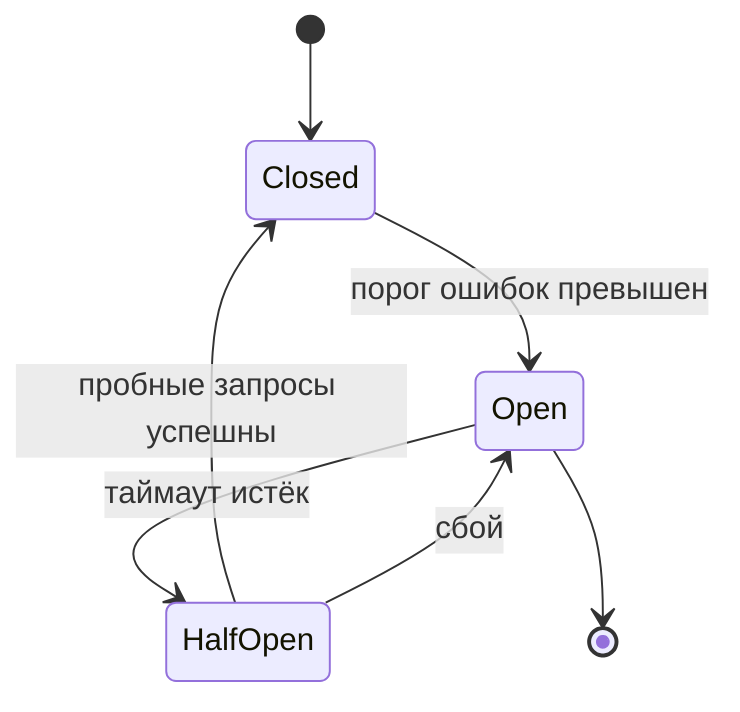

# Микросервисы


### 1. Что такое паттерн Saga и когда его использовать?

Saga — это паттерн управления распределёнными транзакциями в микросервисах. Он представляет бизнес-операцию как последовательность локальных транзакций, каждая в своём сервисе. При сбое на любом шаге выполняются компенсирующие транзакции, отменяющие эффекты предыдущих шагов. Используется, когда одна бизнес-операция затрагивает несколько сервисов с отдельными базами данных, а ACID-транзакции или 2PC неприменимы из-за плохой масштабируемости и связанности.


### 2. В чём разница между хореографией и оркестрацией в Saga

- **Хореография** — децентрализованный подход: каждый сервис после своего шага публикует событие, другие сервисы на него реагируют. Нет центрального управляющего компонента, слабая связанность, но сложнее отслеживать общий поток и отлаживать.
- **Оркестрация** — централизованный подход: специальный оркестратор явно командует сервисами, решает, какой шаг следующий, и запускает компенсации. Проще понимать и мониторить сложные сценарии, но оркестратор становится дополнительной точкой отказа и потенциальной связанности.


### 3. Как реализовать распределённые транзакции в микросервисах

Основной способ — паттерн Saga. Вместо блокирующего 2PC строится цепочка локальных транзакций с компенсациями. Каждый сервис выполняет свою операцию и публикует событие или получает команду; при ошибке запускаются компенсирующие действия. Обеспечивается конечная согласованность (eventual consistency), а не строгая атомарность.


### 4. Что такое компенсирующие транзакции

Это операции, которые семантически отменяют эффект уже выполненной локальной транзакции в рамках Saga. Например, если списание средств прошло, а следующий шаг провалился, компенсация вернёт средства. Компенсации должны быть идемпотентными, чтобы их можно было безопасно повторять при сбоях.


### 5. Что такое паттерн Circuit Breaker

Circuit Breaker (предохранитель) — паттерн отказоустойчивости, который прекращает вызовы неисправного сервиса, чтобы не тратить ресурсы на заведомо неуспешные запросы и дать сбойному сервису время восстановиться. Предотвращает каскадные сбои в распределённой системе.


### 6. Как работает Circuit Breaker и какие у него состояния

У Circuit Breaker три основных состояния:
- **Closed** — запросы проходят к сервису; если доля ошибок превышает порог, предохранитель срабатывает.
- **Open** — запросы немедленно отклоняются без вызова сервиса; по истечении таймаута происходит переход в Half-Open.
- **Half-Open** — пропускается ограниченное число пробных запросов; при успехе возврат в Closed, при сбое — снова в Open.




### 7. Что такое Service Discovery и зачем он нужен

Service Discovery — механизм, позволяющий сервисам находить друг друга в динамической среде, где экземпляры появляются, исчезают и меняют адреса. Используется реестр (Service Registry), где сервисы регистрируются при старте, а клиенты или промежуточные компоненты получают оттуда актуальные адреса. Без этого ручное прописывание хостов и портов стало бы неработоспособным при автомасштабировании и частых деплоях.


### 8. В чём разница между client-side и server-side discovery

- **Client-side discovery** — клиент сам обращается к реестру сервисов, получает список экземпляров и выбирает нужный (например, по алгоритму балансировки).
- **Server-side discovery** — клиент обращается к промежуточному компоненту (балансировщику, API Gateway), который сам запрашивает реестр, выбирает экземпляр и перенаправляет запрос.


### 9. Что такое API Gateway и какие задачи он решает

API Gateway — единая точка входа для клиентских запросов к микросервисам. Решает задачи маршрутизации, аутентификации и авторизации, ограничения скорости (rate limiting), терминации SSL/TLS, кэширования, логирования, мониторинга и балансировки нагрузки. Упрощает клиентов и централизует сквозные функции.


### 10. Что такое шардирование (sharding)

Шардирование — горизонтальное масштабирование базы данных путём разделения данных на независимые части (шарды), размещаемые на разных серверах. Каждый шард содержит уникальный набор данных и может масштабироваться независимо, что повышает производительность и ёмкость системы.


### 11. В чём разница между шардированием и партиционированием

- **Партиционирование** — разделение данных внутри одной базы данных на логические части (партиции) для производительности и управления; все части обычно на одном сервере или в одном кластере СУБД.
- **Шардирование** — распределение данных по нескольким независимым серверам баз данных; каждый шард — отдельная база, и система в целом масштабируется горизонтально.


### 12. Как реализовать горизонтальное масштабирование микросервисов

Нужно сделать сервисы stateless, чтобы любой экземпляр мог обработать любой запрос. Затем добавить реплики (экземпляры) и распределять нагрузку через балансировщик или API Gateway. В Kubernetes использовать Horizontal Pod Autoscaler для автоматического добавления реплик по метрикам (CPU, память, кастомные метрики). Базы данных при необходимости шардировать или реплицировать.


### 13. Что такое паттерн Database per Service

Паттерн, при котором каждый микросервис имеет собственную изолированную базу данных. Другие сервисы не обращаются к ней напрямую, а только через API владельца. Это обеспечивает слабую связанность, независимость схемы и возможность отдельного масштабирования.


### 14. Какие проблемы возникают при использовании общей базы данных

- Жёсткая связанность: изменение схемы затрагивает все сервисы.
- Потеря автономности: сервисы могут непреднамеренно влиять на данные друг друга.
- Сложность масштабирования: нельзя масштабировать БД отдельно под каждый сервис.
- Риск неявных зависимостей и общих блокировок, снижающих отказоустойчивость.


### 15. Как организовать коммуникацию между микросервисами

Двумя основными способами: синхронно (HTTP/REST, gRPC) и асинхронно (брокеры сообщений: Kafka, RabbitMQ). Синхронные вызовы просты, но создают связанность и требуют таймаутов, retry, circuit breaker. Асинхронные события снижают связанность, буферизуют нагрузку и повышают устойчивость, но усложняют отладку и требуют идемпотентности обработчиков.


### 16. В чём разница между синхронной и асинхронной коммуникацией

- **Синхронная** — отправитель блокируется в ожидании ответа; просто, но зависимость от доступности получателя и риск каскадных сбоев.
- **Асинхронная** — отправитель публикует сообщение и не ждёт немедленного ответа; слабая связанность, устойчивость к сбоям и возможность буферизации, но сложнее гарантировать порядок, идемпотентность и наблюдаемость.


### 17. Как обеспечить отказоустойчивость микросервисов

Применять набор паттернов: таймауты, повторные попытки с экспоненциальной задержкой и джиттером, Circuit Breaker, Bulkhead для изоляции ресурсов, fallback-ответы (кэш, значения по умолчанию), асинхронную коммуникацию через брокеры, репликацию и health checks. Также важны мониторинг, алертинг и хаос-тестирование.


### 18. Что такое паттерн Bulkhead

Bulkhead (переборка) — изоляция ресурсов (например, пулов потоков или соединений) для разных зависимостей или типов запросов. Если одна зависимость начинает тормозить и исчерпывает свой пул, другие части системы, использующие отдельные пулы, продолжают работать. Название по аналогии с водонепроницаемыми переборками корабля.


### 19. Что такое паттерн Retry и как его правильно использовать

Retry — повторение неудачного вызова в расчёте на временный сбой. Правильно использовать только для идемпотентных операций и временных ошибок (сетевые сбои, таймауты, 5xx). Нужно ограничивать число попыток, применять экспоненциальную задержку с джиттером, не повторять при бизнес-ошибках (4xx) и сочетать с Circuit Breaker, чтобы не устраивать «шторм» повторов.

❌ Повтор без задержки, при любой ошибке, с большим числом попыток:

```java
for (int attempt = 0; attempt < 10; attempt++) {
    try {
        return paymentService.charge(order);
    } catch (Exception e) {
        // повтор немедленно и даже при 4xx (некорректный платёж)
    }
}
```

✅ Ограничение числа попыток, только сетевые/5xx ошибки, экспоненциальная задержка + джиттер:

```java
int maxAttempts = 3;
long baseDelayMs = 200;
for (int attempt = 0; attempt < maxAttempts; attempt++) {
    try {
        return paymentService.charge(order);
    } catch (IOException | ServiceUnavailableException e) {
        long delay = baseDelayMs * (1L << attempt)          // 200, 400, 800
                   + ThreadLocalRandom.current().nextLong(baseDelayMs);
        Thread.sleep(delay);
    }
}
throw new ServiceException("Все попытки исчерпаны");
```


### 20. Что такое exponential backoff

Exponential backoff — стратегия увеличения интервала между повторными попытками экспоненциально (например, 100 мс, 200 мс, 400 мс, 800 мс). Даёт сбойной системе время восстановиться и снижает нагрузку. Часто добавляют джиттер (случайный разброс), чтобы множество клиентов не повторяли запросы синхронно.


### 21. Как мониторить распределённую систему микросервисов

Собирать три вида телеметрии: метрики (задержки, ошибки, насыщение, количество запросов), логи (структурированные, с корреляционными ID) и трассировки. Использовать централизованные системы: Prometheus + Grafana для метрик, ELK/Loki для логов, Jaeger/Tempo/Zipkin для трассировок. Настраивать алерты по SLO/SLI и дашборды по ключевым бизнес- и техническим показателям.


### 22. Что такое distributed tracing

Distributed tracing — техника наблюдаемости, при которой каждому запросу присваивается уникальный trace ID, передаваемый между всеми сервисами. Это позволяет собрать полный путь запроса через распределённую систему, увидеть время на каждом участке, выявить узкие места и источник ошибок. Стандарт де-факто — OpenTelemetry.


### 23. Как реализовать аутентификацию и авторизацию в микросервисах

Обычно используют OAuth 2.0/OpenID Connect и токены JWT. Клиент аутентифицируется на сервере авторизации, получает JWT, передаёт его в запросах. API Gateway или каждый сервис проверяет подпись и срок действия токена, извлекает роли/scopes и выполняет авторизацию. Подход stateless и хорошо масштабируется; для внутренних вызовов можно использовать mTLS или сервисные токены.


### 24. Что такое паттерн Strangler Fig

Strangler Fig — постепенная миграция монолита на микросервисы. Новая функциональность реализуется в микросервисах, а фасад (например, API Gateway) постепенно перенаправляет трафик от старых частей монолита к новым. Монолит со временем «удушается», и его функции полностью заменяются сервисами. Позволяет избежать рискованного «big-bang» переписывания.


### 25. Как тестировать микросервисы

На нескольких уровнях: модульные тесты (изоляция компонентов), интеграционные (взаимодействие с БД, брокерами, внешними API; часто через Testcontainers), контрактные (Pact) для проверки совместимости API, компонентные (сервис как чёрный ящик с заглушками зависимостей), end-to-end для сквозных сценариев, а также хаос-тестирование для проверки отказоустойчивости. Важна автоматизация в CI/CD.


### 26. Какие инструменты используются для оркестрации микросервисов

Основной инструмент — Kubernetes: автоматизирует развёртывание, масштабирование, self-healing и управление контейнерами. Также используются Docker Swarm (проще, встроен в Docker), HashiCorp Nomad (лёгкий оркестратор), Apache Mesos/Marathon. Для управления развёртываниями и пайплайнами в Kubernetes применяют Argo CD/Argo Workflows, Helm, а для локальной разработки — Tye, Telepresence, Skaffold.


### 27. DDD стратегически: Bounded Contexts, Context Mapping

**Bounded Context (Ограниченный контекст)** — граница, внутри которой **доменная модель** имеет **односмысленное** определение. Вне этой границы то же слово может означать другое.

**Пример**: «Заказ» в контексте **E-Commerce** — это корзина + оплата + доставка. В контексте **Бухгалтерия** — это проводка + налоги + отчётность. Одна и та же сущность, но **разные модели**.

**Почему Bounded Contexts важны**:
- **Микросервис = Bounded Context** (не всегда, но часто).
- **Границы** контекстов определяют **границы** сервисов.
- **Интеграция** между контекстами — через **Context Mapping**.

**Context Mapping** — паттерны взаимодействия между контекстами:

| Паттерн | Описание | Пример |
|---|---|---|
| **Partnership** | Два контекста развивают модель **вместе**, согласовывая изменения. | E-Commerce + Delivery (оба меняют модель «Заказ» синхронно). |
| **Shared Kernel** | Общий фрагмент модели, который **разделяют** два контекста. Риск: изменения в общем ядре ломают обоих. | Общий модуль «Адрес» (страна, город, улица). |
| **Customer-Supplier** | «Поставщик» (upstream) предоставляет API, «Клиент» (downstream) потребляет. Клиент может **просить** изменения, но поставщик **решает**. | Billing (поставщик) → Invoice (клиент). |
| **Conformist** | Клиент **полностью** принимает модель поставщика (без изменений). | Legacy API → новый сервис (принимает как есть). |
| **Open Host Service** | Поставщик предоставляет **стабильный** API (контракт), клиенты могут использовать его без прямых отношений. | Публичное API (GitHub, Stripe). |
| **Published Language** | Общий **формат** данных (JSON, XML, авро), который понимают все контексты. | Webhook payload (стандартизированный JSON). |
| **Anti-Corruption Layer (ACL)** | **Переводчик** между моделями: клиент **не видит** модель поставщика, а работает со своей. | Интеграция с legacy-системой (ACL трансформирует legacy-формат в свою модель). |
| **Separate Ways** | Контексты **не взаимодействуют** (нет общей модели). | CRM и ERP (разные области). |

**Как находить Bounded Contexts**:
1. **Event Storming**: наклеить события на стену, сгруппировать по смыслу → каждая группа = потенциальный контекст.
2. **Ubiquitous Language**: где один термин имеет **разные** определения → граница контекста.
3. **Доменные правила**: где правила **меняются** → граница контекста.

**В микросервисах**:
- **Один сервис = один контекст** (ideally).
- **API Gateway** = **Shared Kernel** или **Open Host Service**.
- **Event Bus** (Kafka) = **Published Language** (события в общем формате).
- **ACL** = **adapter** (например, Spring Integration, MapStruct).

**Типовые ошибки**:
- **Один сервис = весь домен** (God Service) → нет границ.
- **Shared Kernel** между 5+ сервисами → каждый изменения ломает всех.
- **Нет ACL** → legacy-модель «протекла» в новый сервис.

### 28. Distributed locks: Redis/ZooKeeper/etcd, алгоритмы, fencing tokens

**Distributed Lock** — механизм **взаимного исключения** (mutual exclusion) между **разными** нодами (сервисами, репликами).

**Зачем**:
- **Единственный** процесс выполняет **критическую** операцию (например, **пересчёт** инвентаря, **перевод** денег).
- **Выбор лидера** (leader election) в кластере.
- **Одноразовая** обработка события (idempotency).

**Реализации**:

**1. Redis (SET NX + TTL)**:
```java
// Поставить замок:
String lockKey = "lock:inventory:recompute";
boolean acquired = redis.opsForValue()
    .setIfAbsent(lockKey, requestId, Duration.ofSeconds(30));

// Освободить (только если мы держим):
String script = "if redis.call('get', KEYS[1]) == ARGV[1] then " +
                "return redis.call('del', KEYS[1]) else return 0 end";
redis.execute(script, List.of(lockKey), requestId);
```
- **Плюс**: простота, скорость.
- **Минус**: **нет** fencing (если нод **завис** → замок **не** освобождён → другие **ждут**).

**2. ZooKeeper (ephemeral nodes)**:
```java
// Создать ephemeral node (исчезает при обрыве соединения):
String path = "/locks/inventory-recompute/" + requestId;
Stat stat = zk.create(path, requestId.getBytes(), 
    ZooDefs.Ids.OPEN_ACL_UNSAFE, CreateMode.EPHEMERAL);
```
- **Плюс**: **ephemeral** (замок **освобождается** при обрыве), **consistency** (ZAB).
- **Минус**: **ZooKeeper** = **отдельная** инфраструктура, **медленнее** Redis.

**3. etcd (Lease + Watch)**:
```go
// Создать lease (TTL):
leaseID, _ := client.Grant(ctx, 30) // 30 sec
// Создать key с lease:
client.Put(ctx, "/locks/inventory-recompute", requestId, client.WithLease(leaseID))
// Watch для leader election:
watchChan := client.Watch(ctx, "/locks/")
```
- **Плюс**: **Lease** (TTL), **Watch** (leader election), **Raft** (consistency).
- **Минус**: **etcd** = **отдельная** инфраструктура.

**Fencing Token**:
- **Проблема**: нод **завис** (GC pause, network partition) → **не** освободил замок → другие **получили** замок → **два** нода **одновременно** в **критической** секции.
- **Решение**: **монотонно** возрастающий **token** (например, **timestamp** или **counter**). **Ресурс** (БД, файловая система) **отклоняет** операции со **старым** token.

```java
// Поставить замок с token:
long token = System.currentTimeMillis(); // или atomic counter
redis.opsForValue().set("lock:inventory", token + ":" + requestId, Duration.ofSeconds(30));

// В БД (если поддерживает):
// UPDATE inventory SET version = :token WHERE version < :token;
// Если затронуто 0 строк → token устарел → операция отклонена.
```

**Сравнение**:
| | Redis | ZooKeeper | etcd |
|---|---|---|---|
| **Скорость** | Высокая | Средняя | Средняя |
| **Consistency** | AP (eventual) | CP (ZAB) | CP (Raft) |
| **Ephemeral** | Нет (TTL) | Да | Да (Lease) |
| **Fencing** | Нет (нужно вручную) | Да (zxid) | Да (revision) |
| **Инфраструктура** | Простая | Сложная | Сложная |
| **Использование** | Кэширование, rate limiting | Leader election, distributed lock | Leader election, config |

**Best practice**:
- **Redis** для **простых** замков (rate limiting, idempotency).
- **ZooKeeper/etcd** для **leader election** и **критичных** замков (fencing).
- **Всегда** использовать **TTL** (замок **не** должен **висеть** вечно).
- **Fencing token** для **критичных** операций (деньги, инвентарь).

### 29. API Composition pattern

**API Composition** — паттерн, при котором **один** API-запрос **составляет** данные из **нескольких** микросервисов и возвращает **единый** ответ.

**Проблема**: клиент (браузер, мобильное приложение) делает **N** запросов к **N** сервисам → **N** round-trips, **медленно**, **сложно** на клиенте.

**Решение**: **BFF (Backend For Frontend)** или **API Composition** сервис:
1. Клиент делает **один** запрос к BFF.
2. BFF **параллельно** вызывает **N** микросервисов.
3. BFF **составляет** ответ и возвращает клиенту.

**Пример**:
```
Клиент: GET /orders/123
BFF: 
  1. GET /api/orders/123        → { id: 123, status: "SHIPPED" }
  2. GET /api/items?orderId=123 → [ { product: "Laptop", qty: 1 }, ... ]
  3. GET /api/shipping/123      → { carrier: "UPS", tracking: "1Z999..." }
  4. GET /api/payments/123      → { method: "card", amount: 999 }
Ответ: { order: {...}, items: [...], shipping: {...}, payment: {...} }
```

**Реализация в Spring**:
```java
@GetMapping("/orders/{id}")
public Mono<OrderCompositeDto> getOrder(@PathVariable Long id) {
    return Mono.zip(
        orderService.getById(id),
        itemService.getByOrderId(id),
        shippingService.getByOrderId(id),
        paymentService.getByOrderId(id)
    ).map((tuple) -> new OrderCompositeDto(
        tuple.getT1(), tuple.getT2(), tuple.getT3(), tuple.getT4()
    ));
}
```

**Когда BFF, когда API Gateway**:
- **API Gateway**: **маршрутизация**, **auth**, **rate limiting** (не знает о бизнес-логике).
- **BFF**: **составление** данных, **адаптация** под конкретный клиент (веб, мобильное, TV).
- **Один BFF** на **каждый** тип клиента (веб-BFF, mobile-BFF).

**Типовые ошибки**:
- **Синхронные** вызовы (последовательно) → **медленно**. Нужно **параллельно** (Reactor, CompletableFuture).
- **Нет fallback** → если один сервис **упал** → весь ответ **500**. Нужно **graceful degradation** (вернуть **часть** данных + **ошибку** для **отсутствующей** части).
- **BFF = God Service** → **составляет** данные для **всех** клиентов → **сложно** поддерживать. Лучше **один BFF** на **каждый** клиент.

### 30. Materialized views для CQRS

**CQRS (Command Query Responsibility Segregation)** — разделение **write** (команды) и **read** (запросы) моделей.

**Materialized View** — **предвычисленная** таблица (или вид), которая **храниит** **результат** **сложного** запроса и **обновляется** **асинхронно** при **изменении** **исходных** данных.

**Зачем в CQRS**:
- **Write** модель: **нормализованная** (3NF, транзакции, инварианты).
- **Read** модель: **денормализованная** (оптимизирована под **запросы**, **материализованные** **виды**).
- **Обновление** read модели: **асинхронно** (через **события** или **outbox**).

**Пример**:
```sql
-- Write модель (нормализованная):
-- orders (id, user_id, status, created_at)
-- order_items (id, order_id, product_id, qty, price)
-- products (id, name, category)

-- Read модель (материализованный вид):
CREATE MATERIALIZED VIEW order_summary AS
SELECT 
    o.id,
    o.user_id,
    o.status,
    o.created_at,
    SUM(oi.qty * oi.price) AS total,
    COUNT(oi.id) AS item_count,
    p.category
FROM orders o
JOIN order_items oi ON o.id = oi.order_id
JOIN products p ON oi.product_id = p.id
GROUP BY o.id, o.user_id, o.status, o.created_at, p.category;

-- Обновление (асинхронно):
REFRESH MATERIALIZED VIEW CONCURRENTLY order_summary;
```

**В PostgreSQL**:
- **`CREATE MATERIALIZED VIEW`** — создаёт **предвычисленную** таблицу.
- **`REFRESH MATERIALIZED VIEW CONCURRENTLY`** — обновляет **без** блокировки **чтения** (нужен **уникальный** индекс).
- **Автоматическое** обновление: **triggers** или **pg_materialized_view** (расширение) или **app-level** (outbox + Kafka).

**В Spring Boot**:
```java
// Outbox pattern: при изменении orders → событие в outbox → Kafka → consumer обновляет materialized view
@Service
public class OrderService {
    @Transactional
    public void createOrder(OrderDto dto) {
        orderRepo.save(dto);
        outboxRepo.save(new OutboxEvent("ORDER_CREATED", dto.getId()));
    }
}

// Consumer (Kafka):
@KafkaListener(topics = "order-events")
public void onOrderCreated(OrderCreatedEvent event) {
    orderSummaryView.refresh(event.getOrderId()); // обновить materialized view
}
```

**Проблемы**:
- **Consistency**: materialized view **не** всегда **актуален** (lag между write и read). **Eventual consistency**.
- **Обновление**: **REFRESH** может быть **долгим** (на **больших** данных). **CONCURRENTLY** помогает, но **не** мгновенно.
- **Хранение**: materialized view **занимает** **место** в БД (дублирование данных).

**Когда materialized views, когда denormalization**:
- **Materialized views**: **PostgreSQL** (встроенная поддержка), **сложные** запросы (JOIN, GROUP BY).
- **Denormalization**: **MySQL** (нет MV), **простые** запросы (добавить **колонку** в **основную** таблицу).

### 31. Eventual consistency vs causal consistency, CRDT

**Eventual Consistency** — если **нет** новых **записей**, то **все** реплики **в конечном** счёте **станут** **одинаковыми**. **Никакой** гарантии **когда**.

**Causal Consistency** — если операция **A** **причинно** **предшествовала** операции **B** (A → B), то **все** реплики, которые **увидели** B, **должны** **увидеть** **и** A. **Гарантия** **причинно-следственной** **последовательности**.

**Пример**:
- **Eventual**: пользователь **меняет** имя (A), затем **публикует** пост (B). На **одной** реплике **пост** **увиден**, но **имя** **ещё** **старое** (A **не** **доставлен**).
- **Causal**: если **пост** **увиден** (B), то **имя** **обязательно** **новое** (A **доставлен**).

**CRDT (Conflict-free Replicated Data Type)** — **структуры** **данных**, которые **автоматически** **решают** **конфликты** **без** **координации** (без **leader**, без **consensus**).

**Типы CRDT**:
- **G-Counter** (increment-only counter): каждая реплика **инкрементит** свой **локальный** счётчик, **merge** = **максимум** по **каждой** реплике.
- **PN-Counter** (increment + decrement): **P** (increment) + **N** (decrement), **merge** = **разность**.
- **OR-Set** (Observed-Remove Set): **добавление** и **удаление** **элементов**, **merge** = **объединение** (удаление **победит** добавление **того** **же** элемента).
- **LWW-Register** (Last-Writer-Wins): **последнее** **значение** **побеждает** (по **clock**).

**Пример (G-Counter)**:
```
Реплика A: {A: 3}
Реплика B: {B: 2}
Merge: {A: 3, B: 2} → total = 5
```

**Когда CRDT**:
- **Offline-first** приложения (синхронизация при появлении сети).
- **P2P** системы (нет централизованного сервера).
- **协作** (co-editing: документы, whiteboard).

**Когда НЕ CRDT**:
- **Строгая** **консистентность** (финансы, инвентарь).
- **Сложные** **инварианты** (CRDT **не** гарантирует **бизнес-правила**).

**Сравнение**:
| | Eventual | Causal | CRDT |
|---|---|---|---|
| **Гарантия** | Реплики **в конечном** счёте **одинаковы** | Причинно-следственная **последовательность** | **Конфликты** **решаются** **автоматически** |
| **Координация** | Нет | Нет (vector clocks) | Нет |
| **Конфликты** | **Могут** **быть** (без **решения**) | **Нет** (причинная **порядок**) | **Решаются** **автоматически** |
| **Пример** | DNS, CDN | Kafka (partition order) | Figma, Google Docs |

### 32. SLO/SLI/SLA в микросервисах: error budgets

**SLI (Service Level Indicator)** — **метрика** **качества** сервиса.
**SLO (Service Level Objective)** — **цель** по SLI.
**SLA (Service Level Agreement)** — **контракт** с **клиентом** (штрафы за нарушение).

**Примеры**:
| SLI | SLO | Период | Error Budget |
|---|---|---|---|
| **Uptime** (доля успешных запросов) | 99.9% | Месяц | 43.8 мин |
| **p95 latency** | < 500 ms | Месяц | 5% запросов > 500 ms |
| **Error rate** | < 0.1% | Час | 0.1% ошибок |

**Error Budget** = **100%** − **SLO**. **Допустимый** **объём** **ошибок** за **период**.

**Как использовать**:
- **Error budget > 50%**: можно **рисковать** с **релизами** (быстрый **rollout**, **canary**).
- **Error budget < 50%**: **осторожно** (медленный **rollout**, **rollback** при **ошибках**).
- **Error budget = 0%**: **заморозка** **релизов** (только **bugfix**).

**Alerting по SLO (burn rate)**:
```promql
# Быстрый burn (14.4x): error budget исчерпается за день
sum(rate(http_requests_total{status=~"5.."}[5m]))
  /
sum(rate(http_requests_total[5m])) > 0.0144  # 1.44% (14.4x от 0.1%)

# Медленный burn (1x): error budget исчерпается за месяц
sum(rate(http_requests_total{status=~"5.."}[1h]))
  /
sum(rate(http_requests_total[1h])) > 0.001  # 0.1%
```

**В микросервисах**:
- **Каждый** сервис — **свои** SLO (не **один** на **всю** систему).
- **SLO** **зависят** от **важности** (критичный сервис — 99.95%, фоновый — 99%).
- **Error budget** **учитывается** при **релизах** (CI/CD: **canary** + **SLO** **проверка**).

### 33. OpenTelemetry в микросервисах: traces, metrics, logs correlation

**OpenTelemetry (OTel)** — **стандарт** (CNCF) для **телеметрии**: **единый** API и SDK для **метрик**, **логов** и **трассировок**.

**Компоненты**:
- **OTel SDK** — в **каждом** микросервисе (Java, Go, Python, ...).
- **OTel Collector** — **агент/демон**, **собирает** телеметрию из SDK и **экспортирует** в бэкенды.
- **W3C Trace Context** — **пропагация** trace id между сервисами (заголовки `traceparent`, `tracestate`).

**Traces**:
- **Trace** = полный **путь** запроса (от клиента до последнего сервиса).
- **Span** = отдельный **участок** (HTTP-запрос, DB-запрос, Kafka-сообщение).
- **Propagator**: **W3C Trace Context** (стандарт), **B3** (Zipkin), **Jaeger**.

**Metrics**:
- **Counter** (монотонно возрастающий), **Gauge** (мгновенный), **Histogram** (распределение).
- **Экспорт**: **Prometheus** (pull), **OTLP** (push).

**Logs**:
- **Structured** (JSON) + **trace_id** + **span_id** в **каждом** логе.
- **Корреляция**: **trace_id** в **logs** ↔ **traces** ↔ **metrics**.

**В Java (Spring Boot 3)**:
```xml
<dependency>
    <groupId>io.opentelemetry</groupId>
    <artifactId>opentelemetry-sdk</artifactId>
</dependency>
<dependency>
    <groupId>io.opentelemetry.instrumentation</groupId>
    <artifactId>opentelemetry-spring-boot-starter</artifactId>
</dependency>
```
```yaml
opentelemetry:
  sdk:
    tracer:
      span-processor: batch
    resource:
      attributes:
        service.name: order-service
  exporter:
    otlp:
      endpoint: http://otel-collector:4317
```

**Auto-instrumentation** (Java agent):
```bash
java -javaagent:opentelemetry-javaagent.jar \
     -Dotel.service.name=order-service \
     -jar order-service.jar
```
- **HTTP** (Spring MVC, WebClient) — **auto** spans.
- **JPA** — **auto** spans (SQL).
- **Kafka** — **auto** spans (producer/consumer).
- **MDC** — **auto** trace_id, span_id в **logs**.

**Collector**:
```yaml
# otel-collector-config.yaml
receivers:
  otlp:
    protocols:
      grpc:
        endpoint: 0.0.0.0:4317
processors:
  batch:
    timeout: 5s
exporters:
  otlp/jaeger:
    endpoint: jaeger:4317
  prometheus:
    endpoint: 0.0.0.0:8889
  otlp/elk:
    endpoint: elasticsearch:4317
service:
  pipelines:
    traces:
      receivers: [otlp]
      processors: [batch]
      exporters: [otlp/jaeger]
    metrics:
      receivers: [otlp]
      processors: [batch]
      exporters: [prometheus]
    logs:
      receivers: [otlp]
      processors: [batch]
      exporters: [otlp/elk]
```

**Корреляция (Grafana Explore)**:
1. **Metrics**: **p95 latency** **вырос** → **клик** на **metric** → **traces**.
2. **Traces**: **медленный** span → **клик** на **span** → **logs** (по **trace_id**).
3. **Logs**: **ERROR** → **клик** на **trace_id** → **traces**.

**Best practice**:
- **OTel SDK** + **auto-instrumentation** (Java agent) в **каждом** сервисе.
- **OTel Collector** (DaemonSet) — **batching**, **sampling**, **routing**.
- **W3C Trace Context** — **пропагация**.
- **Structured logging** (JSON) + **MDC** (trace_id, span_id).
- **Grafana Explore** — **корреляция** (metrics → traces → logs).

### 34. Idempotency keys: реализация, хранение

**Idempotency** — свойство операции, при котором **повторное** выполнение **не** изменяет **состояние** (кроме первого раза).

**Зачем**:
- **Клиент** **повторяет** запрос (network timeout, retry).
- **Kafka** **доставляет** сообщение **дважды** (at-least-once).
- **Пользователь** **дважды** **нажал** кнопку.

**Без idempotency**: **двойной** **перевод**, **двойной** **заказ**, **двойная** **отправка**.

**Реализация**:

**1. Idempotency Key (уникальный идентификатор операции)**:
- **Клиент** **генерирует** **уникальный** **ключ** (UUID) для **каждой** операции.
- **Сервер** **хранит** **ключ** + **результат** (TTL = время жизни операции).
- **Повторный** запрос с **тем же** ключом → **сервер** возвращает **кэшированный** результат (не **повторяет** операцию).

```java
@PostMapping("/payments")
public ResponseEntity<PaymentResponse> pay(@RequestHeader("Idempotency-Key") String key,
                                           @RequestBody PaymentRequest req) {
    // Проверить, был ли уже этот запрос
    Optional<CachedResult> cached = idempotencyStore.get(key);
    if (cached.isPresent()) {
        return ResponseEntity.ok(cached.get());
    }
    
    // Выполнить операцию
    PaymentResponse result = paymentService.process(req);
    
    // Сохранить результат
    idempotencyStore.put(key, result, Duration.ofHours(24));
    
    return ResponseEntity.status(201).body(result);
}
```

**Хранение**:
- **Redis** (TTL = 24–48 ч): `SET idempotency:<key> <result> EX 86400`.
- **PostgreSQL** (таблица `idempotency_keys`): `INSERT ... ON CONFLICT DO NOTHING`.
- **TTL**: **24–48 ч** (достаточно для **retry**, **не** занимает **место** вечно).

**2. Natural Idempotency (естественная идемпотентность)**:
- **Операция** **самая** по **себе** **идемпотентная** (например, **`SET`** в **Redis**, **`INSERT ... ON CONFLICT DO NOTHING`** в **PostgreSQL**).
- **Не** нужно **хранилище** **ключей**.

**3. Idempotency in Kafka**:
- **Producer**: `enable.idempotence=true` (Kafka **дедуплицирует** на **уровне** **брокера**).
- **Consumer**: **идемпотентная** обработка (проверка **уже** **обработанного** **сообщения** по **key**).

```java
@KafkaListener(topics = "payments")
public void onPayment(PaymentEvent event) {
    if (processedKeys.contains(event.getIdempotencyKey())) {
        return; // уже обработано
    }
    paymentService.process(event);
    processedKeys.add(event.getIdempotencyKey());
}
```

**Типовые ошибки**:
- **Нет TTL** → **хранилище** **растёт** **бесконечно**.
- **Ключ** **не** **уникален** (например, **timestamp**) → **конфликты**.
- **Результат** **храниится** **в** **памяти** (не **Redis/БД**) → **потеря** при **рестарте**.
- **Idempotency** **только** на **клиенте** (сервер **не** проверяет) → **не** работает при **retry** на **сервере**.

**Best practice**:
- **Клиент** **генерирует** **UUID** для **каждой** операции.
- **Сервер** **хранит** **ключ** + **результат** в **Redis** (TTL = 24 ч).
- **Повторный** запрос → **кэшированный** результат.
- **Kafka**: **idempotent producer** + **idempotent consumer**.

### 35. Saga state machine vs choreography: trade-offs

**Saga** — последовательность **локальных** транзакций, каждая из которых **публикует** событие, запускающее **следующую**.

**Два стиля**:

**1. Orchestrated Saga (Оркестрация)**:
- **Центральный** оркестратор **управляет** последовательностью.
- **Плюс**: **ясный** поток, **просто** отлаживать, **легко** добавить **compensating** transaction.
- **Минус**: **оркестратор** = **single point of failure**, **сложнее** масштабировать.

**2. Choreographed Saga (Хореография)**:
- **Каждый** сервис **подписан** на события **других** и **решает** сам, что делать дальше.
- **Плюс**: **децентрализация**, **масштабируемость**, **нет** SPOF.
- **Минус**: **сложно** отлаживать (поток **размазан** по **многим** сервисам), **трудно** добавить **compensating** transaction.

**State Machine** (для оркестрации):
- **Состояния**: `STARTED` → `RESERVED` → `PAID` → `SHIPPED` → `COMPLETED` / `COMPENSATED`.
- **Переходы**: событие → новое состояние.
- **Compensating**: если **состояние** **не** удалось → **откат** (compensating transaction).

```java
// Оркестратор (Spring Statemachine или кастомный):
@OnTransition(source = "RESERVED", target = "PAID", event = "PAYMENT_APPROVED")
public void onPaymentApproved() {
    paymentService.charge(orderId);
}

@OnTransition(source = "PAID", target = "SHIPPED", event = "SHIPPING_CONFIRMED")
public void onShippingConfirmed() {
    shippingService.ship(orderId);
}

@OnTransition(source = "SHIPPED", target = "COMPENSATED", event = "SHIPPING_FAILED")
public void onShippingFailed() {
    paymentService.refund(orderId); // compensating
    inventoryService.release(orderId); // compensating
}
```

**Сравнение**:
| | Orchestrated | Choreographed |
|---|---|---|
| **Контроль** | Центральный оркестратор | Каждый сервис сам |
| **Отладка** | Простая (один поток) | Сложная (распределённый) |
| **Compensating** | Легко (оркестратор знает все шаги) | Сложно (нужно **определять** **какие** **шаги** **откатывать**) |
| **SPOF** | Да (оркестратор) | Нет |
| **Масштабируемость** | Средняя | Высокая |
| **Новый сервис** | Нужно **изменить** оркестратор | **Подписаться** на **событие** (без **изменения** других) |
| **Пример** | Заказ (оркестратор = OrderService) | Оплата (каждый сервис **реагирует** на **события**) |

**Когда что**:
- **Orchestrated**: **сложные** **процессы** (заказ, бронирование), **много** **шагов**, **нужен** **контроль**.
- **Choreographed**: **простые** **процессы** (оплата, уведомление), **мало** **шагов**, **нужна** **масштабируемость**.

**Типовые ошибки**:
- **Choreographed** без **event sourcing** → **не** понятно **какое** **состояние** **сейчас** (нет **истории**).
- **Orchestrated** без **idempotency** → **повторное** **событие** → **двойной** **шаг**.
- **Compensating** **не** **идемпотентный** → **откат** **не** **работает** при **повторе**.

### 36. Multi-tenancy: schema-per-tenant, row-level security, discriminator

**Multi-tenancy** — **одна** система обслуживает **многих** **арендаторов** (tenant'ов) — **разных** **компаний**, **пользователей**, **организаций**.

**Подходы**:

**1. Database-per-Tenant**:
- **Каждый** tenant — **отдельная** БД (или **отдельная** schema).
- **Плюс**: **полная** изоляция (данные **не** смешиваются), **легко** удалить **tenant** (drop DB).
- **Минус**: **дорого** (N БД = N соединений, N бэкапов), **сложно** масштабировать.

**2. Schema-per-Tenant**:
- **Одна** БД, **каждый** tenant — **отдельная** schema.
- **Плюс**: **изоляция** (схемы **не** пересекаются), **легче** чем DB-per-tenant.
- **Минус**: **N** схем = **N** таблиц (ограничение **PostgreSQL**: **64K** relation'ов на БД).

**3. Row-Level Security (RLS)**:
- **Одна** таблица, **каждый** ряд имеет **`tenant_id`**.
- **PostgreSQL RLS**: **политики** на **уровне** строк (WHERE `tenant_id = current_setting('app.tenant_id')`).
- **Плюс**: **одна** таблица, **мало** ресурсов, **просто** масштабировать.
- **Минус**: **изоляция** **на** **уровне** **запроса** (если **забыл** `tenant_id` в WHERE → **данные** **другого** tenant).

```sql
-- PostgreSQL RLS:
ALTER TABLE orders ENABLE ROW LEVEL SECURITY;

CREATE POLICY tenant_isolation ON orders
    USING (tenant_id = current_setting('app.tenant_id')::uuid);

-- В приложении (Spring JDBC):
connection.createStatement().execute("SET app.tenant_id = '" + tenantId + "'");
```

**4. Discriminator (tenant_id в каждой строке)**:
- **Одна** таблица, **каждый** ряд имеет **`tenant_id`**.
- **Приложение** **всегда** **добавляет** `WHERE tenant_id = ?` в **каждый** запрос.
- **Плюс**: **просто** (нет RLS), **гибко**.
- **Минус**: **легко** **забыть** `tenant_id` → **данные** **другого** tenant (критичная ошибка).

**Сравнение**:
| | DB-per-Tenant | Schema-per-Tenant | RLS | Discriminator |
|---|---|---|---|---|
| **Изоляция** | Максимальная | Высокая | Высокая (RLS) | Средняя (зависит от кода) |
| **Ресурсы** | Высокие (N БД) | Средние (N схем) | Низкие (1 таблица) | Низкие (1 таблица) |
| **Масштабируемость** | Низкая | Средняя | Высокая | Высокая |
| **Удаление tenant** | Drop DB | Drop schema | DELETE WHERE tenant_id | DELETE WHERE tenant_id |
| **Сложность** | Высокая | Средняя | Средняя | Низкая |
| **Ошибки** | Мало (изоляция) | Мало | Мало (RLS) | Много (забыл tenant_id) |

**Best practice**:
- **Мало** tenant'ов (< 10), **высокая** изоляция → **DB-per-Tenant**.
- **Средне** tenant'ов (10–100), **нужна** изоляция → **Schema-per-Tenant** или **RLS**.
- **Много** tenant'ов (> 100), **масштабируемость** → **RLS** (PostgreSQL) или **Discriminator** (с **осторожностью**).
- **Всегда** **тестировать** **изоляцию** (попытка **доступа** к **данным** **другого** tenant → **должна** **отклониться**).
