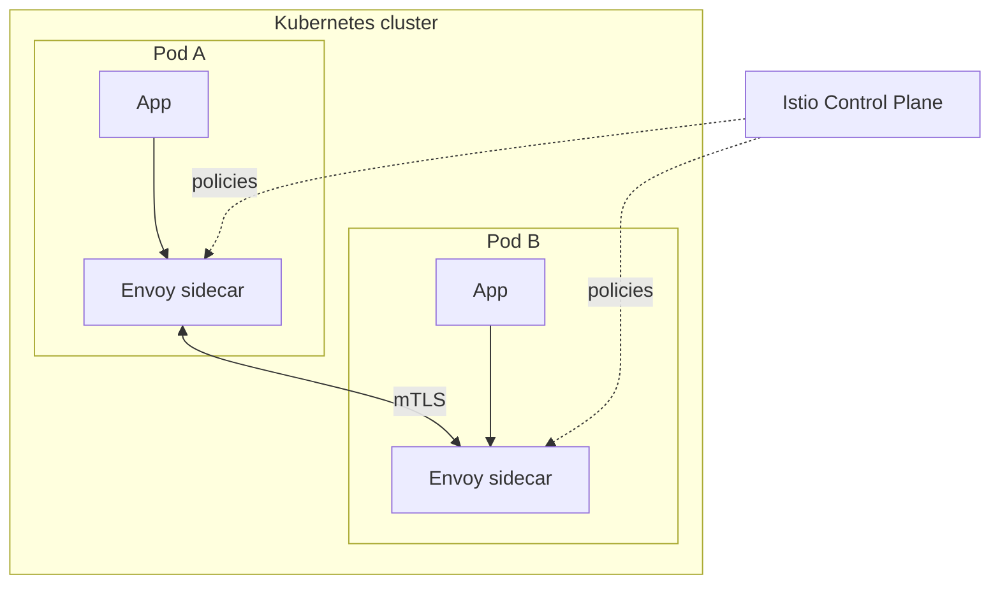

# Сети и протоколы


### 1. Что такое OSI-модель и TCP/IP — в чём разница

**OSI-модель** — 7 уровней (Physical, Data Link, Network, Transport, Session, Presentation, Application). Это **концептуальная** модель для разговора о сетях. **TCP/IP** — 4 уровня (Link, Internet, Transport, Application) — **практическая** модель, по которой реально работает интернет.

**Соответствие уровней:**

| OSI                                       | TCP/IP      | Примеры              |
|-------------------------------------------|-------------|----------------------|
| 1. Physical                               | Link        | Ethernet, Wi-Fi      |
| 2. Data Link                              | Link        | ARP, MAC             |
| 3. Network                                | Internet    | IP, ICMP, BGP        |
| 4. Transport                              | Transport   | TCP, UDP             |
| 5–7. Session / Presentation / Application | Application | HTTP, DNS, TLS, SMTP |

**На собеседовании важно:** понимать, на каком уровне живёт каждый протокол (DNS — Application, IP — Network, TCP — Transport) и где решаются конкретные проблемы (маршрутизация — Network, доставка — Transport, шифрование — Presentation/Application).

### 2. TCP vs UDP: в чём разница и когда что использовать

| Критерий             | **TCP**                                         | **UDP**                                        |
|----------------------|-------------------------------------------------|------------------------------------------------|
| Соединение           | connection-oriented (SYN/SYN-ACK/ACK handshake) | connectionless                                 |
| Доставка             | гарантия (ретрансмит, порядок)                  | best-effort                                    |
| Порядок              | да (sequence numbers)                           | нет                                            |
| Контроль потока/окна | да (sliding window, congestion)                 | нет                                            |
| Header               | 20 байт                                         | 8 байт                                         |
| Latency              | выше (ACK, ретрансмиссии)                       | ниже                                           |
| Примеры              | HTTP, HTTPS, SSH, SMTP, PostgreSQL              | DNS, VoIP, видео, игры, NTP, QUIC (внутри UDP) |

**Когда TCP:** REST API, базы данных, email — нужен порядок и доставка.

**Когда UDP:** DNS-запросы (быстрее, потери не критичны), стриминг (потеря кадра важнее задержки), realtime-игры.

**На middle-уровне:** уверенно объяснить таблицу и дать 2–3 примера для каждого.

### 3. Как работает TCP-соединение: handshake и teardown

**Three-way handshake (установка):**
1. Клиент → `SYN` (seq=x)
2. Сервер → `SYN-ACK` (seq=y, ack=x+1)
3. Клиент → `ACK` (ack=y+1) — соединение установлено

**Four-way teardown (закрытие):**
1. Клиент → `FIN` (хочу закрыть)
2. Сервер → `ACK`
3. Сервер дописал данные → `FIN`
4. Клиент → `ACK` — соединение закрыто (TIME_WAIT ~60с, чтобы дошли поздние пакеты)

**Ключевые состояния** (для сетевого debug):
- `ESTABLISHED` — активное соединение
- `TIME_WAIT` — клиент ждёт «остатки» (~60 с)
- `CLOSE_WAIT` — сервер не закрыл — признак утечки соединений
- `FIN_WAIT_2` — ожидаем FIN от сервера

```bash
ss -tan | head -20   # кто и на каком состоянии
# CLOSE_WAIT в больших количествах — у кода не закрываются соединения
```

### 4. Что такое TLS/SSL handshake и как он работает

TLS (Transport Layer Security) — шифрование канала поверх TCP. **TLS 1.2** (классика) и **TLS 1.3** (быстрее, безопаснее, по умолчанию в современных браузерах).

**TLS 1.3 handshake (упрощённо):**
1. `ClientHello` — клиент шлёт поддерживаемые cipher suites + `random`
2. `ServerHello` + `Certificate` — сервер выбирает cipher, шлёт сертификат
3. `Finished` от сервера — клиент проверяет подпись и шлёт `Finished`
4. Дальше — **шифрованный** обмен данными (симметричное шифрование, ключи согласованы через ECDHE)

**Ключевые концепции:**
- **Certificate** — X.509, подписан CA; браузер проверяет цепочку до trusted root
- **ECDHE** — ephemeral key exchange, forward secrecy (даже если приватный ключ утечёт — старые сессии не раскрыть)
- **Cipher suite** — набор: `TLS_AES_128_GCM_SHA256` = аутентификация + шифрование + hash
- **SNI** (Server Name Indication) — клиент в `ClientHello` сообщает, какой хост хочет, чтобы один IP мог обслуживать множество сайтов

**Что спрашивают на собеседовании:** почему HTTPS (порт 443), что такое certificate pinning, как работает SNI, чем TLS 1.3 лучше 1.2 (1 RTT вместо 2, меньше cipher suites, обязательная forward secrecy).

### 5. Что такое HTTP и каков жизненный цикл запроса

**HTTP** (HyperText Transfer Protocol) — текстовый протокол уровня Application поверх TCP. **HTTP/1.1** — по умолчанию, **HTTP/2** (binary framing, multiplexing) и **HTTP/3** (на UDP/QUIC, ещё быстрее) — поддерживаются современными серверами и браузерами.

**Жизненный цикл запроса:**
```
Клиент → DNS lookup (имя → IP)
      → TCP handshake (или TLS)
      → HTTP request (method, URL, headers, body)
      → Сервер → HTTP response (status, headers, body)
      → TCP teardown (или keep-alive)
```

**HTTP/1.1 features:**
- `Connection: keep-alive` — одно TCP-соединение на много запросов (по умолчанию)
- `Pipelining` — несколько запросов без ожидания ответов (на практике мало используется)
- `Chunked encoding` — ответ передаётся кусками, без заранее известного `Content-Length`
- `Caching` — `ETag`, `Cache-Control`, `If-None-Match`

**HTTP/2** (по умолчанию в Chrome на HTTPS):
- **Binary framing** — бинарные фреймы вместо текста
- **Multiplexing** — много request/response по одному TCP-соединению (нет head-of-line blocking на HTTP-уровне)
- **Header compression** (HPACK)
- **Server push** (в новых версиях — deprecated)

**HTTP/3** (на QUIC/UDP):
- Устойчив к packet loss (каждый stream независим)
- 0-RTT connection establishment (возвращающиеся клиенты)

**На middle-уровне:** достаточно знать разницу HTTP/1.1 vs HTTP/2 (multiplexing) и понимать, что HTTP/3 = HTTP поверх QUIC на UDP.

### 6. Что такое DNS и как работает запрос

**DNS** (Domain Name System) — иерархическая система имён → IP-адреса. Работает поверх UDP (порт 53), иногда TCP (для больших ответов, zone transfer).

**Иерархия:**
```
.com (TLD)
  ├── example.com (NS: ns1.example-dns.net)
  │     ├── www (A: 93.184.216.34)
  │     ├── api (CNAME → www)
  │     └── mx (MX: mail.example.com)
  └── another.com
```

**Типы записей (самые важные):**
- **A** — IPv4 адрес
- **AAAA** — IPv6 адрес
- **CNAME** — алиас на другое имя
- **MX** — почтовый сервер
- **NS** — nameserver зоны
- **TXT** — произвольный текст (SPF, DKIM)
- **PTR** — обратный lookup (IP → имя)
- **SOA** — Start of Authority (параметры зоны)

**Как работает запрос (recursive resolution):**
1. Клиент → local DNS resolver (192.168.x.x)
2. Resolver → root server `.` (a.root-servers.net)
3. Root → TLD `.com` (a.gtld-servers.net)
4. TLD → authoritative NS `example.com` (ns1.example-dns.net)
5. NS → ответ A-записью
6. Resolver кэширует ответ (TTL) → клиенту

**TTL** (Time To Live) — сколько секунд ответ живёт в кэше. Меньше TTL → быстрее обновление, но больше нагрузка на DNS.

```bash
dig example.com A +trace   # полный путь
dig example.com +short     # только ответ
nslookup example.com
host -t MX example.com     # почтовый сервер
```

### 7. Что такое IP-адреса и подсети (CIDR)

**IP-адрес** — 32 бита (IPv4) или 128 бит (IPv6). **IPv4** — `a.b.c.d` (каждый октет 0-255). **IPv6** — 8 групп по 16 бит в hex (`2001:db8::1`).

**CIDR** (Classless Inter-Domain Routing) — способ описать подсеть: `IP/маска`.
- `192.168.1.0/24` — маска 255.255.255.0, 256 адресов (0-255)
- `192.168.1.0/16` — маска 255.255.0.0, 65536 адресов
- `10.0.0.0/8` — «внутренняя» сеть, 16 777 216 адресов

**Классы (исторические):**
- **A** (1-126.x.x.x) — крупные сети, /8
- **B** (128-191.x.x.x) — средние, /16
- **C** (192-223.x.x.x) — мелкие, /24
- **D** (224-239) — multicast
- **E** (240-255) — reserved

**Private-диапазоны** (RFC 1918, не роутятся в интернет):
- `10.0.0.0/8`
- `172.16.0.0/12` (172.16-31.x.x)
- `192.168.0.0/16`

**NAT** (Network Address Translation) — преобразование внутренних IP в внешний (и обратно), чтобы один публичный IP обслуживал множество внутренних машин. В облаках (AWS VPC, GCP VPC) подсети — основа сети.

### 8. Что такое HTTP status codes и как их группировать

**Классы статусов (4-значных кодов):**
- **1xx** — Informational (100 Continue, 101 Switching Protocols)
- **2xx** — Success
  - `200 OK` — обычный успех
  - `201 Created` — ресурс создан (REST POST)
  - `202 Accepted` — принято, но обработка асинхронная
  - `204 No Content` — успех без тела (DELETE)
- **3xx** — Redirect
  - `301 Moved Permanently` — новый URL навсегда (кэшируется)
  - `302 Found` — временный редирект
  - `304 Not Modified` — кэш валиден, тело не передаём (с `ETag`)
  - `307 Temporary Redirect` — временный, метод сохраняется
  - `308 Permanent Redirect` — постоянный, метод сохраняется
- **4xx** — Client Error
  - `400 Bad Request` — malformed запрос
  - `401 Unauthorized` — нужна аутентификация
  - `403 Forbidden` — авторизован, но нет доступа
  - `404 Not Found` — ресурс не найден
  - `409 Conflict` — конфликт (REST: дубликат, версия)
  - `422 Unprocessable Entity` — semantically invalid
  - `429 Too Many Requests` — rate limit
- **5xx** — Server Error
  - `500 Internal Server Error` — generic
  - `501 Not Implemented`
  - `502 Bad Gateway` — upstream вернул garbage
  - `503 Service Unavailable` — временно недоступен
  - `504 Gateway Timeout` — upstream не ответил

**Частые ошибки в REST-дизайне:**
- Возвращать `200` для ошибок (вместо `4xx`/`5xx`)
- Путать `401` (не авторизован) и `403` (авторизован, но не может)
- Возвращать `200` с пустым телом вместо `204` для DELETE

### 9. Что такое proxy и типы прокси

**Proxy** — промежуточный сервер между клиентом и origin-сервером. Бывает **forward proxy** (клиент → proxy → интернет, для корпоративных сетей) и **reverse proxy** (клиент → proxy → origin, за сервером).

**Типы reverse proxy:**
- **Load balancer** — распределяет трафик между экземплярами (nginx, HAProxy, ALB)
- **Caching proxy** — кеширует ответы (Varnish, nginx cache)
- **TLS termination** — завершает TLS, дальше — plain HTTP (AWS ALB, nginx)
- **API gateway** — маршрутизация, аутентификация, rate limiting (Kong, Apigee)

**Пример nginx reverse proxy:**
```nginx
upstream backend {
    server 10.0.0.1:8080;
    server 10.0.0.2:8080;
}
server {
    listen 443 ssl;
    server_name api.example.com;
    ssl_certificate /etc/ssl/cert.pem;
    ssl_certificate_key /etc/ssl/key.pem;
    location / {
        proxy_pass http://backend;
        proxy_set_header Host $host;
        proxy_set_header X-Real-IP $remote_addr;
        proxy_read_timeout 60s;
    }
}
```

**Зачем reverse proxy:**
- Терминация TLS (серверы не трогают сертификаты)
- Балансировка нагрузки
- Кеширование статики
- Rate limiting, WAF
- Health checks и failover

### 10. Что такое load balancing и алгоритмы распределения

**Load balancing** — распределение входящего трафика между несколькими инстансами приложения, чтобы:
- Не перегружать один инстанс
- Обеспечивать отказоустойчивость (failover)
- Позволять горизонтально масштабироваться

**Уровни балансировки:**
- **L4 (Transport)** — по IP+порт (TCP, UDP). Быстрый, но «глупый» (не смотрит HTTP-заголовок). Примеры: AWS NLB, nginx stream.
- **L7 (Application)** — по HTTP-заголовкам, cookie, URL. Медленнее, но гибче (path-based routing, A/B). Примеры: AWS ALB, nginx http, HAProxy.

**Алгоритмы:**
- **Round-robin** — по кругу (по умолчанию)
- **Weighted round-robin** — с весами (большие инстансы — больше запросов)
- **Least connections** — тому, у кого меньше активных соединений
- **IP hash** — sticky по IP клиента (session affinity)
- **Consistent hashing** — стабильное распределение (минимум перемещений при добавлении/удалении ноды)

**Health checks** — балансировщик периодически опрашивает инстансы (`/actuator/health`) и убирает из пула те, что не отвечают. **Session stickiness** (sticky session) — один клиент всегда на одном инстансе (проблема: нарушает stateless-принцип, лучше external session store).

### 11. Что такое firewall и сетевая безопасность

**Firewall** — устройство/программа, фильтрующая сетевой трафик по правилам. Бывает:
- **Stateless** — фильтрует каждый пакет независимо
- **Stateful** — следит за состоянием соединений (TCP handshake, ACK), разрешает ответ на исходящий запрос

**Уровни защиты:**
- **Network firewall** — по IP, порту, протоколу (iptables, nftables, AWS Security Groups)
- **Application firewall (WAF)** — по содержимому HTTP (ModSecurity, AWS WAF)
- **Host-based firewall** — на конкретной машине (iptables, ufw)

**Пример iptables:**
```bash
# Разрешить HTTP и HTTPS, только с конкретного IP
iptables -A INPUT -p tcp --dport 80 -s 10.0.0.0/8 -j ACCEPT
iptables -A INPUT -p tcp --dport 443 -j ACCEPT
iptables -A INPUT -j DROP   # всё остальное — блок
```

**AWS Security Groups** (stateful, allow-only):
```yaml
- CidrIp: 10.0.0.0/8
  FromPort: 8080
  ToPort: 8080
  IpProtocol: tcp
```

**WAF rules** (OWASP Top 10):
- SQL injection
- XSS
- Path traversal (`../../etc/passwd`)
- Malicious user agents
- CC attack (rate limiting)

### 12. Что такое VPN и как он работает

**VPN** (Virtual Private Network) — создание приватного туннеля поверх публичной сети. Типы:

- **Site-to-site** — соединяет две сети (офис + офис, офис + облако). Пример: AWS Site-to-Site VPN, IPsec tunnel.
- **Client-to-site (remote access)** — пользователь из дома подключается к корпоративной сети. Пример: OpenVPN, WireGuard, Cisco AnyConnect.
- **WireGuard** — современный, быстрый, простой протокол (по умолчанию в AWS Client VPN, Proton VPN).
- **IPsec** — классический протокол для site-to-site (ESP, AH).
- **OpenVPN** — гибкий, поддерживает TLS и IPsec.

**Как работает WireGuard (упрощённо):**
1. Клиент и сервер обмениваются public keys (Diffie-Hellman)
2. Устанавливается symmetric key
3. Все пакеты шифруются ChaCha20-Poly1305
4. Ноль overhead на handshake (stateless)

**Зачем VPN:**
- Шифрование трафика (WIFI в кафе, публичные сети)
- Обход гео-блокировок
- Доступ к корпоративной сети извне
- Соединение веток офисов (SD-WAN)

**Проблемы VPN:**
- Latency (шифрование + обход)
- Single point of failure (сервер)
- Scale (ограничение по числу клиентов)

### 13. Что такое CDN и как он работает

**CDN** (Content Delivery Network) — распределённая сеть edge-серверов по всему миру, которая кэширует контент ближе к пользователям.

**Как работает:**
1. Клиент → ближайший edge (по GeoDNS)
2. Edge проверяет кэш
   - **Hit** — отдаёт из кэша (быстро)
   - **Miss** — идёт на origin-сервер, кеширует ответ, отдаёт клиенту
3. Дальнейшие запросы — hit (быстро)

**Что кэшируют:**
- Статика (CSS, JS, изображения, видео)
- HTML (если `Cache-Control` позволяет)
- API-ответы (если идемпотентные и с `ETag`)

**Пример nginx cache:**
```nginx
proxy_cache_path /var/cache/nginx levels=1:2
    keys_zone=my_cache:10m max_size=1g inactive=60m;

server {
    location /api/ {
        proxy_pass http://backend;
        proxy_cache my_cache;
        proxy_cache_key $scheme$proxy_host$request_uri;
        proxy_cache_valid 200 10m;
        proxy_cache_stale_while_revalidate 30s;
    }
}
```

**Плюсы CDN:**
- Latency (ближе к пользователю)
- Нагрузка на origin (меньше запросов)
- DDoS mitigation (распределение)
- Global reachability

**Примеры:** CloudFlare, Akamai, AWS CloudFront, Fastly.

### 14. Что такое DDoS и как от него защищаться

**DDoS** (Distributed Denial of Service) — атака, когда множество ботов/компрометированных машин шлют трафик на цель, чтобы её «положить».

**Типы атак:**
- **Volume-based** (L3/L4) — flood пакетов (UDP, ICMP, SYN flood). Цель — исчерпать bandwidth.
- **Protocol-based** (L3/L4) — SYN flood (half-open connections), amplification (DNS, NTP reflection).
- **Application-layer** (L7) — HTTP flood (много GET/POST на `/login`), Slowloris (медленные соединения), R.U.D.Y.

**Защита (многоуровневая):**
1. **CDN / DDoS protection** (CloudFlare, AWS Shield) — фильтрует на edge
2. **Rate limiting** — на балансировщике (nginx, APISIX)
3. **WAF rules** — блокирует подозрительные patterns
4. **Anycast** — распределяет трафик на множество IP (AWS, CloudFlare)
5. **Syn cookies** — stateless SYN-ACK (ядро Linux)
6. **Blackholing** — временно отбрасывает трафик на атакованный IP

**nginx rate limiting:**
```nginx
limit_req_zone $binary_remote_addr zone=api:10m rate=10r/s;
server {
    location /api/ {
        limit_req zone=api burst=20 nodelay;
        proxy_pass http://backend;
    }
}
```

### 15. Что такое REST vs GraphQL vs gRPC

| Критерий       | **REST**                    | **GraphQL**          | **gRPC**                         |
|----------------|-----------------------------|----------------------|----------------------------------|
| Протокол       | HTTP/1.1 или HTTP/2         | HTTP/1.1 (POST)      | HTTP/2 (binary)                  |
| Формат         | JSON                        | JSON                 | Protocol Buffers (binary)        |
| Эндпоинты      | много (`/users`, `/orders`) | один (`/graphql`)    | методы в `.proto`                |
| Over-fetching  | да (все поля)               | нет (только нужные)  | нет (определённый schema)        |
| Under-fetching | да (несколько запросов)     | нет (одним запросом) | нет                              |
| Кэширование    | легко (GET)                 | сложнее (POST)       | нет (идемпотентность)            |
| Streaming      | нет (chunked)               | подписки (WebSocket) | да (server/client/bidirectional) |
| Типизация      | Swagger/OpenAPI             | SDL (GraphQL)        | `.proto` (сильная)               |
| Использование  | публичные API               | фронтенд, mobile     | микросервисы (внутренние)        |

**REST** — де-факто стандарт для публичных API. **GraphQL** — когда клиенту нужны «ровно те поля, что нужны» (mobile, web с разными UI). **gRPC** — между микросервисами (быстро, сильно типизировано, streaming).

**Когда что:**
- Публичный API → REST (простота, кэширование, универсальность)
- Фронтенд с разными UI (mobile + web) → GraphQL (гибкие запросы)
- Внутренние микросервисы → gRPC (производительность, typing)

### 16. Что такое WebSocket и как он работает

**WebSocket** — full-duplex протокол поверх TCP (порт 80/443), который устанавливает одно длинное соединение и позволяет обмениваться сообщениями в обе стороны без overhead HTTP-заголовков.

**Handshake:**
1. Клиент → HTTP GET с `Upgrade: websocket` + `Connection: Upgrade` + `Sec-WebSocket-Key`
2. Сервер → `101 Switching Protocols` + `Sec-WebSocket-Accept`
3. Дальше — бинарные/текстовые фреймы (не HTTP)

**Пример (Spring WebSocket):**
```java
@Controller
public class WsController {
    @MessageMapping("/chat")          // клиент шлёт
    public void handle(@Payload String msg) {
        logger.info("Received: {}", msg);
    }
}

@Configuration
@EnableWebSocketMessageBroker
public class WsConfig implements WebSocketMessageBrokerConfigurer {
    public void configureMessageBroker(MessageBrokerRegistry reg) {
        reg.enableSimpleBroker("/topic");
        reg.setApplicationDestinationPrefixes("/app");
    }
}
```

**Когда WebSocket:**
- Realtime чаты, уведомления
- Live-дашборды (метрики, котировки)
- Многопользовательские игры
- Совместное редактирование (collaborative editing)

**Противопоставление REST:**
- **REST** — request/response (клиент инициирует)
- **WebSocket** — full-duplex (сервер может сам слать)

**Проблемы:**
- Stateful (сложнее масштабировать — нужен sticky session или broadcast через Redis pub/sub)
- Не кэшируется
- TLS termination на proxy (nginx) должен поддерживать `Upgrade`

### 17. Что такое API Gateway и его функции

**API Gateway** — единая точка входа для клиентских запросов к микросервисам (см. также вопрос 422). Функции:
- **Маршрутизация** — по URL/path → нужный микросервис
- **Аутентификация и авторизация** — проверка JWT, OAuth2
- **Rate limiting** — ограничение по клиенту/IP
- **TLS termination**
- **Caching** — кэш ответов (idempotent GET)
- **Logging и metrics** — единый лог всех запросов
- **Transformation** — преобразование запроса (REST → gRPC, versioning)
- **Circuit breaker** — защита от каскадных сбоев
- **Versioning** — `/api/v1/...` vs `/api/v2/...`

**Примеры:** AWS API Gateway, Kong, Apigee, Zuul (Netflix), Spring Cloud Gateway.

**Spring Cloud Gateway (reactive):**
```java
@Bean
public RouteLocator routes(RouteLocatorBuilder builder) {
    return builder.routes()
        .route("orders", r -> r.path("/api/orders/**")
            .filters(f -> f.rewritePath("/api/orders/(?<seg>.*)", "/orders/$\{seg}"))
            .uri("lb://order-service"))
        .route("users", r -> r.path("/api/users/**")
            .uri("lb://user-service"))
        .build();
}
```

### 18. Что такое mTLS и зачем он нужен

**mTLS** (mutual TLS) — расширение TLS, при котором **и клиент, и сервер** предъявляют сертификаты друг другу. В обычном TLS проверяется только сервер (клиент доверяет CA).

**Как работает:**
1. ClientHello
2. ServerHello + Certificate (сервер)
3. **CertificateRequest** (сервер просит сертификат клиента)
4. Клиент → Certificate (клиент) + CertificateVerify
5. Дальше — шифрованный обмен

**Зачем mTLS:**
- **Zero Trust** — сервисы в микросервисной архитектуре удостоверяют друг друга
- **Kubernetes Service Mesh** (Istio, Linkerd) — автоматический mTLS между подами (см. вопрос 617)
- **High-security environments** — банковские API, IoT
- **Безопасность без IP-based аутентификации** — сертификат = идентичность

**Пример (Kubernetes + Istio):**
```yaml
# Включаем mTLS по умолчанию в namespace
apiVersion: security.istio.io/v1beta1
kind: PeerAuthentication
metadata:
  name: default
  namespace: default
spec:
  mtls:
    mode: STRICT   # mTLS обязателен
```

**Как получить сертификаты для mTLS:**
- **Private CA** (свой) — для внутренней сети
- **Public CA** (Let's Encrypt, DigiCert) — для публичных API
- **SPIFFE/SPIRE** — стандарт для сервис-идентичности (Kubernetes, service mesh)

### 19. Что такое service mesh и зачем он нужен

**Service Mesh** — слой сетевой абстракции для микросервисов, который «встраивается» в каждый под (sidecar-прокси) и предоставляет:
- **mTLS** между сервисами (автоматически)
- **Traffic management** — canary, A/B, retries, timeouts
- **Observability** — distributed tracing, metrics
- **Resilience** — circuit breaker, bulkhead
- **Service discovery** — автоматический

**Примеры:** **Istio** (самый популярный), **Linkerd**, **Cilium** (eBPF-based, без sidecar).

**Архитектура Istio:**


**Когда нужен service mesh:**
- Много микросервисов (>10)
- Нужен mTLS без ручного управления сертификатами
- Нужны advanced traffic policies (canary, retries)
- Нужна observability без изменений в коде

**Когда не нужен:**
- Малое число сервисов (простые таймауты/retries в коде)
- Высокая чувствительность к latency (sidecar = overhead)
- Команда не готова к сложности (Istio — это «зверь»)

### 20. Что такое networking в Kubernetes (Pod, Service, Ingress)

**Уровни сети в K8s:**
1. **Pod** — имеет свой IP (ClusterIP), доступен внутри кластера
2. **Service** — виртуальный IP + DNS имя, балансировка между подами
   - `ClusterIP` (по умолчанию) — только внутри кластера
   - `NodePort` — открывает порт на каждом ноде (30000-32767)
   - `LoadBalancer` — внешний cloud LB (AWS ELB, GCP LB)
   - `ExternalName` — CNAME на внешний DNS
3. **Ingress** — L7 маршрутизация (по host/path) на Service
4. **NetworkPolicy** — firewall между подами (allow/deny по label)

**Пример Service + Ingress:**
```yaml
apiVersion: v1
kind: Service
metadata:
  name: api
spec:
  selector:
    app: api
  ports:
    - port: 80
      targetPort: 8080
---
apiVersion: networking.k8s.io/v1
kind: Ingress
metadata:
  name: api
  annotations:
    nginx.ingress.kubernetes.io/rewrite-target: /
spec:
  rules:
    - host: api.example.com
      http:
        paths:
          - path: /
            pathType: Prefix
            backend:
              service:
                name: api
                port:
                  number: 80
```

**DNS в K8s:**
- Pod: `pod-name.namespace.svc.cluster.local`
- Service: `service-name.namespace.svc.cluster.local`
- CoreDNS (по умолчанию) резолвит имена внутри кластера

**NetworkPolicy (firewall):**
```yaml
apiVersion: networking.k8s.io/v1
kind: NetworkPolicy
metadata:
  name: allow-frontend-only
  namespace: backend
spec:
  podSelector:
    matchLabels:
      app: api
  ingress:
    - from:
        - namespaceSelector:
            matchLabels:
              name: frontend
      ports:
        - port: 8080
```

### 21. Что такое DNS в Kubernetes и как работает service discovery

**DNS в K8s** — CoreDNS (по умолчанию) или coredns + node-local DNS cache. Каждый Service получает DNS-запись:
- `service-name.namespace.svc.cluster.local` → ClusterIP
- `service-name.svc.cluster.local` (default namespace)

**Как работает:**
1. Приложение в поде делает `getaddrinfo("api-svc.default.svc.cluster.local")`
2. Запрос идёт на CoreDNS (Service `kube-dns` в namespace `kube-system`)
3. CoreDNS резолвит в ClusterIP (виртуальный IP)
4. Traffic идёт через kube-proxy (iptables/ipvs) на поды с соответствующими label

**Service discovery — два подхода:**
- **DNS-based** (по умолчанию) — приложение резолвит имя в IP
- **Client-side** — приложение опрашивает API K8s (Kube Client) и выбирает под

**Headless Service** (`clusterIP: None`):
- Не создаёт виртуальный IP
- DNS возвращает **все** IP подов (round-robin)
- Используется для statefulset (каждый под имеет стабильное имя)

**Пример:**
```yaml
apiVersion: v1
kind: Service
metadata:
  name: postgres
spec:
  clusterIP: None   # headless
  selector:
    app: postgres
  ports:
    - port: 5432
```

Тогда `postgres-0.postgres.default.svc.cluster.local` резолвится в IP первого пода.

### 22. Что такое Zero Trust Network

**Zero Trust** — модель безопасности, где **никому не доверяем по умолчанию** (ни внутренним пользователям, ни сервисам, ни устройствам). Каждый запрос авторизуется независимо.

**Принципы:**
1. **Never trust, always verify** — каждый запрос проверяется (даже из внутренней сети)
2. **Least privilege** — минимальные права
3. **Micro-segmentation** — сеть разбита на зоны, между ними — firewall
4. **Assume breach** — предположим, что сеть уже скомпрометирована
5. **Continuous verification** — постоянная проверка (не «раз при входе»)

**Как реализовать:**
- **mTLS** между сервисами (service mesh)
- **Identity-based access** (OAuth2, OIDC, SPIFFE)
- **Network segmentation** (NetworkPolicy в K8s, VPC в облаке)
- **Micro-segmentation** — каждый под имеет свою политику
- **Zero Trust Network Access (ZTNA)** — альтернатива VPN (CloudFlare Access, Zscaler)

**Противопоставление «perimeter security»:**
- **Классика** — «внутри — доверяем, снаружи — нет» (VPN)
- **Zero Trust** — «внутри и снаружи — проверяем каждый запрос»

**Технологии Zero Trust:**
- **SPIFFE/SPIRE** — standard для сервис-идентичности
- **Service mesh** (Istio, Linkerd) — mTLS + policies
- **ZTNA** — CloudFlare Access, Zscaler, Palo Alto Prisma
- **IAM** — AWS IAM, Okta, Keycloak


