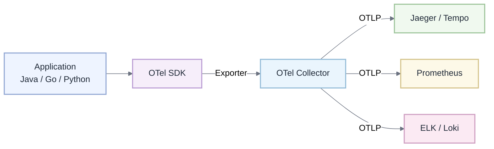
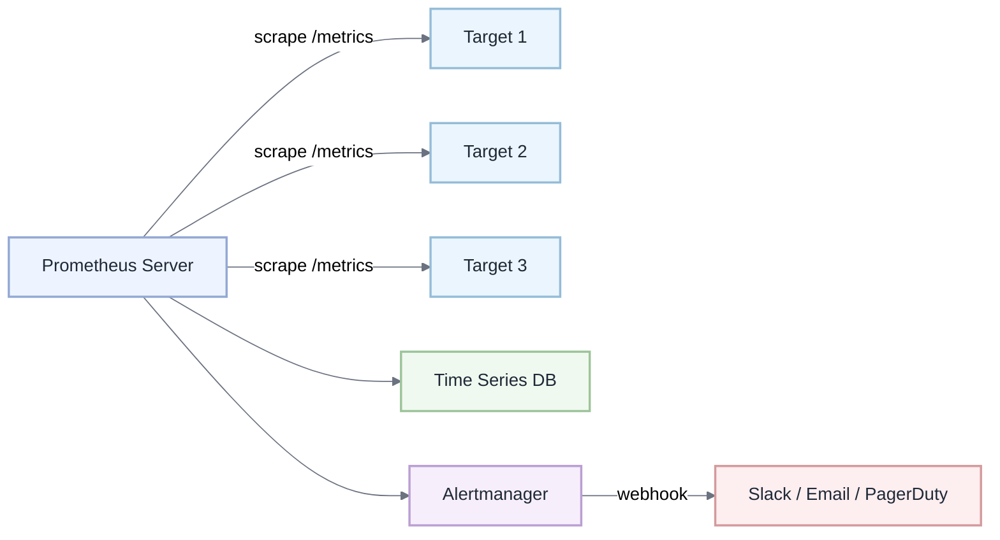
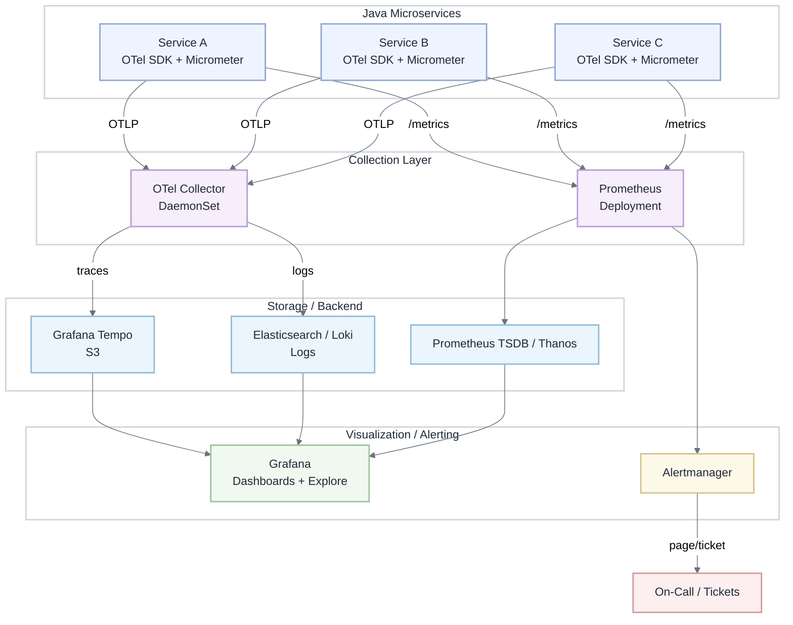

# Observability & Monitoring

### 1. Что такое observability и в чём её отличие от мониторинга

Observability (наблюдаемость) — свойство системы, позволяющее понять её внутреннее состояние по внешним наблюдениям (логи, метрики, трассировки). Термин пришёл из теории управления: система наблюдаема, если по её выходам можно однозначно определить состояние.

- **Мониторинг** — измерение заранее известных метрик + алерты по порогам: «знаем, что сломалось».
- **Observability** — возможность исследовать неизвестное: «почему запрос стал медленнее на 40%, хотя все пороги в норме».

Ключевое отличие:

| | Мониторинг | Observability |
|---|---|---|
| Вопрос | «Что сломалось?» | «Почему?» |
| Метрики | Заранее определены | Любые (включая ad-hoc) |
| Алерты | Пороговые | По SLO/SLI (симптомные) |
| Данные | Агрегированные | Сырые + агрегированные |
| Инструменты | Zabbix, Nagios | OpenTelemetry, Jaeger, Prometheus, ELK |

Три столпа наблюдаемости:
- **Метрики** — числовые измерения во времени: CPU, задержки, ошибки, пропускная способность.
- **Логи** — дискретные события с метаданными: timestamp, level, trace id, message.
- **Трассировки** — путь запроса через сервисы: span-ы с parent-child связями.

Сравнение на примере:
- **Мониторинг** отвечает на «что»: аптайм упал, CPU > 90%.
- **Наблюдаемость** отвечает на «почему»: p99 вырос на 200 мс — из-за N+1 запроса в БД, паузы GC или блокировки в пуле потоков.
- В микросервисной архитектуре без наблюдаемости диагностировать проблемы невозможно (100+ сервисов, распределённые вызовы).

Пример:
- **Мониторинг**: «API вернул 500 на 2% запросов» (алерт по порогу).
- **Наблюдаемость**: «Из 2% ошибок 90% — timeout в вызове к сервису X; p95 X = 2 c (раньше 200 мс); trace id `abc123` показывает, что 1.8 с ушло на запрос к БД; план запроса — full table scan» → причина: пропал индекс после миграции.

**Итог:**
- Мониторинг — часть наблюдаемости.
- Наблюдаемость — более широкая концепция: мониторинг + возможность исследовать неизвестное.


### 2. Что такое OpenTelemetry: SDK, Collector, контекст и пропагация

OpenTelemetry (OTel) — стандарт (CNCF) для телеметрии. Заменяет проприетарные решения (Jaeger client, Zipkin, Datadog SDK).

- **Единый API и SDK** — сбор метрик, логов и трассировок из любого приложения.
- **Vendor-neutral** — экспортирует в любой бэкенд (Jaeger, Tempo, Prometheus, ELK, Datadog).

Архитектура:


**OTel SDK** — библиотека в приложении. Создаёт spans, метрики, логи и экспортирует их.

- `TracerProvider` → `Tracer` → `Span`.
- `MeterProvider` → `Meter` → метрики (Counter, Histogram, Gauge).
- `LoggerProvider` → `Logger` (OpenTelemetry Logging API).
- `Context` — несёт активный span, trace id, span id, baggage (metadata).

**OTel Collector** — агент/демон. Собирает телеметрию из SDK (по OTLP) и экспортирует в бэкенды (Jaeger, Prometheus, ELK).

- Режимы развёртывания: DaemonSet (на каждом узле) или Deployment (центральное).
- `Receiver` — принимает данные: OTLP, Prometheus scrape, Jaeger, Zipkin.
- `Processor` — трансформирует: batch, attrs, tail sampling.
- `Exporter` — отправляет в бэкенд: OTLP, Prometheus, Elastic.

**Пропагация (Propagation)** — передача trace context между сервисами.

- **Стандарт** — W3C Trace Context: заголовки `traceparent` (`00-<trace-id>-<span-id>-<flags>`, 32 hex + 16 hex + 2 hex) и `tracestate` (vendor-specific metadata, например `sampling decision`).
- **Альтернатива** — B3 (Zipkin): `X-B3-TraceId`, `X-B3-SpanId`.
- **Legacy** — формат Jaeger.
- OTel поддерживает все форматы одновременно (multi-propagator).

Пример (Java):
```java
// 1. Инициализация SDK (Spring Boot 3: open-telemetry dependency)
GlobalOpenTelemetry otel = GlobalOpenTelemetry.get();
Tracer tracer = otel.getTracer("my-service");

// 2. Создание span
Span span = tracer.spanBuilder("processOrder").startSpan();
try (Scope scope = span.makeCurrent()) {
    // бизнес-логика
    orderService.process(order);
} finally {
    span.end();
}

// 3. Пропагация в HTTP-запросе (WebClient / RestTemplate)
HttpClient httpClient = HttpClient.newBuilder()
    .builder()
    .propagator(W3CTraceContextPropagator.getInstance())
    .build();
// OTel auto-instrumentation добавит traceparent в заголовки
```

Для большинства фреймворков достаточно подключить auto-instrumentation-агент: в Java — `opentelemetry-javaagent.jar` (bytecode injection без изменения кода), в Go — `otelhttp` middleware, в Python — пакеты `opentelemetry-instrumentation-*`.

Collector нужен не только как прокси:
- Разделяет приложение от бэкенда (можно менять бэкенд без перекомпиляции).
- Объединяет запросы в батчи (меньше сетевых вызовов).
- Выполняет tail sampling (отбрасывает «неинтересные» трассировки после сбора).
- Фильтрует лишние атрибуты.
- Маршрутизирует разные типы телеметрии в разные бэкенды.

**Итог:**
- OpenTelemetry — единый стандарт для телеметрии.
- SDK живёт в приложении, Collector — на уровне инфраструктуры.
- W3C Trace Context — для пропагации между сервисами.
- Бэкенд можно менять без изменения кода.


### 3. Как устроен Prometheus: pull-модель, PromQL, recording rules, alerting rules

Prometheus — система мониторинга (CNCF). Де-факто стандарт в Kubernetes.

- **Pull-модель** — Prometheus сам опрашивает (scrape) целевые сервисы по HTTP-эндпоинту `/metrics`.
- **TSDB** — встроенное хранилище time series.
- **PromQL** — язык запросов.
- **Alertmanager** — роутинг алертов.

Архитектура:


**Time series** — последовательность значений во времени.

- Каждая метрика с конкретным набором меток (labels) — отдельная series.
- Пример: `http_requests_total{method="GET", status="200"}` — одна series; `http_requests_total{method="POST", status="500"}` — другая.
- Метки — пары «ключ-значение», идентифицирующие series.
- **Важно**: не создавать метки с высокой кардинальностью (`user_id`, `request_id`) — переполнит хранилище.

**Pull-модель** — Prometheus сам опрашивает цели по HTTP, а не принимает данные от них.

- Преимущества: не нужно открывать исходящие порты, легко обнаруживать новые цели через service discovery, централизованное управление.
- Недостаток: задержка до `scrape_interval` (обычно 15–30 c).
- Для event-driven сценариев (batch jobs) используют **Pushgateway**.

**Service Discovery** — механизм обнаружения целей.

- **Kubernetes** — Prometheus автоматически находит Pod'ы через API.
- **Consul и другие** — поддерживаются.
- **Статическая конфигурация** — `scrape_configs` в `prometheus.yaml`.

**PromQL** — язык запросов к Prometheus.

- **Селекторы**: `metric_name{label="value"}` (фильтр) или `metric_name` (все series).
- **Арифметические операторы**: +, -, *, /.
- **Сравнения**: >, <, ==, !=.
- **Агрегации**: `sum`, `avg`, `max`, `min`, `count`, `topk`, `bottomk`.
- **Функции времени**: `rate()` (средняя скорость за интервал), `increase()` (прирост), `irate()` (мгновенная скорость), `delta()`, `deriv()`, `predict_linear()`.
- **Группировка**: `by` / `without` по меткам.

Примеры PromQL:
```promql
# 1. request rate (запросы/сек) за 5 минут
sum(rate(http_requests_total[5m]))

# 2. error rate (доля ошибок)
sum(rate(http_requests_total{status=~"5.."}[5m]))
  /
sum(rate(http_requests_total[5m]))

# 3. p95 latency
histogram_quantile(0.95,
  sum(rate(http_request_duration_seconds_bucket[5m])) by (le))

# 4. top 5 endpoints по request rate
topk(5, sum(rate(http_requests_total[5m])) by (endpoint))

# 5. CPU usage (ядра)
sum(rate(container_cpu_usage_seconds_total[5m])) by (pod)
```

**Recording Rules** — предвычисленные выражения, результат которых хранится в хранилище.

Зачем:
- Ускорение сложных запросов (предвычислить `sum(rate(...))` раз в 30 c).
- Алерты по recording rule вместо raw-запроса.
- Экономия ресурсов (меньше вычислений при каждом обращении).

```yaml
# prometheus.rules
groups:
  - name: api
    interval: 30s
    rules:
      - record: job:http_requests:rate5m
        expr: sum(rate(http_requests_total[5m])) by (job)
      - record: job:http_errors:rate5m
        expr: sum(rate(http_requests_total{status=~"5.."}[5m])) by (job)
```

**Alerting Rules** — условия, по которым Prometheus отправляет алерт в Alertmanager.

```yaml
groups:
  - name: api
    rules:
      - alert: HighErrorRate
        expr: >
          sum(rate(http_requests_total{status=~"5.."}[5m]))
          /
          sum(rate(http_requests_total[5m])) > 0.05
        for: 5m
        labels:
          severity: critical
        annotations:
          summary: "High error rate on {{ $labels.job }}"
          description: "Error rate is {{ $value | humanize }} (threshold 5%)"

      - alert: HighLatency
        expr: histogram_quantile(0.95, sum(rate(http_request_duration_seconds_bucket[5m])) by (le)) > 1
        for: 10m
        labels:
          severity: warning
        annotations:
          summary: "p95 latency > 1s on {{ $labels.job }}"
```

**Alertmanager** — роутер алертов.

- Группирует алерты по job и severity.
- Ингибирует (critical приглушает warning).
- Поддерживает silencing (временное отключение на период работ).
- Маршрутизация — разные каналы для разных severity.

Данные хранятся во встроенной TSDB (Time Series Database), оптимизированной для time series.

- Период хранения по умолчанию 15 дней (настраивается `--storage.tsdb.retention.time`).
- Для долгосрочного хранения и горизонтального масштабирования используют Thanos, Cortex или Mimir (хранение в S3).

**Итог:**
- Prometheus — pull-модель + PromQL + recording/alerting rules + Alertmanager.
- Де-факто стандарт в Kubernetes.
- Для долгосрочного хранения и горизонтального масштабирования — Thanos/Cortex/Mimir.


### 4. Как устроена distributed-трассировка: Jaeger/Tempo, trace propagation, sampling

Distributed трассировка — техника, при которой каждый запрос получает уникальный trace id, который передаётся между всеми сервисами. Позволяет собрать полный путь запроса, увидеть время на каждом участке, выявить узкие места и источник ошибок.

**Trace** — полный путь запроса от клиента до последнего сервиса.

**Span** — отдельный участок trace (например, «HTTP-запрос к сервису X» или «вызов к БД»).

Поля span:
- `trace id` — общий для всей трассировки.
- `span id` — уникальный для span.
- `parent span id` — ссылка на родительский.
- `name` — например, `GET /users`.
- `start time` и `duration`.
- `attributes` — метаданные: `http.status`, `db.statement`.
- `events` — например, «exception thrown».

**Trace propagation** — передача trace context между сервисами.

- **Стандарт** — W3C Trace Context: заголовки `traceparent` и `tracestate`.
- **Альтернатива** — B3 (Zipkin): `X-B3-TraceId`, `X-B3-SpanId`.
- **Legacy** — формат Jaeger.
- OTel поддерживает все форматы одновременно (multi-propagator).

Хранилище трассировок: 
- **Jaeger** (CNCF) — query API, UI, хранилище Cassandra или Elasticsearch; 
- **Grafana Tempo** — S3-based, горизонтально масштабируемый, тесная интеграция с Grafana; 
- **Zipkin** — legacy, проще, хранилище Elasticsearch; 
- **LightStep**, **Honeycomb** — коммерческие.

**Sampling** — отбор трассировок (не все интересны).

- **Head-based** — решение на входе (client): «записать 10% запросов».
  - Преимущество: мало данных, легко реализовать.
  - Недостаток: если редкий запрос с ошибкой не отобран, он не виден.
- **Tail-based** — решение на выходе (Collector): «записать все запросы, где есть ошибка или p99 > 1 c».
  - Преимущество: все «интересные» трассировки сохраняются.
  - Недостаток: нужно временно хранить все трассировки до принятия решения, выше нагрузка на Collector.

Пример (OTel + Jaeger):
```java
// Service A
Span span = tracer.spanBuilder("processOrder").startSpan();
try (Scope scope = span.makeCurrent()) {
    orderService.process(order);
    // WebClient auto-instrumentation добавит traceparent в заголовки
    userService.getUser(order.getUserId());
} finally {
    span.end();
}

// Service B (получает traceparent из заголовков)
// OTel auto-instrumentation создаёт child span с тем же trace id
```

Поиск трассировок:
- **Jaeger UI** — по trace id, operation, tags.
- **Grafana Tempo** — через Explore: trace-и, метрики и логи коррелированы по trace id. Можно перейти из метрики в trace и затем в лог.

**Итог:**
- Distributed-трассировка — стандарт для микросервисов.
- OpenTelemetry — для сбора, W3C Trace Context — для пропагации, Jaeger или Tempo — для хранения и запросов.
- Tail-based sampling — для production: сохраняет трассировки с ошибками и медленные.


### 5. Что такое Micrometer: registry, custom meters, таймеры, distribution summary

Micrometer — vendor-neutral библиотека для сбора метрик в Java.

- Аналог Dropwizard Metrics, но универсальная.
- Интегрирована в Spring Boot 2+ через auto-config.
- Экспортирует метрики в любую registry: Prometheus, Datadog, StatsD, JMX, Influx.

**Meter** — метрика. 

Четыре типа: 
- **Counter** — монотонно возрастающее значение (например, `http_requests_total`); 
- **Gauge** — мгновенное значение (например, `heap_memory_used`); 
- **Timer** — время выполнения (например, `http_request_duration_seconds`); 
- **DistributionSummary** — распределение значений (например, `response_size_bytes`).

**Registry** — бэкенд хранения метрик (Prometheus, Datadog, JMX, Influx).

- **CompositeRegistry** — позволяет одновременно экспортировать в несколько registry.
- Собственные метрики создаются через Micrometer API.

Примеры:

```java
// 1. Counter
Counter counter = Counter.builder("orders.created")
    .description("Total orders created")
    .tag("channel", "web")
    .register(meterRegistry);
counter.increment(); // +1

// 2. Gauge
Gauge.builder("heap.memory.used", () -> Runtime.getRuntime().totalMemory() - Runtime.getRuntime().freeMemory())
    .register(meterRegistry);

// 3. Timer
Timer timer = Timer.builder("order.processing")
    .description("Time to process an order")
    .tag("type", "standard")
    .register(meterRegistry);
timer.record(() -> orderService.process(order)); // measure + execute

// 4. DistributionSummary
DistributionSummary summary = DistributionSummary.builder("response.size")
    .description("Response size in bytes")
    .register(meterRegistry);
summary.record(responseBytes);

// 5. Custom (functional)
Gauge.builder("active.connections", connectionPool, ConnectionPool::getActiveConnections)
    .register(meterRegistry);
```

В Spring Boot `MeterRegistry` доступен через auto-config:

```java
@Autowired
MeterRegistry meterRegistry;

// В controller'е
@GetMapping("/orders")
public Mono<List<Order>> getOrders() {
    return Timer.builder("orders.get")
        .register(meterRegistry)
        .record(Mono.defer(() -> orderService.findAll()));
}
```

**DistributionSummary** хранит распределение значений.

- Перцентили (p50, p90, p95, p99) предвычислены (в отличие от Prometheus, где `histogram_quantile` вычисляется на лету).
- Также хранит count, sum и max.
- Перцентили настраиваются через `serviceLevelObjectives`:

```java
DistributionSummary summary = DistributionSummary.builder("response.size")
    .serviceLevelObjectives(0.5, 0.9, 0.95, 0.99) // p50, p90, p95, p99
    .register(meterRegistry);
```

**Observation API** (Spring Boot 3) — аннотация `@Observed` автоматически создаёт span и метрику одновременно.

- `Observation` — API для ручного создания.
- Интегрируется с Micrometer и OpenTelemetry:

```java
@Observed(name = "order.processing", contextualName = "Process Order")
public Order processOrder(OrderDto dto) {
    // Micrometer auto-creates:
    // - Timer "order.processing"
    // - Span "order.processing" (if OTel enabled)
}
```

**Итог:**
- Micrometer — стандарт для сбора метрик в Java.
- Используй Counter/Gauge/Timer/DistributionSummary, Spring Boot auto-config.
- Observation API — для трассировки + метрик одновременно.
- Экспорт в Prometheus (де-факто) или Datadog/StatsD.


### 6. Что такое RED-методология и USE-методология

RED и USE — две методологии для мониторинга микросервисов.

RED (Rate, Errors, Duration) — для user-facing сервисов (API, front-end):
- **Rate** — количество запросов в единицу времени (requests/sec).
- **Errors** — доля ошибок (5xx, 4xx, timeout).
- **Duration** — время запросов (p50, p95, p99).

```promql
# Rate
sum(rate(http_requests_total[5m])) by (job)

# Errors
sum(rate(http_requests_total{status=~"5.."}[5m])) by (job)
  /
sum(rate(http_requests_total[5m])) by (job)

# Duration (p95)
histogram_quantile(0.95,
  sum(rate(http_request_duration_seconds_bucket[5m])) by (job, le))
```

RED:
- Популярен простотой: три метрики, быстро настроить.
- Ориентирован на пользователя — показывает то, что видит пользователь (скорость, ошибки).
- Типовые алерты: доля ошибок > 5% или p95 > 1 c.

**USE (Utilization, Saturation, Errors)** — для ресурсов (CPU, память, диск, сеть, пул потоков, пул соединений).

- **Utilization (загрузка)** — доля времени, когда ресурс занят (например, CPU usage 70%).
- **Saturation (насыщение)** — степень насыщения (например, длина очереди, ожидающие запросы, OOM).
- **Errors (ошибки)** — ошибки (например, disk I/O errors, connection refused).

```promql
# CPU utilization
sum(rate(container_cpu_usage_seconds_total[5m])) by (pod)

# Memory saturation
container_memory_working_set_bytes / container_spec_memory_limit_bytes

# Disk I/O errors
rate(node_disk_io_errors[5m])

# Thread pool saturation
tomcat_threads_busy / tomcat_threads_current
```

USE:
- Ориентирован на ресурсы, помогает видеть узкие места (CPU, память, диск).
- Прогнозный характер: насыщение предсказывает деградацию до того, как появятся ошибки.
- Типовые алерты: CPU > 80% (загрузка), длина очереди > 100 (насыщение).

| | RED | USE |
|---|---|---|
| Для | User-facing API | Ресурсы (CPU, память, диск) |
| Вопрос | «Что видит пользователь?» | «Какой ресурс в узком месте?» |
| Метрики | Rate, Errors, Duration | Utilization, Saturation, Errors |
| Алерты | Доля ошибок, p95-латентность | CPU > 80%, длина очереди |
| Пример | API, front-end | Kubernetes pod, JVM, БД |

На практике:
- **RED** ставят на каждый user-facing сервис (API, BFF, front-end).
- **USE** — на каждый ресурс (CPU, память, диск, сеть, пул потоков, пул соединений, Kafka consumer lag).
- Вместе дают полную картину: RED отвечает «что сломалось для пользователя», USE — «почему» (какой ресурс в узком месте).

**Итог:**
- RED — для пользователя, USE — для ресурсов.
- Используй обе для полной картины.
- RED — симптом, USE — причина.


### 7. Как агрегировать логи: ELK/Loki, structured logging, MDC

Log aggregation — централизация логов из всех сервисов в одной системе. Без этого невозможно диагностировать проблемы в микросервисах (логи разбросаны по 100+ серверам/подам).

**ELK (Elasticsearch, Logstash, Kibana):**
- **Elasticsearch** — поисковый движок с full-text search и JSON indexing.
- **Logstash** — pipeline для сбора и трансформации: input → filter → output.
- **Kibana** — UI для поиска и визуализации.
- Преимущества: мощный поиск, аналитика, ML.
- Недостатки: тяжёлый (RAM, CPU), дорогой (лицензия), сложный в администрировании.

**Loki (Grafana):**
- Подход: индексирует метки, а не текст — оптимизирован для логов.
- Сбор: Promtail/Alloy (tail file, systemd journal).
- UI: Grafana.
- Преимущества: лёгкий (меньше RAM/CPU), дешёвый, простой, интеграция с Prometheus.
- Недостатки: меньше возможностей поиска (только метки + full-text на малом объёме).

Выбор:
- **ELK** — для крупных компаний со сложной аналитикой и ML.
- **Loki** — для Kubernetes-native стеков, Prometheus-экосистемы и экономии ресурсов.

**ELK (Elasticsearch, Logstash, Kibana):**
- **Elasticsearch** — поисковый движок с full-text search и JSON indexing.
- **Logstash** — pipeline для сбора и трансформации: input → filter → output.
- **Kibana** — UI для поиска и визуализации.
- Преимущества: мощный поиск, аналитика, ML.
- Недостатки: тяжёлый (RAM, CPU), дорогой (лицензия), сложный в администрировании.

**Loki (Grafana):**
- Подход: индексирует метки, а не текст — оптимизирован для логов.
- Сбор: Promtail/Alloy (tail file, systemd journal).
- UI: Grafana.
- Преимущества: лёгкий (меньше RAM/CPU), дешёвый, простой, интеграция с Prometheus.
- Недостатки: меньше возможностей поиска (только метки + full-text на малом объёме).

Выбор:
- **ELK** — для крупных компаний со сложной аналитикой и ML.
- **Loki** — для Kubernetes-native стеков, Prometheus-экосистемы и экономии ресурсов.

**Structured Logging** — логи в структурированном формате (JSON), а не обычный текст:
```json
{"timestamp":"2026-01-15T10:30:00Z","level":"ERROR","service":"order-api","trace_id":"abc123","span_id":"def456","message":"Failed to process order","order_id":123,"error":"timeout"}
```
Преимущества структурированных логов:
- Поиск по любому полю (не только текст).
- Корреляция с trace-ами (trace_id, span_id).
- Агрегация (например, count по level).
- Индексация (Loki индексирует метки, Elasticsearch — всё).

**MDC (Mapped Diagnostic Context)** — контекст на ThreadLocal для логов (SLF4J/Logback).
```java
// Spring Boot: MDC auto-populated (trace_id, span_id)
log.info("Processing order {}", orderId);
// Итог: "Processing order 123" + MDC (trace_id, span_id)

// Ручное
MDC.put("userId", "user123");
log.info("User action");
MDC.remove("userId");
```

В Reactor:
- MDC не работает (ThreadLocal теряется между переключениями потоков).
- Используй `Context` (см. Q704) + logback-reactive или OTel.

Пример (Logback + JSON):
```xml
<!-- logback-spring.xml -->
<configuration>
    <appender name="JSON" class="ch.qos.logback.core.ConsoleAppender">
        <encoder class="net.logstash.logback.encoder.LogstashEncoder">
            <customFields>{"service":"${APP_NAME}"}</customFields>
        </encoder>
    </appender>
    <root level="INFO">
        <appender-ref ref="JSON"/>
    </root>
</configuration>
```

**Итог:**
- Loki — Kubernetes-native, лёгкий, Prometheus-экосистема.
- ELK — мощный, но сложный.
- Structured logging (JSON) + MDC (или Context в Reactor) — обязательны для корреляции с trace-ами и поиска.


### 8. Что такое SLO, SLI, SLA и error budgets

**SLI (Service Level Indicator)** — метрика качества сервиса (например, доля успешных запросов, p95-латентность, uptime).

**SLO (Service Level Objective)** — цель по SLI (например, 99.9% успешных запросов за месяц, p95-латентность < 500 ms).

**SLA (Service Level Agreement)** — контракт с клиентом (например, 99.9% uptime, штраф за нарушение). SLA публичный, SLO — внутренний.

**Error Budget** — допустимый объём ошибок за период = 100% − SLO.

- Пример: SLO = 99.9% → error budget = 0.1% = 43.8 min downtime за месяц.
- Баланс между надёжностью и скоростью релизов:
  - Бюджет исчерпан → замораживают релизы (только bugfix).
  - Остаток большой → можно рискнуть с релизами.

Примеры SLI/SLO:

| SLI | SLO | Период | Error Budget |
|---|---|---|---|
| Uptime (доля успешных запросов) | 99.9% | Месяц | 43.8 min |
| p95-латентность | < 500 ms | Месяц | 5% запросов > 500 ms |
| Error rate | < 0.1% | Час | 0.1% ошибок |
| Availability | 99.95% | Квартал | 6.2 hours |

Как вычислить:
```promql
# Uptime SLI (доля успешных запросов)
1 - (
  sum(rate(http_requests_total{status=~"5.."}[30d]))
  /
  sum(rate(http_requests_total[30d]))
)

# p95 latency SLI
histogram_quantile(0.95,
  sum(rate(http_request_duration_seconds_bucket[30d])) by (le)) < 0.5
```

Скорость расходования бюджета (burn rate) — как быстро SLO расходует error budget.

- Burn rate 1 — расход по плану (100% бюджета за 30 дней).
- 5× — пять раз быстрее (бюджет за ~6 дней).
- 10× — за день.
- 100× — за несколько часов.
- На практике алертируют по burn rate, а не по порогам CPU: это симптом, который не зависит от архитектуры.

Классический приём из книги Google SRE — multi-window, multi-burn-rate:

- Два окна: 1 час и 6 часов.
- Два порога burn rate: 5× и 1×.
- **Page** (критично, телефон on-call) — burn rate 5× в окне 1 часа: острый инцидент, который скоро исчерпает бюджет.
- **Ticket** (тихо, Slack) — burn rate 1× в окне 6 часов: медленное, но стабильное расхождение, которое без внимания исчерпает бюджет за месяц.
- Два окна фильтруют шум: короткое окно ловит резкий спад, длинное — медленный дрейф.

Пример (Prometheus) — SLI как доля успешных запросов и два порога burn rate:
```promql
# SLI: fraction of successful requests (200-299):
sum(rate(http_requests_total{status=~"2.."}[5m]))
/
sum(rate(http_requests_total[5m]))

# Burn rate 5× (1h window, 5× faster than 0.1%):
(
  1 - (
    sum(rate(http_requests_total{status=~"2.."}[1h]))
    /
    sum(rate(http_requests_total[1h]))
  )
) > (5 * 0.001)  # 5× 0.1% = 0.5%

# Burn rate 1× (6h window, 1× faster than 0.1%):
(
  1 - (
    sum(rate(http_requests_total{status=~"2.."}[6h]))
    /
    sum(rate(http_requests_total[6h]))
  )
) > (1 * 0.001)  # 1× 0.1% = 0.1%
```

В Alertmanager это два правила — критичное (page) и тихое (ticket):
```yaml
- alert: HighErrorRatePage
  expr: (1 - (sum(rate(http_requests_total{status=~"2.."}[1h])) / sum(rate(http_requests_total[1h])))) > 0.005
  for: 5m
  labels:
    severity: page
  annotations:
    summary: "SLO burn rate 5× — page on-call"

- alert: HighErrorRateTicket
  expr: (1 - (sum(rate(http_requests_total{status=~"2.."}[6h])) / sum(rate(http_requests_total[6h])))) > 0.001
  for: 30m
  labels:
    severity: ticket
  annotations:
    summary: "SLO burn rate 1× — ticket"
```

Смысл подхода:
- Не алертить на причину («CPU high»), а на симптом («доля ошибок высокая»).
- Держать один алерт на SLO вместо десяти на десять причин.
- Меньше алертов, но все осмысленные — alert fatigue снижается.

**Итог:**
- SLI — метрика, SLO — цель, SLA — контракт, error budget — допустимый объём ошибок.
- Burn rate — скорость расходования бюджета.
- Multi-window (1h page + 6h ticket) + multi-burn-rate (5× + 1×) — стандарт Google SRE.
- Алерты по SLO (burn rate) — по симптомам, а не по причинам.
- Error budget — баланс между надёжностью и скоростью релизов.


### 9. Как стратегии алертинга: симптомы vs причины, alert fatigue

Alert fatigue — усталость от алертов: слишком много шумных алертов, команда игнорирует все, реальные проблемы пропадают в шуме.

**Симптомные алерты** — по тому, что видит пользователь.

- Примеры: доля ошибок > 5%, p95-латентность > 1 c, uptime < 99.9%, корреляция с SLO (error budget burn rate).
- Преимущества: мало алертов, только важные, понятны команде, не зависят от внутренней архитектуры (можно менять код без изменения алертов).

**Причинные алерты** — по внутренним метрикам.

- Примеры: CPU > 80%, память > 90%, disk I/O errors, Kafka consumer lag > 1000.
- Преимущества: proactive (видят проблему до того, как пользователь увидит), помогают с диагностикой.
- Недостатки: много алертов (шум), ложные положительные (CPU высокий, но пользователь не страдает), зависят от архитектуры (при изменении кода нужно менять алерты).

Практика:
- **Page** (кричать) — только симптомы (доля ошибок, p95-латентность, uptime).
- **Ticket** (тихо) — причины (CPU, память, диск) — для диагностики.
- **Ингибирование**: если симптом сработал, ингибировать причины (не кричать по CPU, если уже кричим по доле ошибок).
- **Группировка**: group by job, severity (не по каждому поду).

Конфигурация Alertmanager:
```yaml
route:
  group_by: ['job', 'severity']
  group_wait: 30s
  group_interval: 5m
  repeat_interval: 4h
  routes:
    - matchers:
        - severity = "critical"
      receiver: page-oncall
    - matchers:
        - severity = "warning"
      receiver: ticket
inhibit_rules:
  - source_matchers:
      - severity = "critical"
    target_matchers:
      - severity = "warning"
    equal: ['job', 'instance']
```

**Итог:**
- Page — симптомы (то, что видит пользователь).
- Ticket — причины (внутренние метрики).
- Ингибирование + группировка — борьба с alert fatigue.
- SLO-based alerting (burn rate) — лучший подход: симптом + количественная оценка.


### 10. Что такое Micrometer Observation API и @Observed

Observation API (Micrometer 1.10+, Spring Boot 3) — унифицированный API для создания span и метрики одновременно.

- Раньше: `Tracer.spanBuilder(...)` для трассировки + `Timer.builder(...)` для метрики — два вызова, два контекста.
- С Observation: один вызов создаёт span + Timer + low/high cardinality метрики (например, error count).

API:
```java
// 1. Annotation @Observed
@Observed(name = "order.processing", contextualName = "Process Order")
public Order processOrder(OrderDto dto) {
    // Micrometer auto-creates:
    // - Span "order.processing" (if OTel enabled)
    // - Timer "order.processing"
    // - Counter "order.processing.errors" (if exception)
}

// 2. Manual (Observation.create)
Observation observation = Observation.createNotStarted("order.processing", tracer)
    .contextualName("Process Order")
    .lowCardinalityKeyValue("type", dto.getType())
    .start();
try (Observation.Scope scope = observation.openScope()) {
    // business logic
    return orderService.process(dto);
} catch (Exception e) {
    observation.error(e);
    throw e;
} finally {
    observation.stop();
}

// 3. With Reactor (Mono/Flux)
Mono<Order> result = Mono.fromCallable(() -> orderService.process(dto))
    .observe(Observation.createNotStarted("order.processing", tracer));
```

**Low cardinality** (например, `type`, `endpoint`):
- Мало уникальных значений.
- Можно использовать как label в метриках.

**High cardinality** (например, `user_id`, `request_id`):
- Много уникальных значений.
- Только в span-ах (не в метриках, иначе переполнит хранилище).

```java
.observation
    .lowCardinalityKeyValue("endpoint", "/orders")  // label in metrics
    .highCardinalityKeyValue("user_id", "123")      // only in span
```

Auto-observation:
- **Spring Web** — для HTTP-запросов (GET/POST → span + Timer).
- **Spring Data** — для JPA-запросов.
- **Spring Kafka** — для producer/consumer.
- Свои — через `@Observed` или `Observation.createNotStarted`.

**Итог:**
- Observation API — унифицированный API для трассировки + метрик.
- @Observed — аннотация для авто-создания span и метрик.
- Низкая/высокая кардинальность — важно для метрик (не переполнить БД).
- Spring Boot 3 — auto-observation для HTTP, JPA, Kafka.


### 11. Как настроить корреляцию логов, метрик и trace-ов

Корреляция — связь логов, метрик и трассировок по общим идентификаторам. Без корреляции невозможно перейти из метрики в trace в лог.

- **Trace id** — общий для всей трассировки.
- **Span id** — уникальный для span.
- **Request id** — уникальный для HTTP-запроса (может совпадать с trace id или быть отдельным).

**Логи**: trace id и span id в каждом логе (MDC / Context).
```java
// Spring Boot: MDC auto-populated (trace_id, span_id)
log.info("Processing order {}", orderId);
// Вывод (JSON):
// {"timestamp":"...","level":"INFO","trace_id":"abc123","span_id":"def456","message":"Processing order 123"}
```

**Метрики**:

- Trace id как label не рекомендуется (высокая кардинальность).
- Лучше агрегированные метрики (без trace id) + связь через endpoint/operation:
```java
// НЕ: Counter.builder("requests").tag("trace_id", traceId) — высокая кардинальность
// ДА: Counter.builder("requests").tag("endpoint", "/orders").tag("status", "200")
```

**Trace-и**: span с атрибутами (endpoint, status, user_id).

В Grafana Explore trace-и, метрики и логи коррелированы по trace id:

1. Дашборд показывает p95-латентность.
2. Клик на метрику ведёт к trace-ам (по endpoint/time).
3. Клик на trace ведёт к span-ам (по trace id).
4. Клик на span ведёт к логам (по trace id + span id).

В Reactor:
- MDC не работает (ThreadLocal теряется).
- Используют `Context` + logback-reactive или OTel (auto-populated).

**Итог:**
- Корреляция: trace id в логах (MDC/Context) + агрегированные метрики (без trace id) + trace-и (span-ы).
- Grafana Explore — переход из метрики в trace, затем в логи по trace id.
- Ручная корреляция с высокой кардинальностью — антипаттерн.


### 12. Как построить observability-стек для Java-микросервисов (референс-архитектура)

Референс-архитектура observability для Java-микросервисов в Kubernetes:



В каждом сервисе — **OTel SDK**: Java agent (`opentelemetry-javaagent.jar`) для auto-instrumentation (HTTP, JPA, Kafka), Micrometer для метрик (Timer, Counter, Gauge), Observation API для единой трассировки + метрик.

**OTel Collector** (DaemonSet) принимает OTLP (gRPC), выполняет batch, attrs и tail sampling, экспортирует в Tempo (trace-и) и Loki/ES (логи).

**Prometheus** (Deployment) скрейпит `/metrics` с каждого сервиса, хранит recording rules (предвычисленные запросы) и alerting rules (SLO-based). Долгосрочное хранение — Thanos/Cortex (S3).

**Grafana Tempo** — S3-based, горизонтально масштабируемый, trace-и + метрики + логи в Explore.

**Loki** — Alloy/Promtail собирают логи (file tail), Grafana — UI. Structured logging (JSON) + MDC (trace_id, span_id).

**Grafana** — дашборды (RED + USE), Explore (корреляция trace-и + метрики + логи), алерты (SLO-based, burn rate).

**Alertmanager** — группировка, ингибирование, silencing, роутинг: page (critical) / ticket (warning).

Лучшая практика:
- Auto-instrumentation (OTel Java agent) вместо ручной instrumentации.
- Structured logging (JSON) + MDC обязательно.
- SLO-based alerting (burn rate) по симптомам, не по причинам.
- Tail sampling (OTel Collector) — сохранять trace-и с ошибками и медленные.
- Низкая/высокая кардинальность (Micrometer) — не переполнить хранилище.
- Grafana Explore — корреляция (метрики → trace-и → логи).

**Итог:**
- OTel SDK (auto-instrumentation) + Micrometer (метрики) + OTel Collector (батчинг, sampling).
- Prometheus (метрики) + Tempo (trace-и) + Loki (логи) + Grafana (визуализация) + Alertmanager (алерты).
- SLO-based alerting + корреляция — ключ к production-ready наблюдаемости.


### 13. Какие бывают типы метрик: Counter, Gauge, Timer, Histogram — когда какой

Типы метрик:
| Тип | Пример | Семантика | Применение |
|-----|--------|-----------|----------|
| Counter | `requests_total` | монотонно растёт (reset только на 0 после restart) | количество событий |
| Gauge | `heap_used_bytes` | текущее значение (может расти и падать) | уровень ресурса |
| Timer | `request_duration` | duration + count | время операции |
| Histogram | `response_size` | distribution (buckets) | распределение значений |

Counter (Micrometer):
```java
Counter.builder("orders_created")
  .description("Созданные заказы")
  .tag("status", "success")
  .register(meterRegistry)
  .increment();
```

Gauge:
```java
Gauge.builder("db_pool_active", dataSource, DataSource::getActiveConnections)
  .description("Активные connection'ы в пуле")
  .register(meterRegistry);
```

Timer:
```java
Timer.builder("order_service.create")
  .tag("endpoint", "POST /orders")
  .register(meterRegistry)
  .record(() -> orderService.create(order));
```

Histogram:
```java
DistributionSummary.builder("response_size_bytes")
  .serviceLevelObjectives(1024, 10240, 102400, 1024000)  // buckets
  .register(meterRegistry)
  .record(responseBody.length());
```

В Prometheus Counter мапится в `counter` (с суффиксом `total`), Gauge → `gauge`, Timer → `histogram` + `summary` (перцентили), Histogram → `histogram`.

**Итог:**
- Counter — количество событий (монотонно).
- Gauge — текущее состояние (уровень).
- Timer — время операции (= Histogram + count).
- Histogram — распределение (бакеты для перцентилей).

### 14. Что такое кардинальность и почему высокая кардинальность — проблема

Кардинальность = количество уникальных time series (комбинация метрики + меток).

Пример:
```
http_requests_total{method="GET", path="/users/{id}", status="200"}
```
Если `{id}` — 100000 уникальных пользователей → 100000 time series (высокая кардинальность).

Проблемы высокой кардинальности:
- Память: каждая time series — ~1-2 KB меток + samples; 1 млн series → GB.
- Медленные запросы: `sum by (path)` по 1 млн series — секунды.
- Хранение: 15 дней × 1 млн series = тяжёлая БД.
- Раздувание WAL (write-ahead log растёт).

Примеры низкой vs высокой кардинальности:
| Низкая | Высокая |
|--------|---------|
| `http_requests_total{method="GET"}` (1) | `http_requests_total{user_id="user_12345"}` (100000) |
| `db_pool_active{db="postgres"}` (1) | `cache_size_bytes{key="user_12345"}` (100000) |
| `order_created_total{status="success"}` (1) | `order_created_total{order_id="order_12345"}` (1000000) |


**Route template** (шаблон маршрута) вместо path:
```java
// ПЛОХО (высокая кардинальность):
.tag("path", request.getRequestURI())  // /users/12345 → 100000 series

// ХОРОШО (низкая кардинальность):
.tag("route", request.getHandler().toString())  // UserController.getUser → 100 series
```

**Не метить user_id, order_id** — только status, method, endpoint:
```java
Timer.builder("orders.create")
  .tag("status", "success")       // OK (2-3 values)
  // .tag("user_id", userId)      // НЕ (100000 values)
  .register(meterRegistry);
```

**Агрегация**:
- Если нужна детализация — в логи (Loki), не в метрики (Prometheus).
- Micrometer: только tags с низкой кардинальностью; высокая кардинальность → логи + MDC.

Мониторинг кардинальности:
```promql
# Количество time series:
count(http_requests_total)

# Рост:
rate(count(http_requests_total)[1h])

# Top-10 metrics по cardinality:
topk(10, count by (__name__)({}))
```

Alert:
```yaml
- alert: HighCardinality
  expr: count(http_requests_total) > 50000
  for: 5m
  labels:
    severity: warning
```

**Итог:**
- Кардинальность = количество уникальных time series.
- Высокая кардинальность → память, медленные запросы, раздувание WAL.
- Решение: route template вместо path, не метить `user_id`/`order_id`.
- Высокая кардинальность → логи (Loki), а не метрики.

### 14.1. Как технически ограничить высокую кардинальность в Micrometer (MeterFilter)

Даже если договорились не использовать `user_id` в тегах, разработчики могут ошибиться. В Spring Boot это предотвращается глобально через `MeterFilter`:

```java
@Configuration
public class MetricsConfig {

    @Bean
    public MeterFilter denyHighCardinalityTags() {
        return new MeterFilter() {
            @Override
            public Meter.Id map(Meter.Id id) {
                // Принудительно удаляем опасные теги из всех метрик
                return id.replaceTags(id.getTags().stream()
                    .filter(tag -> !tag.getKey().equals("user_id"))
                    .filter(tag -> !tag.getKey().equals("order_id"))
                    .toList());
            }

            @Override
            public DistributionStatisticConfig configure(Meter.Id id, DistributionStatisticConfig config) {
                // Ограничиваем количество перцентилей для экономии памяти
                return DistributionStatisticConfig.builder()
                    .percentiles(0.5, 0.95, 0.99)
                    .build()
                    .merge(config);
            }
        };
    }
}
```

Упоминание `MeterFilter.deny()` или `MeterFilter.maximumAllowableTags()` показывает, что ты:
- Не просто знаешь теорию.
- Умеешь защитить production-кластер от OOM из-за раздувания Prometheus TSDB.

### 15. Как устроен Prometheus: TSDB, chunks, compaction, retention

Prometheus — pull-based TSDB (time-series database).

- Забирает метрики с эндпоинтов `/metrics` (scrape, pull).
- Хранит последние 2 часа в памяти (Head).
- На диске — chunks (2-минутные блоки) + index.
- Compaction объединяет chunks в более крупные.
- Retention удаляет старые (по умолчанию 15 дней).

Структура TSDB:
```
tsdb/
  head/            # in-memory (последние 2 ч)
  0123456789/      # chunk 1 (2 мин)
  0123456790/      # chunk 2 (2 мин)
  0123456800/      # chunk 3 (2 мин)
  index/           # inverted index (labels → series)
  wal/             # write-ahead log
```

Каждый chunk:
- Хранит 2 минуты данных (128 samples по 15-сек интервалу).
- Кодирование — XOR (Gorilla): 1.5 бит на sample.
- Сжатие — zstd, lz4.

Index:
- Inverted index (`label=value → series_ids`).
- Postings для быстрых запросов.
- Сжатие dictionary + postings.

Compaction:
- Объединяет 12 chunks (24 ч) в 1 крупный блок.
- Работает в фоне (не блокирует scrape).
- Результат: меньше файлов, быстрее чтение.

Retention:
```yaml
storage:
  tsdb:
    retention.time: 15d      # 15 дней
    retention.size: 50GB     # или 50 GB (whichever first)
    max-block-time: 48h      # max block duration
```

WAL (write-ahead log):
- Обеспечивает crash safety: если Prometheus упадёт, WAL восстанавливает head.
- Truncate — после compaction (24 ч).

Поток запроса:
1. Парсинг PromQL.
2. Inverted index (найти series).
3. Чтение chunks (head + on-disk).
4. Декодирование (Gorilla).
5. Агрегация (sum, rate, etc).

Настройка производительности:
- `--storage.tsdb.retention.time` — период хранения.
- `--web.enable-remote-write-receiver` — remote write для Thanos.
- `--storage.tsdb.max-block-time` — период compaction.
- `--storage.tsdb.wal-compression` — сжатие WAL.

**Итог:**
- Prometheus — TSDB: 2-минутные chunks, Gorilla encoding, inverted index, compaction.
- Head (in-memory, 2 ч) + on-disk (chunks) + WAL (crash safety).
- Хранение — 15 дней по умолчанию.
- Запрос: index → chunks → decode → aggregate.

### 16. Как устроена Jaeger vs Tempo vs Grafana Cloud

**Jaeger** (CNCF, graduate):
- **Состав trace-а**: span-ы (операции), trace — цепочка span-ов одного запроса.
- **Хранилище**: Cassandra, Elasticsearch, Kafka, Badger (embedded).
- **Sampling**: head-based (client) + tail-based (collector).
- **UI**: поиск по trace id, operation, tags.
- **Масштабируемость**: Cassandra — горизонтально, Badger — single node.
- **Поиск**: по tags, process (service), span (operation).

**Tempo** (Grafana Labs):
- **Хранилище**: S3, GCS, Blob, local disk.
- **Модель данных**: blocks (похоже на Prometheus TSDB).
- **Запросы**: TraceQL (новый язык запросов, 2023).
- **Tail sampling**: в OTel Collector (не в Tempo).
- **UI**: Grafana Explore (интегрирован).
- **Масштабируемость**: S3 — горизонтально (объектное хранилище).
- **Стоимость**: S3 дёшево (penny per GB), хранение — месяцы.

**Grafana Cloud** (managed):
- **Состав**: managed Prometheus + Loki (логи) + Tempo (trace-и) + Grafana.
- **UI**: один интерфейс — Grafana Explore.
- **Корреляция**: метрики ↔ trace-и ↔ логи.
- **Стоимость**: per GB (ingested) — дорого при большом объёме.
- **Ограничения**: нет self-hosting, vendor lock-in.

Сравнение:
| Фича | Jaeger | Tempo | Grafana Cloud |
|------|--------|-------|---------------|
| Хранилище | Cassandra/ES/Badger | S3/GCS/local | managed |
| Масштабируемость | высокая (Cassandra) | высокая (S3) | высокая |
| Стоимость | self-hosted | дёшево (S3) | дорого |
| Tail sampling | collector | collector | collector |
| UI | Jaeger UI | Grafana Explore | Grafana |
| Корреляция | ограничена | метрики+логи+trace-и | метрики+логи+trace-и |
| Запросы | trace ID | TraceQL | TraceQL + PromQL + LogQL |
| Self-hosted | да | да | нет |

Выбор:
- **On-premises с большим объёмом** — Jaeger (Cassandra) или Tempo (S3).
- **Cloud с корреляцией** — Grafana Cloud (managed).
- **Низкая стоимость с хранением** — Tempo (S3).

Tail Sampling в обоих случаях настраивается в **OTel Collector** (не во встроенных механизмах бэкенда) — это современный стандарт.

**Итог:**
- Jaeger (Cassandra/ES, self-hosted), Tempo (S3, TraceQL, низкая стоимость), Grafana Cloud (managed, all-in-one).
- Tail Sampling — в OTel Collector.
- On-premises → Jaeger/Tempo, cloud → Grafana Cloud, низкая стоимость → Tempo (S3).

### 17. Что такое structured logging и как настроить MDC в Java

Structured logging = логи в структурированном формате (JSON) с полями (не просто строка).

Пример:
```json
{
  "timestamp": "2024-01-15T10:30:45.123Z",
  "level": "INFO",
  "logger": "com.example.OrderService",
  "thread": "http-nio-8080-exec-1",
  "message": "Заказ создан",
  "traceId": "a1b2c3d4e5f6",
  "spanId": "1234567890",
  "orderId": "order_12345",
  "userId": "user_42",
  "duration_ms": 125
}
```

Преимущества structured:
- Поиск по полю (`orderId = "order_12345"`, не regex по строке).
- Агрегация (`avg(duration_ms) by status`).
- Корреляция (traceId + spanId → distributed-трассировка).
- Фильтрация по полю (не по message).

**MDC (Mapped Diagnostic Context)** — карта на ThreadLocal (key → value).

- Log4j2/Logback используют MDC в layout.
- Spring Boot — `MDC.put` в filter.

Настройка (Logback + JSON):
```xml
<dependency>
  <groupId>net.logstash.logback</groupId>
  <artifactId>logstash-logback-encoder</artifactId>
  <version>7.4</version>
</dependency>
```
```xml
<appender name="JSON" class="net.logstash.logback.LogstashEncoder">
  <encoder class="net.logstash.logback.encoder.LogstashEncoder">
    <customFields>{"app":"orders-service"}</customFields>
  </encoder>
</appender>
```

MDC + Spring Boot (filter):
```java
@Component
@Order(Ordered.HIGHEST_PRECEDENCE)
public class TraceFilter extends OncePerRequestFilter {
  @Override
  protected void doFilterInternal(HttpServletRequest request,
                                   HttpServletResponse response,
                                   FilterChain chain) throws Exception {
    String traceId = request.getHeader("X-Trace-Id");
    if (traceId == null) {
      traceId = UUID.randomUUID().toString();
    }
    MDC.put("traceId", traceId);
    MDC.put("requestId", request.getRequestURI());
    try {
      chain.doFilter(request, response);
    } finally {
      MDC.clear();
    }
  }
}
```

Корреляция с OTel:
```java
@Aspect
@Component
public class TraceAspect {
  @Around("execution(* com.example..*.*(..))")
  public Object trace(ProceedingJoinPoint pjp) throws Throwable {
    Span span = Span.current();
    MDC.put("traceId", span.getSpanContext().getTraceId());
    MDC.put("spanId", span.getSpanContext().getSpanId());
    try {
      return pjp.proceed();
    } finally {
      MDC.remove("traceId");
      MDC.remove("spanId");
    }
  }
}
```

Thread-safety:
- MDC — ThreadLocal, не передаётся между потоками (в CompletableFuture/ExecutorService/Virtual Threads).
- Ручное управление MDC в фильтрах или аспектах ломается при `@Async`, `CompletableFuture` или Virtual Threads.

**Современный подход в Spring Boot 3 (Observation API + Context Propagation):**

- Вместо ручных `MDC.put` используют **Micrometer Context Propagation**.
- Добавь зависимость `io.micrometer:context-propagation`.
- Включи auto-instrumentation OTel (`opentelemetry-javaagent.jar`).
- Spring автоматически пробрасывает `traceId`/`spanId` в логи через Logback/MDC — даже в виртуальных потоках и Reactor-цепочках.

```java
// Никаких ручных MDC.put! Просто используй Observation:
@Observed(name = "order.process")
public void process(Order order) {
    // Выполняется в Virtual Thread или Reactor Scheduler
    log.info("Processing order {}", order.id());
    // В JSON-логе АВТОМАТИЧЕСКИ появятся: "trace_id": "...", "span_id": "..."
}
```

Если нужна ручная передача контекста в `CompletableFuture`, используй `ContextSnapshot`:
```java
try (var scope = ContextSnapshot.setAllThreadLocalsFrom(ContextRegistry.getInstance().getCurrentContext())) {
    CompletableFuture.runAsync(() -> log.info("Trace ID сохранен!"));
}
```

### 18. Как настроить distributed-трассировку: OTel SDK, propagation, context

Distributed-трассировка = отслеживание запроса через микросервисы.

- 1 trace = 1 запрос.
- N span-ов = N операций.

OTel SDK (Java):
```xml
<dependency>
  <groupId>io.opentelemetry</groupId>
  <artifactId>opentelemetry-sdk</artifactId>
  <version>1.24.0</version>
</dependency>
<dependency>
  <groupId>io.opentelemetry</groupId>
  <artifactId>opentelemetry-sdk-trace</artifactId>
</dependency>
```

Инициализация:
```java
OpenTelemetrySdk sdk = OpenTelemetrySdk.builder()
  .setTracerProvider(
    SdkTracerProvider.builder()
      .addSpanProcessor(BatchSpanProcessor.builder(
        OtlpGrpcSpanExporter.builder()
          .setEndpoint("http://otel-collector:4317")
          .build()).build())
      .setSampler(Sampler.parentBasedRootSampler(
        Sampler.traceIdRatioBased(0.1)  // 10% traces
      ))
      .build()
  )
  .buildAndRegisterGlobal();
```

- **W3C TraceContext** (стандарт): `traceparent: 00-<trace_id>-<span_id>-<flags>`.
- **B3** (Zipkin): `X-B3-TraceId`, `X-B3-SpanId`, `X-B3-Sampled`.
- **OTel propagator**: `TraceContextPropagator`.

```java
OpenTelemetry otel = OpenTelemetrySdk.builder()
  .setPropagators(ContextPropagators.create(
    W3CTraceContextPropagator.getInstance()
  ))
  .build();
```

Ручная instrumentация:
```java
Tracer tracer = GlobalOpenTelemetry.getTracer("my-app");
Span span = tracer.spanBuilder("order.create")
  .setAttribute("order.id", orderId)
  .setAttribute("order.status", "success")
  .startSpan();
try (Span span = tracer.spanBuilder("order.create")
      .setAttribute("order.id", orderId)
      .startSpan()) {
  orderService.create(order);
}
```

Auto-instrumentation (OTel Java agent) — авто-инструментируются:
- Spring Boot.
- Servlet.
- JDBC.
- gRPC.
- Kafka.
```bash
java -javaagent:opentelemetry-javaagent.jar \
     -Dotel.traces.exporter=otlp \
     -Dotel.metrics.exporter=otlp \
     -Dotel.logs.exporter=otlp \
     -Dotel.service.name=orders-service \
     -Dotel.traces.sampler=parentbased_traceidratio:0.1 \
     -jar app.jar
```
OTel Collector:
- Принимает OTLP (gRPC/HTTP).
- Выполняет sampling и filtering.
- Экспортирует в Jaeger/Tempo.
- Батчинг: 5000 spans или 5 сек (whichever first).
- Tail sampling: trace-и с ошибками/медленные — 100%, обычные — 10%.

```yaml
receivers:
  otlp:
    protocols:
      grpc:
        endpoint: 0.0.0.0:4317

processors:
  batch:
    send_batch_size: 5000
    timeout: 5s
  tailsampling:
    decision_wait: 1s
    policies:
      - name: errors
        type: status_code
        status_code: {codes: [ERROR]}
      - name: slow
        type: probabilistic
        probabilistic: {sample_ratio: 0.1}

exporters:
  otlp/tempo:
    endpoint: tempo:4317

service:
  pipelines:
    traces:
      receivers: [otlp]
      processors: [batch, tailsampling]
      exporters: [otlp/tempo]
```

Корреляция:
- MDC (логи).
- Trace_id/span_id в Prometheus labels (через Micrometer/OTel bridge).

**Итог:**
- OTel SDK (Tracer, Span, Sampler) + Propagation (W3C TraceContext).
- OTel Java agent (auto-instrumentation) + OTel Collector (батчинг, tail sampling).
- Tempo — хранилище.
- Корреляция: MDC (логи) + trace_id (метрики).

### 19. Как построить dashboard в Grafana: RED, USE, SLO

Grafana-дашборд = визуализация:
- Метрики (Prometheus).
- Trace-и (Tempo).
- Логи (Loki).

RED (Rate, Errors, Duration) — для сервисов:
```
┌──────────────────────────────────────┐
│  Rate (req/s)     │  Errors (%/s)    │
├──────────────────────────────────────┤
│  Duration (p50/p95/p99)              │
└──────────────────────────────────────┘
```
- **Rate**: `sum(rate(http_requests_total[1m])) by (status)`.
- **Errors**: `sum(rate(http_requests_total{status=~"5.."}[1m])) / sum(rate(http_requests_total[1m]))`.
- **Duration**: `histogram_quantile(0.95, sum(rate(http_request_duration_seconds_bucket[1m])) by (le))`.

- **CPU**: загрузка (доля CPU, used %), насыщение (load average), ошибки (throttled).
- **Память**: загрузка (доля heap, used %), насыщение (паузы GC), ошибки (OOM).
- **Диск**: загрузка (доля диска, used %), насыщение (IOPS), ошибки (I/O errors).
- **Сеть**: загрузка (доля bandwidth, used %), насыщение (очередь), ошибки (retransmits).

SLO-панель:
- Доля успешных запросов (line chart).
- Остаток бюджета ошибок (gauge).
- Текущая скорость расходования (bar chart).
- Статус SLO — достигнут ли 99.9% (gauge, зелёный/красный).

Пример дашборда:
```
Ряд 1: Обзор SLO
  - SLI (доля успешных запросов)
  - Остаток бюджета ошибок
  - Скорость расходования

Ряд 2: RED
  - Rate (stacked area: 2xx, 4xx, 5xx)
  - Errors (line)
  - Duration (p50, p95, p99)

Ряд 3: Ресурсы (USE)
  - CPU (загрузка, насыщение)
  - Память (heap, GC)
  - Диск (I/O)

Ряд 4: Trace-и
  - Топ-10 медленных trace-ов (Tempo)
  - Trace-и с ошибками (Tempo)

Ряд 5: Логи
  - Недавние ошибки (Loki)
```

Grafana JSON (фрагмент):
```json
{
  "title": "Rate (req/s)",
  "type": "timeseries",
  "targets": [
    {
      "expr": "sum(rate(http_requests_total[1m])) by (status)",
      "legendFormat": "{{status}}"
    }
  ]
}
```

Переменные:
- `{{service}}` (dropdown).
- `{{env}}` (prod/staging).
- Период (1h, 6h, 24h).

Корреляция:
- Клик на метрику → trace-и (Tempo, по trace_id).
- Клик на trace → логи (Loki, по trace_id).

**Итог:**
- Grafana-дашборд = SLO (SLI, бюджет ошибок, скорость расходования) + RED (rate, errors, duration) + USE (загрузка, насыщение, ошибки).
- Trace-и (Tempo) + логи (Loki) — на дашборде.
- Корреляция: метрики → trace-и → логи (по trace_id).
- Переменные: service, env, время.

