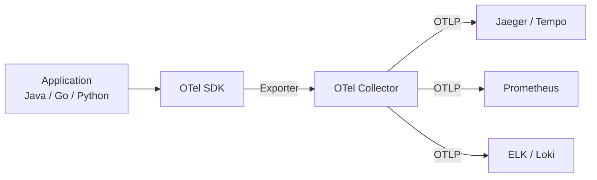
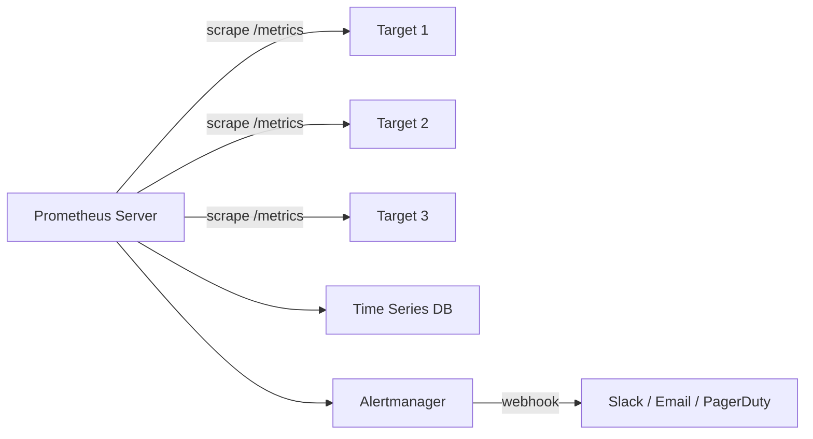
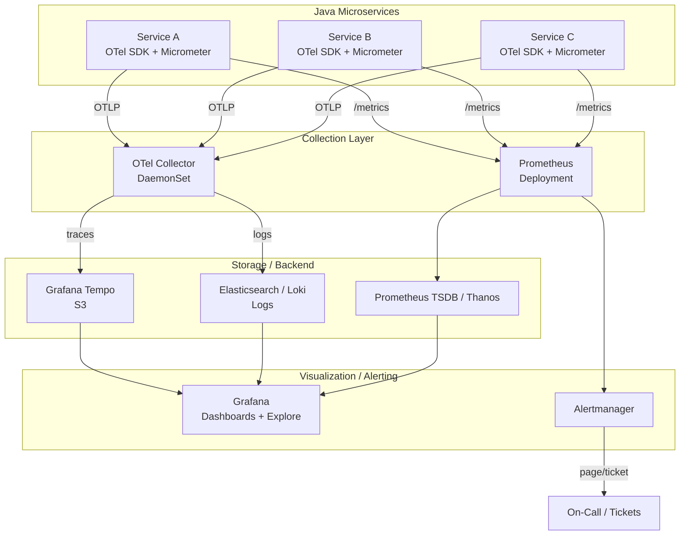

# Observability & Monitoring

### 1. Что такое observability и в чём её отличие от мониторинга

**Observability (наблюдаемость)** — это свойство системы, позволяющее понять её **внутреннее состояние** на основе **внешних наблюдений** (логи, метрики, трассировки). Термин пришёл из теории управления: система наблюдаема, если по её выходам можно однозначно определить состояние.

**Мониторинг** — измерение **заранее известных** метрик и алерты по порогам. Это «знаем, что сломалось».
**Observability** — возможность **исследовать** неизвестное: «почему запрос стал медленнее на 40%, даже если все пороги в норме».

**Ключевое отличие**:
| | Мониторинг | Observability |
|---|---|---|
| Вопрос | «Что сломалось?» | «Почему?» |
| Метрики | Заранее определены | Любые (включая ad-hoc) |
| Алерты | Пороговые | По SLO/SLI (симвомные) |
| Данные | Агрегированные | Сырые + агрегированные |
| Инструменты | Zabbix, Nagios | OpenTelemetry, Jaeger, Prometheus, ELK |

**Три столпа observability**:
1. **Метрики (Metrics)** — численные измерения во времени (CPU, задержки, ошибки, throughput).
2. **Логи (Logs)** — дискретные события с метаданными (timestamp, level, trace id, message).
3. **Трассировки (Traces)** — путь запроса через сервисы (spans с parent-child связями).

**Почему это важно**:
- **Мониторинг** отвечает на «что» (аптайм, CPU > 90%).
- **Observability** отвечает на «почему» (почему p99 задержки выросл на 200 мс — из-за N+1 запроса в БД, из-за GC pause, из-за блокировки в пуле потоков).
- В **микросервисной** архитектуре без observability **невозможно** диагностировать проблемы (100+ сервисов, распределённые вызовы).

**Пример**:
- Мониторинг: «API вернул 500 на 2% запросов» (алерт по порогу).
- Observability: «Из 2% ошибок 90% — timeout в вызове к сервису X, p95 задержки X = 2 c (раньше 200 мс), trace id `abc123` показывает, что 1.8 с ушло на запрос к БД, a query plan показывает full table scan» → **причина**: пропал индекс после миграции.

**Вывод**: мониторинг — это **часть** observability. Observability — более широкая концепция, включающая мониторинг + **возможность исследовать** неизвестное.


### 2. Что такое OpenTelemetry: SDK, Collector, контекст и пропагация

**OpenTelemetry (OTel)** — **стандарт** (CNCF) для **телеметрии**: единый API и SDK для сбора **метрик**, **логов** и **трассировок** из любого приложения. Заменяет проприетарные решения (Jaeger client, Zipkin, Datadog SDK).

**Архитектура**:


**Компоненты**:

1. **OTel SDK** — библиотека в приложении, создаёт **spans**, **метрики**, **логи** и **экспортирует** их.
   - **TracerProvider** — создаёт `Tracer`, который создаёт `Span`.
   - **MeterProvider** — создаёт `Meter`, который создаёт **метрики** (Counter, Histogram, Gauge).
   - **LoggerProvider** — создаёт `Logger` (OpenTelemetry Logging API).
   - **Context** — несёт **активный span**, **trace id**, **span id**, **baggage** (metadata).

2. **OTel Collector** — **агент/демон**, который **собирает** телеметрию из SDK (по **OTLP** — OpenTelemetry Protocol) и **экспортирует** в бэкенды (Jaeger, Prometheus, ELK). Может работать как **daemonset** (на каждом узле) или **deployment** (центральное).
   - **Receiver** — принимает данные (OTLP, Prometheus scrape, Jaeger, Zipkin).
   - **Processor** — трансформирует (batch, attrs, tail sampling).
   - **Exporter** — отправляет в бэкенд (OTLP, Prometheus, Elastic).

3. **Пропагация (Propagation)** — передача **trace context** между сервисами.
   - **W3C Trace Context** — стандарт: заголовки `traceparent` и `tracestate`.
     - `traceparent: 00-<trace-id>-<span-id>-<flags>` (32 hex + 16 hex + 2 hex).
     - `tracestate` — vendor-specific metadata (например, `sampling decision`).
   - **B3** (Zipkin) — альтернативный формат (`X-B3-TraceId`, `X-B3-SpanId`).
   - **Jaeger** — legacy формат.
   - OTel **поддерживает все** форматы (multi-propagator).

**Пример (Java)**:
```java
// 1. Инициализация SDK (Spring Boot 3: open-telemetry dependency)
GlobalOpenTelemetry otel = GlobalOpenTelemetry.get();
Tracer tracer = otel.getTracer("my-service");

// 2. Создание span
Span span = tracer.spanBuilder("processOrder").startSpan();
try (Scope scope = span.makeCurrent()) {
    // бизнес-логика
    orderService.process(order);
} finally {
    span.end();
}

// 3. Пропагация в HTTP-запросе (WebClient / RestTemplate)
HttpClient httpClient = HttpClient.newBuilder()
    .builder()
    .propagator(W3CTraceContextPropagator.getInstance())
    .build();
// OTel auto-instrumentation добавит traceparent в заголовки
```

**Auto-instrumentation**:
- **Java**: `opentelemetry-javaagent.jar` — **bytecode injection** (no code changes).
- **Go**: `otelhttp` middleware.
- **Python**: `opentelemetry-instrumentation-*` пакеты.

**Зачем нужен Collector**:
- **Отделяет** приложение от бэкенда (можно менять бэкенд без перекомпиляции).
- **Batching** — объединяет запросы в батчи (меньше сетевых вызовов).
- **Sampling** — **tail sampling** (отбрасывает «неинтересные» трассировки после сбора).
- **Filtering** — отбрасывает лишние атрибуты.
- **Routing** — разные бэкенды для разных типов телеметрии.

**Вывод**: OpenTelemetry — **единый стандарт** для телеметрии. Используй **SDK** в приложении, **Collector** на уровне инфраструктуры, **W3C Trace Context** для пропагации. Это **future-proof** (можно менять бэкенд без изменения кода).


### 3. Как устроен Prometheus: pull-модель, PromQL, recording rules, alerting rules

**Prometheus** — **система мониторинга** (CNCF), де-факто стандарт в Kubernetes. **Pull-модель**: Prometheus **сам** опрашивает (scrape) целевые сервисы по HTTP-эндпоинту `/metrics`.

**Архитектура**:


**Ключевые концепции**:

1. **Time series** — последовательность значений во времени. Каждая метрика — это **вектор** time series (с метками).
   - Пример: `http_requests_total{method="GET", status="200"}` — отдельная series.
   - **Метки (labels)** — ключ-значение, идентифицируют series. **Не** создавать метки с высоким кардинальностью (user_id, request_id) — **взорвёт** БД.

2. **Pull-модель**:
   - Prometheus **сам** опрашивает цели (не цели пушат).
   - **Преимущества**: не нужно открывать исходящие порты, легко обнаруживать новые цели (service discovery), централизованное управление.
   - **Недостатки**: задержка до `scrape_interval` (обычно 15–30 c), не подходит для **event-driven** (используй **Pushgateway** для batch jobs).

3. **Service Discovery**:
   - **Kubernetes**: автоматическое обнаружение Pod'ов через API.
   - **Consul**, **Etc.** — другие источники.
   - **Статический** — `scrape_configs` в `prometheus.yaml`.

4. **PromQL** — **язык запросов** к Prometheus.
   - **Селекторы**: `metric_name{label="value"}` — выбирает series.
   - **Инстанс-селектор**: `metric_name` (все series), `metric_name{job="api"}` (фильтр).
   - **Операторы**: арифметические (+, -, *, /), сравнения (>, <, ==, !=), агрегации (`sum`, `avg`, `max`, `min`, `count`, `topk`, `bottomk`).
   - **Функции времени**: `rate()` (ср. скорость за интервал), `increase()` (прирост), `irate()` (мгновенная скорость), `delta()`, `deriv()`, `predict_linear()`.
   - **Подсказки**: `by` / `without` — группировка по меткам.

**Примеры PromQL**:
```promql
# 1. request rate (запросы/сек) за 5 минут
sum(rate(http_requests_total[5m]))

# 2. error rate (доля ошибок)
sum(rate(http_requests_total{status=~"5.."}[5m]))
  /
sum(rate(http_requests_total[5m]))

# 3. p95 latency
histogram_quantile(0.95,
  sum(rate(http_request_duration_seconds_bucket[5m])) by (le))

# 4. top 5 endpoints по request rate
topk(5, sum(rate(http_requests_total[5m])) by (endpoint))

# 5. CPU usage (ядра)
sum(rate(container_cpu_usage_seconds_total[5m])) by (pod)
```

**Recording Rules** — **предвычисленные** выражения, хранящиеся в БД. Используются для:
- **Ускорения** сложных запросов (предвычислить `sum(rate(...))` раз в 30 c).
- **Алертов** (алерт по recording rule, а не по raw-запросу).
- **Экономии** ресурсов (меньше вычислений при запросе).

```yaml
# prometheus.rules
groups:
  - name: api
    interval: 30s
    rules:
      - record: job:http_requests:rate5m
        expr: sum(rate(http_requests_total[5m])) by (job)
      - record: job:http_errors:rate5m
        expr: sum(rate(http_requests_total{status=~"5.."}[5m])) by (job)
```

**Alerting Rules** — **условия**, по которым Prometheus **отправляет** алерт в **Alertmanager**.

```yaml
groups:
  - name: api
    rules:
      - alert: HighErrorRate
        expr: >
          sum(rate(http_requests_total{status=~"5.."}[5m]))
          /
          sum(rate(http_requests_total[5m])) > 0.05
        for: 5m
        labels:
          severity: critical
        annotations:
          summary: "High error rate on {{ $labels.job }}"
          description: "Error rate is {{ $value | humanize }} (threshold 5%)"

      - alert: HighLatency
        expr: histogram_quantile(0.95, sum(rate(http_request_duration_seconds_bucket[5m])) by (le)) > 1
        for: 10m
        labels:
          severity: warning
        annotations:
          summary: "p95 latency > 1s on {{ $labels.job }}"
```

**Alertmanager** — **роутер** алертов:
- **Группировка** (group by job, severity).
- **Ингибирование** (critical ингибирует warning).
- **Silencing** (временное отключение на период работ).
- **Роутинг** (разные каналы для разных severity).

**Хранение**:
- **TSDB** (Time Series Database) — встроенная, оптимизированная для time series.
- **Retention** — по умолчанию 15 дней (настраивается `--storage.tsdb.retention.time`).
- **Long-term**: **Thanos**, **Cortex**, **Mimir** (горизонтальное масштабирование, long-term storage в S3).

**Вывод**: Prometheus — **pull-модель** + **PromQL** + **recording/alerting rules** + **Alertmanager**. Де-факто стандарт в Kubernetes. Для **long-term** и **горизонтального масштабирования** — Thanos/Cortex/Mimir.


### 4. Как устроена distributed tracing: Jaeger/Tempo, trace propagation, sampling

**Distributed tracing** — техника, при которой **каждый запрос** получает **уникальный trace id**, который **передаётся** между всеми сервисами. Это позволяет **собрать полный путь** запроса через распределённую систему, увидеть **время на каждом участке**, выявить **узкие места** и **источник ошибок**.

**Ключевые концепции**:

1. **Trace** — полный путь запроса (от клиента до последнего сервиса).
2. **Span** — **отдельный участок** trace (например, «HTTP-запрос к сервису X», «вызов к БД»). Каждый span имеет:
   - **trace id** (общий для всего trace).
   - **span id** (уникальный для span).
   - **parent span id** (ссылка на родительский span).
   - **name** (например, `GET /users`).
   - **start time**, **duration**.
   - **attributes** (метаданные: http.status, db.statement).
   - **events** (например, «exception thrown»).
3. **Trace propagation** — передача **trace context** между сервисами.
   - **W3C Trace Context**: заголовки `traceparent` и `tracestate`.
   - **B3** (Zipkin): `X-B3-TraceId`, `X-B3-SpanId`.
   - **Jaeger**: legacy формат.
   - **OTel** поддерживает **все** форматы (multi-propagator).

**Бэкенды**:
- **Jaeger** — CNCF, **высокоуровневый**, **query API**, **UI**. Использует **Cassandra** или **Elasticsearch** как storage.
- **Grafana Tempo** — **S3-based**, **горизонтально масштабируемый**, **интеграция с Grafana**.
- **Zipkin** — legacy, **проще**, **Elasticsearch** storage.
- **LightStep**, **Honeycomb** — коммерческие.

**Sampling** — **отбор** трассировок (не все трассировки interesting):
- **Head-based** — решение **на входе** (client): «записать 10% запросов».
  - **Преимущество**: мало данных, легко реализовать.
  - **Недостаток**: если **редкий** запрос (например, error) **не** отобран — **не видно**.
- **Tail-based** — решение **на выходе** (Collector): «записать все запросы, где есть error или p99 latency > 1 c».
  - **Преимущество**: **все** «интересные» трассировки (errors, slow) сохраняются.
  - **Недостаток**: нужно хранить **все** трассировки **временно** (до решения), выше нагрузка на Collector.

**Пример (OTel + Jaeger)**:
```java
// Service A
Span span = tracer.spanBuilder("processOrder").startSpan();
try (Scope scope = span.makeCurrent()) {
    orderService.process(order);
    // WebClient auto-instrumentation добавит traceparent в заголовки
    userService.getUser(order.getUserId());
} finally {
    span.end();
}

// Service B (получает traceparent из заголовков)
// OTel auto-instrumentation создаёт child span с тем же trace id
```

**UI и запросы**:
- **Jaeger UI** — поиск по **trace id**, **operation**, **tags**.
- **Grafana Tempo** — **Grafana Explore** (traces + metrics + logs **коррелированы**).
- **Корреляция**: **trace id** в **логах** (MDC) и **метриках** (label) → **переход** из метрики в trace в log.

**Вывод**: distributed tracing — **стандарт** для микросервисов. Используй **OpenTelemetry** для **сбора**, **W3C Trace Context** для **пропагации**, **Jaeger/Tempo** для **хранения/запросов**. **Tail-based sampling** — для **production** (сохраняет errors/slow).


### 5. Что такое Micrometer: registry, custom meters, таймеры, distribution summary

**Micrometer** — **vendor-neutral** библиотека для **сбора метрик** в Java (аналог Dropwizard Metrics, но **универсальная**). Интегрирована в **Spring Boot 2+** (auto-config). Экспортирует метрики в **любую** **registry**: Prometheus, Datadog, StatsD, JMX, Influx.

**Ключевые концепции**:

1. **Meter** — **метрика** (Counter, Gauge, Timer, DistributionSummary).
   - **Counter** — **монотонно возрастающее** значение (например, `http_requests_total`).
   - **Gauge** — **мгновенное** значение (например, `heap_memory_used`).
   - **Timer** — **время** выполнения (например, `http_request_duration_seconds`).
   - **DistributionSummary** — **распределение** значений (например, `response_size_bytes`).

2. **Registry** — **бэкенд** хранения метрик (Prometheus, Datadog, JMX, Influx).
   - **CompositeRegistry** — **одновременно** экспортирует в **несколько** registry.

3. **Custom meters** — **свои** метрики через **Micrometer API**.

**Примеры**:

```java
// 1. Counter
Counter counter = Counter.builder("orders.created")
    .description("Total orders created")
    .tag("channel", "web")
    .register(meterRegistry);
counter.increment(); // +1

// 2. Gauge
Gauge.builder("heap.memory.used", () -> Runtime.getRuntime().totalMemory() - Runtime.getRuntime().freeMemory())
    .register(meterRegistry);

// 3. Timer
Timer timer = Timer.builder("order.processing")
    .description("Time to process an order")
    .tag("type", "standard")
    .register(meterRegistry);
timer.record(() -> orderService.process(order)); // measure + execute

// 4. DistributionSummary
DistributionSummary summary = DistributionSummary.builder("response.size")
    .description("Response size in bytes")
    .register(meterRegistry);
summary.record(responseBytes);

// 5. Custom (functional)
Gauge.builder("active.connections", connectionPool, ConnectionPool::getActiveConnections)
    .register(meterRegistry);
```

**Spring Boot integration**:
```java
// Auto-configured (Spring Boot 2+)
@Autowired
MeterRegistry meterRegistry;

// В controller'е
@GetMapping("/orders")
public Mono<List<Order>> getOrders() {
    return Timer.builder("orders.get")
        .register(meterRegistry)
        .record(Mono.defer(() -> orderService.findAll()));
}

// Observation API (Spring Boot 3)
@Observed(name = "order.processing", contextualName = "Process Order")
public Order processOrder(OrderDto dto) {
    // ...
}
```

**Distribution Summary** — **распределение** значений:
- **Percentiles** (p50, p90, p95, p99) — **предвычисленные** (не как в Prometheus, где `histogram_quantile` вычисляется **на лету**).
- **Count**, **sum**, **max**.
- **Настройка percentiles**: `DistributionSummary.builder(...).serviceLevelObjectives(0.5, 0.9, 0.95, 0.99)`.

```java
DistributionSummary summary = DistributionSummary.builder("response.size")
    .serviceLevelObjectives(0.5, 0.9, 0.95, 0.99) // p50, p90, p95, p99
    .register(meterRegistry);
```

**Observation API (Spring Boot 3)**:
- **`@Observed`** — **annotation** для **автоматического** создания **span'а** + **метрики**.
- **`Observation`** — **API** для **ручного** создания.
- **Интеграция** с **Micrometer** + **OpenTelemetry**.

```java
@Observed(name = "order.processing", contextualName = "Process Order")
public Order processOrder(OrderDto dto) {
    // Micrometer auto-creates:
    // - Timer "order.processing"
    // - Span "order.processing" (if OTel enabled)
}
```

**Вывод**: Micrometer — **стандарт** для **сбора метрик** в Java. Используй **Counter/Gauge/Timer/DistributionSummary**, **Spring Boot auto-config**, **Observation API** для **tracing + metrics**. Экспорт в **Prometheus** (де-факто) или **Datadog/StatsD**.


### 6. Что такое RED-методология и USE-методология

**RED** и **USE** — **две** **методологии** для **мониторинга** **микросервисов**.

**RED (Rate, Errors, Duration)** — для **user-facing** сервисов (API, front-end):
- **Rate** — **количество** запросов в единицу времени (requests/sec).
- **Errors** — **доля** ошибок (5xx, 4xx, timeout).
- **Duration** — **время** запросов (p50, p95, p99).

```promql
# Rate
sum(rate(http_requests_total[5m])) by (job)

# Errors
sum(rate(http_requests_total{status=~"5.."}[5m])) by (job)
  /
sum(rate(http_requests_total[5m])) by (job)

# Duration (p95)
histogram_quantile(0.95,
  sum(rate(http_request_duration_seconds_bucket[5m])) by (job, le))
```

**Зачем RED**:
- **Простота**: 3 метрики, **быстро** настроить.
- **User-centric**: **видит** то, что **видит** пользователь (скорость, ошибки).
- **Алерты**: **error rate > 5%**, **p95 > 1 s** → **критичный** алерт.

**USE (Utilization, Saturation, Errors)** — для **ресурсов** (CPU, memory, disk, network, thread pool, connection pool):
- **Utilization** — **доля** времени, когда ресурс **занят** (например, CPU usage 70%).
- **Saturation** — **насыщение** (например, queue length, pending requests, OOM).
- **Errors** — **ошибки** (например, disk I/O errors, connection refused).

```promql
# CPU utilization
sum(rate(container_cpu_usage_seconds_total[5m])) by (pod)

# Memory saturation
container_memory_working_set_bytes / container_spec_memory_limit_bytes

# Disk I/O errors
rate(node_disk_io_errors[5m])

# Thread pool saturation
tomcat_threads_busy / tomcat_threads_current
```

**Зачем USE**:
- **Resource-centric**: **видит** **узкие места** (CPU, memory, disk).
- **Proactive**: **насыщение** → **предсказывает** **деградацию** **до** **ошибок**.
- **Алерты**: **CPU > 80%** (utilization), **queue length > 100** (saturation).

**Сравнение**:
| | RED | USE |
|---|---|---|
| Для | **User-facing** API | **Ресурсы** (CPU, memory, disk) |
| Вопрос | «Что видит пользователь?» | «Какой ресурс в узком месте?» |
| Метрики | Rate, Errors, Duration | Utilization, Saturation, Errors |
| Алерты | Error rate, p95 latency | CPU > 80%, queue length |
| Пример | API, front-end | Kubernetes pod, JVM, БД |

**Практика**:
- **RED** для **каждого** **user-facing** сервиса (API, BFF, front-end).
- **USE** для **каждого** **ресурса** (CPU, memory, disk, network, thread pool, connection pool, Kafka consumer lag).
- **Вместе**: **RED** отвечает «что сломалось для пользователя», **USE** — «почему» (ресурс в узком месте).

**Вывод**: **RED** — для **пользователя**, **USE** — для **ресурсов**. Используй **обе** для **полной** картины. **RED** — **symptom**, **USE** — **cause**.


### 7. Как агрегировать логи: ELK/Loki, structured logging, MDC

**Log aggregation** — **централизация** **логов** из **всех** сервисов в **одной** системе. Без этого **невозможно** **диагностировать** проблемы в **микросервисах** (логи разбросаны по 100+ серверам/подам).

**Стек 1: ELK (Elasticsearch, Logstash, Kibana)**
- **Elasticsearch** — **поисковый** **движок** (full-text search, JSON indexing).
- **Logstash** — **pipeline** для **сбора** и **трансформации** (input → filter → output).
- **Kibana** — **UI** для **поиска** и **визуализации**.
- **Преимущества**: **мощный** поиск, **аналитика**, **ML**.
- **Недостатки**: **тяжёлый** (RAM, CPU), **дорогой** (лицензия), **сложный** в **администрировании**.

**Стек 2: Loki (Grafana)**
- **Loki** — **log aggregation** **система**, **оптимизированная** для **логов** (не индексирует **текст**, а **метки**).
- **Пromtail/Alloy** — **agent** для **сбора** логов (tail file, systemd journal).
- **Grafana** — **UI**.
- **Преимущества**: **лёгкий** (меньше RAM/CPU), **дешёвый**, **простой**, **интеграция** с **Prometheus** (одна **экосистема**).
- **Недостатки**: **меньше** **возможностей** **поиска** (только **метки** + **full-text** на **малом** объёме).

**Выбор**:
- **ELK** — **крупные** компании, **сложная** **аналитика**, **ML**.
- **Loki** — **Kubernetes**-native, **Prometheus**-экосистема, **экономия** ресурсов.

**Structured Logging** — **логи** в **структурированном** формате (JSON), а не **plain text**.
```json
{"timestamp":"2026-01-15T10:30:00Z","level":"ERROR","service":"order-api","trace_id":"abc123","span_id":"def456","message":"Failed to process order","order_id":123,"error":"timeout"}
```
**Преимущества**:
- **Поиск** по **любому** **полю** (не только **текст**).
- **Корреляция** с **traces** (trace_id, span_id).
- **Агрегация** (например, **count** по **level**).
- **Индексация** (Loki **индексирует** **метки**, Elasticsearch **всё**).

**MDC (Mapped Diagnostic Context)** — **ThreadLocal**-based **контекст** для **логов** (SLF4J/Logback).
```java
// Spring Boot: MDC auto-populated (trace_id, span_id)
log.info("Processing order {}", orderId);
// Вывод: "Processing order 123" + MDC (trace_id, span_id)

// Rучное
MDC.put("userId", "user123");
log.info("User action");
MDC.remove("userId");
```

**В Reactor**: **MDC не работает** (ThreadLocal теряется между переключениями потоков). Используй **`Context`** (см. Q704) + **logback-reactive** или **OTel**.

**Пример (Logback + JSON)**:
```xml
<!-- logback-spring.xml -->
<configuration>
    <appender name="JSON" class="ch.qos.logback.core.ConsoleAppender">
        <encoder class="net.logstash.logback.encoder.LogstashEncoder">
            <customFields>{"service":"${APP_NAME}"}</customFields>
        </encoder>
    </appender>
    <root level="INFO">
        <appender-ref ref="JSON"/>
    </root>
</configuration>
```

**Вывод**: **Loki** — **Kubernetes**-native, **лёгкий**, **Prometheus**-экосистема. **ELK** — **мощный**, **сложный**. **Structured logging** (JSON) + **MDC** (или **Context** в Reactor) — **обязательны** для **корреляции** с **traces** и **поиска**.


### 8. Что такое SLO, SLI, SLA и error budgets

**SLI (Service Level Indicator)** — **метрика** **качества** сервиса (например, **доля** **успешных** запросов, **p95** latency, **uptime**).

**SLO (Service Level Objective)** — **цель** по **SLI** (например, **99.9%** **успешных** запросов за **месяц**, **p95** latency < **500 ms**).

**SLA (Service Level Agreement)** — **контракт** с **клиентом** (например, **99.9%** **uptime**, **штраф** за **нарушение**). **SLA** — **публичный**, **SLO** — **внутренний**.

**Error Budget** — **допустимый** **объём** **ошибок** за **период** = **100%** − **SLO**.
- Пример: SLO = **99.9%** → error budget = **0.1%** = **43.8 min** downtime за **месяц**.
- **Зачем**: **баланс** между **надёжностью** и **скоростью** **релизов**. Если **error budget** **исчерпан** → **заморозка** **релизов** (только **bugfix**). Если **остаток** **большой** → **можно** **рискнуть** с **релизами**.

**Примеры SLI/SLO**:

| SLI | SLO | Период | Error Budget |
|---|---|---|---|
| **Uptime** (доля успешных запросов) | 99.9% | Месяц | 43.8 min |
| **p95 latency** | < 500 ms | Месяц | 5% запросов > 500 ms |
| **Error rate** | < 0.1% | Час | 0.1% ошибок |
| **Availability** | 99.95% | Квартал | 6.2 hours |

**Как вычислить**:
```promql
# Uptime SLI (доля успешных запросов)
1 - (
  sum(rate(http_requests_total{status=~"5.."}[30d]))
  /
  sum(rate(http_requests_total[30d]))
)

# p95 latency SLI
histogram_quantile(0.95,
  sum(rate(http_request_duration_seconds_bucket[30d])) by (le)) < 0.5
```

**Alerting по SLO**:
- **Бурст-алерт**: **error rate > 1%** в **последние** **5 min** (быстрая реакция).
- **Симвомный алерт**: **error budget burn rate** > **14.4x** (потрачено **14.4x** быстрее **нужного** → **исчерпается** за **день** вместо **месяца**).

```yaml
# Burn rate alert
- alert: ErrorBudgetBurn
  expr: >
    sum(rate(http_requests_total{status=~"5.."}[5m]))
    /
    sum(rate(http_requests_total[5m])) > 0.01  # 1% error rate
  for: 5m
  labels:
    severity: critical
```

**Вывод**: **SLI** — **метрика**, **SLO** — **цель**, **SLA** — **контракт**, **error budget** — **допустимый объём ошибок**. **Alerting** по **SLO** (burn rate) — **symptom-based** (не **cause-based**). **Error budget** — **баланс** между **надёжностью** и **скоростью** **релизов**.


### 9. Как стратегии алертинга: symptoms vs causes, alert fatigue

**Alert fatigue** — **усталость** от **алиртов**: **слишком** **много** **шумных** **алиртов** → **команда** **игнорирует** **все**. **Результат**: **реальные** **проблемы** **пропадают** в **шуме**.

**Две стратегии**:

**1. Symptoms (симптомные)** — алерты по **то, что видит пользователь**:
- **Error rate** > **5%** (пользователь видит **ошибки**).
- **p95 latency** > **1 s** (пользователь видит **медленность**).
- **Uptime** < **99.9%** (пользователь видит **доступность**).
- **Корреляция** с **SLO** (error budget burn rate).

**Преимущества**:
- **Мало** **алиртов** (только **важные**).
- **Понятны** **команде** (то, что **видит** пользователь).
- **Не** **зависят** от **внутренней** **архитектуры** (можно **менять** **код** без **изменения** **алиртов**).

**2. Causes (причинные)** — алерты по **внутренним** **метрикам**:
- **CPU** > **80%**.
- **Memory** > **90%**.
- **Disk** **I/O** **errors**.
- **Kafka** **consumer** **lag** > **1000**.

**Преимущества**:
- **Proactive** (видит **проблему** **до** **того**, как **пользователь** **увидит**).
- **Диагностика** (помогает **найти** **причину**).

**Недостатки**:
- **Много** **алиртов** (шум).
- **Ложные** **положительные** (CPU **высокий**, но **пользователь** **не** **страдает**).
- **Зависят** от **архитектуры** (при **изменении** **кода** нужно **менять** **алирты**).

**Практика (best practice)**:
- **Page** (кричать) — **только** **symptoms** (error rate, p95 latency, uptime).
- **Ticket** (тихо) — **causes** (CPU, memory, disk) — **для** **диагностики**.
- **Ингибирование**: если **symptom** **сработал** → **ингибировать** **causes** (не **кричать** **по** **CPU**, если **уже** **кричим** **по** **error rate**).
- **Группировка**: **group by** **job**, **severity** (не **по** **каждому** **поду**).

**Alertmanager configuration**:
```yaml
route:
  group_by: ['job', 'severity']
  group_wait: 30s
  group_interval: 5m
  repeat_interval: 4h
  routes:
    - matchers:
        - severity = "critical"
      receiver: page-oncall
    - matchers:
        - severity = "warning"
      receiver: ticket
inhibit_rules:
  - source_matchers:
      - severity = "critical"
    target_matchers:
      - severity = "warning"
    equal: ['job', 'instance']
```

**Вывод**: **Page** — **symptoms** (то, что **видит** пользователь). **Ticket** — **causes** (внутренние **метрики**). **Ингибирование** + **группировка** — **борьба** с **alert fatigue**. **SLO-based** **alerting** (burn rate) — **лучший** **подход** (symptom + **quantified**).


### 10. Что такое Micrometer Observation API и @Observed

**Observation API** (Micrometer 1.10+, Spring Boot 3) — **унифицированный** **API** для **создания** **span'а** + **метрики** **одновременно**. Заменяет **отдельные** **вызовы** **Tracer** + **MeterRegistry**.

**Зачем нужен**:
- **Раньше**: **Tracer.spanBuilder(...)** для **tracing** + **Timer.builder(...)** для **metrics** — **два** **вызова**, **два** **контекста**.
- **С Observation**: **один** **вызов** → **span** + **Timer** + **low-high** **metric** (например, **error** **count**).

**API**:
```java
// 1. Annotation @Observed
@Observed(name = "order.processing", contextualName = "Process Order")
public Order processOrder(OrderDto dto) {
    // Micrometer auto-creates:
    // - Span "order.processing" (if OTel enabled)
    // - Timer "order.processing"
    // - Counter "order.processing.errors" (if exception)
}

// 2. Manual (Observation.create)
Observation observation = Observation.createNotStarted("order.processing", tracer)
    .contextualName("Process Order")
    .lowCardinalityKeyValue("type", dto.getType())
    .start();
try (Observation.Scope scope = observation.openScope()) {
    // business logic
    return orderService.process(dto);
} catch (Exception e) {
    observation.error(e);
    throw e;
} finally {
    observation.stop();
}

// 3. With Reactor (Mono/Flux)
Mono<Order> result = Mono.fromCallable(() -> orderService.process(dto))
    .observe(Observation.createNotStarted("order.processing", tracer));
```

**Low vs High cardinality**:
- **Low cardinality** (например, `type`, `endpoint`) — **мало** **уникальных** **значений** → **можно** **использовать** как **label** в **метриках**.
- **High cardinality** (например, `user_id`, `request_id`) — **много** **уникальных** **значений** → **только** в **span'ах** (не в **метриках**, иначе **взорвёт** **БД**).

```java
.observation
    .lowCardinalityKeyValue("endpoint", "/orders")  // label in metrics
    .highCardinalityKeyValue("user_id", "123")      // only in span
```

**Интеграция с Spring**:
- **Spring Web**: **auto-observation** для **HTTP** requests (GET/POST → span + Timer).
- **Spring Data**: **auto-observation** для **JPA** queries.
- **Spring Kafka**: **auto-observation** для **producer/consumer**.
- **Custom**: **@Observed** или **Observation.createNotStarted**.

**Вывод**: **Observation API** — **унифицированный** **API** для **tracing** + **metrics**. **@Observed** — **annotation** для **авто-создания**. **Low/high cardinality** — **важно** для **метрик** (не **взорвать** **БД**). **Spring Boot 3** — **auto-observation** для **HTTP**, **JPA**, **Kafka**.


### 11. Как настроить correlation between logs, metrics, and traces

**Correlation** — **связь** **логов**, **метрик** и **трассировок** по **общим** **идентификаторам** (**trace id**, **span id**, **request id**). Без correlation **невозможно** **перейти** из **метрики** в **trace** в **log**.

**Ключевые идентификаторы**:
- **Trace id** — **общий** для **всего** trace.
- **Span id** — **уникальный** для **span**.
- **Request id** — **уникальный** для **HTTP request** (может **совпадать** с **trace id** или **быть** **отдельным**).

**Как настроить**:

1. **Logs**: **trace id** и **span id** в **каждом** **лог** (MDC / Context).
```java
// Spring Boot: MDC auto-populated (trace_id, span_id)
log.info("Processing order {}", orderId);
// Вывод (JSON):
// {"timestamp":"...","level":"INFO","trace_id":"abc123","span_id":"def456","message":"Processing order 123"}
```

2. **Metrics**: **trace id** как **label** (не рекомендуется из-за **high cardinality**). Лучше **aggregated** metrics (без trace id) + **link** через **endpoint**/**operation**.
```java
// НЕ: Counter.builder("requests").tag("trace_id", traceId) — high cardinality
// ДА: Counter.builder("requests").tag("endpoint", "/orders").tag("status", "200")
```

3. **Traces**: **span** с **атрибутами** (endpoint, status, user_id).

**Grafana**: **Explore** → **traces** + **metrics** + **logs** **коррелированы** (по **trace id**).

**Пример (Grafana)**:
1. **Dashboard**: **p95 latency** **вырос** (metric).
2. **Klick** на **metric** → **traces** (по **endpoint**/**time**).
3. **Klick** на **trace** → **spans** (по **trace id**).
4. **Klick** на **span** → **logs** (по **trace id** + **span id**).

**В Reactor**: **MDC не работает** (ThreadLocal теряется). Используй **`Context`** + **logback-reactive** или **OTel** (auto-populated).

**Вывод**: **Correlation** — **trace id** в **logs** (MDC/Context) + **aggregated** metrics (без trace id) + **traces** (spans). **Grafana Explore** — **переход** из **metrics** в **traces** в **logs** по **trace id**. **Rучная** correlation (high cardinality) — **антипаттерн**.


### 12. Как построить observability-стек для Java-микросервисов (референс-архитектура)

**Референс-архитектура** observability для **Java-микросервисов** в **Kubernetes**:



**Компоненты**:

1. **OTel SDK** (в каждом сервисе):
   - **Java agent** (`opentelemetry-javaagent.jar`) — **auto-instrumentation** (HTTP, JPA, Kafka).
   - **Micrometer** — **метрики** (Timer, Counter, Gauge).
   - **Observation API** — **unified** (tracing + metrics).

2. **OTel Collector** (DaemonSet):
   - **Receiver**: OTLP (gRPC).
   - **Processor**: batch, attrs, tail sampling.
   - **Exporter**: OTLP → Tempo (traces), OTLP → Loki/ES (logs).

3. **Prometheus** (Deployment):
   - **Scrape** `/metrics` с **каждого** сервиса.
   - **Recording rules** (предвычисленные запросы).
   - **Alerting rules** (SLO-based).
   - **Thanos/Cortex** — **long-term** storage (S3).

4. **Grafana Tempo** (traces):
   - **S3**-based, **горизонтально масштабируемый**.
   - **Grafana Explore** — **traces** + **metrics** + **logs**.

5. **Loki** (logs):
   - **Alloy/Promtail** — **сбор** логов (file tail).
   - **Grafana** — **UI**.
   - **Structured logging** (JSON) + **MDC** (trace_id, span_id).

6. **Grafana**:
   - **Dashboards**: RED (Rate, Errors, Duration) + USE (Utilization, Saturation, Errors).
   - **Explore**: **traces** + **metrics** + **logs** (correlation).
   - **Alerting**: **SLO-based** (burn rate).

7. **Alertmanager**:
   - **Группировка**, **ингибирование**, **silencing**.
   - **Роутинг**: **page** (critical) / **ticket** (warning).

**Best practices**:
- **Auto-instrumentation** (OTel Java agent) — **не** **ручная** instrumentация.
- **Structured logging** (JSON) + **MDC** (trace_id, span_id) — **обязательно**.
- **SLO-based alerting** (burn rate) — **symptom-based** (не **cause-based**).
- **Tail sampling** (OTel Collector) — **сохранять** **errors**/**slow** traces.
- **Low/high cardinality** (Micrometer) — **не** **взорвать** **БД**.
- **Grafana Explore** — **correlation** (metrics → traces → logs).

**Вывод**: **OTel SDK** (auto-instrumentation) + **Micrometer** (metrics) + **OTel Collector** (batching, sampling) + **Prometheus** (metrics) + **Tempo** (traces) + **Loki** (logs) + **Grafana** (visualization) + **Alertmanager** (alerting). **SLO-based** **alerting** + **correlation** — **ключ** к **production-ready** observability.


