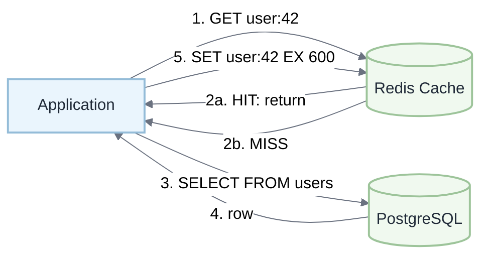

# Redis и кэширование


### 1. Что такое Redis и почему он быстрый

**Redis** (REmote DIctionary Server) — in-memory хранилище данных типа «ключ-значение» с расширенными структурами данных. Основные типы: `String` (строки, счётчики, бинарные данные), `Hash` (объекты — поля-значения), `List` (связные списки — очереди, ленты), `Set` (множества), `Sorted Set / ZSet` (множество с баллом — рейтинги, лидерборды), `Stream` (журнал событий), плюс Bitmap, HyperLogLog, Geo.

Почему быстрый:
- **Данные в памяти** — нет обращения к диску на каждый запрос (диск используется только для персистентности).
- **Однопоточное ядро** обработки команд — нет блокировок и переключений контекста на путь запроса (I/O в новых версиях частично многопоточен).
- **Мультиплексирование I/O** (epoll) — один поток обслуживает десятки тысяч соединений.
- **Экономичные структуры данных** (SDS-строки, зиплисты/listpack для маленьких коллекций).

Типичная производительность — 100К+ операций в секунду на инстанс. Применение: кэш, сессии, счётчики/лимитеры (rate limiting), распределённые локи, pub/sub, лидерборды. Клиент в Java — **Lettuce** (по умолчанию в Spring Boot, netty-based, потокобезопасен) или **Jedis**.

```java
try (Jedis jedis = pool.getResource()) {
    jedis.setex("user:42:session", 3600, json);  // ключ с TTL 1 час
    jedis.hset("user:42", Map.of("name", "Anna", "age", "30")); // Hash
    jedis.zadd("leaderboard", 1250, "user:42");  // Sorted Set: балл = очки
    long top = jedis.zrevrank("leaderboard", "user:42"); // место в рейтинге
}
```

### 2. Redis vs Memcached — что выбрать

| Критерий | Redis | Memcached |
|---|---|---|
| Структуры данных | String, Hash, List, Set, ZSet, Stream | Только строки/байты |
| Персистентность | RDB-снапшоты + AOF-журнал | Нет (только память) |
| Репликация/отказоустойчивость | Реплики, Sentinel, Cluster | Простая клиентская шардинг-логика |
| Максимальный размер значения | 512 МБ | 1 МБ (по умолчанию) |
| Многопоточность | Однопоточное ядро (+многопоточный I/O) | Многопоточный |
| Дополнительно | Lua-скрипты, pub/sub, транзакции, локи | Простой кэш |

**Вывод:** Memcached исторически выбирали для простейшего кэша маленьких объектов с очень высокой конкуренцией; практически во всех новых проектах выбирают Redis — структуры данных, персистентность, кластеризация и экосистема (Spring Data Redis, Redisson) перекрывают сценарий Memcached. Если нужен «просто кэш строк» и уже есть Memcached — он тоже жизнеспособен, но начинать новый проект на нём причин мало.

### 3. Что такое паттерн Cache-Aside (кэширование сбоку)

**Cache-Aside (Lazy Loading)** — самый распространённый паттерн кэширования: приложение само управляет кэшем, БД остаётся источником истины.



Чтение: 1) ищем в кэше — **cache hit**: возвращаем; 2) **cache miss**: читаем из БД, кладём в кэш с TTL, возвращаем. Запись: сохраняем в БД, затем **инвалидируем** кэш (удалить ключ), а не обновляем его.

```java
public User getUser(long id) {
    String key = "user:" + id;
    User cached = redis.get(key);                 // 1. попытка из кэша
    if (cached != null) return cached;            // hit — 0 обращений к БД

    User user = repository.findById(id)           // 2. miss — идём в БД
        .orElseThrow(() -> new NotFoundException(id));
    redis.setex(key, Duration.ofMinutes(10), user); // 3. кладём с TTL
    return user;
}

public void updateUser(User u) {
    repository.save(u);
    redis.del("user:" + u.id());                  // инвалидация, не обновление
}
```

Плюсы: кэш содержит только реально запрашиваемые данные, сбой кэша не ломает систему (деградация к скорости БД), простота. Минусы: первый запрос после miss всегда медленный (cold start), код кэширования размазан по сервису. Почему при записи **инвалидируют, а не обновляют**: обновление может перезаписать свежее значение устаревшим (гонка двух писателей), а удаление заставляет следующий запрос перечитать актуальные данные из БД.

### 4. Что такое Write-Through, Write-Behind и Write-Around

Стратегии записи при кэшировании:

- **Write-Through** — запись идёт одновременно в кэш и в БД (кэш в пути записи). Данные в кэше всегда актуальны; каждая запись чуть медленнее. Хорош для read-heavy данных, которые читают сразу после записи.
- **Write-Behind (Write-Back)** — пишем в кэш, ответ отдаём сразу, а в БД данные попадают асинхронно (пакетно). Очень быстрый, но при падении кэша теряются незафлашенные записи — нужна репликация кэша и аккуратность. Редко оправдан в бизнес-данных, часто — в метриках/счётчиках.
- **Write-Around** — пишем напрямую в БД, кэш наполняется только при чтении (по сути Cache-Aside на чтение). Данные, записанные и не прочитанные, не замусоривают кэш.

```java
// Write-Through: синхронная запись в оба хранилища
public void save(User u) {
    repository.save(u);
    redis.setex("user:" + u.id(), ttl, u);   // кэш обновлён до ответа клиенту
}

// Write-Behind: быстрый ответ, отложенный flush
public void incrementViews(long videoId) {
    redis.incr("video:" + videoId + ":views");       // мгновенно
    flusher.schedule(videoId);                        // пакетная запись в БД раз в N сек
}
```

### 5. Что такое TTL и как устроено истечение ключей в Redis

**TTL (time to live)** — время жизни ключа. Задаётся при записи (`SETEX`, `SET ... EX 60`) или позже (`EXPIRE`). В Java-клиентах — `setex`/`set(key, value, Duration)`. TTL сбрасывается при перезаписи ключа командой `SET`.

Redis удаляет истёкшие ключи **двумя механизмами** (ленивая + активная очистка):
1. **Ленивое (passive)**: ключ проверяется при обращении — если истёк, клиент получает `null`, ключ удаляется.
2. **Активное (active)**: фоновый поток каждые 100 мс проверяет случайную выборку ключей с TTL и удаляет истёкшие.

Выбор TTL — компромисс: слишком длинный — устаревшие данные и рост памяти; слишком короткий — постоянные miss и нагрузка на БД. Практика: TTL = несколько минут для «горячих» справочников, часы — для стабильных данных; плюс **джиттер** (например, 10 ± 2 минуты), чтобы ключи не истекали синхронно и не вызывали штампед.

### 6. Что такое Cache Stampede (скачок кэша — «толпа» запросов после истечения ключа) и как с ним бороться

**Cache stampede (thundering herd)** — ситуация: «горячий» ключ истекает, и сотни параллельных запросов одновременно видят miss и идут в БД с одним и тем же тяжёлым запросом. БД получает всплеск нагрузки, деградирует, таймауты множат retries — каскадный сбой.

Способы борьбы:
1. **Мьютекс/блокировка на пересчёт**: один запрос берёт лок (например, `SET key:lock NX EX 5`), пересчитывает значение и пишет в кэш; остальные коротко ждут или возвращают старое значение.
2. **Прогрев заранее (early recomputation)**: хранить логическое время истечения внутри значения; когда до реального TTL осталось 10%, один из запросов асинхронно обновляет кэш, пока все продолжают читать старое значение (перенос перерасчёта в фон).
3. **Никогда не истекающий ключ + инвалидация при записи** — для данных, которые меняются редко.
4. **Rate limiting / bulkhead** на обращения к БД как страховка.

```java
public User getUser(long id) {
    String key = "user:" + id;
    User u = redis.get(key);
    if (u != null) return u;

    if (redis.setNxEx(key + ":lock", "1", Duration.ofSeconds(5))) {
        try {
            u = repository.findById(id).orElseThrow();
            redis.setex(key, ttlWithJitter(), u);   // только один пересчитывает
            return u;
        } finally { redis.del(key + ":lock"); }
    }
    Thread.sleep(50);                               // остальные — короткое ожидание
    return redis.get(key);                          // и повторная попытка из кэша
}
```

### 7. Что такое cache penetration (пробитие кэша) и кэширование null-значений

**Cache penetration** — запросы к данным, которых **не существует**: их нет ни в кэше, ни в БД. Каждый такой запрос всегда проходит до БД (miss), и атакующий может забить БД миллионами запросов несуществующих id.

Защиты:
1. **Кэшировать пустой результат** — положить в кэш маркер отсутствия с коротким TTL (30–60 сек): следующий запрос такого id получит быстрый «нет».
2. **Bloom filter** перед кэшем — вероятностная структура: «id точно отсутствует в наборе» отсекает запрос до БД.
3. **Валидация входных данных** — id по формату (диапазоны, UUID) отбрасываются на входе.
4. **Rate limiting** по клиенту/IP.

```java
private static final User ABSENT = new User(); // маркер-пустышка

public Optional<User> getUser(long id) {
    User cached = redis.get("user:" + id);
    if (cached != null) {
        return cached.id() == 0 ? Optional.empty() : Optional.of(cached); // маркер
    }
    Optional<User> db = repository.findById(id);
    // В БД тоже нет — кладём маркер на 30 сек, чтобы не бить БД каждый раз
    redis.setex("user:" + id, db.isPresent() ? TTL_LONG : Duration.ofSeconds(30),
                db.orElse(ABSENT));
    return db;
}
```

### 8. Как инвалидируют кэш и какие есть стратегии инвалидации

Инвалидация — удаление устаревших записей кэша. Стратегии:

1. **TTL** — простое время жизни. Всегда как страховка, редко как единственный механизм (между обновлением БД и истечением TTL данные в кэше неконсистентны).
2. **Инвалидация при записи (invalidate-on-write)** — после коммита в БД удаляем затронутые ключи. Проблема: нужно знать все ключи, зависящие от данных, и не забывать ни одну точку записи.
3. **Событийная инвалидация** — публикуем доменное событие (Kafka «UserUpdated»), отдельный обработчик инвалидирует кэш; работает и между сервисами (кэш пользователя в сервисе заказов).
4. **Версионирование ключей** — ключ включает версию данных: `user:{id}:v{version}`; при изменении версии старые ключи естественным образом уходят (по TTL).
5. **Краткий TTL + допускаемая просрочка** — бизнес-решение: если данные могут быть неактуальны N минут, TTL N/2 и никакой сложной логики.

Практика: комбинировать **короткий TTL как основу + событийную инвалидацию для чувствительных данных + версионирование для тяжёлых агрегатов**. В distributed-среде помните про гонку «запись в БД → инвалидация → параллельный miss → чтение старого значения из реплики БД → запись старого в кэш»; лечится версионированием или кратким TTL.

### 9. Как работает Spring Cache (@Cacheable, @CachePut, @CacheEvict)

Spring Cache — абстракция кэширования поверх AOP: методы перехватываются прокси, результат кладётся в `CacheManager` (Redis, Caffeine, Ehcache). Включение — `@EnableCaching` + зависимость (`spring-boot-starter-data-redis`) + `spring.cache.type=redis`.

- **`@Cacheable`** — перед вызовом метода смотрим в кэш; hit — метод не вызывается; miss — вызов и сохранение результата.
- **`@CachePut`** — метод выполняется всегда, результат кладётся в кэш (для обновления).
- **`@CacheEvict`** — удаляет записи (все `allEntries = true` или по ключу).
- **`@Caching`** — комбинация нескольких операций. **`cacheManager`** — выбор менеджера, **`condition`/`unless`** — условия кэширования (`unless = "#result == null"`).

```java
@Service
public class ProductService {
    @Cacheable(cacheNames = "products", key = "#id",
               unless = "#result == null")
    public Product get(long id) {
        return repository.findById(id).orElse(null);   // heavy query
    }

    @CachePut(cacheNames = "products", key = "#product.id")
    public Product update(Product product) {
        return repository.save(product);               // обновили и в кэше
    }

    @CacheEvict(cacheNames = "products", allEntries = true)
    public void recalculateAll() { /* массовый пересчёт */ }
}
```

Подводные камни: **self-invocation** (внутренний вызов `this.get()` идёт мимо прокси — кэш не работает, та же проблема, что у `@Transactional`); аннотации не работают на `private`-методах; `null` по умолчанию не кэшируется; ключ по умолчанию — `SimpleKey(аргументы)`, для объектов-аргументов нужен корректный `equals/hashCode` или SpEL-ключ.

### 10. Как настроить Redis в Spring Boot и какой TTL задать ключам

Конфигурация подключения и сериализации:

```yaml
spring:
  data:
    redis:
      host: redis-host
      port: 6379
  cache:
    type: redis
    redis:
      time-to-live: 10m           # глобальный TTL для всех кэшей
      cache-null-values: false    # не кэшировать null
```

```java
@Bean
public RedisCacheManager cacheManager(RedisConnectionFactory cf) {
    RedisCacheConfiguration base = RedisCacheConfiguration.defaultCacheConfig()
        .entryTtl(Duration.ofMinutes(10))                          // дефолт
        .serializeValuesWith(SerializationPair.fromSerializer(
            new GenericJackson2JsonRedisSerializer()));            // JSON вместо JDK-сериализации

    Map<String, RedisCacheConfiguration> perCache = Map.of(
        "products", base.entryTtl(Duration.ofHours(1)),            // стабильный справочник
        "stock",    base.entryTtl(Duration.ofSeconds(30)));        // часто меняется

    return RedisCacheManager.builder(cf)
        .cacheDefaults(base)
        .withInitialCacheConfigurations(perCache)
        .build();
}
```

Практика TTL: различать кэши по природе данных; добавлять джиттер; не хранить в Redis то, что страшно потерять без персистентности; для JDK-сериализации помнить, что она хрупка к изменениям классов — JSON-сериализатор удобнее для кэша.

### 11. Чем кэш Hibernate второго уровня отличается от Redis-кэша

**L2-кэш Hibernate** — кэш **сущностей и коллекций** на уровне EntityManagerFactory (провайдеры: Ehcache, Infinispan, Caffeine). Работает в терминах ORM: ключ — «сущность + id», данные — снимки состояния сущностей; учитывает dirty checking и пространства имен таблиц для инвалидации.

- **Что кэширует:** только сущности по первичному ключу (`em.find`) и коллекции; **запросы** кэширует отдельно Query Cache (с осторожностью).
- **Локальность:** в кластере каждый узел держит свой L2 (нужен распределённый провайдер), в то время как Redis — единый кэш для всех инстансов.
- **Согласованность:** L2 согласован с текущей сессией Hibernate; Redis-кэш на уровне сервиса должен инвалидироваться вручную.
- **Когда какой:** L2 — для часто читаемых по id справочников внутри одного приложения; Redis — когда кэш нужен нескольким сервисам, для DTO/агрегатов и когда важен контроль TTL/инвалидации.

```java
@Entity
@Cache(usage = CacheConcurrencyStrategy.READ_WRITE)  // включение L2 для сущности
public class Currency { ... }

// application.properties
spring.jpa.properties.hibernate.cache.use_second_level_cache=true
spring.jpa.properties.hibernate.cache.region.factory_class=jcache
```

На собеседовании важно назвать уровни: **L1** — кэш сессии (всегда включён), **L2** — фабрики сессий (опционален), **Query Cache** — результаты запросов.

### 12. Как Redis обеспечивает персистентность (RDB и AOF)

По умолчанию Redis хранит всё в памяти, но умеет сохраняться на диск двумя способами:

- **RDB (snapshots)** — периодические бинарные снапшоты всего датасета (настраиваются `save 900 1` — «если за 900 сек ≥1 изменения»). Плюсы: компактный файл, быстрый рестарт, не влияет на latency запросов (fork + copy-on-write). Минусы: теряются данные с последнего снапшота.
- **AOF (Append Only File)** — журнал всех команд записи, включается `appendonly yes`. Плюсы: потеря максимум ~1 сек (`appendfsync everysec`) или ноль (`always`, медленно). Минусы: файл больше, реконструкция дольше; периодический rewrite (AOF rewrite) сжимает журнал.
- Комбинация **RDB + AOF** — типовой прод-выбор: AOF для долговечности, RDB для быстрого рестарта и бэкапов.

Для чисто кэш-сценариев персистентность часто отключают: если кэш потерян, он прогреется из БД. Для данных-источников (сессии, локи, счётчики) — обязательно AOF + реплика.

### 13. Как сделать распределённую блокировку через Redis

Когда несколько инстансов сервиса не должны выполнять операцию одновременно (идемпотентный обработчик, пересчёт отчёта), лок в памяти JVM не помогает — нужна **распределённая блокировка**. Redis даёт её через атомарный `SET key value NX EX ttl`:

- `NX` — установить только если ключа нет (соревнование выигрывает один);
- `EX ttl` — автособождение, если владелец умер.

```java
public boolean tryLock(String key, String owner, Duration ttl) {
    return Boolean.TRUE.equals(redis.setIfAbsent(key, owner, ttl));
}

public void unlock(String key, String owner) {
    // удалять чужой лок нельзя: проверка + удаление атомарно через Lua
    redis.execute(LuaScript.of(
        "if redis.call('get', KEYS[1]) == ARGV[1] " +
        "then return redis.call('del', KEYS[1]) else return 0 end",
        key, owner));
}
```

Тонкости: разблокировка должна проверять **владельца** (Lua-скрипт, как выше) — иначе поток A снимет лок потока B, если тот протух; для долгих операций нужен «продлевающий» поток (watchdog). Готовое решение — **Redisson**: `RLock` с watchdog-автопродлением, reentrant-локами, `RReadWriteLock`, а также RedLock-вариантом для кворума. Помните: Redis-лок — это оптимизация, а не строгая гарантия (в отказных сценариях возможны два владельца); для строгих гарантий — ZooKeeper/etcd или idempotency-key на операции.

### 14. Какие топологии развертывания Redis бывают

- **Standalone** — один инстанс. Просто, но единственная точка отказа; для кэша приемлемо (потеря кэша деградирует производительность, не данные).
- **Master + Replica** — асинхронная репликация чтений на реплики (`READONLY`), масштабирует чтение и даёт резервную копию; при падении мастера нужен ручной promote.
- **Redis Sentinel** — надстройка над master+replica: 3+ Sentinel-процесса следят за мастером, проводят автоматический failover и сообщают клиентам актуальный мастер (Lettuce умеет по `redis-sentinel://...`). Минус: shards нет — все данные в одном мастере.
- **Redis Cluster** — шардинг на 16384 слота, ключи распределяются по хэш-слотам (`CRC16(key) % 16384`); автоматическая маршрутизация, отказоустойчивость, горизонтальное масштабирование. Ограничения: multi-key операции только по ключам одного слота (`hash tags` вида `{user42}:cart` решают), клиент должен понимать MOVED/ASK.
- Облачные управляемые варианты (Redis Cloud, ElastiCache, Aiven) — по сути вышеописанные топологии как сервис.

Практика для собеса: кэш и сессии — Sentinel достаточно; большой объём или высокая нагрузка записи — Cluster; данные, обрабатываемые мультиключевыми операциями, группируйте hash-tag'ами.


### 15. Что такое cache warming и как избежать cold start

**Проблема**: **cold start** (пустой кэш после **restart**) → **N** **requests** → **N** **DB queries** → **load spike**.

**Cache warming** = **pre-populate** кэш до **traffic**:
1. **Eager loading**: **загружаем** **hot keys** при **startup**.
2. **Lazy loading**: **пополняем** по **first request** (но **slow**).
3. **Background**: **background job** (например: **cron**) → **populate** **cache**.

**Пример (Eager loading)**:
```java
@Component
public class CacheWarmer {
  @Autowired private CacheManager cacheManager;
  @Autowired private ProductRepository productRepo;
  
  @EventListener(ApplicationReadyEvent.class)
  public void warmUp() {
    Cache cache = cacheManager.getCache("products");
    // Hot products (top 1000 by view count):
    List<Product> hot = productRepo.findTop1000ByViews();
    for (Product p : hot) {
      cache.put(p.getId(), p);
    }
    log.info("Cache warmed: {} products", hot.size());
  }
}
```

**Background warming**:
```java
@Scheduled(cron = "0 0 * * * *")  // hourly
public void refreshCache() {
  List<Product> hot = productRepo.findTop1000ByViews();
  for (Product p : hot) {
    cache.put(p.getId(), p);  // overwrite
  }
}
```

**Lazy warming** (по **first request**):
```java
@Cacheable(value = "products", key = "#id")
public Product getProduct(Long id) {
  return productRepo.findById(id);  // first call → DB, next → cache
}
```

**Выбор**:
| Метод | Когда | Pros | Cons |
|-------|-------|------|------|
| **Eager** | **hot keys** (известны) | **no cold start** | **memory** (все **hot keys**) |
| **Background** | **periodic refresh** | **fresh** | **memory** |
| **Lazy** | **unknown keys** | **memory** (только **accessed**) | **cold start** |

**Вывод**: **cache warming** = **eager** (**hot keys** при **startup**), **background** (**periodic refresh**), **lazy** (**first request**). **Eager** — **no cold start**, **memory**. **Background** — **fresh**. **Lazy** — **memory** (только **accessed**).

### 16. Как выбрать TTL для кэша: trade-off между freshness и hit rate

**TTL** (Time-To-Live) = **сколько** **время** **ключ** **живёт** в **кэше**.

**Trade-off**:
- **Короткий TTL** (например: **1 мин**): **fresh** (но **low hit rate**, **high DB load**).
- **Длинный TTL** (например: **1 час**): **high hit rate** (но **stale**).

**Выбор TTL**:
1. **Data volatility**: **как часто** **меняется** **data**?
   - **Rarely** (например: **reference data**) → **длинный TTL** (1 час).
   - **Often** (например: **stock price**) → **короткий TTL** (1 мин).
2. **Business requirements**: **насколько** **важен** **freshness**?
   - **Critical** (например: **payment**) → **короткий TTL** (1 мин).
   - **Non-critical** (например: **product description**) → **длинный TTL** (1 час).
3. **DB load**: **сколько** **DB queries** **допустимо**?
   - **Low** (например: **read-heavy**) → **длинный TTL** (1 час).
   - **High** (например: **write-heavy**) → **короткий TTL** (1 мин).

**Примеры**:
| Ключ | TTL | Почему |
|------|-----|--------|
| **Product** (description) | 1 час | **rarely changes**, **low criticality** |
| **Stock price** | 1 мин | **changes often**, **high criticality** |
| **User profile** | 30 мин | **sometimes changes**, **medium criticality** |
| **Session** | 30 мин | **user inactivity** |
| **Reference data** (countries) | 24 часа | **almost never changes** |

**Jitter** (случайный **offset**):
```java
// Без jitter: все keys expire одновременно → stampede.
int ttl = 3600;  // 1 hour

// С jitter: keys expire в разное время → no stampede.
int ttl = 3600 + ThreadLocalRandom.current().nextInt(600);  // 1h + 0-10min
```

**Вывод**: **TTL** зависит от **data volatility**, **business requirements**, **DB load**. **Короткий TTL** = **fresh** (но **low hit rate**). **Длинный TTL** = **high hit rate** (но **stale**). **Jitter** — **avoid stampede**.

### 17. Как Redis справляется с memory pressure: eviction policies

**Memory pressure** = **memory** **Redis** **полна** → **нужно** **выбросить** **keys**.

**Eviction policies** (политики **выброса**):
| Policy | Описание |
|--------|----------|
| **noeviction** | **не выбрасывать** (новые **writes** → **error**) |
| **allkeys-lru** | **выбросить** **LRU** (least recently used) из **все** **keys** |
| **allkeys-lfu** | **выбросить** **LFU** (least frequently used) из **все** **keys** |
| **allkeys-random** | **выбросить** **random** из **все** **keys** |
| **volatile-lru** | **выбросить** **LRU** из **keys с TTL** |
| **volatile-lfu** | **выбросить** **LFU** из **keys с TTL** |
| **volatile-random** | **выбросить** **random** из **keys с TTL** |
| **volatile-ttl** | **выбросить** **ключ с минимальным TTL** из **keys с TTL** |

**Выбор**:
- **Cache** (все **keys** — **cache**) → **allkeys-lru** (или **allkeys-lfu**).
- **Session** (keys с **TTL**) → **volatile-lru** (или **volatile-lfu**).
- **Critical data** (не **выбрасывать**) → **noeviction** (но **writes** → **error**).

**Настройка**:
```bash
# Redis config:
maxmemory 1gb
maxmemory-policy allkeys-lru
```
```yaml
# docker-compose:
redis:
  command: redis-server --maxmemory 1gb --maxmemory-policy allkeys-lru
```

**LRU vs LFU**:
- **LRU** (Least Recently Used): **выбросить** **ключ**, **который** **не** **использовался** **давно**.
- **LFU** (Least Frequently Used): **выбросить** **ключ**, **который** **используется** **редко**.
- **LRU** — **проще** (O(1)), **LFU** — **точнее** (но **сложнее**).

**Вывод**: **memory pressure** → **eviction policy**. **Cache** → **allkeys-lru** (или **allkeys-lfu**). **Session** (keys с **TTL**) → **volatile-lru**. **Critical data** → **noeviction** (но **writes** → **error**). **LRU** — **проще**, **LFU** — **точнее**.

### 18. Как работать с Redis Streams и когда их использовать

**Redis Streams** = **append-only log** (похоже на **Kafka**, но **in-memory**).

**Когда использовать**:
1. **Lightweight messaging** (не **Kafka**, но **message queue**).
2. **Consumer groups** (например: **N** **consumers** читают **1** **stream**).
3. **At-least-once delivery** (message не **теряется**).
4. **In-memory** (быстрее **Kafka**, но **без persist**).

**Пример**:
```java
// Producer:
Jedis jedis = new Jedis("localhost");
jedis.xadd("orders", StreamEntry.ID.NEW, "orderId", "order_12345", "amount", "100");

// Consumer group:
jedis.xgroupCreate("orders", "workers", StreamEntry.INF_ID, true);
List<Map<String, String>> messages = jedis.xread(
  XReadParams.xreadParams().group("orders", "worker-1").count(10),
  new String[]{"orders", ">"}
);
```

**Consumer groups**:
- **XGROUP CREATE** stream group $ create group.
- **XREADGROUP** group consumer > read messages.
- **XACK** stream group consumer message_id acknowledge.

**Вывод**: **Redis Streams** = **lightweight messaging** (не **Kafka**). **Consumer groups** (N **consumers** → 1 **stream**). **At-least-once** (message не **теряется**). **In-memory** (быстрее **Kafka**, но **без persist**).

### 19. Как оптимизировать Redis pipeline и batching

**Pipeline** = **batch** **commands** → **1** **round-trip** (не **N**).

**Пример**:
```java
// Без pipeline: N round-trips.
for (int i = 0; i < 1000; i++) {
  jedis.set("key" + i, "value" + i);  // 1000 round-trips
}

// С pipeline: 1 round-trip.
Pipeline p = jedis.pipelined();
for (int i = 0; i < 1000; i++) {
  p.set("key" + i, "value" + i);  // batch
}
p.sync();  // 1 round-trip
```

**Batching**:
- **Партия** **N** **commands** → **1** **request**.
- **Response**: **N** **responses** (но **1** **round-trip**).

**Когда использовать**:
- **Bulk load** (например: **1000** **keys**).
- **Fan-out** (например: **N** **keys** → **1** **DB query**).
- **Low latency** (например: **< 1ms**).

**Ограничения**:
- **Memory**: **pipeline** → **memory** (buffer).
- **Ordering**: **pipeline** → **FIFO** (order сохранён).
- **Error handling**: **1 error** → **все** **commands** в **batch** **error** (или **retry**).

**Вывод**: **pipeline** = **batch** **commands** → **1** **round-trip** (не **N**). **Bulk load** (1000 **keys**), **fan-out**, **low latency**. **Memory** (buffer), **ordering** (FIFO), **error handling** (1 error → **retry**).

### 20. Как настроить Redis в Kubernetes: statefulset, persistence

**K8s + Redis** = **StatefulSet** (stateful service) + **PVC** (persistent volume claim).

**StatefulSet**:
- **Stable network identity** (например: **redis-0**, **redis-1**, **redis-2**).
- **Stable storage** (PVC на **replica**).
- **Ordered deployment** (redis-0 → redis-1 → redis-2).

**Пример**:
```yaml
apiVersion: apps/v1
kind: StatefulSet
metadata:
  name: redis
spec:
  serviceName: redis
  replicas: 3
  selector:
    matchLabels:
      app: redis
  template:
    metadata:
      labels:
        app: redis
    spec:
      containers:
      - name: redis
        image: redis:7
        command: ["redis-server", "--appendonly", "yes"]
        ports:
        - containerPort: 6379
        volumeMounts:
        - mountPath: /data
          name: data
  volumeClaimTemplates:
  - metadata:
      name: data
    spec:
      accessModes: ["ReadWriteOnce"]
      resources:
        requests:
          storage: 10Gi
```

**PVC** (Persistent Volume Claim):
- **Storage**: **10Gi** (например: **EBS** в **AWS**).
- **Access mode**: **ReadWriteOnce** (1 **pod** → 1 **PVC**).
- **Retain**: **data** **сохраняется** после **delete** **pod**.

**Service**:
```yaml
apiVersion: v1
kind: Service
metadata:
  name: redis
spec:
  clusterIP: None  # Headless service
  selector:
    app: redis
  ports:
  - port: 6379
```
- **Headless service** (clusterIP: None) → **DNS** **redis-0.redis**, **redis-1.redis**, **redis-2.redis**.

**Sentinel** (high availability):
```yaml
# redis-sentinel (3 replicas):
apiVersion: apps/v1
kind: StatefulSet
metadata:
  name: redis-sentinel
spec:
  replicas: 3
  template:
    spec:
      containers:
      - name: sentinel
        image: redis:7
        command: ["redis-sentinel", "/etc/redis/sentinel.conf"]
```

**Вывод**: **K8s + Redis** = **StatefulSet** (stable identity, storage) + **PVC** (persistent volume) + **headless service** (DNS). **Sentinel** (high availability). **Retain** (data **сохраняется** после **delete** **pod**).

