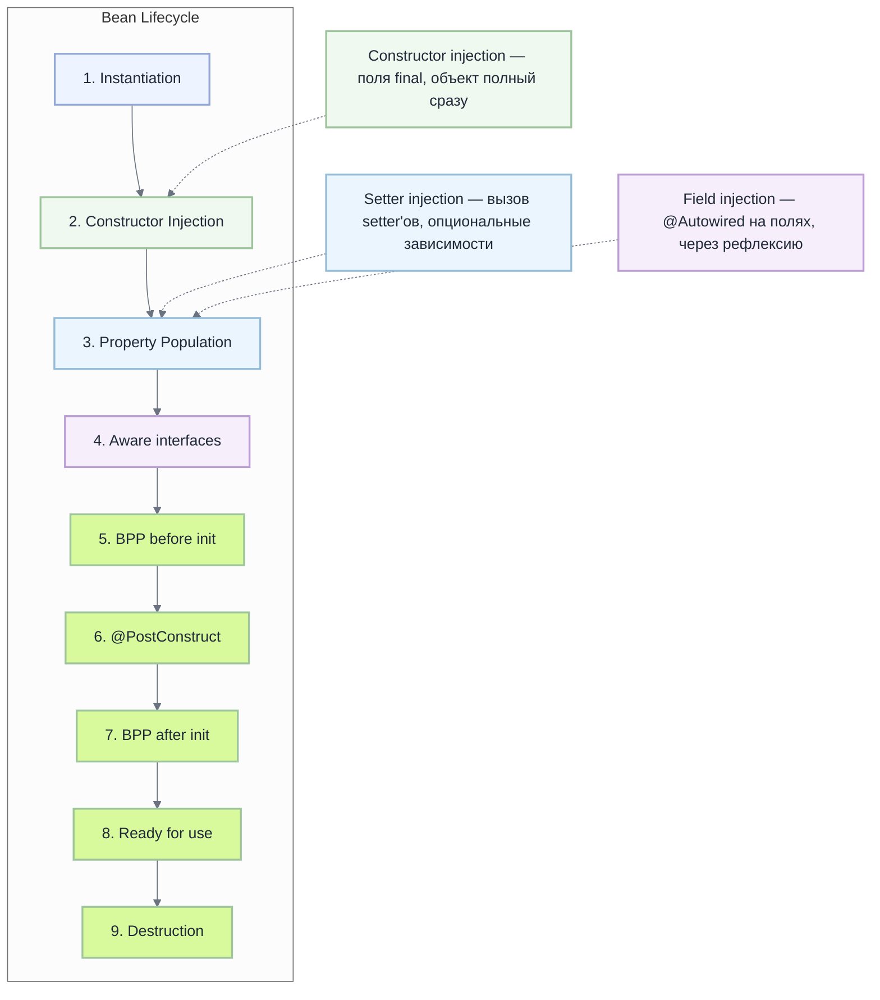
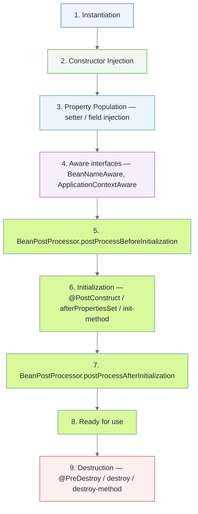
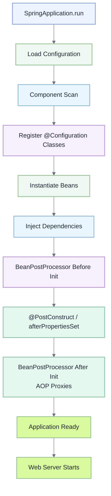

# Spring / Spring Boot

### 1. Что такое Dependency Injection

Dependency Injection (DI — внедрение зависимостей, объект не создаёт зависимости сам, а получает их извне) — это паттерн проектирования и ключевая концепция Spring, при которой объект не создаёт свои зависимости самостоятельно, а получает их извне (от контейнера Spring). Контейнер IoC (Inversion of Control — инверсия контроля, контейнер управляет жизненным циклом объектов) управляет созданием бинов (bean — объект, управляемый Spring-контейнером) и их связыванием, внедряя нужные зависимости в поля, конструктор или сеттеры. Это обеспечивает слабую связанность (loose coupling — компоненты не знают о конкретике реализации друг друга), упрощает тестирование (зависимости можно подменить моками — тестовыми двойниками) и делает код более гибким.

**Trade-offs:**
- DI через Spring: мощно, декларативно, но магическое поведение (AOP-прокси, lazy-init) может затруднить отладку.
- Без DI (Service Locator): проще, но скрытые зависимости, сложнее тестировать.
- Constructor injection vs field injection: constructor = final fields + explicit, field = проще, но null-состояние до инициализации.

**Follow-up (что спросит интервьюер):**
- «А circular dependency?» → Spring: `@Lazy` на одном из полей, или рефакторинг (вынести общий сервис).
- «А `@Autowired` vs `@Inject`?» → `@Autowired` — Spring, `@Inject` — JSR-330 (стандарт Java). В Spring Boot 4+ `@Autowired` опционален (один конструктор — авто).
- «А prototype scope + DI?» → Каждый `get()` создаёт новый бин. В singleton-бинe — одна ссылка (проблема).

```java
// ❌ Без DI: объект создаёт свои зависимости сам
public class OrderService {
    private final UserRepository userRepo = new UserRepositoryImpl();
    private final PaymentService paymentService = new PaymentServiceImpl();
}

// ✅ С DI: зависимости внедряются извне
@Service
public class OrderService {
    private final UserRepository userRepo;
    private final PaymentService paymentService;

    public OrderService(UserRepository userRepo, PaymentService paymentService) {
        this.userRepo = userRepo;
        this.paymentService = paymentService;
    }
}
```

### 2. В чём разница между constructor, setter и field injection

- **Constructor injection**: зависимости передаются через параметры конструктора. Поля могут быть `final`, объект не может быть создан в неполном состоянии.
- **Setter injection**: зависимости передаются через вызовы setter-методов после создания объекта. Поля не могут быть `final`. Подходит для опциональных или переконфигурируемых зависимостей.
- **Field injection**: зависимости внедряются напрямую в поля с помощью `@Autowired`. Поля не могут быть `final`, объект можно создать без зависимостей (они будут `null`), что скрывает проблемы до момента использования.




### 3. Какой тип injection рекомендуется использовать и почему

Рекомендуется **constructor injection**. Причины:
- Позволяет объявить поля `final`, гарантируя неизменяемость и невозможность создания объекта в неполном состоянии.
- Явно показывает обязательные зависимости в сигнатуре конструктора.
- Упрощает модульное тестирование: зависимости можно передать напрямую в конструкторе без рефлексии и Spring-контекста.
- Компилятор гарантирует, что все обязательные зависимости переданы.

Spring официально признаёт только конструкторную и setter-инъекцию как правильные варианты; field injection считается устаревшей практикой.


### 4. Что такое Bean в Spring

Bean (бин) — это объект, который создаётся, настраивается и управляется Spring IoC-контейнером (Inversion of Control — инверсия управления, контейнер создаёт и связывает объекты вместо вас). В отличие от обычного Java-объекта, созданного через `new`, жизненным циклом бина управляет Spring: он создаёт экземпляр, внедряет зависимости, вызывает методы инициализации и уничтожения. Бины обычно определяются через аннотации (`@Component`, `@Service` и т.д.) или в конфигурационных классах (`@Bean`).


### 5. Как создать Bean в Spring

Основные способы:
- **Аннотации стереотипов**: `@Component`, `@Service`, `@Repository`, `@Controller` на классе — Spring найдёт их при сканировании компонентов.
- **`@Bean` в `@Configuration`-классе**: метод, помеченный `@Bean`, возвращает объект, который регистрируется как бин. Позволяет создавать бины для сторонних классов, которые нельзя аннотировать.
- **XML-конфигурация** (устаревший подход): `<bean id="..." class="..."/>`.

```java
// Способ 1: Аннотация стереотипа
@Service
public class OrderService { ... }

// Способ 2: @Bean в @Configuration
@Configuration
public class AppConfig {
    @Bean
    public RestTemplate restTemplate() {
        return new RestTemplate();
    }

    @Bean
    public ObjectMapper objectMapper() {
        return new ObjectMapper()
            .disable(DeserializationFeature.FAIL_ON_UNKNOWN_PROPERTIES);
    }
}
```


### 6. Что такое Bean Lifecycle

Bean Lifecycle (жизненный цикл бина) — это последовательность этапов, которые проходит бин от создания до уничтожения под управлением Spring-контейнера. Spring предоставляет хуки (callback-методы — методы, вызываемые контейнером в определённые моменты), позволяющие разработчику вмешаться в процесс на определённых стадиях: после создания экземпляра, после внедрения зависимостей, перед уничтожением.




### 7. Какие этапы жизненного цикла Bean

Основные этапы:
1.  **Instantiation**: контейнер создаёт экземпляр бина (через конструктор).
2.  **Populate properties (Dependency Injection)**: внедряются зависимости.
3.  **BeanPostProcessor.postProcessBeforeInitialization()**: вызывается для каждого бина до инициализации.
4.  **Initialization**: вызывается `@PostConstruct`-метод, затем `afterPropertiesSet()` (если реализован `InitializingBean`), затем custom init-method.
5.  **BeanPostProcessor.postProcessAfterInitialization()**: вызывается после инициализации; на этом этапе часто создаются AOP-прокси.
6.  **Ready for use**: бин готов к использованию.
7.  **Destruction**: при закрытии контекста вызывается `@PreDestroy`-метод, затем `destroy()` (если реализован `DisposableBean`), затем custom destroy-method.


### 8. Что такое BeanPostProcessor

`BeanPostProcessor` — это интерфейс Spring, позволяющий вмешаться в процесс инициализации бина до и после вызова методов инициализации. Он предоставляет два метода:
- `postProcessBeforeInitialization()`: вызывается до `@PostConstruct` и `afterPropertiesSet()`.
- `postProcessAfterInitialization()`: вызывается после инициализации; именно здесь Spring AOP оборачивает бины в прокси.

`BeanPostProcessor` — ключевой механизм, на котором построены многие функции Spring (аннотации, AOP, `@Transactional` и т.д.).


### 9. Что делают методы с аннотацией @PostConstruct и @PreDestroy

- **`@PostConstruct`**: метод вызывается **после** создания экземпляра бина и внедрения всех зависимостей, но **до** того, как бин станет доступен для использования. Используется для инициализации (например, загрузки кэша, открытия ресурсов).
- **`@PreDestroy`**: метод вызывается **перед уничтожением** бина при закрытии контекста. Используется для освобождения ресурсов (закрытия соединений, остановки потоков).

Обе аннотации — стандарт JSR-250, считаются best practice для lifecycle-колбэков в современном Spring.

```java
@Service
public class ConnectionPoolService {

    private Pool pool;

    @PostConstruct
    public void init() {
        // Вызывается после внедрения зависимостей
        pool = new Pool(/* параметры из конфигурации */);
        pool.connect();
    }

    @PreDestroy
    public void destroy() {
        // Вызывается при закрытии контекста
        pool.close();
    }
}
```


### 10. Что такое scope Bean

Scope (область видимости) бина определяет, как долго живёт бин и сколько экземпляров создаётся для одного определения бина в контейнере. Разные scope позволяют управлять жизненным циклом бина в зависимости от потребностей приложения.


### 11. Какие scope существуют в Spring

Spring поддерживает шесть scope:
- **`singleton`** (по умолчанию): один экземпляр на контейнер.
- **`prototype`**: новый экземпляр при каждом запросе бина.
- **`request`**: один экземпляр на HTTP-запрос (только web-aware контекст).
- **`session`**: один экземпляр на HTTP-сессию (web-aware).
- **`application`**: один экземпляр на `ServletContext` (web-aware).
- **`websocket`**: один экземпляр на WebSocket-сессию (web-aware).

Последние четыре доступны только в веб-приложениях.


### 12. В чём разница между singleton и prototype scope

- **`singleton`**: Spring создаёт **ровно один** экземпляр бина на весь контейнер и возвращает его при каждом запросе. Подходит для stateless-сервисов, репозиториев. Spring управляет полным жизненным циклом (включая `@PreDestroy`).
- **`prototype`**: Spring создаёт **новый экземпляр** при каждом запросе бина. Контейнер не управляет полным жизненным циклом: после создания и внедрения зависимостей он не вызывает `@PreDestroy` и не отслеживает экземпляр. Подходит для stateful, короткоживущих объектов.


### 13. Что такое прокси в Spring

Прокси (proxy, объект-заместитель) — это объект, который оборачивает целевой бин и перехватывает вызовы его методов. Spring использует прокси для реализации сквозной функциональности (cross-cutting concerns — функциональность, которая пронизывает несколько модулей: транзакции, безопасность, кэширование, логирование). Клиентский код вызывает методы прокси, который выполняет дополнительную логику (например, открытие/закрытие транзакции) до или после делегирования вызова реальному объекту.


### 14. Когда Spring создаёт прокси

Spring создаёт прокси для бина, когда обнаруживает, что к нему нужно применить AOP-advice (например, `@Transactional`, `@Cacheable`, `@Async`, методы с `@Around` и т.д.). Прокси создаётся на этапе `BeanPostProcessor.postProcessAfterInitialization()`. Spring AOP использует два механизма:
- JDK dynamic proxy: если целевой объект реализует хотя бы один интерфейс.
- CGLIB proxy: если целевой объект не реализует интерфейсов, создаётся подкласс целевого класса во время выполнения.

Можно принудительно указать CGLIB через `proxyTargetClass = true`.


### 15. Что такое AOP (Aspect-Oriented Programming)

AOP (Aspect-Oriented Programming, аспектно-ориентированное программирование) — это парадигма, позволяющая вынести сквозную функциональность (логирование, транзакции, безопасность, кэширование), которая разбросана по многим классам, в отдельные модули — аспекты (aspects). Spring AOP реализует AOP через прокси: аспект определяет, где (pointcut — срез, выражение, определяющее какие методы перехватываются) и что (advice — совет, действие, выполняемое в определённой точке) должно быть выполнено, и Spring оборачивает целевые бины в прокси, применяющие advice в нужных точках.


### 16. Что такое аспект, advice, pointcut, join point

- Aspect (аспект): модуль, инкапсулирующий сквозную функциональность (например, класс с `@Aspect`).
- Advice (совет): действие, выполняемое аспектом в определённой точке (`@Before`, `@After`, `@Around`, `@AfterReturning`, `@AfterThrowing`).
- Pointcut (срез): выражение, определяющее, какие методы (join points) должны быть перехвачены (например, `execution(* com.example.service.*.*(..))`).
- Join point (точка соединения): конкретный момент выполнения программы (вызов метода, обработка исключения), к которому может быть применён advice. В Spring AOP join point — это всегда вызов метода.


### 17. Что делает аннотация @Transactional

`@Transactional` — декларативная аннотация Spring, которая оборачивает выполнение метода в **транзакцию**. Spring через AOP-прокси автоматически:
1.  Открывает транзакцию перед вызовом метода.
2.  Выполняет метод.
3.  Выполняет `commit`, если метод завершился успешно, или `rollback`, если возникло unchecked-исключение (по умолчанию).

Разработчик избавляется от ручного управления транзакциями (`begin`, `commit`, `rollback`).

```java
@Service
public class OrderService {

    @Transactional
    public void createOrder(Order order) {
        // Если метод завершится успешно — commit
        // Если будет unchecked-исключение — rollback
        orderRepo.save(order);
        paymentService.charge(order.getTotal());
    }

    @Transactional(readOnly = true)
    public Order findOrder(Long id) {
        return orderRepo.findById(id).orElseThrow();
    }

    @Transactional(rollbackFor = CustomException.class)
    public void updateOrder(Order order) {
        // Rollback не только при unchecked, но и при CustomException
        orderRepo.save(order);
    }
}
```


### 18. Почему @Transactional не работает при self-invocation

Spring AOP реализован через **прокси**. Когда метод `A` вызывает метод `B` **того же класса** через `this.B()`, вызов происходит **напрямую у целевого объекта**, минуя прокси. Прокси не участвует, поэтому транзакционная логика (открытие/закрытие транзакции) не применяется — `@Transactional` на методе `B` **игнорируется**. Это одна из самых распространённых причин «неработы» `@Transactional`.

```java
@Service
public class OrderService {

    // ❌ Self-invocation: @Transactional не сработает
    public void createOrder(Order order) {
        this.saveOrder(order); // Вызов напрямую, минуя прокси
    }

    @Transactional
    private void saveOrder(Order order) {
        // Транзакция НЕ будет открыта!
        orderRepo.save(order);
    }
}
```


### 19. Как решить проблему с self-invocation

Основные решения:
1.  **Разделить на разные бины** (рекомендуемый): вынести метод с `@Transactional` в отдельный сервис и внедрить его в вызывающий класс.
2.  **Внедрить самого себя (self-injection)**: внедрить прокси своего бина через `@Autowired` (или `@Lazy`) и вызывать метод через прокси-ссылку.
3.  **Использовать `AopContext.currentProxy()`**: получить текущий прокси и вызвать метод через него (требует `@EnableAspectJAutoProxy(exposeProxy = true)`).
4.  **Перейти на AspectJ** (без прокси): режим `@EnableTransactionManagement(mode = AdviceMode.ASPECTJ)` компилирует/загружает аспекты в байт-код, и self-invocation работает.

На практике чаще всего выбирают **разделение на разные бины** как наиболее чистый архитектурный подход.

```java
// ✅ Решение 1: Разделить на разные бины
@Service
public class OrderService {

    private final OrderTransactionService transactionService;

    public OrderService(OrderTransactionService transactionService) {
        this.transactionService = transactionService;
    }

    public void createOrder(Order order) {
        // Вызов через прокси другого бина — @Transactional сработает
        transactionService.saveOrder(order);
    }
}

@Service
public class OrderTransactionService {

    @Transactional
    public void saveOrder(Order order) {
        // Транзакция будет открыта
        orderRepo.save(order);
    }
}

// ✅ Решение 2: Self-injection через @Lazy
@Service
public class OrderService {

    @Autowired
    @Lazy
    private OrderService self; // Внедряем прокси самого себя

    public void createOrder(Order order) {
        self.saveOrder(order); // Вызов через прокси
    }

    @Transactional
    public void saveOrder(Order order) {
        orderRepo.save(order);
    }
}
```


### 20. Что такое автоконфигурация в Spring Boot

**Автоконфигурация** — это механизм Spring Boot, который автоматически настраивает приложение на основе **наличия классов в classpath**, **существующих бинов** и **свойств конфигурации**. Вместо ручного объявления каждого бина (DataSource, TransactionManager, ViewResolver и т.д.) Spring Boot анализирует зависимости и применяет разумные настройки по умолчанию, следуя принципу «**convention over configuration**». Условия применения автоконфигураций задаются через `@ConditionalOnClass`, `@ConditionalOnMissingBean`, `@ConditionalOnProperty` и другие.


### 21. Как работает @SpringBootApplication

`@SpringBootApplication` — это **составная аннотация**, объединяющая три ключевые аннотации:
- **`@Configuration`**: помечает класс как источник определений бинов.
- **`@EnableAutoConfiguration`**: включает механизм автоконфигурации Spring Boot.
- **`@ComponentScan`**: запускает сканирование компонентов в пакете, где находится главный класс, и во всех подпакетах.

Размещение главного класса в **корневом пакете** проекта гарантирует, что `@ComponentScan` найдёт все компоненты приложения.


### 22. Что такое starter в Spring Boot

**Starter** — это набор удобных зависимостей, который можно добавить в проект (через Maven/Gradle) и получить **готовый набор библиотек** для определённой функциональности (web, JPA, security, test и т.д.). Starter избавляет от необходимости вручную подбирать совместимые версии библиотек и описывать их конфигурацию. Например, `spring-boot-starter-web` подтягивает Spring MVC, встроенный Tomcat, Jackson и всё необходимое для создания REST-приложения. Автоконфигурация затем автоматически настраивает компоненты на основе присутствующих starter'ов.


### 23. Что делает аннотация @ComponentScan

`@ComponentScan` указывает Spring, в каких **пакетах** искать компоненты (классы с `@Component` и его специализациями: `@Service`, `@Repository`, `@Controller`), чтобы зарегистрировать их как бины. Без указания пакетов сканируется пакет класса, на котором стоит аннотация, и все его подпакеты. `@SpringBootApplication` уже включает `@ComponentScan`, поэтому в типичном Spring Boot-приложении отдельно её указывать не нужно.


### 24. Что такое @Configuration класс

`@Configuration` — это аннотация, помечающая класс как **источник определений бинов** для Spring-контекста. Внутри такого класса методы, помеченные `@Bean`, возвращают объекты, которые регистрируются как бины. `@Configuration`-классы сами являются бинами и обрабатываются контейнером особым образом: вызовы `@Bean`-методов внутри класса перехватываются (через CGLIB-прокси), чтобы гарантировать, что возвращается **один и тот же экземпляр** бина (singleton), даже если метод вызывается несколько раз.


### 25. В чём разница между @Component, @Service, @Repository, @Controller

Все четыре аннотации — это **специализации `@Component`**, и все они регистрируют класс как Spring-бин. Разница — в **семантике** и **дополнительном поведении**:
- **`@Component`**: общая аннотация для любого Spring-управляемого компонента.
- **`@Service`**: помечает компонент **бизнес-слоя** (service layer). Дополнительного поведения не добавляет, но улучшает читаемость и семантику.
- **`@Repository`**: помечает компонент **слоя доступа к данным** (DAO). Добавляет **автоматическую трансляцию** исключений persistence-слоя в `DataAccessException` Spring.
- **`@Controller`**: помечает компонент **веб-слоя** (контроллер Spring MVC). Дополнительно связывает класс с механизмом обработки HTTP-запросов.

Рекомендуется использовать специализированные аннотации вместо `@Component`, чтобы явно обозначить роль класса.


### 26. Что делает аннотация @Autowired

`@Autowired` — аннотация Spring, указывающая контейнеру **внедрить зависимость** в поле, конструктор или setter. По умолчанию внедрение происходит **по типу** (`byType`): Spring ищет бин, тип которого соответствует требуемому. Если подходящий бин не найден, по умолчанию выбрасывается `NoSuchBeanDefinitionException` (можно изменить через `required = false`). Может применяться к конструкторам, полям, setter-методам и методам конфигурации.


### 27. Что делать, если есть несколько бинов одного типа

Если в контейнере есть **несколько бинов** одного типа, `@Autowired` по типу не может выбрать один и выбрасывает `NoUniqueBeanDefinitionException`. Решения:
- Использовать **`@Qualifier("beanName")`** вместе с `@Autowired`, чтобы указать **имя** нужного бина.
- Использовать **`@Primary`** на одном из бинов, чтобы сделать его кандидатом по умолчанию.
- Внедрять **коллекцию** (`List<MyService>`, `Map<String, MyService>`), чтобы получить все бины этого типа и выбрать нужный вручную.


### 28. Что такое @Qualifier

`@Qualifier` — аннотация, которая используется **совместно с `@Autowired`** (или `@Inject`) для уточнения, **какой именно бин** должен быть внедрён, когда кандидатов несколько. Значением аннотации является **имя бина** (или его qualifier). Например: `@Autowired @Qualifier("postgresDataSource") private DataSource dataSource;`. Это позволяет разрешить неоднозначность, возникающую при наличии нескольких бинов одного типа.


### 29. Что такое profiles в Spring

**Profiles** — это механизм Spring, позволяющий **логически группировать** определения бинов и конфигурации и **активировать их только в определённых средах** (например, `dev`, `test`, `prod`). Компоненты или конфигурационные классы, помеченные `@Profile("prod")`, регистрируются только тогда, когда профиль `prod` активен. Активные профили задаются через `spring.profiles.active` (в `application.properties`, переменной окружения или аргументе командной строки). Это позволяет иметь разные настройки (URL базы данных, уровни логирования, заглушки внешних сервисов) для разных сред без изменения кода. Поддерживаются выражения: `@Profile({"dev","test"})` (активен любой из), `@Profile("!prod")` (активен, если `prod` не активен).

```java
// Разные конфигурации для разных сред
@Profile("dev")
@Component
public class DevDataSourceConfig {
    @Bean
    public DataSource dataSource() {
        return DataSourceBuilder.create()
            .url("jdbc:postgresql://localhost:5432/app_dev")
            .username("dev")
            .password("dev")
            .build();
    }
}

@Profile("prod")
@Component
public class ProdDataSourceConfig {
    @Bean
    public DataSource dataSource() {
        return DataSourceBuilder.create()
            .url(System.getenv("DB_URL"))
            .username(System.getenv("DB_USER"))
            .password(System.getenv("DB_PASS"))
            .build();
    }
}

// Запуск с активным профилем:
// java -jar app.jar --spring.profiles.active=dev
```

### 30. Какие propagation-режимы транзакций есть в @Transactional

`@Transactional` управляет не только тем, будет ли транзакция, но и тем, как она соотносится с уже активной транзакцией. Параметр `propagation` определяет это поведение:

- **`REQUIRED`** (по умолчанию): если транзакция активна — присоединиться к ней; если нет — создать новую. Самый частый случай.
- **`REQUIRES_NEW`**: всегда создать новую транзакцию, даже если уже есть активная. Предыдущая — приостанавливается. Используется, когда нужно записать данные независимо от внешнего отката (например, аудиторский лог — должен сохраниться, даже если бизнес-операция откачется).
- **`NESTED`**: создать вложенную транзакцию через SAVEPOINT. Откат вложенной — откатить до SAVEPOINT, внешний продолжается.
- **`SUPPORTS`**: если есть транзакция — работать в ней; если нет — работать без.
- **`NOT_SUPPORTED`**: приостановить текущую и работать без транзакции.
- **`MANDATORY`**: обязательно работать в транзакции, если её нет — выбросить `TransactionRequiredException`.
- **`NEVER`**: обязательно работать без транзакции, если она есть — выбросить.

```java
@Transactional
public void createOrder(Order order) {
    // REQUIRED — работаем в этой транзакции
    orderRepo.save(order);
    // REQUIRES_NEW — новая транзакция: audit сохранится даже если createOrder откатится
    auditService.recordOrderCreated(order.getId());
    // Если здесь произойдёт unchecked exception — order не сохранится,
    // НО audit уже закоммичен (REQUIRES_NEW)
    paymentService.charge(order.getTotal());
}

@Service
public class AuditService {
    @Transactional(propagation = Propagation.REQUIRES_NEW)
    public void recordOrderCreated(Long orderId) {
        auditRepo.save(new AuditEvent("ORDER_CREATED", orderId));
    }
}
```

### 31. Что такое isolation level и как его задать через @Transactional

Isolation level (уровень изоляции) определяет, как параллельно выполняющиеся транзакции видят изменения друг друга. В `@Transactional` задаётся параметром `isolation`:

- **`ISOLATION_DEFAULT`** (по умолчанию) — уровень, установленный в БД.
- **`ISOLATION_READ_UNCOMMITTED`** — читает недозволенные данные (dirty read). Почти не используется.
- **`ISOLATION_READ_COMMITTED`** — читает только закоммиченные данные. Уровень по умолчанию в PostgreSQL, MySQL (InnoDB).
- **`ISOLATION_REPEATABLE_READ`** — все SELECT в одной транзакции видят один снимок. Уровень по умолчанию в MySQL.
- **`ISOLATION_SERIALIZABLE`** — полная изоляция, максимум корректности, минимум параллелизма.

```java
@Transactional(isolation = Isolation.REPEATABLE_READ)
public BigDecimal calculateInventory(String warehouseId) {
    // Все SELECT внутри этой транзакции увидят одинаковое состояние inventory
    return inventoryRepo.sumByWarehouse(warehouseId);
}

@Transactional(isolation = Isolation.SERIALIZABLE)
public void transferInventory(String from, String to, int qty) {
    // Максимальная корректность — но возможны serialization_failure при конфликте
    inventoryRepo.decrement(from, qty);
    inventoryRepo.increment(to, qty);
}
```

### 32. Что делает readOnly = true в @Transactional

`readOnly = true` — оптимизация для методов, которые только читают данные:
1. **JDBC**: устанавливает `Statement`/`Connection` в read-only режим — БД может оптимизировать (не пишет WAL, не берёт write-блокировки).
2. **JPA/Hibernate**: Hibernate не отслеживает изменения в Persistence Context (dirty checking выключен) — меньше CPU, меньше памяти.
3. **Semantics**: подсказка для разработчика — метод не должен изменять состояние.

```java
@Service
public class OrderService {
    // ❌ Неправильно: метод только читает, но транзакция «на запись»
    @Transactional
    public List<Order> findRecentOrders() {
        return orderRepo.findRecent();
    }

    // ✅ Правильно: readOnly — оптимизация + семантика
    @Transactional(readOnly = true)
    public List<Order> findRecentOrders() {
        return orderRepo.findRecent();
    }
}
```

### 33. Как задать timeout для @Transactional

Параметр `timeout` (в секундах) ограничивает время жизни транзакции. Если транзакция не завершилась за отведённое время — Spring откатывает её и выбрасывает `TransactionTimedOutException`. Полезно для защиты от «висящих» транзакций (зависшие внешние сервисы, медленные SQL-запросы):

```java
@Transactional(timeout = 5) // 5 секунд
public void callExternalPayment(String orderId) {
    // Если внешний платёжный сервис завис на 10 сек — транзакция откатится
    // через 5 сек, освобождая блокировки БД
    externalPaymentClient.charge(orderId);
    orderRepo.markPaid(orderId);
}
```

### 34. Как @Transactional ведёт себя с @Async

`@Async` и `@Transactional` работают вместе, но порядок важен:
- **`@Async` на публичном методе**: метод запускается в другом потоке, транзакция создаётся в том потоке, который вызывает метод.
- **Само-вызов @Async не работает** — как и @Transactional (прокси не участвует).
- **Типичный паттерн**: `@Async` на оркестраторе, `@Transactional` на каждом шаге отдельно — чтобы одна ошибка не откатывала весь async-поток.

```java
@Service
public class OrderEventService {
    @Async
    public void processOrderCreated(OrderCreatedEvent event) {
        // Каждый шаг — своя транзакция, каждая независима
        notifyService.notify(event.getOrderId());        // своя транзакция
        inventoryService.reserve(event.getOrderId());   // своя транзакция
        analyticsService.track(event.getOrderId());     // своя транзакция
    }
}

@Service
public class NotifyService {
    @Transactional
    public void notify(Long orderId) {
        // Если этот шаг упадёт — только он откатится, остальные выполнятся
        notificationRepo.save(new Notification(orderId, "ORDER_CREATED"));
    }
}
```

### 35. Что происходит, если в @Transactional-метод пробросить checked exception

По умолчанию `@Transactional` откатывает транзакцию **только при unchecked исключениях** (`RuntimeException`, `Error`). Checked exceptions (`Exception` и его наследники) **не вызывают откат** — транзакция успешно завершается (`commit`), что часто является багом.

Решение: явно указать, какие исключения должны вызывать откат:
- **`rollbackFor = MyException.class`** — откат при этом исключении.
- **`noRollbackFor = MyException.class`** — НЕ откатывать при этом исключении (редко используется).

```java
@Transactional(rollbackFor = PaymentException.class)
public void pay(Order order) throws PaymentException {
    // PaymentException — checked exception
    // Без rollbackFor транзакция бы закоммитилась, а order был бы частично сохранён
    orderRepo.save(order);
    if (paymentClient.charge(order.getTotal()) == 0) {
        throw new PaymentException("Недостаточно средств");
    }
    orderRepo.markPaid(order.getId());
}
```

### 36. Как работает порядок advice в AOP и как его контролировать

Когда к методу применяется несколько advice (например, `@Around` для логирования + `@Around` для метрик + `@After` для аудита), они выполняются в определённом порядке. Spring управляет этим через:
- **`@Order`** на аспекте: меньший номер — более высокий приоритет (выполняется первым при входе, последним при выходе).
- **`Ordered`** интерфейс: аналог `@Order`, но через реализацию.
- **Без явного порядка**: Spring определяет порядок по алфавиту имени класса (нестабильно — лучше всегда явный).

Порядок для `@Around` (самый частый advice):
1. **Вход**: advice с меньшим `@Order` выполняется первым (оборачивает снаружи).
2. **Выход**: advice с меньшим `@Order` выполняется последним (самый внешний).

```java
@Aspect
@Order(1) // Выполняется первым при входе, последним при выходе
public class LoggingAspect {
    @Around("execution(* com.example.service..*(..))")
    public Object log(ProceedingJoinPoint pjp) throws Throwable {
        long start = System.nanoTime();
        Object result = pjp.proceed();
        log.info("{} took {} ms", pjp.getSignature(), (System.nanoTime() - start) / 1_000_000);
        return result;
    }
}

@Aspect
@Order(2) // Внутренний — выполняется вторым при входе, первым при выходе
public class MetricsAspect {
    @Around("execution(* com.example.service..*(..))")
    public Object metric(ProceedingJoinPoint pjp) throws Throwable {
        try {
            return pjp.proceed();
        } finally {
            metricsRegistry.increment(pjp.getSignature().toShortString());
        }
    }
}
```

### 37. Какие pointcut-выражения поддерживает Spring AOP

Pointcut (срез) — выражение, определяющее, какие методы перехватываются. Основные виды:

- **`execution(...)`** — по сигнатуре метода:
  ```
  execution(* com.example.service..*(..))    — все методы в package service и подпакетах
  execution(public int com.example.*.get*(..)) — public int get*() в классах уровня example
  execution(* save*(..))                    — все методы, начинающиеся с save
  ```
- **`within(...)`** — все методы внутри класса:
  ```
  within(com.example.service..*)             — все методы всех классов в package service
  ```
- **`@annotation(...)`** — методы с конкретной аннотацией:
  ```
  @annotation(com.example.Auditable)         — все методы с @Auditable
  ```
- **`args(...)`** — по типам параметров:
  ```
  args(java.lang.String, ..)                 — методы, первый параметр — String
  ```
- **`this(...)` / `target(...)`** — по типу прокси / целевого объекта.
- **Комбинирование**: `&&` (AND), `||` (OR), `!` (NOT).

```java
@Aspect
public class AuditAspect {
    // Методы с @Audit в package com.example + методы save*() в repo
    @Pointcut("@annotation(com.example.Audit) || execution(* com.example.repo..save*(..))")
    public void auditPointcut() {}

    @AfterReturning(pointcut = "auditPointcut()", returning = "result")
    public void audit(JoinPoint jp, Object result) {
        log.info("AUDIT: {} returned {}", jp.getSignature(), result);
    }
}
```

### 38. Чем Spring AOP отличается от AspectJ

Spring AOP и AspectJ реализуют одну идею (aspect-oriented programming), но технически разные:

| | Spring AOP | AspectJ |
|---|---|---|
| **Механизм** | Proxy (JDK dynamic proxy или CGLIB) | Compile-time / load-time weaving |
| **Pointcut** | Только **вызовы методов** | Любые **join points**: вызовы, поля, конструкторы |
| **Self-invocation** | Не работает (прокси обходятся) | Работает (вшит в байт-код) |
| **Настройка** | `@EnableAspectJAutoProxy` | AspectJ compiler (`ajc`) или load-time weaving |
| **Зависимость** | Spring AOP (легкий) | aspectjrt + aspectjweaver |
| **Производительность** | Небольшой overhead (прокси) | Нулевой overhead (вшит в байт-код) |
| **Сложность** | Проще | Сложнее (нужен aspectj-компилер) |

Для 95% задач Spring AOP достаточно. AspectJ нужен, когда:
- Нужны pointcut на поля/конструкторы.
- Self-invocation должна работать.
- Нужен нулевой overhead на горячих путях.

### 39. Как использовать @Aspect и @Order в одном классе

Можно объединить несколько advice в одном аспекте и управлять порядком внутри:

```java
@Aspect
@Order(1)
public class OrderProcessingAspect {

    @Pointcut("execution(* com.example.service..create*(..))")
    public void createOrderPointcut() {}

    // Логирование — самый внешний слой
    @Around("createOrderPointcut()")
    public Object log(ProceedingJoinPoint pjp) throws Throwable {
        log.info("Creating order: {}", pjp.getArgs()[0]);
        return pjp.proceed();
    }

    // Метрики — после логирования
    @AfterReturning(pointcut = "createOrderPointcut()", returning = "result")
    public void metric(JoinPoint jp, Object result) {
        metricsRegistry.increment("order.created");
    }

    // Обработка ошибок — самый внутренний
    @AfterThrowing(pointcut = "createOrderPointcut()", throwing = "ex")
    public void onException(JoinPoint jp, Throwable ex) {
        log.error("Order creation failed", ex);
        metricsRegistry.increment("order.created.error");
    }
}
```

### 40. В чём разница между @Value и @ConfigurationProperties

- **`@Value("${key}")`**: внедряет **одну конкретную** настройку в поле или параметр конструктора. Подходит для простых случаев (одна строка, один число). Поддерживает выражения с дефолтами: `@Value("${app.timeout:30}")`.
- **`@ConfigurationProperties`**: **привязывает** целое дерево настроек из `application.properties`/`yml` к типу (POJO или record). Поддерживает **binding** (связывание) иерархических свойств, валидацию (`@Validated` + JSR-303), prefix.

```java
// @Value — одна настройка
@Component
public class App {
    @Value("${app.timeout:30}")
    private int timeout;
}

// @ConfigurationProperties — дерево настроек
@ConfigurationProperties(prefix = "app")
@Validated
public record AppConfig(
    @NotNull String name,
    @Min(1) @Max(300) int timeout,
    @Valid Pool pool
) {}

@Configuration
@EnableConfigurationProperties(AppConfig.class)
public class AppConfigRegistrar {}

// application.properties:
// app.name=my-app
// app.timeout=60
// app.pool.max-size=20
// app.pool.timeout=30
```

### 41. Как работает binding и relaxed binding в @ConfigurationProperties

**Relaxed binding** — механизм Spring Boot, позволяющий указывать одно и то же свойство разными способами записи. Все следующие формы эквивалентны для `app.maxConnections`:

```
app.maxConnections=100
app.max-connections=100
app.max_connections=100
app.MAXCONNECTIONS=100
```

Правила:
- **`application.properties`**: `app.max-connections=100` или `app.maxConnections=100` — оба работают.
- **`application.yml`**: `app.maxConnections: 100` или `app.max-connections: 100` — оба работают.
- **Переменные окружения**: `APP_MAX_CONNECTIONS=100` (капс + подчёркивание).
- **Аргументы командной строки**: `--app.max-connections=100`.

Binding (связывание) происходит через `Binder` API: Spring преобразует плоскую иерархию свойств (`app.pool.max-size`) в вложенную структуру (`AppConfig.Pool.maxSize`).

```java
@ConfigurationProperties(prefix = "app")
public record AppConfig(String name, Pool pool) {
    public record Pool(int maxSize, int timeout) {}
}

// application.yml:
// app:
//   name: my-app
//   pool:
//     max-size: 20      # → AppConfig.Pool.maxSize = 20
//     timeout: 30       # → AppConfig.Pool.timeout = 30
```

### 42. Какие @Conditional аннотации есть и когда их использовать

`@Conditional` — механизм Spring Boot, позволяющий регистрировать бин только при выполнении определённого условия. Основные варианты:

- **`@ConditionalOnClass`**: если в classpath есть определённый класс.
- **`@ConditionalOnMissingClass`**: если класса НЕТ в classpath.
- **`@ConditionalOnBean`**: если в контексте есть бин определённого типа.
- **`@ConditionalOnMissingBean`**: если бина НЕТ (самый частый — используется в auto-configuration).
- **`@ConditionalOnProperty`**: если свойство конфигурации имеет определённое значение.
- **`@ConditionalOnExpression`**: если SpEL-выражение возвращает true.
- **`@ConditionalOnWebApplication`**: если приложение — веб-приложение.

```java
@Configuration
@ConditionalOnClass(RedisTemplate.class)
@ConditionalOnProperty(name = "app.redis.enabled", havingValue = "true")
public class RedisConfig {
    @Bean
    @ConditionalOnMissingBean  // Если пользователь уже определил свою RedisTemplate — не перетираем
    public RedisTemplate<String, Object> redisTemplate(RedisConnectionFactory factory) {
        return new RedisTemplate<>();
    }
}
```

### 43. Как работают PropertySource и их порядок

Spring Boot загружает свойства из нескольких источников в определённом порядке. Источник с **более высоким приоритетом** перетирает значения из источника с более низким:

1. **Аргументы командной строки** (`--key=value`) — самый высокий приоритет.
2. **Переменные окружения** (`KEY=value`).
3. **`application-{profile}.properties`/`yml`** (для активного профиля).
4. **`application.properties`/`yml`**.
5. **`@PropertySource`** (в конфигурационных классах).
6. **Default properties** (в `spring-boot` — самые низкие).

```java
// src/main/resources/application.properties
app.name=dev-app
app.timeout=30

// src/main/resources/application-prod.properties
app.name=prod-app
app.timeout=60

// Запуск: java -jar app.jar --spring.profiles.active=prod --app.timeout=120
// Результат:
// app.name = prod-app        (из application-prod.properties)
// app.timeout = 120          (из аргументов командной строки — перетирает prod)
```

### 44. Как добавить свой PropertySource

Можно добавить собственный источник свойств через `@PropertySource`:

```java
@Configuration
@PropertySource("classpath:custom.properties")     // Файл в classpath
@PropertySource("file:/etc/app/external.properties") // Внешний файл
public class CustomConfig {
    // Spring добавит этот источник в PropertySources
}
```

Или программно через `Environment`:

```java
@Configuration
public class DynamicConfig {
    @Bean
    public PropertySource<?> dynamicProperties() {
        return new MapPropertySource("dynamic", Map.of(
            "app.feature.enabled", "true",
            "app.debug", "false"
        ));
    }
}
```

### 45. Что такое @ControllerAdvice и @ExceptionHandler

`@ControllerAdvice` — аннотация для **глобальной обработки исключений** во всех контроллерах. Вместо того чтобы оборачивать каждый endpoint в try-catch, вы объявляете один класс с `@ControllerAdvice` и методы `@ExceptionHandler` — Spring автоматически перехватывает выбрасываемые исключения и применяет соответствующий обработчик.

```java
@RestControllerAdvice
public class GlobalExceptionHandler {

    // Обработка валидационных ошибок (Bad Request)
    @ExceptionHandler(MethodArgumentNotValidException.class)
    public ResponseEntity<ProblemDetail> handleValidation(MethodArgumentNotValidException ex) {
        ProblemDetail pd = ProblemDetail.forStatus(HttpStatus.BAD_REQUEST);
        pd.setTitle("Invalid input");
        Map<String, String> errors = new HashMap<>();
        ex.getBindingResult().getFieldErrors()
           .forEach(fe -> errors.put(fe.getField(), fe.getDefaultMessage()));
        pd.setProperty("errors", errors);
        return ResponseEntity.badRequest().body(pd);
    }

    // Обработка «не найдено»
    @ExceptionHandler(ResourceNotFoundException.class)
    public ResponseEntity<ProblemDetail> handleNotFound(ResourceNotFoundException ex) {
        ProblemDetail pd = ProblemDetail.forStatus(HttpStatus.NOT_FOUND);
        pd.setTitle(ex.getMessage());
        return ResponseEntity.status(HttpStatus.NOT_FOUND).body(pd);
    }

    // Обработка всех остальных исключений
    @ExceptionHandler(Exception.class)
    public ResponseEntity<ProblemDetail> handleGeneric(Exception ex) {
        log.error("Unexpected error", ex);
        ProblemDetail pd = ProblemDetail.forStatus(HttpStatus.INTERNAL_SERVER_ERROR);
        pd.setTitle("Internal server error");
        pd.setProperty("traceId", MDC.get("traceId"));
        return ResponseEntity.status(HttpStatus.INTERNAL_SERVER_ERROR).body(pd);
    }
}
```

### 46. Что такое ProblemDetail (RFC 7807)

**ProblemDetail** — стандартная структура ошибок в HTTP (RFC 7807, «Application Error Problem Details»). В Spring Boot 3 это класс `org.springframework.http.ProblemDetail`, который сериализуется в JSON по стандарту:

```json
{
  "type": "https://example.com/errors/not-found",
  "title": "Resource not found",
  "status": 404,
  "detail": "Order with id 123 not found",
  "instance": "/api/orders/123",
  "traceId": "abc123"
}
```

Поля:
- **`type`** — URI, идентифицирующий тип проблемы.
- **`title`** — краткое описание.
- **`status`** — HTTP статус.
- **`detail`** — детали (опционально).
- **`instance`** — URI конкретного ресурса.
- **Дополнительные поля** — через `setProperty()`.

```java
@ExceptionHandler(OrderNotFoundException.class)
public ProblemDetail handleNotFound(OrderNotFoundException ex) {
    ProblemDetail pd = ProblemDetail.forStatusAndDetail(HttpStatus.NOT_FOUND, ex.getMessage());
    pd.setType(URI.create("https://example.com/errors/order-not-found"));
    pd.setTitle("Order not found");
    pd.setProperty("orderId", ex.getOrderId());
    return pd;
}
```

### 47. Как работает Bean Validation (JSR 380) в Spring Boot

Bean Validation — стандарт JSR 380 (Hibernate Validator — референс-реализация) для декларативной валидации объектов. В Spring Boot используется через:
- **`@Valid` / `@Validated`** на параметрах контроллера — валидация при десериализации DTO.
- **`@Validated`** на уровне класса (в сочетании с `@ControllerAdvice`) — групповая валидация.
- **Группы валидации** (`@Validated(CreateGroup.class)`) — разные правила для разных операций.

```java
public record CreateOrderRequest(
    @NotNull @Positive Long productId,
    @Min(1) @Max(100) int quantity,
    @Email @Size(max = 255) String customerEmail,
    @Future LocalDateTime deliveryDate
) {}

@RestController
@RequestMapping("/api/orders")
public class OrderController {

    @PostMapping
    public ResponseEntity<OrderDto> create(@Valid @RequestBody CreateOrderRequest req) {
        // Если валидация не прошла — MethodArgumentNotValidException → @ExceptionHandler
        OrderDto result = orderService.create(req);
        return ResponseEntity.status(HttpStatus.CREATED).body(result);
    }
}
```

### 48. Что такое Actuator и как настроить endpoints

**Actuator** — модуль Spring Boot, который предоставляет **готовые эндпоинты для мониторинга и управления** приложением в production:
- **`/actuator/health`** — состояние приложения (UP/DOWN) + детализация по компонентам.
- **`/actuator/metrics`** — метрики (JVM, HTTP, DB, Kafka и т.д.).
- **`/actuator/info`** — информация (версия, git commit).
- **`/actuator/env`** — активные свойства (чувствительный — лучше закрыть).
- **`/actuator/beans`** — список всех бинов.
- **`/actuator/mappings`** — все URL-маппинги.
- **`/actuator/loggers`** — управление уровнями логирования в рантайме.

Настройка в `application.properties`:
```properties
# Включить нужные эндпоинты
management.endpoints.web.exposure.include=health,info,metrics
# Закрыть чувствительные
management.endpoints.web.exposure.exclude=env,beans
# Безопасность: авторизация для чувствительных
management.endpoint.health.show-details=when-authorized
management.endpoints.web.base-path=/internal/actuator
```

```java
// Кастомный health check
@Component
public class PaymentGatewayHealthIndicator implements HealthIndicator {
    @Override
    public Health health() {
        boolean up = paymentClient.ping();
        return up ? Health.up().withDetail("latencyMs", 42).build()
                  : Health.down().withDetail("reason", "timeout").build();
    }
}
```

### 49. Как настроить логирование в Spring Boot

Spring Boot использует **SLF4J** (API) + **Logback** (реализация) по умолчанию. Конфигурация через `logback-spring.xml` (специфично для Spring) или `application.properties`:

```properties
# application.properties
logging.level.root=INFO
logging.level.com.example.service=DEBUG
logging.level.org.hibernate.SQL=DEBUG
logging.file.name=logs/app.log
logging.pattern.file=%d{yyyy-MM-dd HH:mm:ss.SSS} [%thread] %-5level %logger{36} - %msg%n
```

```xml
<!-- logback-spring.xml (в src/main/resources) -->
<configuration>
    <appender name="CONSOLE" class="ch.qos.logback.core.ConsoleAppender">
        <encoder>
            <pattern>%d{HH:mm:ss.SSS} [%thread] %-5level %logger{36} - %msg%n</pattern>
        </encoder>
    </appender>

    <appender name="FILE" class="ch.qos.logback.core.rolling.RollingFileAppender">
        <file>logs/app.log</file>
        <rollingPolicy class="ch.qos.logback.core.rolling.TimeBasedRollingPolicy">
            <fileNamePattern>logs/app-%d{yyyy-MM-dd}.log</fileNamePattern>
            <maxHistory>30</maxHistory>
        </rollingPolicy>
        <encoder>
            <pattern>%d{yyyy-MM-dd HH:mm:ss.SSS} [%thread] %-5level %logger{36} [%X{traceId}] - %msg%n</pattern>
        </encoder>
    </appender>

    <logger name="com.example.service" level="DEBUG"/>
    <root level="INFO">
        <appender-ref ref="CONSOLE"/>
        <appender-ref ref="FILE"/>
    </root>
</configuration>
```

**MDC (Mapped Diagnostic Context)** — механизм SLF4J для хранения контекста (traceId, userId, requestId) в каждом лог-записи. Заполняется через `MDC.put("traceId", ...)` и подставляется в pattern через `[%X{traceId}]`.

### 50. Как работает @Async и как настроить ExecutorService

`@Async` — аннотация для асинхронного выполнения методов. По умолчанию Spring использует `SimpleAsyncTaskExecutor` (создаёт новый поток для каждой задачи — **не рекомендуется** для production). Лучше настроить пул потоков:

```java
@Configuration
@EnableAsync
public class AsyncConfig {

    @Bean(name = "taskExecutor")
    public Executor taskExecutor() {
        ThreadPoolTaskExecutor executor = new ThreadPoolTaskExecutor();
        executor.setCorePoolSize(10);
        executor.setMaxPoolSize(20);
        executor.setQueueCapacity(100);
        executor.setThreadNamePrefix("async-");
        executor.setRejectedExecutionHandler(new ThreadPoolExecutor.CallerRunsPolicy());
        executor.initialize();
        return executor;
    }
}

@Service
public class NotificationService {
    @Async("taskExecutor") // Явно указать имя пула
    public void sendEmail(String to, String subject) {
        // Выполняется в отдельном потоке из пула
        log.info("Sending email to {} (thread: {})", to, Thread.currentThread().getName());
        emailClient.send(to, subject);
    }
}
```

**Важные нюансы:**
- `@Async` работает только на **публичных** методах.
- Self-invocation не работает (прокси обходятся).
- Возвращает `CompletableFuture<T>` (или `Future<T>`), а не `T` — для получения результата.
- **Исключения** в @Async-методах теряются (никто не слушает `CompletableFuture`), если не перехвачены через `AsyncUncaughtExceptionHandler`.

```java
// Обработка исключений в @Async
@Bean
public AsyncUncaughtExceptionHandler asyncExceptionHandler() {
    return (throwable, method, params) ->
        log.error("Async method {} failed", method.getName(), throwable);
}
```

### 51. Что такое Spring Context и как работает его инициализация

**Spring ApplicationContext** — контейнер, который управляет жизненным циклом всех бинов приложения. При запуске Spring Boot происходит:

1. **Загрузка конфигурации**: `SpringApplication.run()` → создание `AnnotationConfigApplicationContext`.
2. **Component scanning**: поиск бинов по пакетам (`@ComponentScan`).
3. **Обработка `@Configuration`**: создание CGLIB-прокси для `@Configuration`-классов (гарантия singleton для `@Bean`-методов).
4. **Регистрация бинов**: создание экземпляров, внедрение зависимостей (constructor/setter/field).
5. **Вызов хуков инициализации**: `@PostConstruct`, `InitializingBean.afterPropertiesSet()`, custom init-method.
6. **BeanPostProcessor.postProcessAfterInitialization()**: применение AOP-прокси (`@Transactional`, `@Async`, `@Cacheable`).
7. **Приложение готово**: контроллеры слушают HTTP, сервисы готовы к работе.



**Graceful shutdown**: при остановке (SIGTERM, `application.stop()`) Spring:
1. Останавливает принимать новые HTTP-запросы.
2. Даёт время активным запросам завершиться (`server.shutdown=graceful`).
3. Вызывает `@PreDestroy` для всех бинов.
4. Закрывает пулы потоков, соединения с БД, Kafka-коньюмеры.

```properties
server.shutdown=graceful
spring.lifecycle.timeout-per-shutdown-phase=30s
```

### 52. Как работают Spring Events (ApplicationEvent, @EventListener)

Spring Events — механизм внутрипроцессной коммуникации между бинами через события. Позволяет развязать компоненты: отправитель (publisher, публикующий) не знает о получателях (listeners, слушатели), а получатели не знают друг о друге.

Компоненты:
- `ApplicationEvent` — базовый класс для событий (или любой `Object` в Spring Boot 3+).
- `ApplicationEventPublisher` — интерфейс для публикации событий (внедряется через `@Autowired`).
- `@EventListener` — аннотация для слушателей (метод, который вызывается при публикации события).
- `SmartApplicationListener` — интерфейс для продвинутых слушателей (контроль порядка, асинхронность).

Базовый пример:

```java
// 1. Определить событие (в Spring Boot 3+ можно использовать любой класс)
public record OrderCreatedEvent(Long orderId, BigDecimal total) {}

// 2. Публиковать событие
@Service
public class OrderService {
    private final ApplicationEventPublisher eventPublisher;

    public OrderService(ApplicationEventPublisher eventPublisher) {
        this.eventPublisher = eventPublisher;
    }

    @Transactional
    public void createOrder(Order order) {
        orderRepo.save(order);
        // Публикация события — не знает о слушателях
        eventPublisher.publishEvent(new OrderCreatedEvent(order.getId(), order.getTotal()));
    }
}

// 3. Слушать событие
@Component
public class OrderCreatedListener {

    @EventListener
    public void onOrderCreated(OrderCreatedEvent event) {
        // Синхронный вызов в том же потоке, что и publishEvent()
        log.info("Order created: {}", event.orderId());
        sendNotification(event.orderId());
    }
}
```

Асинхронные события (с `@Async`):

```java
@Component
public class AsyncOrderListener {

    @Async("taskExecutor")  // Выполняется в отдельном потоке
    @EventListener
    public void onOrderCreatedAsync(OrderCreatedEvent event) {
        // Не блокирует основной поток
        log.info("Async: processing order {}", event.orderId());
        sendEmail(event.orderId());
    }
}
```

Порядок слушателей (`@Order`):

```java
@Component
@Order(1)  // Выполняется первым
public class FirstListener {
    @EventListener
    public void onEvent(OrderCreatedEvent event) {
        log.info("First listener");
    }
}

@Component
@Order(2)  // Выполняется вторым
public class SecondListener {
    @EventListener
    public void onEvent(OrderCreatedEvent event) {
        log.info("Second listener");
    }
}
```

Когда Spring Events, когда Kafka/Outbox:
- Spring Events: коммуникация внутри одного процесса (один Spring Context). Быстро, просто, нет сети.
- Kafka/Outbox: коммуникация между процессами (распределённые микросервисы). Надёжно, масштабируемо, но сложнее.

### 53. Что такое @TransactionalEventListener и когда его использовать

`@TransactionalEventListener` — слушатель, который вызывается только после успешного commit транзакции (или после rollback, если указано). Решает классическую проблему: если слушатель с `@EventListener` выполнился, а транзакция откатилась — данные несогласованны.

Сценарий:
1. Метод `createOrder()` в транзакции: сохраняет заказ + публикует событие.
2. Если транзакция закоммитится — слушатель `@TransactionalEventListener` выполнится.
3. Если транзакция откатится — слушатель не выполнится (событие «потеряется»).

```java
@Component
public class OrderTransactionalListener {

    // Вызывается только после успешного commit
    @TransactionalEventListener
    public void onOrderCreated(OrderCreatedEvent event) {
        // Транзакция уже закоммичена — данные в БД
        // Можно безопасно отправлять уведомления, вызывать внешние сервисы
        log.info("Order committed: {}", event.orderId());
        paymentService.charge(event.total());
    }

    // Вызывается после rollback (редко используется)
    @TransactionalEventListener(fallbackExecution = true)
    public void onOrderCreatedFallback(OrderCreatedEvent event) {
        // Если транзакция откатилась — можно выполнить «откатные» действия
        log.warn("Order rolled back: {}", event.orderId());
    }
}
```

Параметры `@TransactionalEventListener`:
- `fallbackExecution = false` (по умолчанию): слушатель вызывается только в рамках активной транзакции. Если события опубликованы вне транзакции — слушатель не вызывается.
- `fallbackExecution = true`: если нет активной транзакции — слушатель вызывается немедленно (как обычный `@EventListener`).
- `phase = TransactionPhase.BEFORE_COMMIT`: вызывается перед commit (по умолчанию `AFTER_COMMIT`).

Типовая ошибка:
```java
// ❌ Неправильно: @EventListener без транзакционной синхронизации
@EventListener
public void onOrderCreated(OrderCreatedEvent event) {
    // Выполняется немедленно при publishEvent()
    // Если транзакция откатится — данные несогласованны!
    paymentService.charge(event.total());
}

// ✅ Правильно: @TransactionalEventListener
@TransactionalEventListener
public void onOrderCreated(OrderCreatedEvent event) {
    // Выполняется только после commit
    // Если транзакция откатится — не вызовется
    paymentService.charge(event.total());
}
```


