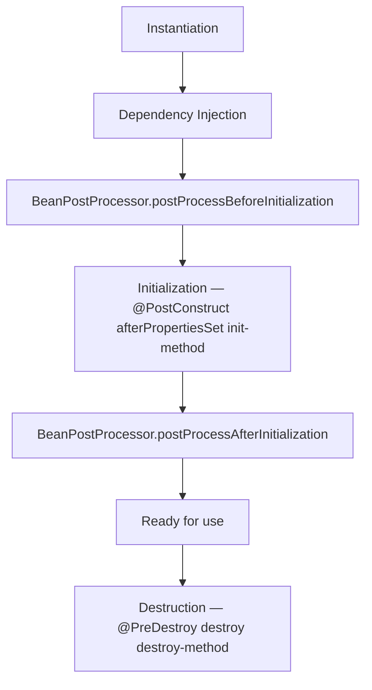

# Spring / Spring Boot

### 1. Что такое Dependency Injection

Dependency Injection (DI) — это паттерн проектирования и ключевая концепция Spring, при которой объект не создаёт свои зависимости самостоятельно, а получает их извне (от контейнера Spring). Контейнер IoC (Inversion of Control) управляет созданием бинов и их связыванием, внедряя нужные зависимости в поля, конструктор или сеттеры. Это обеспечивает слабую связанность, упрощает тестирование (зависимости можно подменить моками) и делает код более гибким.

```java
// ❌ Без DI: объект создаёт свои зависимости сам
public class OrderService {
    private final UserRepository userRepo = new UserRepositoryImpl();
    private final PaymentService paymentService = new PaymentServiceImpl();
}

// ✅ С DI: зависимости внедряются извне
@Service
public class OrderService {
    private final UserRepository userRepo;
    private final PaymentService paymentService;

    public OrderService(UserRepository userRepo, PaymentService paymentService) {
        this.userRepo = userRepo;
        this.paymentService = paymentService;
    }
}
```

### 2. В чём разница между constructor, setter и field injection

- **Constructor injection**: зависимости передаются через параметры конструктора. Поля могут быть `final`, объект не может быть создан в неполном состоянии.
- **Setter injection**: зависимости передаются через вызовы setter-методов после создания объекта. Поля не могут быть `final`. Подходит для опциональных или переконфигурируемых зависимостей.
- **Field injection**: зависимости внедряются напрямую в поля с помощью `@Autowired`. Поля не могут быть `final`, объект можно создать без зависимостей (они будут `null`), что скрывает проблемы до момента использования.


### 3. Какой тип injection рекомендуется использовать и почему

Рекомендуется **constructor injection**. Причины:
- Позволяет объявить поля `final`, гарантируя неизменяемость и невозможность создания объекта в неполном состоянии.
- Явно показывает обязательные зависимости в сигнатуре конструктора.
- Упрощает модульное тестирование: зависимости можно передать напрямую в конструкторе без рефлексии и Spring-контекста.
- Компилятор гарантирует, что все обязательные зависимости переданы.

Spring официально признаёт только конструкторную и setter-инъекцию как правильные варианты; field injection считается устаревшей практикой.


### 4. Что такое Bean в Spring

**Bean** — это объект, который создаётся, настраивается и управляется **Spring IoC-контейнером**. В отличие от обычного Java-объекта, созданного через `new`, жизненным циклом бина управляет Spring: он создаёт экземпляр, внедряет зависимости, вызывает методы инициализации и уничтожения. Бины обычно определяются через аннотации (`@Component`, `@Service` и т.д.) или в конфигурационных классах (`@Bean`).


### 5. Как создать Bean в Spring

Основные способы:
- **Аннотации стереотипов**: `@Component`, `@Service`, `@Repository`, `@Controller` на классе — Spring найдёт их при сканировании компонентов.
- **`@Bean` в `@Configuration`-классе**: метод, помеченный `@Bean`, возвращает объект, который регистрируется как бин. Позволяет создавать бины для сторонних классов, которые нельзя аннотировать.
- **XML-конфигурация** (устаревший подход): `<bean id="..." class="..."/>`.

```java
// Способ 1: Аннотация стереотипа
@Service
public class OrderService { ... }

// Способ 2: @Bean в @Configuration
@Configuration
public class AppConfig {
    @Bean
    public RestTemplate restTemplate() {
        return new RestTemplate();
    }

    @Bean
    public ObjectMapper objectMapper() {
        return new ObjectMapper()
            .disable(DeserializationFeature.FAIL_ON_UNKNOWN_PROPERTIES);
    }
}
```


### 6. Что такое Bean Lifecycle

**Bean Lifecycle** — это последовательность этапов, которые проходит бин от создания до уничтожения под управлением Spring-контейнера. Spring предоставляет хуки (callback-методы), позволяющие разработчику вмешаться в процесс на определённых стадиях: после создания экземпляра, после внедрения зависимостей, перед уничтожением.




### 7. Какие этапы жизненного цикла Bean

Основные этапы:
1.  **Instantiation**: контейнер создаёт экземпляр бина (через конструктор).
2.  **Populate properties (Dependency Injection)**: внедряются зависимости.
3.  **BeanPostProcessor.postProcessBeforeInitialization()**: вызывается для каждого бина до инициализации.
4.  **Initialization**: вызывается `@PostConstruct`-метод, затем `afterPropertiesSet()` (если реализован `InitializingBean`), затем custom init-method.
5.  **BeanPostProcessor.postProcessAfterInitialization()**: вызывается после инициализации; на этом этапе часто создаются AOP-прокси.
6.  **Ready for use**: бин готов к использованию.
7.  **Destruction**: при закрытии контекста вызывается `@PreDestroy`-метод, затем `destroy()` (если реализован `DisposableBean`), затем custom destroy-method.


### 8. Что такое BeanPostProcessor

**`BeanPostProcessor`** — это интерфейс Spring, позволяющий **вмешаться в процесс инициализации бина** до и после вызова методов инициализации. Он предоставляет два метода:
- `postProcessBeforeInitialization()`: вызывается до `@PostConstruct` и `afterPropertiesSet()`.
- `postProcessAfterInitialization()`: вызывается после инициализации; именно здесь Spring AOP оборачивает бины в прокси.

`BeanPostProcessor` — ключевой механизм, на котором построены многие функции Spring (аннотации, AOP, `@Transactional` и т.д.).


### 9. Что делают методы с аннотацией @PostConstruct и @PreDestroy

- **`@PostConstruct`**: метод вызывается **после** создания экземпляра бина и внедрения всех зависимостей, но **до** того, как бин станет доступен для использования. Используется для инициализации (например, загрузки кэша, открытия ресурсов).
- **`@PreDestroy`**: метод вызывается **перед уничтожением** бина при закрытии контекста. Используется для освобождения ресурсов (закрытия соединений, остановки потоков).

Обе аннотации — стандарт JSR-250, считаются best practice для lifecycle-колбэков в современном Spring.

```java
@Service
public class ConnectionPoolService {

    private Pool pool;

    @PostConstruct
    public void init() {
        // Вызывается после внедрения зависимостей
        pool = new Pool(/* параметры из конфигурации */);
        pool.connect();
    }

    @PreDestroy
    public void destroy() {
        // Вызывается при закрытии контекста
        pool.close();
    }
}
```


### 10. Что такое scope Bean

**Scope (область видимости)** бина определяет, **как долго живёт бин** и **сколько экземпляров** создаётся для одного определения бина в контейнере. Разные scope позволяют управлять жизненным циклом бина в зависимости от потребностей приложения.


### 11. Какие scope существуют в Spring

Spring поддерживает шесть scope:
- **`singleton`** (по умолчанию): один экземпляр на контейнер.
- **`prototype`**: новый экземпляр при каждом запросе бина.
- **`request`**: один экземпляр на HTTP-запрос (только web-aware контекст).
- **`session`**: один экземпляр на HTTP-сессию (web-aware).
- **`application`**: один экземпляр на `ServletContext` (web-aware).
- **`websocket`**: один экземпляр на WebSocket-сессию (web-aware).

Последние четыре доступны только в веб-приложениях.


### 12. В чём разница между singleton и prototype scope

- **`singleton`**: Spring создаёт **ровно один** экземпляр бина на весь контейнер и возвращает его при каждом запросе. Подходит для stateless-сервисов, репозиториев. Spring управляет полным жизненным циклом (включая `@PreDestroy`).
- **`prototype`**: Spring создаёт **новый экземпляр** при каждом запросе бина. Контейнер не управляет полным жизненным циклом: после создания и внедрения зависимостей он не вызывает `@PreDestroy` и не отслеживает экземпляр. Подходит для stateful, короткоживущих объектов.


### 13. Что такое прокси в Spring

**Прокси** — это объект-заместитель, который оборачивает целевой бин и перехватывает вызовы его методов. Spring использует прокси для реализации сквозной функциональности (cross-cutting concerns): транзакций, безопасности, кэширования, логирования. Клиентский код вызывает методы прокси, который выполняет дополнительную логику (например, открытие/закрытие транзакции) до или после делегирования вызова реальному объекту.


### 14. Когда Spring создаёт прокси

Spring создаёт прокси для бина, когда обнаруживает, что к нему нужно применить **AOP-advice** (например, `@Transactional`, `@Cacheable`, `@Async`, методы с `@Around` и т.д.). Прокси создаётся на этапе `BeanPostProcessor.postProcessAfterInitialization()`. Spring AOP использует два механизма:
- **JDK dynamic proxy**: если целевой объект реализует хотя бы один интерфейс.
- **CGLIB proxy**: если целевой объект не реализует интерфейсов, создаётся подкласс целевого класса во время выполнения.

Можно принудительно указать CGLIB через `proxyTargetClass = true`.


### 15. Что такое AOP (Aspect-Oriented Programming)

**AOP (аспектно-ориентированное программирование)** — это парадигма, позволяющая вынести **сквозную функциональность** (логирование, транзакции, безопасность, кэширование), которая разбросана по многим классам, в отдельные модули — **аспекты**. Spring AOP реализует AOP через прокси: аспект определяет, **где** (pointcut) и **что** (advice) должно быть выполнено, и Spring оборачивает целевые бины в прокси, применяющие advice в нужных точках.


### 16. Что такое аспект, advice, pointcut, join point

- **Aspect (аспект)**: модуль, инкапсулирующий сквозную функциональность (например, класс с `@Aspect`).
- **Advice (совет)**: действие, выполняемое аспектом в определённой точке (`@Before`, `@After`, `@Around`, `@AfterReturning`, `@AfterThrowing`).
- **Pointcut (срез)**: выражение, определяющее, **какие методы** (join points) должны быть перехвачены (например, `execution(* com.example.service.*.*(..))`).
- **Join point (точка соединения)**: конкретный момент выполнения программы (вызов метода, обработка исключения), к которому может быть применён advice. В Spring AOP join point — это всегда вызов метода.


### 17. Что делает аннотация @Transactional

`@Transactional` — декларативная аннотация Spring, которая оборачивает выполнение метода в **транзакцию**. Spring через AOP-прокси автоматически:
1.  Открывает транзакцию перед вызовом метода.
2.  Выполняет метод.
3.  Выполняет `commit`, если метод завершился успешно, или `rollback`, если возникло unchecked-исключение (по умолчанию).

Разработчик избавляется от ручного управления транзакциями (`begin`, `commit`, `rollback`).

```java
@Service
public class OrderService {

    @Transactional
    public void createOrder(Order order) {
        // Если метод завершится успешно — commit
        // Если будет unchecked-исключение — rollback
        orderRepo.save(order);
        paymentService.charge(order.getTotal());
    }

    @Transactional(readOnly = true)
    public Order findOrder(Long id) {
        return orderRepo.findById(id).orElseThrow();
    }

    @Transactional(rollbackFor = CustomException.class)
    public void updateOrder(Order order) {
        // Rollback не только при unchecked, но и при CustomException
        orderRepo.save(order);
    }
}
```


### 18. Почему @Transactional не работает при self-invocation

Spring AOP реализован через **прокси**. Когда метод `A` вызывает метод `B` **того же класса** через `this.B()`, вызов происходит **напрямую у целевого объекта**, минуя прокси. Прокси не участвует, поэтому транзакционная логика (открытие/закрытие транзакции) не применяется — `@Transactional` на методе `B` **игнорируется**. Это одна из самых распространённых причин «неработы» `@Transactional`.

```java
@Service
public class OrderService {

    // ❌ Self-invocation: @Transactional не сработает
    public void createOrder(Order order) {
        this.saveOrder(order); // Вызов напрямую, минуя прокси
    }

    @Transactional
    private void saveOrder(Order order) {
        // Транзакция НЕ будет открыта!
        orderRepo.save(order);
    }
}
```


### 19. Как решить проблему с self-invocation

Основные решения:
1.  **Разделить на разные бины** (рекомендуемый): вынести метод с `@Transactional` в отдельный сервис и внедрить его в вызывающий класс.
2.  **Внедрить самого себя (self-injection)**: внедрить прокси своего бина через `@Autowired` (или `@Lazy`) и вызывать метод через прокси-ссылку.
3.  **Использовать `AopContext.currentProxy()`**: получить текущий прокси и вызвать метод через него (требует `@EnableAspectJAutoProxy(exposeProxy = true)`).
4.  **Перейти на AspectJ** (без прокси): режим `@EnableTransactionManagement(mode = AdviceMode.ASPECTJ)` компилирует/загружает аспекты в байт-код, и self-invocation работает.

На практике чаще всего выбирают **разделение на разные бины** как наиболее чистый архитектурный подход.

```java
// ✅ Решение 1: Разделить на разные бины
@Service
public class OrderService {

    private final OrderTransactionService transactionService;

    public OrderService(OrderTransactionService transactionService) {
        this.transactionService = transactionService;
    }

    public void createOrder(Order order) {
        // Вызов через прокси другого бина — @Transactional сработает
        transactionService.saveOrder(order);
    }
}

@Service
public class OrderTransactionService {

    @Transactional
    public void saveOrder(Order order) {
        // Транзакция будет открыта
        orderRepo.save(order);
    }
}

// ✅ Решение 2: Self-injection через @Lazy
@Service
public class OrderService {

    @Autowired
    @Lazy
    private OrderService self; // Внедряем прокси самого себя

    public void createOrder(Order order) {
        self.saveOrder(order); // Вызов через прокси
    }

    @Transactional
    public void saveOrder(Order order) {
        orderRepo.save(order);
    }
}
```


### 20. Что такое автоконфигурация в Spring Boot

**Автоконфигурация** — это механизм Spring Boot, который автоматически настраивает приложение на основе **наличия классов в classpath**, **существующих бинов** и **свойств конфигурации**. Вместо ручного объявления каждого бина (DataSource, TransactionManager, ViewResolver и т.д.) Spring Boot анализирует зависимости и применяет разумные настройки по умолчанию, следуя принципу «**convention over configuration**». Условия применения автоконфигураций задаются через `@ConditionalOnClass`, `@ConditionalOnMissingBean`, `@ConditionalOnProperty` и другие.


### 21. Как работает @SpringBootApplication

`@SpringBootApplication` — это **составная аннотация**, объединяющая три ключевые аннотации:
- **`@Configuration`**: помечает класс как источник определений бинов.
- **`@EnableAutoConfiguration`**: включает механизм автоконфигурации Spring Boot.
- **`@ComponentScan`**: запускает сканирование компонентов в пакете, где находится главный класс, и во всех подпакетах.

Размещение главного класса в **корневом пакете** проекта гарантирует, что `@ComponentScan` найдёт все компоненты приложения.


### 22. Что такое starter в Spring Boot

**Starter** — это набор удобных зависимостей, который можно добавить в проект (через Maven/Gradle) и получить **готовый набор библиотек** для определённой функциональности (web, JPA, security, test и т.д.). Starter избавляет от необходимости вручную подбирать совместимые версии библиотек и описывать их конфигурацию. Например, `spring-boot-starter-web` подтягивает Spring MVC, встроенный Tomcat, Jackson и всё необходимое для создания REST-приложения. Автоконфигурация затем автоматически настраивает компоненты на основе присутствующих starter'ов.


### 23. Что делает аннотация @ComponentScan

`@ComponentScan` указывает Spring, в каких **пакетах** искать компоненты (классы с `@Component` и его специализациями: `@Service`, `@Repository`, `@Controller`), чтобы зарегистрировать их как бины. Без указания пакетов сканируется пакет класса, на котором стоит аннотация, и все его подпакеты. `@SpringBootApplication` уже включает `@ComponentScan`, поэтому в типичном Spring Boot-приложении отдельно её указывать не нужно.


### 24. Что такое @Configuration класс

`@Configuration` — это аннотация, помечающая класс как **источник определений бинов** для Spring-контекста. Внутри такого класса методы, помеченные `@Bean`, возвращают объекты, которые регистрируются как бины. `@Configuration`-классы сами являются бинами и обрабатываются контейнером особым образом: вызовы `@Bean`-методов внутри класса перехватываются (через CGLIB-прокси), чтобы гарантировать, что возвращается **один и тот же экземпляр** бина (singleton), даже если метод вызывается несколько раз.


### 25. В чём разница между @Component, @Service, @Repository, @Controller

Все четыре аннотации — это **специализации `@Component`**, и все они регистрируют класс как Spring-бин. Разница — в **семантике** и **дополнительном поведении**:
- **`@Component`**: общая аннотация для любого Spring-управляемого компонента.
- **`@Service`**: помечает компонент **бизнес-слоя** (service layer). Дополнительного поведения не добавляет, но улучшает читаемость и семантику.
- **`@Repository`**: помечает компонент **слоя доступа к данным** (DAO). Добавляет **автоматическую трансляцию** исключений persistence-слоя в `DataAccessException` Spring.
- **`@Controller`**: помечает компонент **веб-слоя** (контроллер Spring MVC). Дополнительно связывает класс с механизмом обработки HTTP-запросов.

Рекомендуется использовать специализированные аннотации вместо `@Component`, чтобы явно обозначить роль класса.


### 26. Что делает аннотация @Autowired

`@Autowired` — аннотация Spring, указывающая контейнеру **внедрить зависимость** в поле, конструктор или setter. По умолчанию внедрение происходит **по типу** (`byType`): Spring ищет бин, тип которого соответствует требуемому. Если подходящий бин не найден, по умолчанию выбрасывается `NoSuchBeanDefinitionException` (можно изменить через `required = false`). Может применяться к конструкторам, полям, setter-методам и методам конфигурации.


### 27. Что делать, если есть несколько бинов одного типа

Если в контейнере есть **несколько бинов** одного типа, `@Autowired` по типу не может выбрать один и выбрасывает `NoUniqueBeanDefinitionException`. Решения:
- Использовать **`@Qualifier("beanName")`** вместе с `@Autowired`, чтобы указать **имя** нужного бина.
- Использовать **`@Primary`** на одном из бинов, чтобы сделать его кандидатом по умолчанию.
- Внедрять **коллекцию** (`List<MyService>`, `Map<String, MyService>`), чтобы получить все бины этого типа и выбрать нужный вручную.


### 28. Что такое @Qualifier

`@Qualifier` — аннотация, которая используется **совместно с `@Autowired`** (или `@Inject`) для уточнения, **какой именно бин** должен быть внедрён, когда кандидатов несколько. Значением аннотации является **имя бина** (или его qualifier). Например: `@Autowired @Qualifier("postgresDataSource") private DataSource dataSource;`. Это позволяет разрешить неоднозначность, возникающую при наличии нескольких бинов одного типа.


### 29. Что такое profiles в Spring

**Profiles** — это механизм Spring, позволяющий **логически группировать** определения бинов и конфигурации и **активировать их только в определённых средах** (например, `dev`, `test`, `prod`). Компоненты или конфигурационные классы, помеченные `@Profile("prod")`, регистрируются только тогда, когда профиль `prod` активен. Активные профили задаются через `spring.profiles.active` (в `application.properties`, переменной окружения или аргументе командной строки). Это позволяет иметь разные настройки (URL базы данных, уровни логирования, заглушки внешних сервисов) для разных сред без изменения кода. Поддерживаются выражения: `@Profile({"dev","test"})` (активен любой из), `@Profile("!prod")` (активен, если `prod` не активен).

```java
// Разные конфигурации для разных сред
@Profile("dev")
@Component
public class DevDataSourceConfig {
    @Bean
    public DataSource dataSource() {
        return DataSourceBuilder.create()
            .url("jdbc:postgresql://localhost:5432/app_dev")
            .username("dev")
            .password("dev")
            .build();
    }
}

@Profile("prod")
@Component
public class ProdDataSourceConfig {
    @Bean
    public DataSource dataSource() {
        return DataSourceBuilder.create()
            .url(System.getenv("DB_URL"))
            .username(System.getenv("DB_USER"))
            .password(System.getenv("DB_PASS"))
            .build();
    }
}

// Запуск с активным профилем:
// java -jar app.jar --spring.profiles.active=dev
```


