# Spring / Spring Boot

### 1. Что такое Dependency Injection и IoC

**IoC (Inversion of Control — инверсия контроля)** — принцип, при котором управление жизненным циклом объектов (создание, связывание, уничтожение) переносится из самого кода приложения во внешний контейнер. Вместо того чтобы объект сам создавал свои зависимости через `new`, контейнер «переворачивает» (inverts) поток контроля: он решает, когда и как создать объект, и передаёт ему уже готовые зависимости.

**Dependency Injection (DI — внедрение зависимостей)** — конкретная реализация IoC, при которой объект не создаёт свои зависимости самостоятельно, а получает их извне (от контейнера Spring). Контейнер IoC управляет созданием бинов (bean — объект, управляемый Spring-контейнером) и их связыванием, внедряя нужные зависимости в поля, конструктор или сеттеры. Это обеспечивает слабую связанность (loose coupling — компоненты не знают о конкретике реализации друг друга), упрощает тестирование (зависимости можно подменить моками — тестовыми двойниками) и делает код более гибким.

**IoC vs DI:** IoC — широкий принцип (инверсия контроля), DI — один из способов реализации IoC. Другой способ — Service Locator (обратный поиск: объект сам запрашивает зависимости у контейнера через `context.getBean()`), который тоже реализует инверсию контроля, но нарушает слабую связанность (скрытая зависимость от контейнера).

**Trade-offs:**
- DI через Spring: мощно, декларативно, но магическое поведение (AOP-прокси, lazy-init) может затруднить отладку.
- Без DI (Service Locator): проще, но скрытые зависимости, сложнее тестировать.
- Constructor injection vs field injection: constructor = final fields + explicit, field = проще, но null-состояние до инициализации.

**Follow-up (что спросит интервьюер):**
- «А circular dependency?» → Spring: `@Lazy` на одном из полей, или рефакторинг (вынести общий сервис).
- «А `@Autowired` vs `@Inject`?» → `@Autowired` — Spring, `@Inject` — JSR-330 (стандарт Java). В Spring Boot 4+ `@Autowired` опционален (один конструктор — авто).
- «А prototype scope + DI?» → Каждый `get()` создаёт новый бин. В singleton-бинe — одна ссылка (проблема).

```java
// ❌ Без DI: объект создаёт свои зависимости сам
public class OrderService {
    private final UserRepository userRepo = new UserRepositoryImpl();
    private final PaymentService paymentService = new PaymentServiceImpl();
}

// ✅ С DI: зависимости внедряются извне
@Service
public class OrderService {
    private final UserRepository userRepo;
    private final PaymentService paymentService;

    public OrderService(UserRepository userRepo, PaymentService paymentService) {
        this.userRepo = userRepo;
        this.paymentService = paymentService;
    }
}
```

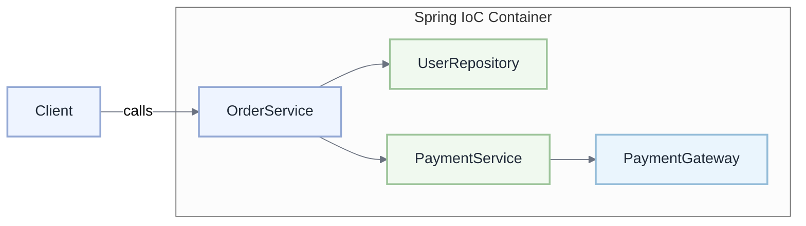

### 2. В чём разница между constructor, setter и field injection

- **Constructor injection**: зависимости передаются через параметры конструктора. Поля могут быть `final`, объект не может быть создан в неполном состоянии.
- **Setter injection**: зависимости передаются через вызовы setter-методов после создания объекта. Поля не могут быть `final`. Подходит для опциональных или переконфигурируемых зависимостей.
- **Field injection**: зависимости внедряются напрямую в поля с помощью `@Autowired`. Поля не могут быть `final`, объект можно создать без зависимостей (они будут `null`), что скрывает проблемы до момента использования.

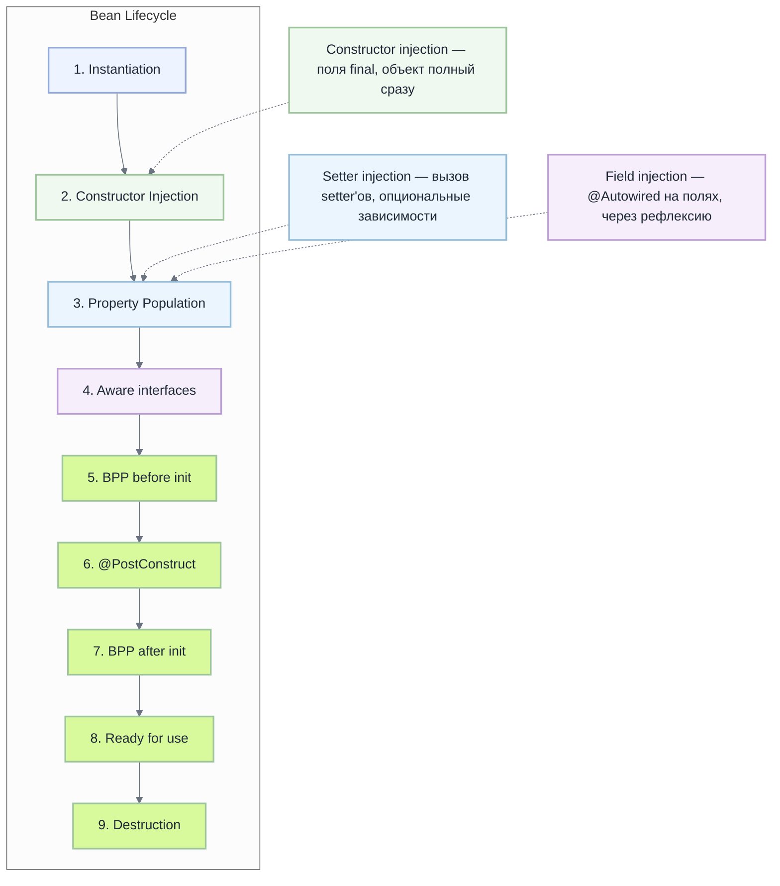


### 3. Какой тип injection рекомендуется использовать и почему

Рекомендуется **constructor injection**. Причины:
- Позволяет объявить поля `final`, гарантируя неизменяемость и невозможность создания объекта в неполном состоянии.
- Явно показывает обязательные зависимости в сигнатуре конструктора.
- Упрощает модульное тестирование: зависимости можно передать напрямую в конструкторе без рефлексии и Spring-контекста.
- Компилятор гарантирует, что все обязательные зависимости переданы.

Spring официально признаёт только конструкторную и setter-инъекцию как правильные варианты; field injection считается устаревшей практикой.


### 4. Что такое Bean в Spring

Bean (бин) — это объект, который создаётся, настраивается и управляется Spring IoC-контейнером (Inversion of Control — инверсия управления, контейнер создаёт и связывает объекты вместо вас). В отличие от обычного Java-объекта, созданного через `new`, жизненным циклом бина управляет Spring: он создаёт экземпляр, внедряет зависимости, вызывает методы инициализации и уничтожения. Бины обычно определяются через аннотации (`@Component`, `@Service` и т.д.) или в конфигурационных классах (`@Bean`).


### 5. Как создать Bean в Spring

Основные способы:
- **Аннотации стереотипов**: `@Component`, `@Service`, `@Repository`, `@Controller` на классе — Spring найдёт их при сканировании компонентов.
- **`@Bean` в `@Configuration`-классе**: метод, помеченный `@Bean`, возвращает объект, который регистрируется как бин. Позволяет создавать бины для сторонних классов, которые нельзя аннотировать.
- **XML-конфигурация** (устаревший подход): `<bean id="..." class="..."/>`.

```java
// Способ 1: Аннотация стереотипа
@Service
public class OrderService { ... }

// Способ 2: @Bean в @Configuration
@Configuration
public class AppConfig {
    @Bean
    public RestTemplate restTemplate() {
        return new RestTemplate();
    }

    @Bean
    public ObjectMapper objectMapper() {
        return new ObjectMapper()
            .disable(DeserializationFeature.FAIL_ON_UNKNOWN_PROPERTIES);
    }
}
```


### 6. Что такое Bean Lifecycle

Bean Lifecycle (жизненный цикл бина) — это последовательность этапов, которые проходит бин от создания до уничтожения под управлением Spring-контейнера. Spring предоставляет хуки (callback-методы), позволяющие разработчику вмешаться в процесс на определённых стадиях.

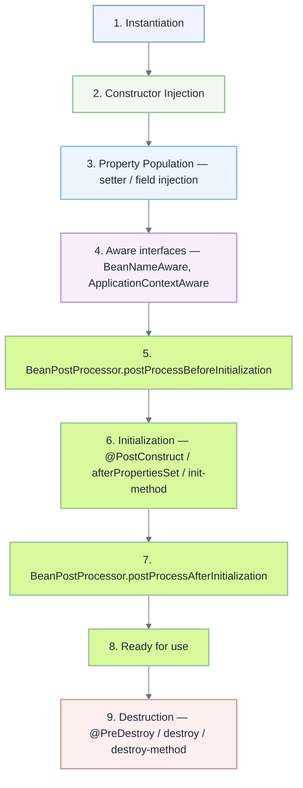

### 7. Какие этапы жизненного цикла Bean (полное описание)

**1. Instantiation** — контейнер создаёт экземпляр бина. Вызывается конструктор: безаргументный (для setter/field injection) или с аргументами (для constructor injection). На этом этапе объект существует, но зависимости ещё не внедрены (кроме constructor injection).

**2. Constructor Injection** — если зависимости объявлены в параметрах конструктора, Spring передаёт их при создании экземпляра. Поля могут быть `final`. Объект рождается полным: после этого шага все обязательные зависимости уже установлены.

**3. Property Population** — Spring внедряет зависимости через setter-методы (`@Autowired` на setter) или напрямую в поля (`@Autowired` на поле, через рефлексию). Поля не могут быть `final`. Если constructor injection уже выполнил свою часть, здесь внедряются только оставшиеся (опциональные) зависимости.

**4. Aware interfaces** — Spring проверяет, реализует ли бин интерфейсы-«осведомлённые»:
- `BeanNameAware.setBeanName(String)` — бин узнаёт своё имя в контейнере.
- `BeanFactoryAware.setBeanFactory(BeanFactory)` — бин получает ссылку на BeanFactory.
- `ApplicationContextAware.setApplicationContext(ApplicationContext)` — бин получает ссылку на ApplicationContext.

Вызовы выполняются в порядке: BeanNameAware → BeanFactoryAware → ApplicationContextAware.

**5. BeanPostProcessor.postProcessBeforeInitialization()** — вызывается для **каждого** зарегистрированного BeanPostProcessor, до инициализации бина. Здесь могут выполняться кастомные операции (например, `ApplicationContextAwareProcessor` inject'ит `@Autowired` на поля, если это ещё не сделано).

**6. Initialization** — собственно инициализация бина. Вызывается **по порядку**:
1. `@PostConstruct`-аннотированный метод (JSR-250).
2. `afterPropertiesSet()` — если бин реализует `InitializingBean`.
3. Custom init-method — метод, указанный в `@Bean(initMethod = "...")` или XML `<bean init-method="...">`.

Используются для загрузки кэша, открытия соединений, проверки конфигурации.

**7. BeanPostProcessor.postProcessAfterInitialization()** — вызывается для **каждого** BeanPostProcessor, после инициализации. Ключевой момент: именно здесь **Spring AOP** оборачивает бин в прокси (если есть `@Transactional`, `@Async`, `@Cacheable` и т.д.). Возвращаемый объект может отличаться от исходного (прокси вместо оригинала).

**8. Ready for use** — бин полностью инициализирован и доступен для использования. Контейнер возвращает этот экземпляр при `getBean()`. Для singleton — один экземпляр на весь контекст.

**9. Destruction** — при закрытии контекста (`context.close()` / shutdown hook):
1. `@PreDestroy`-аннотированный метод (JSR-250).
2. `destroy()` — если бин реализует `DisposableBean`.
3. Custom destroy-method — `@Bean(destroyMethod = "...")` или XML `<bean destroy-method="...">`.

Используются для освобождения ресурсов: закрытие соединений, остановка потоков, очистка кэша. Для **prototype** scope контейнер **не** вызывает destruction (бин не отслеживается после создания).


### 8. Что такое BeanPostProcessor

`BeanPostProcessor` — это интерфейс Spring, позволяющий вмешаться в процесс инициализации бина до и после вызова методов инициализации. Он предоставляет два метода:
- `postProcessBeforeInitialization()`: вызывается до `@PostConstruct` и `afterPropertiesSet()`.
- `postProcessAfterInitialization()`: вызывается после инициализации; именно здесь Spring AOP оборачивает бины в прокси.

`BeanPostProcessor` — ключевой механизм, на котором построены многие функции Spring (аннотации, AOP, `@Transactional` и т.д.).


### 9. Что делают методы с аннотацией @PostConstruct и @PreDestroy

- **`@PostConstruct`**: метод вызывается **после** создания экземпляра бина и внедрения всех зависимостей, но **до** того, как бин станет доступен для использования. Используется для инициализации (например, загрузки кэша, открытия ресурсов).
- **`@PreDestroy`**: метод вызывается **перед уничтожением** бина при закрытии контекста. Используется для освобождения ресурсов (закрытия соединений, остановки потоков).

Обе аннотации — стандарт JSR-250, считаются best practice для lifecycle-колбэков в современном Spring.

```java
@Service
public class ConnectionPoolService {

    private Pool pool;

    @PostConstruct
    public void init() {
        // Вызывается после внедрения зависимостей
        pool = new Pool(/* параметры из конфигурации */);
        pool.connect();
    }

    @PreDestroy
    public void destroy() {
        // Вызывается при закрытии контекста
        pool.close();
    }
}
```


### 10. Что такое scope Bean

Scope (область видимости) бина определяет, как долго живёт бин и сколько экземпляров создаётся для одного определения бина в контейнере. Разные scope позволяют управлять жизненным циклом бина в зависимости от потребностей приложения.


### 11. Какие scope существуют в Spring

Spring поддерживает шесть scope:
- **`singleton`** (по умолчанию): один экземпляр на контейнер.
- **`prototype`**: новый экземпляр при каждом запросе бина.
- **`request`**: один экземпляр на HTTP-запрос (только web-aware контекст).
- **`session`**: один экземпляр на HTTP-сессию (web-aware).
- **`application`**: один экземпляр на `ServletContext` (web-aware).
- **`websocket`**: один экземпляр на WebSocket-сессию (web-aware).

Последние четыре доступны только в веб-приложениях.


### 12. В чём разница между singleton и prototype scope

- **`singleton`**: Spring создаёт **ровно один** экземпляр бина на весь контейнер и возвращает его при каждом запросе. Подходит для stateless-сервисов, репозиториев. Spring управляет полным жизненным циклом (включая `@PreDestroy`).
- **`prototype`**: Spring создаёт **новый экземпляр** при каждом запросе бина. Контейнер не управляет полным жизненным циклом: после создания и внедрения зависимостей он не вызывает `@PreDestroy` и не отслеживает экземпляр. Подходит для stateful, короткоживущих объектов.

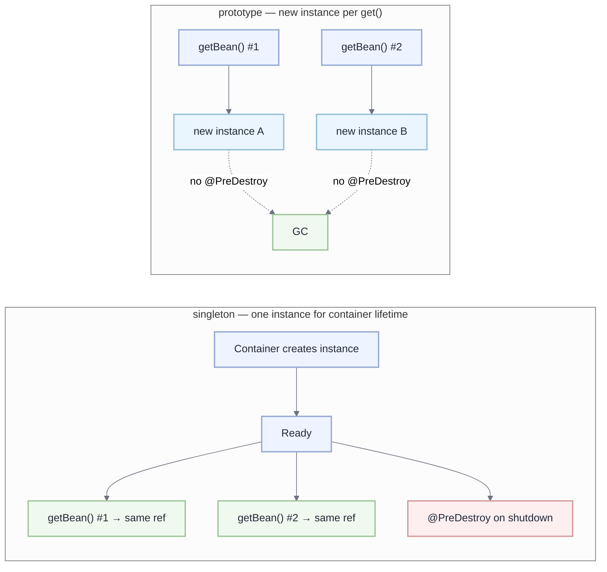


### 13. Что такое прокси в Spring

Прокси (proxy, объект-заместитель) — это объект, который оборачивает целевой бин и перехватывает вызовы его методов. Spring использует прокси для реализации сквозной функциональности (cross-cutting concerns — функциональность, которая пронизывает несколько модулей: транзакции, безопасность, кэширование, логирование). Клиентский код вызывает методы прокси, который выполняет дополнительную логику (например, открытие/закрытие транзакции) до или после делегирования вызова реальному объекту.


### 14. Когда Spring создаёт прокси

Spring создаёт прокси для бина, когда обнаруживает, что к нему нужно применить AOP-advice (например, `@Transactional`, `@Cacheable`, `@Async`, методы с `@Around` и т.д.). Прокси создаётся на этапе `BeanPostProcessor.postProcessAfterInitialization()`. Spring AOP использует два механизма:
- JDK dynamic proxy: если целевой объект реализует хотя бы один интерфейс.
- CGLIB proxy: если целевой объект не реализует интерфейсов, создаётся подкласс целевого класса во время выполнения.

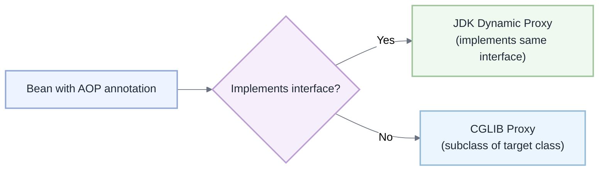

Можно принудительно указать CGLIB через `proxyTargetClass = true`.


### 15. Что такое AOP (Aspect-Oriented Programming)

AOP (Aspect-Oriented Programming, аспектно-ориентированное программирование) — это парадигма, позволяющая вынести сквозную функциональность (логирование, транзакции, безопасность, кэширование), которая разбросана по многим классам, в отдельные модули — аспекты (aspects). Spring AOP реализует AOP через прокси: аспект определяет, где (pointcut — срез, выражение, определяющее какие методы перехватываются) и что (advice — совет, действие, выполняемое в определённой точке) должно быть выполнено, и Spring оборачивает целевые бины в прокси, применяющие advice в нужных точках.


### 16. Что такое аспект, advice, pointcut, join point

- Aspect (аспект): модуль, инкапсулирующий сквозную функциональность (например, класс с `@Aspect`).
- Advice (совет): действие, выполняемое аспектом в определённой точке (`@Before`, `@After`, `@Around`, `@AfterReturning`, `@AfterThrowing`).
- Pointcut (срез): выражение, определяющее, какие методы (join points) должны быть перехвачены (например, `execution(* com.example.service.*.*(..))`).
- Join point (точка соединения): конкретный момент выполнения программы (вызов метода, обработка исключения), к которому может быть применён advice. В Spring AOP join point — это всегда вызов метода.


### 17. Что делает аннотация @Transactional

`@Transactional` — декларативная аннотация Spring, которая оборачивает выполнение метода в **транзакцию**. Spring через AOP-прокси автоматически:
1.  Открывает транзакцию перед вызовом метода.
2.  Выполняет метод.
3.  Выполняет `commit`, если метод завершился успешно, или `rollback`, если возникло unchecked-исключение (по умолчанию).

Разработчик избавляется от ручного управления транзакциями (`begin`, `commit`, `rollback`).

```java
@Service
public class OrderService {

    @Transactional
    public void createOrder(Order order) {
        // Если метод завершится успешно — commit
        // Если будет unchecked-исключение — rollback
        orderRepo.save(order);
        paymentService.charge(order.getTotal());
    }

    @Transactional(readOnly = true)
    public Order findOrder(Long id) {
        return orderRepo.findById(id).orElseThrow();
    }

    @Transactional(rollbackFor = CustomException.class)
    public void updateOrder(Order order) {
        // Rollback не только при unchecked, но и при CustomException
        orderRepo.save(order);
    }
}
```

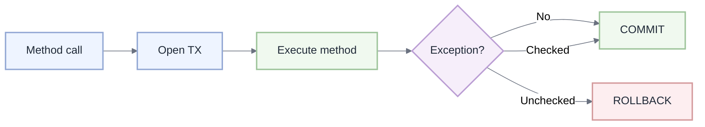


### 18. Почему @Transactional не работает при self-invocation

Spring AOP реализован через **прокси**. Когда метод `A` вызывает метод `B` **того же класса** через `this.B()`, вызов происходит **напрямую у целевого объекта**, минуя прокси. Прокси не участвует, поэтому транзакционная логика (открытие/закрытие транзакции) не применяется — `@Transactional` на методе `B` **игнорируется**. Это одна из самых распространённых причин «неработы» `@Transactional`.

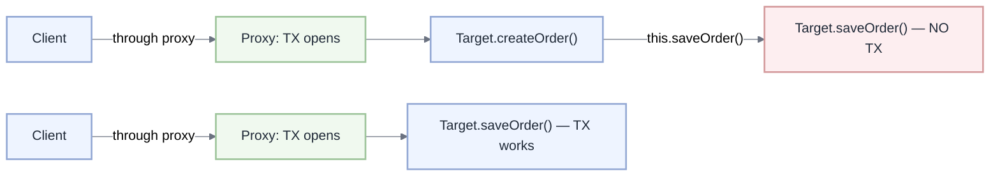

```java
@Service
public class OrderService {

    // ❌ Self-invocation: @Transactional не сработает
    public void createOrder(Order order) {
        this.saveOrder(order); // Вызов напрямую, минуя прокси
    }

    @Transactional
    private void saveOrder(Order order) {
        // Транзакция НЕ будет открыта!
        orderRepo.save(order);
    }
}
```


### 19. Как решить проблему с self-invocation

Основные решения:
1.  **Разделить на разные бины** (рекомендуемый): вынести метод с `@Transactional` в отдельный сервис и внедрить его в вызывающий класс.
2.  **Внедрить самого себя (self-injection)**: внедрить прокси своего бина через `@Autowired` (или `@Lazy`) и вызывать метод через прокси-ссылку.
3.  **Использовать `AopContext.currentProxy()`**: получить текущий прокси и вызвать метод через него (требует `@EnableAspectJAutoProxy(exposeProxy = true)`).
4.  **Перейти на AspectJ** (без прокси): режим `@EnableTransactionManagement(mode = AdviceMode.ASPECTJ)` компилирует/загружает аспекты в байт-код, и self-invocation работает.

На практике чаще всего выбирают **разделение на разные бины** как наиболее чистый архитектурный подход.

```java
// ✅ Решение 1: Разделить на разные бины
@Service
public class OrderService {

    private final OrderTransactionService transactionService;

    public OrderService(OrderTransactionService transactionService) {
        this.transactionService = transactionService;
    }

    public void createOrder(Order order) {
        // Вызов через прокси другого бина — @Transactional сработает
        transactionService.saveOrder(order);
    }
}

@Service
public class OrderTransactionService {

    @Transactional
    public void saveOrder(Order order) {
        // Транзакция будет открыта
        orderRepo.save(order);
    }
}

// ✅ Решение 2: Self-injection через @Lazy
@Service
public class OrderService {

    @Autowired
    @Lazy
    private OrderService self; // Внедряем прокси самого себя

    public void createOrder(Order order) {
        self.saveOrder(order); // Вызов через прокси
    }

    @Transactional
    public void saveOrder(Order order) {
        orderRepo.save(order);
    }
}
```


### 20. Что такое автоконфигурация в Spring Boot

**Автоконфигурация** — это механизм Spring Boot, который автоматически настраивает приложение на основе **наличия классов в classpath**, **существующих бинов** и **свойств конфигурации**. Вместо ручного объявления каждого бина (DataSource, TransactionManager, ViewResolver и т.д.) Spring Boot анализирует зависимости и применяет разумные настройки по умолчанию, следуя принципу «**convention over configuration**». Условия применения автоконфигураций задаются через `@ConditionalOnClass`, `@ConditionalOnMissingBean`, `@ConditionalOnProperty` и другие.

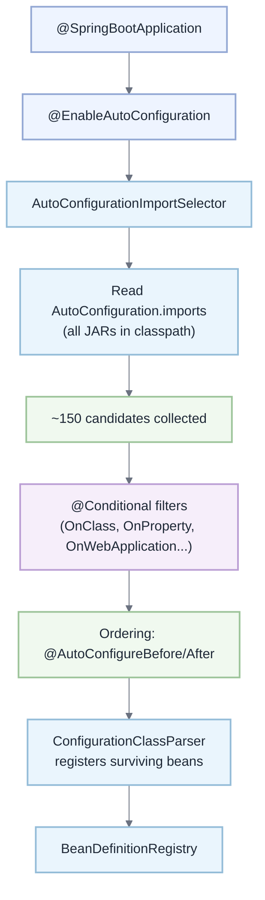

**Как работает «под капотом»**:

1. **`@EnableAutoConfiguration`** на `@SpringBootApplication` триггерит `@Import(AutoConfigurationImportSelector.class)`.
2. **`AutoConfigurationImportSelector`** вызывает `getAutoConfigurationEntry()`, который:
   - Читает файл **`META-INF/spring/org.springframework.boot.autoconfigure.AutoConfiguration.imports`** (Spring Boot 3.x) или **`META-INF/spring.factories`** (Spring Boot 2.x) из **каждого** JAR в classpath. Формат: `org.springframework.boot.autoconfigure.EnableAutoConfiguration=class1,class2,...`.
   - Собирает **все** кандидаты на автоконфигурацию (в Spring Boot 3.x — ~150 классов: `WebMvcAutoConfiguration`, `DataSourceAutoConfiguration`, `JpaAutoConfiguration`, `SecurityAutoConfiguration` и т.д.).
   - Применяет **фильтры** (`@ConditionalOnClass`, `@ConditionalOnWebApplication` и т.д.) — большинство кандидатов отбрасывается сразу (нет класса в classpath → не применяется).
   - Упорядочивает оставшиеся по `@AutoConfiguration(before=..., after=...)` / `@AutoConfigureBefore` / `@AutoConfigureAfter`.
3. **`ConfigurationClassParser`** обрабатывает оставшиеся `@Configuration`-классы (уже с `@Conditional`):
   - Для каждого `@Bean`-метода проверяет `@Conditional`-аннотации.
   - **`@ConditionalOnMissingBean`** — проверяет, уже ли пользователь определил бин этого типа. Если да — **не** регистрирует автоконфигурацию (пользователь имеет приоритет).
   - **`@ConditionalOnProperty`** — проверяет значение в `Environment` (application.properties, env vars, args).
4. **BeanDefinitionRegistry** регистрирует прошедшие фильтрацию бины в контекст.

**Ключевой принцип**: автоконфигурация **никогда** не перетирает пользовательские бины. `@ConditionalOnMissingBean` гарантирует, что если пользователь определил свой `DataSource` — автоконфигурация Spring Boot **не создаст** свой.

```java
// Пример: что происходит при добавлении spring-boot-starter-web
// 1. В classpath появляются: spring-web, spring-webmvc, tomcat-embed-core, jackson
// 2. AutoConfigurationImportSelector находит: WebMvcAutoConfiguration, HttpMessageConvertersAutoConfiguration, ...
// 3. @ConditionalOnClass(DispatcherServlet.class) → true (spring-webmvc в classpath)
// 4. @ConditionalOnWebApplication(type = SERVLET) → true
// 5. @ConditionalOnMissingBean(DispatcherServlet.class) → true (пользователь не определил)
// 6. Result: Spring Boot автоматически создаёт DispatcherServlet, ViewResolver, MessageConverters
```


### 21. Как работает @SpringBootApplication

`@SpringBootApplication` — это **составная аннотация**, объединяющая три ключевые аннотации:
- **`@Configuration`**: помечает класс как источник определений бинов.
- **`@EnableAutoConfiguration`**: включает механизм автоконфигурации Spring Boot.
- **`@ComponentScan`**: запускает сканирование компонентов в пакете, где находится главный класс, и во всех подпакетах.

Размещение главного класса в **корневом пакете** проекта гарантирует, что `@ComponentScan` найдёт все компоненты приложения.


### 22. Что такое starter в Spring Boot

**Starter** — это набор удобных зависимостей, который можно добавить в проект (через Maven/Gradle) и получить **готовый набор библиотек** для определённой функциональности (web, JPA, security, test и т.д.). Starter избавляет от необходимости вручную подбирать совместимые версии библиотек и описывать их конфигурацию. Например, `spring-boot-starter-web` подтягивает Spring MVC, встроенный Tomcat, Jackson и всё необходимое для создания REST-приложения. Автоконфигурация затем автоматически настраивает компоненты на основе присутствующих starter'ов.


### 23. Что делает аннотация @ComponentScan

`@ComponentScan` указывает Spring, в каких **пакетах** искать компоненты (классы с `@Component` и его специализациями: `@Service`, `@Repository`, `@Controller`), чтобы зарегистрировать их как бины. Без указания пакетов сканируется пакет класса, на котором стоит аннотация, и все его подпакеты. `@SpringBootApplication` уже включает `@ComponentScan`, поэтому в типичном Spring Boot-приложении отдельно её указывать не нужно.


### 24. Что такое @Configuration класс

`@Configuration` — это аннотация, помечающая класс как **источник определений бинов** для Spring-контекста. Внутри такого класса методы, помеченные `@Bean`, возвращают объекты, которые регистрируются как бины. `@Configuration`-классы сами являются бинами и обрабатываются контейнером особым образом: вызовы `@Bean`-методов внутри класса перехватываются (через CGLIB-прокси), чтобы гарантировать, что возвращается **один и тот же экземпляр** бина (singleton), даже если метод вызывается несколько раз.


### 25. В чём разница между @Component, @Service, @Repository, @Controller

Все четыре аннотации — это **специализации `@Component`**, и все они регистрируют класс как Spring-бин. Разница — в **семантике** и **дополнительном поведении**:
- **`@Component`**: общая аннотация для любого Spring-управляемого компонента.
- **`@Service`**: помечает компонент **бизнес-слоя** (service layer). Дополнительного поведения не добавляет, но улучшает читаемость и семантику.
- **`@Repository`**: помечает компонент **слоя доступа к данным** (DAO). Добавляет **автоматическую трансляцию** исключений persistence-слоя в `DataAccessException` Spring.
- **`@Controller`**: помечает компонент **веб-слоя** (контроллер Spring MVC). Дополнительно связывает класс с механизмом обработки HTTP-запросов.

Рекомендуется использовать специализированные аннотации вместо `@Component`, чтобы явно обозначить роль класса.


### 26. Что делает аннотация @Autowired

`@Autowired` — аннотация Spring, указывающая контейнеру **внедрить зависимость** в поле, конструктор или setter. По умолчанию внедрение происходит **по типу** (`byType`): Spring ищет бин, тип которого соответствует требуемому. Если подходящий бин не найден, по умолчанию выбрасывается `NoSuchBeanDefinitionException` (можно изменить через `required = false`). Может применяться к конструкторам, полям, setter-методам и методам конфигурации.


### 27. Что делать, если есть несколько бинов одного типа

Если в контейнере есть **несколько бинов** одного типа, `@Autowired` по типу не может выбрать один и выбрасывает `NoUniqueBeanDefinitionException`. Решения:
- Использовать **`@Qualifier("beanName")`** вместе с `@Autowired`, чтобы указать **имя** нужного бина.
- Использовать **`@Primary`** на одном из бинов, чтобы сделать его кандидатом по умолчанию.
- Внедрять **коллекцию** (`List<MyService>`, `Map<String, MyService>`), чтобы получить все бины этого типа и выбрать нужный вручную.

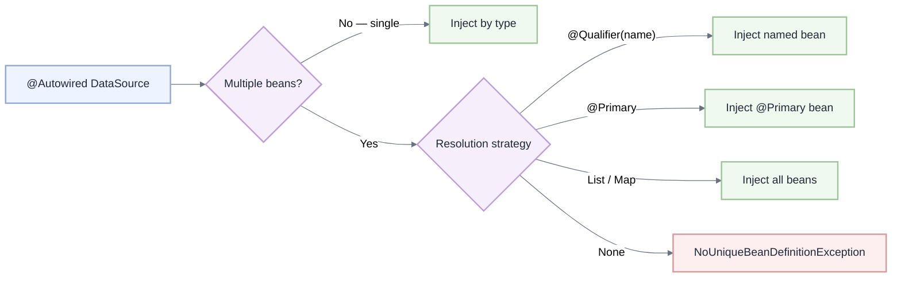


### 28. Что такое @Qualifier

`@Qualifier` — аннотация, которая используется **совместно с `@Autowired`** (или `@Inject`) для уточнения, **какой именно бин** должен быть внедрён, когда кандидатов несколько. Значением аннотации является **имя бина** (или его qualifier). Например: `@Autowired @Qualifier("postgresDataSource") private DataSource dataSource;`. Это позволяет разрешить неоднозначность, возникающую при наличии нескольких бинов одного типа.


### 29. Что такое profiles в Spring

**Profiles** — это механизм Spring, позволяющий **логически группировать** определения бинов и конфигурации и **активировать их только в определённых средах** (например, `dev`, `test`, `prod`). Компоненты или конфигурационные классы, помеченные `@Profile("prod")`, регистрируются только тогда, когда профиль `prod` активен. Активные профили задаются через `spring.profiles.active` (в `application.properties`, переменной окружения или аргументе командной строки). Это позволяет иметь разные настройки (URL базы данных, уровни логирования, заглушки внешних сервисов) для разных сред без изменения кода. Поддерживаются выражения: `@Profile({"dev","test"})` (активен любой из), `@Profile("!prod")` (активен, если `prod` не активен).

```java
// Разные конфигурации для разных сред
@Profile("dev")
@Component
public class DevDataSourceConfig {
    @Bean
    public DataSource dataSource() {
        return DataSourceBuilder.create()
            .url("jdbc:postgresql://localhost:5432/app_dev")
            .username("dev")
            .password("dev")
            .build();
    }
}

@Profile("prod")
@Component
public class ProdDataSourceConfig {
    @Bean
    public DataSource dataSource() {
        return DataSourceBuilder.create()
            .url(System.getenv("DB_URL"))
            .username(System.getenv("DB_USER"))
            .password(System.getenv("DB_PASS"))
            .build();
    }
}

// Запуск с активным профилем:
// java -jar app.jar --spring.profiles.active=dev
```

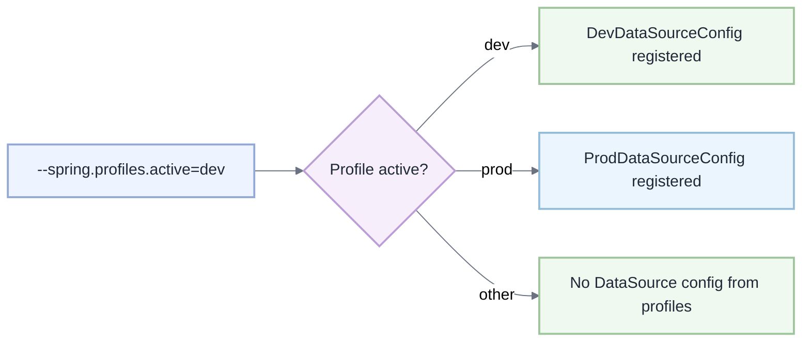

### 30. Какие propagation-режимы транзакций есть в @Transactional

`@Transactional` управляет не только тем, будет ли транзакция, но и тем, как она соотносится с уже активной транзакцией. Параметр `propagation` определяет это поведение:

- **`REQUIRED`** (по умолчанию): если транзакция активна — присоединиться к ней; если нет — создать новую. Самый частый случай.
- **`REQUIRES_NEW`**: всегда создать новую транзакцию, даже если уже есть активная. Предыдущая — приостанавливается. Используется, когда нужно записать данные независимо от внешнего отката (например, аудиторский лог — должен сохраниться, даже если бизнес-операция откачется).
- **`NESTED`**: создать вложенную транзакцию через SAVEPOINT. Откат вложенной — откатить до SAVEPOINT, внешний продолжается.
- **`SUPPORTS`**: если есть транзакция — работать в ней; если нет — работать без.
- **`NOT_SUPPORTED`**: приостановить текущую и работать без транзакции.
- **`MANDATORY`**: обязательно работать в транзакции, если её нет — выбросить `TransactionRequiredException`.
- **`NEVER`**: обязательно работать без транзакции, если она есть — выбросить.

```java
@Transactional
public void createOrder(Order order) {
    // REQUIRED — работаем в этой транзакции
    orderRepo.save(order);
    // REQUIRES_NEW — новая транзакция: audit сохранится даже если createOrder откатится
    auditService.recordOrderCreated(order.getId());
    // Если здесь произойдёт unchecked exception — order не сохранится,
    // НО audit уже закоммичен (REQUIRES_NEW)
    paymentService.charge(order.getTotal());
}

@Service
public class AuditService {
    @Transactional(propagation = Propagation.REQUIRES_NEW)
    public void recordOrderCreated(Long orderId) {
        auditRepo.save(new AuditEvent("ORDER_CREATED", orderId));
    }
}
```

**REQUIRED** (по умолчанию):

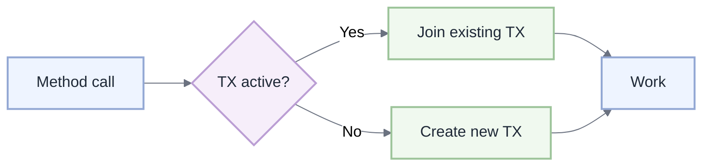

**REQUIRES_NEW**:


**NESTED**:

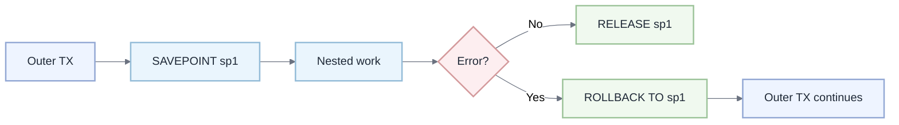

**SUPPORTS**:

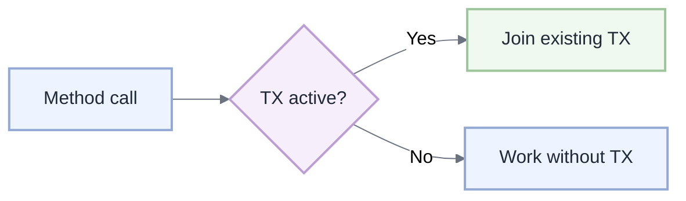

**NOT_SUPPORTED**:


**MANDATORY**:

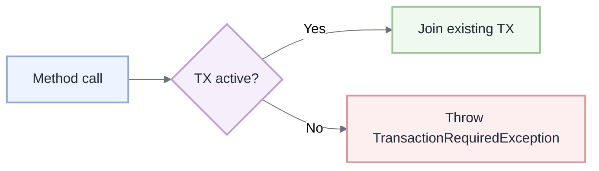

**NEVER**:

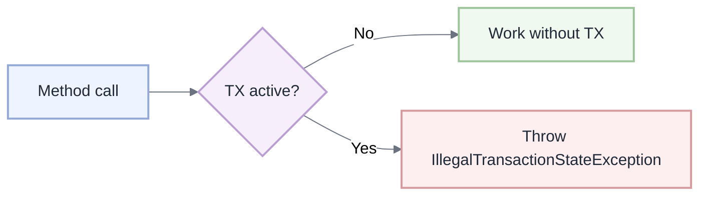

### 31. Что такое isolation level и как его задать через @Transactional

Isolation level (уровень изоляции) определяет, как параллельно выполняющиеся транзакции видят изменения друг друга. В `@Transactional` задаётся параметром `isolation`:

- **`ISOLATION_DEFAULT`** (по умолчанию) — уровень, установленный в БД.
- **`ISOLATION_READ_UNCOMMITTED`** — читает недозволенные данные (dirty read). Почти не используется.
- **`ISOLATION_READ_COMMITTED`** — читает только закоммиченные данные. Уровень по умолчанию в PostgreSQL, MySQL (InnoDB).
- **`ISOLATION_REPEATABLE_READ`** — все SELECT в одной транзакции видят один снимок. Уровень по умолчанию в MySQL.
- **`ISOLATION_SERIALIZABLE`** — полная изоляция, максимум корректности, минимум параллелизма.

```java
@Transactional(isolation = Isolation.REPEATABLE_READ)
public BigDecimal calculateInventory(String warehouseId) {
    // Все SELECT внутри этой транзакции увидят одинаковое состояние inventory
    return inventoryRepo.sumByWarehouse(warehouseId);
}

@Transactional(isolation = Isolation.SERIALIZABLE)
public void transferInventory(String from, String to, int qty) {
    // Максимальная корректность — но возможны serialization_failure при конфликте
    inventoryRepo.decrement(from, qty);
    inventoryRepo.increment(to, qty);
}
```

### 32. Что делает readOnly = true в @Transactional

`readOnly = true` — оптимизация для методов, которые только читают данные. Влияет на **три уровня** одновременно:

**1. Уровень JDBC (Connection/Statement)**:
- `Connection.setReadOnly(true)` — сообщает БД, что транзакция только на чтение.
- **PostgreSQL**: не пишет в WAL (Write-Ahead Log) — меньше I/O, быстрее commit. Не берёт `ROW EXCLUSIVE` lock (берёт только `ACCESS SHARE` — не блокирует другие читальщики).
- **MySQL (InnoDB)**: не записывает в redo log, не берёт write-блокировки. Оптимизирует query plan (может использовать read-only index scan вместо index + heap).
- **H2 / HSQLDB** (in-memory): минимальный эффект (данные в памяти), но семантика сохраняется.

**2. Уровень JPA/Hibernate (Persistence Context)**:
- **Dirty checking выключен**: Hibernate **не** сканирует сущности в Persistence Context при flush. В нормальном режиме Hibernate при каждом `flush()` сравнивает текущее состояние сущности с snapshot (initial state) — это O(N) сравнений. При `readOnly = true` эта проверка **пропускается** — экономия CPU и памяти.
- **Оптимизация загрузки**: Hibernate может использовать `SELECT ... FOR NONE` вместо `SELECT ... FOR UPDATE` (не берёт pessimistic lock).
- **L2 Cache (Second Level Cache)**: при `readOnly = true` Hibernate может кэшировать сущности в L2-кэше (EHCache, Infinispan), потому что гарантировано, что они не изменятся в рамках этой транзакции. В write-режиме кэширование рискованно (могут измениться).
- **Fetch optimization**: Hibernate может агрессивнее использовать batch fetching и join fetching, потому что не нужно отслеживать изменения.

**3. Уровень семантики (для разработчика и ревью)**:
- Явно показывает, что метод **не должен** изменять состояние.
- Если внутри `readOnly = true` метода кто-то вызовет `save()` / `remove()` — Hibernate **не** выполнит запись (в PostgreSQL — ошибка `read-only transaction`, в Hibernate — silently ignored или exception при flush).
- Упрощает code review: видно, что это read-only операция.

**Когда НЕ использовать `readOnly = true`**:
- Если метод **может** модифицировать данные (даже редко) — не ставь `readOnly`.
- Если метод вызывает другие сервисы, которые пишут в БД — не ставь `readOnly` (или убедись, что они используют `REQUIRES_NEW`).
- Если используется **pessimistic locking** (`@Lock(PESSIMISTIC_WRITE)`) — конфликтует с `readOnly`.

```java
@Service
public class OrderService {
    // ❌ Неправильно: метод только читает, но транзакция «на запись»
    @Transactional
    public List<Order> findRecentOrders() {
        return orderRepo.findRecent();
    }

    // ✅ Правильно: readOnly — оптимизация + семантика
    @Transactional(readOnly = true)
    public List<Order> findRecentOrders() {
        return orderRepo.findRecent();
    }

    // ✅ Правильно: readOnly для сложного read-only запроса с join'ами
    @Transactional(readOnly = true)
    public Map<Long, List<OrderItem>> getOrderItemsWithDetails(List<Long> orderIds) {
        // Hibernate не делает dirty checking для 1000+ сущностей
        // PostgreSQL не пишет WAL, не берёт write-locks
        return orderItemRepo.findByOrderIdIn(orderIds).stream()
            .collect(Collectors.groupingBy(OrderItem::getOrderId));
    }
}
```

### 33. Как задать timeout для @Transactional

Параметр `timeout` (в секундах) ограничивает время жизни транзакции. Если транзакция не завершилась за отведённое время — Spring откатывает её и выбрасывает `TransactionTimedOutException`. Полезно для защиты от «висящих» транзакций (зависшие внешние сервисы, медленные SQL-запросы):

```java
@Transactional(timeout = 5) // 5 секунд
public void callExternalPayment(String orderId) {
    // Если внешний платёжный сервис завис на 10 сек — транзакция откатится
    // через 5 сек, освобождая блокировки БД
    externalPaymentClient.charge(orderId);
    orderRepo.markPaid(orderId);
}
```

### 34. Как @Transactional ведёт себя с @Async

`@Async` и `@Transactional` работают вместе, но порядок важен:
- **`@Async` на публичном методе**: метод запускается в другом потоке, транзакция создаётся в том потоке, который вызывает метод.
- **Само-вызов @Async не работает** — как и @Transactional (прокси не участвует).
- **Типичный паттерн**: `@Async` на оркестраторе, `@Transactional` на каждом шаге отдельно — чтобы одна ошибка не откатывала весь async-поток.

```java
@Service
public class OrderEventService {
    @Async
    public void processOrderCreated(OrderCreatedEvent event) {
        // Каждый шаг — своя транзакция, каждая независима
        notifyService.notify(event.getOrderId());        // своя транзакция
        inventoryService.reserve(event.getOrderId());   // своя транзакция
        analyticsService.track(event.getOrderId());     // своя транзакция
    }
}

@Service
public class NotifyService {
    @Transactional
    public void notify(Long orderId) {
        // Если этот шаг упадёт — только он откатится, остальные выполнятся
        notificationRepo.save(new Notification(orderId, "ORDER_CREATED"));
    }
}
```

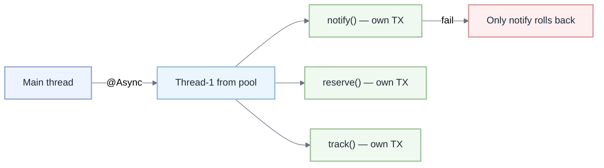

### 35. Что происходит, если в @Transactional-метод пробросить checked exception

По умолчанию `@Transactional` откатывает транзакцию **только при unchecked исключениях** (`RuntimeException`, `Error`). Checked exceptions (`Exception` и его наследники) **не вызывают откат** — транзакция успешно завершается (`commit`), что часто является багом.

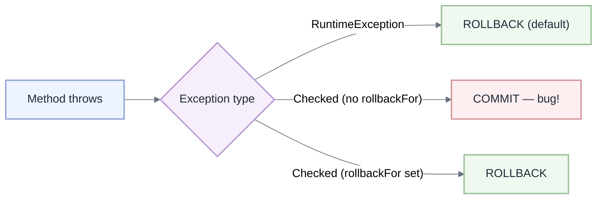

Решение: явно указать, какие исключения должны вызывать откат:
- **`rollbackFor = MyException.class`** — откат при этом исключении.
- **`noRollbackFor = MyException.class`** — НЕ откатывать при этом исключении (редко используется).

```java
@Transactional(rollbackFor = PaymentException.class)
public void pay(Order order) throws PaymentException {
    // PaymentException — checked exception
    // Без rollbackFor транзакция бы закоммитилась, а order был бы частично сохранён
    orderRepo.save(order);
    if (paymentClient.charge(order.getTotal()) == 0) {
        throw new PaymentException("Недостаточно средств");
    }
    orderRepo.markPaid(order.getId());
}
```

### 36. Как работает порядок advice в AOP и как его контролировать

Когда к методу применяется несколько advice (например, `@Around` для логирования + `@Around` для метрик + `@After` для аудита), они выполняются в определённом порядке. Spring управляет этим через:
- **`@Order`** на аспекте: меньший номер — более высокий приоритет (выполняется первым при входе, последним при выходе).
- **`Ordered`** интерфейс: аналог `@Order`, но через реализацию.
- **Без явного порядка**: Spring определяет порядок по алфавиту имени класса (нестабильно — лучше всегда явный).

Порядок для `@Around` (самый частый advice):
1. **Вход**: advice с меньшим `@Order` выполняется первым (оборачивает снаружи).
2. **Выход**: advice с меньшим `@Order` выполняется последним (самый внешний).


```java
@Aspect
@Order(1) // Выполняется первым при входе, последним при выходе
public class LoggingAspect {
    @Around("execution(* com.example.service..*(..))")
    public Object log(ProceedingJoinPoint pjp) throws Throwable {
        long start = System.nanoTime();
        Object result = pjp.proceed();
        log.info("{} took {} ms", pjp.getSignature(), (System.nanoTime() - start) / 1_000_000);
        return result;
    }
}

@Aspect
@Order(2) // Внутренний — выполняется вторым при входе, первым при выходе
public class MetricsAspect {
    @Around("execution(* com.example.service..*(..))")
    public Object metric(ProceedingJoinPoint pjp) throws Throwable {
        try {
            return pjp.proceed();
        } finally {
            metricsRegistry.increment(pjp.getSignature().toShortString());
        }
    }
}
```

### 37. Какие pointcut-выражения поддерживает Spring AOP

Pointcut (срез) — выражение, определяющее, какие методы перехватываются. Основные виды:

- **`execution(...)`** — по сигнатуре метода:
  ```
  execution(* com.example.service..*(..))    — все методы в package service и подпакетах
  execution(public int com.example.*.get*(..)) — public int get*() в классах уровня example
  execution(* save*(..))                    — все методы, начинающиеся с save
  ```
- **`within(...)`** — все методы внутри класса:
  ```
  within(com.example.service..*)             — все методы всех классов в package service
  ```
- **`@annotation(...)`** — методы с конкретной аннотацией:
  ```
  @annotation(com.example.Auditable)         — все методы с @Auditable
  ```
- **`args(...)`** — по типам параметров:
  ```
  args(java.lang.String, ..)                 — методы, первый параметр — String
  ```
- **`this(...)` / `target(...)`** — по типу прокси / целевого объекта.
- **Комбинирование**: `&&` (AND), `||` (OR), `!` (NOT).

```java
@Aspect
public class AuditAspect {
    // Методы с @Audit в package com.example + методы save*() в repo
    @Pointcut("@annotation(com.example.Audit) || execution(* com.example.repo..save*(..))")
    public void auditPointcut() {}

    @AfterReturning(pointcut = "auditPointcut()", returning = "result")
    public void audit(JoinPoint jp, Object result) {
        log.info("AUDIT: {} returned {}", jp.getSignature(), result);
    }
}
```

### 38. Чем Spring AOP отличается от AspectJ

Spring AOP и AspectJ реализуют одну идею (aspect-oriented programming), но технически разные:

| | Spring AOP | AspectJ |
|---|---|---|
| **Механизм** | Proxy (JDK dynamic proxy или CGLIB) | Compile-time / load-time weaving |
| **Pointcut** | Только **вызовы методов** | Любые **join points**: вызовы, поля, конструкторы |
| **Self-invocation** | Не работает (прокси обходятся) | Работает (вшит в байт-код) |
| **Настройка** | `@EnableAspectJAutoProxy` | AspectJ compiler (`ajc`) или load-time weaving |
| **Зависимость** | Spring AOP (легкий) | aspectjrt + aspectjweaver |
| **Производительность** | Небольшой overhead (прокси) | Нулевой overhead (вшит в байт-код) |
| **Сложность** | Проще | Сложнее (нужен aspectj-компилер) |

Для 95% задач Spring AOP достаточно. AspectJ нужен, когда:
- Нужны pointcut на поля/конструкторы.
- Self-invocation должна работать.
- Нужен нулевой overhead на горячих путях.

### 39. Как использовать @Aspect и @Order в одном классе

Можно объединить несколько advice в одном аспекте и управлять порядком внутри:

```java
@Aspect
@Order(1)
public class OrderProcessingAspect {

    @Pointcut("execution(* com.example.service..create*(..))")
    public void createOrderPointcut() {}

    // Логирование — самый внешний слой
    @Around("createOrderPointcut()")
    public Object log(ProceedingJoinPoint pjp) throws Throwable {
        log.info("Creating order: {}", pjp.getArgs()[0]);
        return pjp.proceed();
    }

    // Метрики — после логирования
    @AfterReturning(pointcut = "createOrderPointcut()", returning = "result")
    public void metric(JoinPoint jp, Object result) {
        metricsRegistry.increment("order.created");
    }

    // Обработка ошибок — самый внутренний
    @AfterThrowing(pointcut = "createOrderPointcut()", throwing = "ex")
    public void onException(JoinPoint jp, Throwable ex) {
        log.error("Order creation failed", ex);
        metricsRegistry.increment("order.created.error");
    }
}
```

### 40. В чём разница между @Value и @ConfigurationProperties

- **`@Value("${key}")`**: внедряет **одну конкретную** настройку в поле или параметр конструктора. Подходит для простых случаев (одна строка, один число). Поддерживает выражения с дефолтами: `@Value("${app.timeout:30}")`.
- **`@ConfigurationProperties`**: **привязывает** целое дерево настроек из `application.properties`/`yml` к типу (POJO или record). Поддерживает **binding** (связывание) иерархических свойств, валидацию (`@Validated` + JSR-303), prefix.

```java
// @Value — одна настройка
@Component
public class App {
    @Value("${app.timeout:30}")
    private int timeout;
}

// @ConfigurationProperties — дерево настроек
@ConfigurationProperties(prefix = "app")
@Validated
public record AppConfig(
    @NotNull String name,
    @Min(1) @Max(300) int timeout,
    @Valid Pool pool
) {}

@Configuration
@EnableConfigurationProperties(AppConfig.class)
public class AppConfigRegistrar {}

// application.properties:
// app.name=my-app
// app.timeout=60
// app.pool.max-size=20
// app.pool.timeout=30
```

### 41. Как работает binding и relaxed binding в @ConfigurationProperties

**Relaxed binding** — механизм Spring Boot, позволяющий указывать одно и то же свойство разными способами записи. Все следующие формы эквивалентны для `app.maxConnections`:

```
app.maxConnections=100
app.max-connections=100
app.max_connections=100
app.MAXCONNECTIONS=100
```

Правила:
- **`application.properties`**: `app.max-connections=100` или `app.maxConnections=100` — оба работают.
- **`application.yml`**: `app.maxConnections: 100` или `app.max-connections: 100` — оба работают.
- **Переменные окружения**: `APP_MAX_CONNECTIONS=100` (капс + подчёркивание).
- **Аргументы командной строки**: `--app.max-connections=100`.

Binding (связывание) происходит через `Binder` API: Spring преобразует плоскую иерархию свойств (`app.pool.max-size`) в вложенную структуру (`AppConfig.Pool.maxSize`).

```java
@ConfigurationProperties(prefix = "app")
public record AppConfig(String name, Pool pool) {
    public record Pool(int maxSize, int timeout) {}
}

// application.yml:
// app:
//   name: my-app
//   pool:
//     max-size: 20      # → AppConfig.Pool.maxSize = 20
//     timeout: 30       # → AppConfig.Pool.timeout = 30
```

### 42. Какие @Conditional аннотации есть и когда их использовать

`@Conditional` — механизм Spring Boot, позволяющий регистрировать бин только при выполнении определённого условия. Условия проверяются **в момент парсинга** `@Configuration`-классов (до создания бинов), через `ConfigurationCondition` → `ConditionEvaluator`.

**Основные аннотации**:

| Аннотация | Проверяет | Типичное использование |
|-----------|-----------|----------------------|
| `@ConditionalOnClass` | Класс в classpath (`ClassLoader.loadClass()`) | Автоконфигурация: «применяется только если библиотека добавлена» |
| `@ConditionalOnMissingClass` | Класс **нет** в classpath | Исключение: «не применять если библиотека есть» |
| `@ConditionalOnBean` | Бин уже зарегистрирован в `BeanFactory` | Зависимые конфигурации |
| `@ConditionalOnMissingBean` | Бин **не** зарегистрирован | **Самый частый**: «не перетирать пользовательский бин» |
| `@ConditionalOnProperty` | Значение в `Environment` (properties/env/args) | Feature flags: `app.feature.enabled=true` |
| `@ConditionalOnExpression` | SpEL-выражение → `true` | Сложные условия: `#{!env.getProperty('x').isEmpty()}` |
| `@ConditionalOnWebApplication` | Тип приложения: SERVLET / REACTIVE / ANY | Web-специфичные конфигурации |
| `@ConditionalOnNotWebApplication` | Приложение **не** web | CLI-специфичные конфигурации |
| `@ConditionalOnSingleCandidate` | Ровно один бин (или один `@Primary`) | Внедрение по типу без `@Qualifier` |

**Как проверяются «под капотом»**:

- **`@ConditionalOnClass`**: вызывает `ClassUtils.isPresent(className, classLoader)`. **Важно**: проверяет **наличие класса**, а не **бина**. Если JAR нет в classpath — условие `false`. Может быть `value` (positive) или `name` (string, для опциональных зависимостей, чтобы не ClassNotFoundException).
- **`@ConditionalOnMissingBean`**: вызывает `beanFactory.getBeanNamesForType(type)`. Если массив непустой — условие `false`. Проверяет **типы**, **имена** и **qualifiers** (можно указать `@ConditionalOnMissingBean(name = "myBean")` или `@ConditionalOnMissingBean(type = "com.example.MyService")`).
- **`@ConditionalOnProperty`**: вызывает `environment.getProperty(name)` и сравнивает с `havingValue` (или просто проверяет наличие, если `havingValue` не задан). Поддерживает `matchIfMissing = true` (условие `true` если свойство отсутствует).
- **`@ConditionalOnWebApplication`**: проверяет `WebApplicationType` (determined during `SpringApplication` startup: SERVLET если есть `DispatcherServlet` + `ServletContext`, REACTIVE если есть `RouterFunction` + `ReactiveWebServerApplicationContext`).

**Порядок проверки и ограничения**:
- `@Conditional` проверяется **однократно** при парсинге `@Configuration`. Если условие изменилось после — бин **не** пересоздаётся.
- `@ConditionalOnMissingBean` **чувствителен к порядку**: если два `@Configuration`-класса оба используют `@ConditionalOnMissingBean(DataSource.class)`, то кто **первый** в порядке парсинга — тот и победит. Для управления порядком используйте `@AutoConfigureBefore` / `@AutoConfigureAfter`.
- **Нельзя** использовать `@Conditional` на `@ComponentScan`-компонентах (только на `@Configuration` / `@Bean`).

```java
@Configuration
@ConditionalOnClass(RedisTemplate.class)
@ConditionalOnProperty(name = "app.redis.enabled", havingValue = "true", matchIfMissing = true)
public class RedisConfig {
    @Bean
    @ConditionalOnMissingBean(name = "redisTemplate")
    public RedisTemplate<String, Object> redisTemplate(RedisConnectionFactory factory) {
        RedisTemplate<String, Object> template = new RedisTemplate<>();
        template.setConnectionFactory(factory);
        return template;
    }

    @Bean
    @ConditionalOnSingleCandidate(StringRedisTemplate.class)
    public RedisCacheManager cacheManager(StringRedisTemplate template) {
        // Применяется только если есть ровно один StringRedisTemplate (или один @Primary)
        return RedisCacheManager.builder(template.getConnectionFactory()).build();
    }
}
```

### 43. Как работают PropertySource и их порядок

Spring Boot загружает свойства из нескольких источников в определённом порядке. Источник с **более высоким приоритетом** перетирает значения из источника с более низким:

```mermaid
%%{init: { 'theme': 'neutral', 'themeVariables': { 'primaryColor': '#ffffff', 'primaryTextColor': '#1f2937', 'lineColor': '#6b7280', 'primaryBorderColor': '#d1d5db', 'secondaryColor': '#f3f4f6', 'tertiaryColor': '#e5e7eb' } } }%%
flowchart TB
    A["1. Command-line args (--key=value)"] -->|"overrides"| B["2. OS Environment Variables"]
    B -->|"overrides"| C["3. application-{profile}.properties"]
    C -->|"overrides"| D["4. application.properties"]
    D -->|"overrides"| E["5. @PropertySource"]
    E -->|"overrides"| F["6. Default properties"]
    classDef n0 fill:#eef4ff,stroke:#93a8d4,stroke-width:2px,color:#1f2937
    classDef n1 fill:#f0f9ef,stroke:#9dc49a,stroke-width:2px,color:#1f2937
    classDef n2 fill:#eaf5fd,stroke:#94bcd8,stroke-width:2px,color:#1f2937
    classDef n3 fill:#f6eefa,stroke:#bb9ed4,stroke-width:2px,color:#1f2937
    classDef n4 fill:#d9f99d,stroke:#9dc49a,stroke-width:2px,color:#1f2937
    classDef n5 fill:#fdeef0,stroke:#d49a9c,stroke-width:2px,color:#1f2937
    class A n0
    class B n1
    class C n2
    class D n3
    class E n4
    class F n5
```

1. **Аргументы командной строки** (`--key=value`) — самый высокий приоритет.
2. **Переменные окружения** (`KEY=value`).
3. **`application-{profile}.properties`/`yml`** (для активного профиля).
4. **`application.properties`/`yml`**.
5. **`@PropertySource`** (в конфигурационных классах).
6. **Default properties** (в `spring-boot` — самые низкие).

```java
// src/main/resources/application.properties
app.name=dev-app
app.timeout=30

// src/main/resources/application-prod.properties
app.name=prod-app
app.timeout=60

// Запуск: java -jar app.jar --spring.profiles.active=prod --app.timeout=120
// Результат:
// app.name = prod-app        (из application-prod.properties)
// app.timeout = 120          (из аргументов командной строки — перетирает prod)
```

### 44. Как добавить свой PropertySource

Можно добавить собственный источник свойств через `@PropertySource`:

```java
@Configuration
@PropertySource("classpath:custom.properties")     // Файл в classpath
@PropertySource("file:/etc/app/external.properties") // Внешний файл
public class CustomConfig {
    // Spring добавит этот источник в PropertySources
}
```

Или программно через `Environment`:

```java
@Configuration
public class DynamicConfig {
    @Bean
    public PropertySource<?> dynamicProperties() {
        return new MapPropertySource("dynamic", Map.of(
            "app.feature.enabled", "true",
            "app.debug", "false"
        ));
    }
}
```

### 45. Что такое @ControllerAdvice и @ExceptionHandler

`@ControllerAdvice` — аннотация для **глобальной обработки исключений** во всех контроллерах. Вместо того чтобы оборачивать каждый endpoint в try-catch, вы объявляете один класс с `@ControllerAdvice` и методы `@ExceptionHandler` — Spring автоматически перехватывает выбрасываемые исключения и применяет соответствующий обработчик.

```mermaid
%%{init: { 'theme': 'neutral', 'themeVariables': { 'primaryColor': '#ffffff', 'primaryTextColor': '#1f2937', 'lineColor': '#6b7280', 'primaryBorderColor': '#d1d5db', 'secondaryColor': '#f3f4f6', 'tertiaryColor': '#e5e7eb' } } }%%
flowchart TD
    A[HTTP Request] --> B[Controller method]
    B --> C{Exception?}
    C -->|No| D[Normal response 200]
    C -->|Yes| E["@ControllerAdvice"]
    E --> F{"Match @ExceptionHandler<br/>(by exception type)"}
    F --> G["handleValidation → 400"]
    F --> H["handleNotFound → 404"]
    F --> I["handleGeneric → 500"]
    classDef n0 fill:#eef4ff,stroke:#93a8d4,stroke-width:2px,color:#1f2937
    classDef n1 fill:#f0f9ef,stroke:#9dc49a,stroke-width:2px,color:#1f2937
    classDef n2 fill:#f6eefa,stroke:#bb9ed4,stroke-width:2px,color:#1f2937
    classDef n3 fill:#fdeef0,stroke:#d49a9c,stroke-width:2px,color:#1f2937
    class A,B n0
    class C,F n2
    class D n1
    class E n3
    class G,H,I n3
```

```java
@RestControllerAdvice
public class GlobalExceptionHandler {

    // Обработка валидационных ошибок (Bad Request)
    @ExceptionHandler(MethodArgumentNotValidException.class)
    public ResponseEntity<ProblemDetail> handleValidation(MethodArgumentNotValidException ex) {
        ProblemDetail pd = ProblemDetail.forStatus(HttpStatus.BAD_REQUEST);
        pd.setTitle("Invalid input");
        Map<String, String> errors = new HashMap<>();
        ex.getBindingResult().getFieldErrors()
           .forEach(fe -> errors.put(fe.getField(), fe.getDefaultMessage()));
        pd.setProperty("errors", errors);
        return ResponseEntity.badRequest().body(pd);
    }

    // Обработка «не найдено»
    @ExceptionHandler(ResourceNotFoundException.class)
    public ResponseEntity<ProblemDetail> handleNotFound(ResourceNotFoundException ex) {
        ProblemDetail pd = ProblemDetail.forStatus(HttpStatus.NOT_FOUND);
        pd.setTitle(ex.getMessage());
        return ResponseEntity.status(HttpStatus.NOT_FOUND).body(pd);
    }

    // Обработка всех остальных исключений
    @ExceptionHandler(Exception.class)
    public ResponseEntity<ProblemDetail> handleGeneric(Exception ex) {
        log.error("Unexpected error", ex);
        ProblemDetail pd = ProblemDetail.forStatus(HttpStatus.INTERNAL_SERVER_ERROR);
        pd.setTitle("Internal server error");
        pd.setProperty("traceId", MDC.get("traceId"));
        return ResponseEntity.status(HttpStatus.INTERNAL_SERVER_ERROR).body(pd);
    }
}
```

### 46. Что такое ProblemDetail (RFC 7807)

**ProblemDetail** — стандартная структура ошибок в HTTP (RFC 7807, «Application Error Problem Details»). В Spring Boot 3 это класс `org.springframework.http.ProblemDetail`, который сериализуется в JSON по стандарту:

```json
{
  "type": "https://example.com/errors/not-found",
  "title": "Resource not found",
  "status": 404,
  "detail": "Order with id 123 not found",
  "instance": "/api/orders/123",
  "traceId": "abc123"
}
```

Поля:
- **`type`** — URI, идентифицирующий тип проблемы.
- **`title`** — краткое описание.
- **`status`** — HTTP статус.
- **`detail`** — детали (опционально).
- **`instance`** — URI конкретного ресурса.
- **Дополнительные поля** — через `setProperty()`.

```java
@ExceptionHandler(OrderNotFoundException.class)
public ProblemDetail handleNotFound(OrderNotFoundException ex) {
    ProblemDetail pd = ProblemDetail.forStatusAndDetail(HttpStatus.NOT_FOUND, ex.getMessage());
    pd.setType(URI.create("https://example.com/errors/order-not-found"));
    pd.setTitle("Order not found");
    pd.setProperty("orderId", ex.getOrderId());
    return pd;
}
```

### 47. Как работает Bean Validation (JSR 380) в Spring Boot

Bean Validation — стандарт JSR 380 (Hibernate Validator — референс-реализация) для декларативной валидации объектов. В Spring Boot используется через:
- **`@Valid` / `@Validated`** на параметрах контроллера — валидация при десериализации DTO.
- **`@Validated`** на уровне класса (в сочетании с `@ControllerAdvice`) — групповая валидация.
- **Группы валидации** (`@Validated(CreateGroup.class)`) — разные правила для разных операций.

```java
public record CreateOrderRequest(
    @NotNull @Positive Long productId,
    @Min(1) @Max(100) int quantity,
    @Email @Size(max = 255) String customerEmail,
    @Future LocalDateTime deliveryDate
) {}

@RestController
@RequestMapping("/api/orders")
public class OrderController {

    @PostMapping
    public ResponseEntity<OrderDto> create(@Valid @RequestBody CreateOrderRequest req) {
        // Если валидация не прошла — MethodArgumentNotValidException → @ExceptionHandler
        OrderDto result = orderService.create(req);
        return ResponseEntity.status(HttpStatus.CREATED).body(result);
    }
}
```

### 48. Что такое Actuator и как настроить endpoints

**Actuator** — модуль Spring Boot, который предоставляет **готовые эндпоинты для мониторинга и управления** приложением в production:
- **`/actuator/health`** — состояние приложения (UP/DOWN) + детализация по компонентам.
- **`/actuator/metrics`** — метрики (JVM, HTTP, DB, Kafka и т.д.).
- **`/actuator/info`** — информация (версия, git commit).
- **`/actuator/env`** — активные свойства (чувствительный — лучше закрыть).
- **`/actuator/beans`** — список всех бинов.
- **`/actuator/mappings`** — все URL-маппинги.
- **`/actuator/loggers`** — управление уровнями логирования в рантайме.

Настройка в `application.properties`:
```properties
# Включить нужные эндпоинты
management.endpoints.web.exposure.include=health,info,metrics
# Закрыть чувствительные
management.endpoints.web.exposure.exclude=env,beans
# Безопасность: авторизация для чувствительных
management.endpoint.health.show-details=when-authorized
management.endpoints.web.base-path=/internal/actuator
```

```java
// Кастомный health check
@Component
public class PaymentGatewayHealthIndicator implements HealthIndicator {
    @Override
    public Health health() {
        boolean up = paymentClient.ping();
        return up ? Health.up().withDetail("latencyMs", 42).build()
                  : Health.down().withDetail("reason", "timeout").build();
    }
}
```

### 49. Как настроить логирование в Spring Boot

Spring Boot использует **SLF4J** (API) + **Logback** (реализация) по умолчанию. Конфигурация через `logback-spring.xml` (специфично для Spring) или `application.properties`:

```properties
# application.properties
logging.level.root=INFO
logging.level.com.example.service=DEBUG
logging.level.org.hibernate.SQL=DEBUG
logging.file.name=logs/app.log
logging.pattern.file=%d{yyyy-MM-dd HH:mm:ss.SSS} [%thread] %-5level %logger{36} - %msg%n
```

```xml
<!-- logback-spring.xml (в src/main/resources) -->
<configuration>
    <appender name="CONSOLE" class="ch.qos.logback.core.ConsoleAppender">
        <encoder>
            <pattern>%d{HH:mm:ss.SSS} [%thread] %-5level %logger{36} - %msg%n</pattern>
        </encoder>
    </appender>

    <appender name="FILE" class="ch.qos.logback.core.rolling.RollingFileAppender">
        <file>logs/app.log</file>
        <rollingPolicy class="ch.qos.logback.core.rolling.TimeBasedRollingPolicy">
            <fileNamePattern>logs/app-%d{yyyy-MM-dd}.log</fileNamePattern>
            <maxHistory>30</maxHistory>
        </rollingPolicy>
        <encoder>
            <pattern>%d{yyyy-MM-dd HH:mm:ss.SSS} [%thread] %-5level %logger{36} [%X{traceId}] - %msg%n</pattern>
        </encoder>
    </appender>

    <logger name="com.example.service" level="DEBUG"/>
    <root level="INFO">
        <appender-ref ref="CONSOLE"/>
        <appender-ref ref="FILE"/>
    </root>
</configuration>
```

**MDC (Mapped Diagnostic Context)** — механизм SLF4J для хранения контекста (traceId, userId, requestId) в каждом лог-записи. Заполняется через `MDC.put("traceId", ...)` и подставляется в pattern через `[%X{traceId}]`.

### 50. Как работает @Async и как настроить ExecutorService

`@Async` — аннотация для асинхронного выполнения методов. По умолчанию Spring использует `SimpleAsyncTaskExecutor` (создаёт новый поток для каждой задачи — **не рекомендуется** для production). Лучше настроить пул потоков:

```mermaid
%%{init: { 'theme': 'neutral', 'themeVariables': { 'primaryColor': '#ffffff', 'primaryTextColor': '#1f2937', 'lineColor': '#6b7280', 'primaryBorderColor': '#d1d5db', 'secondaryColor': '#f3f4f6', 'tertiaryColor': '#e5e7eb' } } }%%
flowchart LR
    A[Caller thread] -->|"@Async"| B[Thread pool<br/>core=10, max=20, queue=100]
    B --> C["Thread async-1: task A"]
    B --> D["Thread async-2: task B"]
    B --> E["Thread async-3: task C"]
    B -->|queue full| F["CallerRunsPolicy:<br/>run in caller thread"]
    classDef n0 fill:#eef4ff,stroke:#93a8d4,stroke-width:2px,color:#1f2937
    classDef n1 fill:#f0f9ef,stroke:#9dc49a,stroke-width:2px,color:#1f2937
    classDef n2 fill:#eaf5fd,stroke:#94bcd8,stroke-width:2px,color:#1f2937
    classDef n3 fill:#fdeef0,stroke:#d49a9c,stroke-width:2px,color:#1f2937
    class A n0
    class B n2
    class C,D,E n1
    class F n3
```

```java
@Configuration
@EnableAsync
public class AsyncConfig {

    @Bean(name = "taskExecutor")
    public Executor taskExecutor() {
        ThreadPoolTaskExecutor executor = new ThreadPoolTaskExecutor();
        executor.setCorePoolSize(10);
        executor.setMaxPoolSize(20);
        executor.setQueueCapacity(100);
        executor.setThreadNamePrefix("async-");
        executor.setRejectedExecutionHandler(new ThreadPoolExecutor.CallerRunsPolicy());
        executor.initialize();
        return executor;
    }
}

@Service
public class NotificationService {
    @Async("taskExecutor") // Явно указать имя пула
    public void sendEmail(String to, String subject) {
        // Выполняется в отдельном потоке из пула
        log.info("Sending email to {} (thread: {})", to, Thread.currentThread().getName());
        emailClient.send(to, subject);
    }
}
```

**Важные нюансы:**
- `@Async` работает только на **публичных** методах.
- Self-invocation не работает (прокси обходятся).
- Возвращает `CompletableFuture<T>` (или `Future<T>`), а не `T` — для получения результата.
- **Исключения** в @Async-методах теряются (никто не слушает `CompletableFuture`), если не перехвачены через `AsyncUncaughtExceptionHandler`.

```java
// Обработка исключений в @Async
@Bean
public AsyncUncaughtExceptionHandler asyncExceptionHandler() {
    return (throwable, method, params) ->
        log.error("Async method {} failed", method.getName(), throwable);
}
```

### 51. Что такое Spring Context и как работает его инициализация

**Spring ApplicationContext** — контейнер, который управляет жизненным циклом всех бинов приложения. При запуске Spring Boot происходит:

1. **Загрузка конфигурации**: `SpringApplication.run()` → создание `AnnotationConfigApplicationContext`.
2. **Component scanning**: поиск бинов по пакетам (`@ComponentScan`).
3. **Обработка `@Configuration`**: создание CGLIB-прокси для `@Configuration`-классов (гарантия singleton для `@Bean`-методов).
4. **Регистрация бинов**: создание экземпляров, внедрение зависимостей (constructor/setter/field).
5. **Вызов хуков инициализации**: `@PostConstruct`, `InitializingBean.afterPropertiesSet()`, custom init-method.
6. **BeanPostProcessor.postProcessAfterInitialization()**: применение AOP-прокси (`@Transactional`, `@Async`, `@Cacheable`).
7. **Приложение готово**: контроллеры слушают HTTP, сервисы готовы к работе.

```mermaid
%%{init: { 'theme': 'neutral', 'themeVariables': { 'primaryColor': '#ffffff', 'primaryTextColor': '#1f2937', 'lineColor': '#6b7280', 'primaryBorderColor': '#d1d5db', 'secondaryColor': '#f3f4f6', 'tertiaryColor': '#e5e7eb' } } }%%
flowchart TD
    A[SpringApplication.run] --> B[Load Configuration]
    B --> C[Component Scan]
    C --> D["Register @Configuration Classes"]
    D --> E[Instantiate Beans]
    E --> F[Inject Dependencies]
    F --> G[BeanPostProcessor Before Init]
    G --> H["@PostConstruct / afterPropertiesSet"]
    H --> I["BeanPostProcessor After Init<br/>AOP Proxies"]
    I --> J[Application Ready]
    J --> K[Web Server Starts]
    classDef n0 fill:#eef4ff,stroke:#93a8d4,stroke-width:2px,color:#1f2937
    classDef n1 fill:#f0f9ef,stroke:#9dc49a,stroke-width:2px,color:#1f2937
    classDef n2 fill:#eaf5fd,stroke:#94bcd8,stroke-width:2px,color:#1f2937
    classDef n3 fill:#f6eefa,stroke:#bb9ed4,stroke-width:2px,color:#1f2937
    classDef n4 fill:#f0f9ef,stroke:#9dc49a,stroke-width:2px,color:#1f2937
    classDef n5 fill:#eaf5fd,stroke:#94bcd8,stroke-width:2px,color:#1f2937
    classDef n6 fill:#f6eefa,stroke:#bb9ed4,stroke-width:2px,color:#1f2937
    classDef n7 fill:#e5f7ed,stroke:#92c4ad,stroke-width:2px,color:#1f2937
    classDef n8 fill:#e5f7ed,stroke:#92c4ad,stroke-width:2px,color:#1f2937
    classDef n9 fill:#d9f99d,stroke:#9dc49a,stroke-width:2px,color:#1f2937
    class A n0
    class B n1
    class C n2
    class D n3
    class E n4
    class F n5
    class G n6
    class H n7
    class I n8
    class J n9
    class K n9
```

**Graceful shutdown**: при остановке (SIGTERM, `application.stop()`) Spring:
1. Останавливает принимать новые HTTP-запросы.
2. Даёт время активным запросам завершиться (`server.shutdown=graceful`).
3. Вызывает `@PreDestroy` для всех бинов.
4. Закрывает пулы потоков, соединения с БД, Kafka-консьюмеры.

```properties
server.shutdown=graceful
spring.lifecycle.timeout-per-shutdown-phase=30s
```

### 52. Как работают Spring Events (ApplicationEvent, @EventListener)

Spring Events — механизм внутрипроцессной коммуникации между бинами через события. Позволяет развязать компоненты: отправитель (publisher, публикующий) не знает о получателях (listeners, слушатели), а получатели не знают друг о друге.

```mermaid
%%{init: { 'theme': 'neutral', 'themeVariables': { 'primaryColor': '#ffffff', 'primaryTextColor': '#1f2937', 'lineColor': '#6b7280', 'primaryBorderColor': '#d1d5db', 'secondaryColor': '#f3f4f6', 'tertiaryColor': '#e5e7eb' } } }%%
flowchart LR
    A[OrderService] -->|"publishEvent(OrderCreatedEvent)"| B[ApplicationContext]
    B -->|"@Order(1)"| C[FirstListener — sync, same thread]
    B -->|"@Order(2)"| D[SecondListener — sync, same thread]
    B -->|"@Order(3) + @Async"| E[AsyncListener — separate thread]
    classDef n0 fill:#eef4ff,stroke:#93a8d4,stroke-width:2px,color:#1f2937
    classDef n1 fill:#f0f9ef,stroke:#9dc49a,stroke-width:2px,color:#1f2937
    classDef n2 fill:#eaf5fd,stroke:#94bcd8,stroke-width:2px,color:#1f2937
    class A n0
    class B n2
    class C,D n1
    class E n1
```

Компоненты:
- `ApplicationEvent` — базовый класс для событий (или любой `Object` в Spring Boot 3+).
- `ApplicationEventPublisher` — интерфейс для публикации событий (внедряется через `@Autowired`).
- `@EventListener` — аннотация для слушателей (метод, который вызывается при публикации события).
- `SmartApplicationListener` — интерфейс для продвинутых слушателей (контроль порядка, асинхронность).

Базовый пример:

```java
// 1. Определить событие (в Spring Boot 3+ можно использовать любой класс)
public record OrderCreatedEvent(Long orderId, BigDecimal total) {}

// 2. Публиковать событие
@Service
public class OrderService {
    private final ApplicationEventPublisher eventPublisher;

    public OrderService(ApplicationEventPublisher eventPublisher) {
        this.eventPublisher = eventPublisher;
    }

    @Transactional
    public void createOrder(Order order) {
        orderRepo.save(order);
        // Публикация события — не знает о слушателях
        eventPublisher.publishEvent(new OrderCreatedEvent(order.getId(), order.getTotal()));
    }
}

// 3. Слушать событие
@Component
public class OrderCreatedListener {

    @EventListener
    public void onOrderCreated(OrderCreatedEvent event) {
        // Синхронный вызов в том же потоке, что и publishEvent()
        log.info("Order created: {}", event.orderId());
        sendNotification(event.orderId());
    }
}
```

Асинхронные события (с `@Async`):

```java
@Component
public class AsyncOrderListener {

    @Async("taskExecutor")  // Выполняется в отдельном потоке
    @EventListener
    public void onOrderCreatedAsync(OrderCreatedEvent event) {
        // Не блокирует основной поток
        log.info("Async: processing order {}", event.orderId());
        sendEmail(event.orderId());
    }
}
```

Порядок слушателей (`@Order`):

```java
@Component
@Order(1)  // Выполняется первым
public class FirstListener {
    @EventListener
    public void onEvent(OrderCreatedEvent event) {
        log.info("First listener");
    }
}

@Component
@Order(2)  // Выполняется вторым
public class SecondListener {
    @EventListener
    public void onEvent(OrderCreatedEvent event) {
        log.info("Second listener");
    }
}
```

Когда Spring Events, когда Kafka/Outbox:
- Spring Events: коммуникация внутри одного процесса (один Spring Context). Быстро, просто, нет сети.
- Kafka/Outbox: коммуникация между процессами (распределённые микросервисы). Надёжно, масштабируемо, но сложнее.

### 53. Что такое @TransactionalEventListener и когда его использовать

`@TransactionalEventListener` — слушатель, который вызывается только после успешного commit транзакции (или после rollback, если указано). Решает классическую проблему: если слушатель с `@EventListener` выполнился, а транзакция откатилась — данные несогласованны.

```mermaid
%%{init: { 'theme': 'neutral', 'themeVariables': { 'primaryColor': '#ffffff', 'primaryTextColor': '#1f2937', 'lineColor': '#6b7280', 'primaryBorderColor': '#d1d5db', 'secondaryColor': '#f3f4f6', 'tertiaryColor': '#e5e7eb' } } }%%
flowchart LR
    A["@Transactional method"] --> B[save order + publishEvent]
    B --> C{TX result}
    C -->|"commit"| D["@TransactionalEventListener fires<br/>(AFTER_COMMIT)"]
    C -->|"rollback"| E["Listener NOT fired<br/>(event discarded)"]
    classDef n0 fill:#eef4ff,stroke:#93a8d4,stroke-width:2px,color:#1f2937
    classDef n1 fill:#f0f9ef,stroke:#9dc49a,stroke-width:2px,color:#1f2937
    classDef n2 fill:#f6eefa,stroke:#bb9ed4,stroke-width:2px,color:#1f2937
    classDef n3 fill:#fdeef0,stroke:#d49a9c,stroke-width:2px,color:#1f2937
    class A,B n0
    class C n2
    class D n1
    class E n3
```

Сценарий:
1. Метод `createOrder()` в транзакции: сохраняет заказ + публикует событие.
2. Если транзакция закоммитится — слушатель `@TransactionalEventListener` выполнится.
3. Если транзакция откатится — слушатель не выполнится (событие «потеряется»).

```java
@Component
public class OrderTransactionalListener {

    // Вызывается только после успешного commit
    @TransactionalEventListener
    public void onOrderCreated(OrderCreatedEvent event) {
        // Транзакция уже закоммичена — данные в БД
        // Можно безопасно отправлять уведомления, вызывать внешние сервисы
        log.info("Order committed: {}", event.orderId());
        paymentService.charge(event.total());
    }

    // Вызывается после rollback (редко используется)
    @TransactionalEventListener(fallbackExecution = true)
    public void onOrderCreatedFallback(OrderCreatedEvent event) {
        // Если транзакция откатилась — можно выполнить «откатные» действия
        log.warn("Order rolled back: {}", event.orderId());
    }
}
```

Параметры `@TransactionalEventListener`:
- `fallbackExecution = false` (по умолчанию): слушатель вызывается только в рамках активной транзакции. Если события опубликованы вне транзакции — слушатель не вызывается.
- `fallbackExecution = true`: если нет активной транзакции — слушатель вызывается немедленно (как обычный `@EventListener`).
- `phase = TransactionPhase.BEFORE_COMMIT`: вызывается перед commit (по умолчанию `AFTER_COMMIT`).

Типовая ошибка:
```java
// ❌ Неправильно: @EventListener без транзакционной синхронизации
@EventListener
public void onOrderCreated(OrderCreatedEvent event) {
    // Выполняется немедленно при publishEvent()
    // Если транзакция откатится — данные несогласованны!
    paymentService.charge(event.total());
}

// ✅ Правильно: @TransactionalEventListener
@TransactionalEventListener
public void onOrderCreated(OrderCreatedEvent event) {
    // Выполняется только после commit
    // Если транзакция откатится — не вызовется
    paymentService.charge(event.total());
}
```

### 54. DispatcherServlet и жизненный цикл HTTP-запроса в Spring MVC

**DispatcherServlet** — реализация паттерна Front Controller в Spring MVC. Все HTTP-запросы проходят через него, и он оркестрирует цепочку компонентов:

1. **`HandlerMapping`** — находит подходящий обработчик (controller method) по URL, HTTP-методу и аннотациям (`@RequestMapping`, `@GetMapping` и т.д.).
2. **`HandlerAdapter`** — определяет, как вызвать найденный обработчик (разбирает параметры, вызывает метод через рефлексию).
3. **`HandlerMethodArgumentResolver`** — конвертирует входящие параметры HTTP-запроса в аргументы метода: `@RequestParam` → query string, `@PathVariable` → URL segment, `@RequestBody` → десериализация через `HttpMessageConverter`.
4. **`HttpMessageConverter`** — сериализует/десериализует тело запроса/ответа (Jackson для JSON, String для text/plain и т.д.).
5. **`HandlerExceptionResolver`** — обрабатывает исключения, выброшенные из контроллера (находит `@ExceptionHandler`).
6. **View resolution** (для `@Controller` без `@ResponseBody`) — рендерит представление (Thymeleaf и т.д.).

```mermaid
%%{init: { 'theme': 'neutral', 'themeVariables': { 'primaryColor': '#ffffff', 'primaryTextColor': '#1f2937', 'lineColor': '#6b7280', 'primaryBorderColor': '#d1d5db', 'secondaryColor': '#f3f4f6', 'tertiaryColor': '#e5e7eb' } } }%%
flowchart TD
    A[HTTP Request] --> B[DispatcherServlet]
    B --> C[HandlerMapping — find handler]
    C --> D[HandlerAdapter — invoke method]
    D --> E[ArgumentResolvers — bind params]
    E --> F[Controller method executes]
    F --> G{Result?}
    G -->|"@ResponseBody"| H[HttpMessageConverter → JSON/XML]
    G -->|"View name"| I[ViewResolver → Template]
    G -->|"Exception"| J[ExceptionResolver → @ExceptionHandler]
    H --> K[HTTP Response]
    I --> K
    J --> K
    classDef n0 fill:#eef4ff,stroke:#93a8d4,stroke-width:2px,color:#1f2937
    classDef n1 fill:#f0f9ef,stroke:#9dc49a,stroke-width:2px,color:#1f2937
    classDef n2 fill:#eaf5fd,stroke:#94bcd8,stroke-width:2px,color:#1f2937
    classDef n3 fill:#fdeef0,stroke:#d49a9c,stroke-width:2px,color:#1f2937
    class A,B n0
    class C,D,E n1
    class F n2
    class G n3
    class H,I n1
    class J n3
    class K n0
```

**Trade-offs:**
- Единая точка входа (DispatcherServlet) — централизованная логика, но длинная цепочка компонентов затрудняет отладку.
- Гибкость через SPI (`HandlerMapping`, `HandlerAdapter` можно заменить) — но нужно понимать внутренности.

**Follow-up (что спросит интервьюер):**
- «Где в цепочке фильтры и интерсепторы?» → Servlet Filter до DispatcherServlet, Interceptor между HandlerMapping и вызовом метода.
- «Как работает content negotiation?» → `Accept` header + `produces` в `@RequestMapping` → выбор `HttpMessageConverter`.
- «Что такое `HandlerMethod`?» → обёртка над `java.lang.reflect.Method` + бин контроллера + аргументные резолверы.

### 55. Filter vs HandlerInterceptor vs Aspect

Три уровня перехвата запросов в Spring, каждый на своём уровне стека:

| | Servlet Filter | HandlerInterceptor | AOP @Around |
|---|---|---|---|
| **Уровень** | Servlet API (ниже Spring) | Spring MVC | Spring AOP (выше Spring MVC) |
| **Контекст** | `ServletRequest/Response` | `HttpServletRequest`, `HttpServletResponse`, handler | `ProceedingJoinPoint` (метод + аргументы) |
| **Доступ к Spring-бинам** | Через `RequestContextHolder` | Да, `SpringHandlerInterceptor` | Да, инъекция |
| **Применяется к** | ВСЕМ запросам (включая static) | Только MVC-запросам | Только к методам бинов |
| **Порядок** | Первый (самый ранний) | После DispatcherServlet | Внутри вызова метода |
| **Можно ли прервать** | `response.sendError()` / `forward()` | `preHandle()` → `false` | `throw` из advice |

```mermaid
%%{init: { 'theme': 'neutral', 'themeVariables': { 'primaryColor': '#ffffff', 'primaryTextColor': '#1f2937', 'lineColor': '#6b7280', 'primaryBorderColor': '#d1d5db', 'secondaryColor': '#f3f4f6', 'tertiaryColor': '#e5e7eb' } } }%%
flowchart TD
    A[Request] --> B[Filter 1 — auth]
    B --> C[Filter 2 — CORS]
    C --> D[DispatcherServlet]
    D --> E[Interceptor.preHandle]
    E --> F["AOP @Around — logging"]
    F --> G[Controller method]
    G --> F2["AOP @Around — return"]
    F2 --> E2[Interceptor.postHandle]
    E2 --> C2[Filter — response]
    C2 --> A2[Response]
    classDef n0 fill:#eef4ff,stroke:#93a8d4,stroke-width:2px,color:#1f2937
    classDef n1 fill:#f0f9ef,stroke:#9dc49a,stroke-width:2px,color:#1f2937
    classDef n2 fill:#eaf5fd,stroke:#94bcd8,stroke-width:2px,color:#1f2937
    classDef n3 fill:#f6eefa,stroke:#bb9ed4,stroke-width:2px,color:#1f2937
    class A,A2 n0
    class B,C,C2 n1
    class D n2
    class E,E2 n3
    class F,F2 n3
    class G n1
```

**Trade-offs:**
- **Filter** — самый ранний, видит все запросы (включая static resources), но не знает о Spring-бинах напрямую. Идеален для аутентификации, CORS, gzip.
- **Interceptor** — знает о handler'е (какой метод будет вызван), но только для MVC-запросов. Подходит для логирования, авторизации на уровне метода.
- **Aspect** — самый гибкий (работает на любом бине, не только контроллеры), но не работает при self-invocation.

**Follow-up (что спросит интервьюер):**
- «Можно ли из Filter'а получить Spring-бин?» → Да, через `RequestContextHolder` → `RequestMappingHandlerMapping` → handler.
- «В чём разница `preHandle` / `postHandle` / `afterCompletion`?» → `preHandle` до вызова, `postHandle` после возврата (до view), `afterCompletion` всегда (даже при исключении).
- «Почему для логирования запросов чаще Filter?» → Filter видит запрос до Spring (включает raw headers, body), работает для всех запросов.

### 56. @RestController и HttpMessageConverters

**`@RestController`** = `@Controller` + `@ResponseBody`. Каждый метод контроллера автоматически сериализует результат через `HttpMessageConverter` в тело HTTP-ответа (без view resolution).

**Механизм выбора конвертера:**
1. Spring смотрит `Content-Type` (для запроса) или `Accept` (для ответа).
2. Смотрит тип объекта (для `@RequestBody` — целевой класс, для ответа — тип возвращаемого значения).
3. Идёт по списку зарегистрированных `HttpMessageConverter` и ищет первый, который поддерживает и тип, и media type.
4. Если не найден → `HttpMediaTypeNotSupportedException` (415 для запроса, 406 для ответа).

**Стандартные конвертеры (в порядке приоритета):**
- `MappingJackson2HttpMessageConverter` — JSON (Jackson). Поддерживает `application/json`, `application/*+json`.
- `StringHttpMessageConverter` — `text/plain`, `text/html`.
- `ByteArrayHttpMessageConverter` — `application/octet-stream`.
- `Jaxb2RootElementHttpMessageConverter` (если JAXB в classpath) — XML.
- `ResourceHttpMessageConverter` — `application/octet-stream` (файлы).

```mermaid
%%{init: { 'theme': 'neutral', 'themeVariables': { 'primaryColor': '#ffffff', 'primaryTextColor': '#1f2937', 'lineColor': '#6b7280', 'primaryBorderColor': '#d1d5db', 'secondaryColor': '#f3f4f6', 'tertiaryColor': '#e5e7eb' } } }%%
flowchart LR
    A["@RequestBody / return value"] --> B{Content-Type / Accept}
    B -->|"application/json"| C[Jackson → JSON]
    B -->|"text/plain"| D[StringConverter → String]
    B -->|"application/octet-stream"| E[ByteArrayConverter]
    B -->|"application/xml"| F[JAXB → XML]
    B -->|"no match"| G[415 / 406]
    classDef n0 fill:#eef4ff,stroke:#93a8d4,stroke-width:2px,color:#1f2937
    classDef n1 fill:#f0f9ef,stroke:#9dc49a,stroke-width:2px,color:#1f2937
    classDef n2 fill:#f6eefa,stroke:#bb9ed4,stroke-width:2px,color:#1f2937
    classDef n3 fill:#fdeef0,stroke:#d49a9c,stroke-width:2px,color:#1f2937
    class A n0
    class B n2
    class C,D,E,F n1
    class G n3
```

**Кастомный конвертер:**

```java
@Configuration
public class WebConfig implements WebMvcConfigurer {
    @Override
    public void configureMessageConverters(List<HttpMessageConverter<?>> converters) {
        converters.add(new CustomXmlConverter());
    }
}
```

**Trade-offs:**
- Jackson по умолчанию — быстрый, гибкий, но большой JAR. Gson/Moshi — легче, но меньше фич (polymorphism, custom serializers).
- Настройка через `ObjectMapper`-бин (глобально) vs `@JsonComponent` (на уровне класса).

**Follow-up (что спросит интервьюер):**
- «Как настроить Jackson для `LocalDateTime`?» → `spring.jackson.serialization.write-dates-as-timestamps=false` + `jackson-datatype-jsr310` (auto in Boot).
- «Что если клиент пришлёт `Accept: application/xml`, а JAXB нет?» → 406 Not Acceptable.
- «Как сериализовать `Stream<T>` без загрузки в память?» → `StreamingJackson2HttpMessageConverter` + `SSE` (Server-Sent Events).

### 57. AOT-компиляция в Spring Boot 3+ и GraalVM Native Image

**AOT (Ahead-Of-Time) compilation** — процесс генерации статического кода в момент сборки (build time), который исполняется без рефлексии в рантайме. **GraalVM Native Image** — компиляция Java-приложения в самодостаточный нативный бинарный файл (без JVM).

**Процесс сборки native image:**

```mermaid
%%{init: { 'theme': 'neutral', 'themeVariables': { 'primaryColor': '#ffffff', 'primaryTextColor': '#1f2937', 'lineColor': '#6b7280', 'primaryBorderColor': '#d1d5db', 'secondaryColor': '#f3f4f6', 'tertiaryColor': '#e5e7eb' } } }%%
flowchart LR
    A["mvn package<br/>(Maven build)"] --> B["AOT processing<br/>(Spring generates static code)"]
    B --> C["GraalVM native-image<br/>(compile to binary)"]
    C --> D["Executable file<br/>(no JVM needed)"]
    classDef n0 fill:#eef4ff,stroke:#93a8d4,stroke-width:2px,color:#1f2937
    classDef n1 fill:#f0f9ef,stroke:#9dc49a,stroke-width:2px,color:#1f2937
    classDef n2 fill:#eaf5fd,stroke:#94bcd8,stroke-width:2px,color:#1f2937
    classDef n3 fill:#d9f99d,stroke:#9dc49a,stroke-width:2px,color:#1f2937
    class A n0
    class B n2
    class C n1
    class D n3
```

**Ключевые концепции:**
- **`RuntimeHints`** — аннотация/программный API для декларирования рефлексии, ресурсов и native access, которые GraalVM не может вычислить статически.
- **Reachability Metadata** — JSON-файлы в JAR'ах библиотек, описывающие, какие классы/методы нужно включать в image.
- **`spring-native`** — Maven/Gradle плагин Spring, который автоматизирует AOT processing + native-image.

**Отличия запуска:**
- JAR: старт ~2-5 сек, RAM ~100-500 MB, нужен JVM.
- Native image: старт ~50-200 мс, RAM ~20-50 MB, самодостаточный ELF/Mach-O.

**Trade-offs:**
- Native: мгновенный старт + малая память — идеален для serverless (Lambda, Cloud Run). Но: долгая сборка (10-30 мин), ограниченная совместимость библиотек (рефлексия, dynamic proxy).
- JAR: проще, полная совместимость, быстрая сборка. Но: долгий старт, больше памяти.

**Follow-up (что спросит интервьюер):**
- «Что делать, если библиотека несовместима с Native Image?» → `RuntimeHints` + Reachability Metadata, или fallback на JVM (mixed deployment).
- «Как профилировать native image?» → `--verbose`, GraalVM diagnostics (`-H:+PrintCompilation`), external profilers (AsyncProfiler).
- «Что такое `spring-native`?» → Maven/Gradle плагин, который запускает AOT processing и `native-image` при `mvn native:build`.

### 58. Virtual Threads в Spring Boot 3.2+

**Virtual Threads (JEP 444, Java 21)** — лёгкие потоки, управляемые JVM (не OS). Отличаются от platform threads:
- Создание/уничтожение: ~100x дешевле (нет OS thread per virtual thread).
- Блокировка I/O: virtual thread **unmounts** с carrier thread и освобождает его для других задач (no pinning).
- Масштабирование: миллионы виртуальных потоков одновременно.

**Интеграция в Spring Boot 3.2+:**
- Флаг: `spring.threads.virtual.enabled=true`
- Эффект: Tomcat создаёт **virtual thread per request** (вместо fixed thread pool).
- `@Async` с `TaskExecutor` → virtual threads.
- `JdbcTemplate` / `JPA` — connection pool не меняется (DB connections — bottleneck, не threads).

```mermaid
%%{init: { 'theme': 'neutral', 'themeVariables': { 'primaryColor': '#ffffff', 'primaryTextColor': '#1f2937', 'lineColor': '#6b7280', 'primaryBorderColor': '#d1d5db', 'secondaryColor': '#f3f4f6', 'tertiaryColor': '#e5e7eb' } } }%%
flowchart LR
    subgraph platform ["Platform threads (traditional)"]
        direction TB
        P1["Thread pool: 200 threads"] --> P2["Each thread = OS thread"]
        P2 --> P3["Blocked on I/O → thread wasted"]
    end
    subgraph virtual ["Virtual threads (Spring Boot 3.2+)"]
        direction TB
        V1["1 carrier thread per CPU core"] --> V2["Millions virtual threads"]
        V2 --> V3["Blocked on I/O → unmount, carrier freed"]
    end
    classDef n0 fill:#eef4ff,stroke:#93a8d4,stroke-width:2px,color:#1f2937
    classDef n1 fill:#f0f9ef,stroke:#9dc49a,stroke-width:2px,color:#1f2937
    classDef n2 fill:#fdeef0,stroke:#d49a9c,stroke-width:2px,color:#1f2937
    class P1,V1 n0
    class P2,V2 n1
    class P3 n2
    class V3 n1
```

**Ограничения:**
- **`synchronized`**: пока virtual thread блокирован в `synchronized`-блоке — carrier thread **pinned** (не может переключиться). Решение: `ReentrantLock` вместо `synchronized`.
- **`ThreadLocal`**: работает, но в пулах виртуальных потоков `ThreadLocal` создаётся на каждый поток (миллионы). Решение: `ScopedValue` (Java 25) или явная передача контекста.
- **JNI**: вызывает pinning (carrier не освобождается).

**Trade-offs:**
- Virtual threads: синхронный код с масштабом WebFlux — проще ментальная модель, нет reactor.
- WebFlux: асинхронный код, но сложнее (callback hell / project reactor), лучше для truly non-blocking (WebSocket, SSE).

**Follow-up (что спросит интервьюер):**
- «Почему `synchronized` плохо работает?» → Pinning: carrier thread не может выполнить другую virtual thread пока первая в `synchronized`.
- «Что такое carrier thread pinning?» → Virtual thread «прилипает» к carrier, блокируя его. Избегать через `ReentrantLock`.
- «Как virtual threads работают с `ThreadLocal`?» → Работают, но каждый virtual thread — новый ThreadLocal (миллионы). `ScopedValue` — замена.

### 59. Observability: Micrometer + OpenTelemetry

**Observability** — способность системы диагностировать её внутреннее состояние по внешним метрикам. Три столпа:

| Столп | Что | Инструмент |
|-------|-----|-----------|
| **Metrics** | Числовые замеры (latency, throughput, errors) | Micrometer → Prometheus / Grafana |
| **Tracing** | distributed trace (запрос через 5 сервисов) | OpenTelemetry → Jaeger / Zipkin / Tempo |
| **Logging** | Текстовые записи с контекстом | SLF4J/Logback + MDC (traceId) |

**Spring Boot 3: Sleuth → Micrometer Tracing + OpenTelemetry**

Spring Cloud Sleuth (устаревший) заменён на:
- **Micrometer Tracing** — abstractions (span, propagation) — `Tracer` API.
- **OpenTelemetry SDK** — реализация (collection, export).
- Bridge: `micrometer-tracing-bridge-otel` — Micrometer API → OTel SDK.

```mermaid
%%{init: { 'theme': 'neutral', 'themeVariables': { 'primaryColor': '#ffffff', 'primaryTextColor': '#1f2937', 'lineColor': '#6b7280', 'primaryBorderColor': '#d1d5db', 'secondaryColor': '#f3f4f6', 'tertiaryColor': '#e5e7eb' } } }%%
flowchart LR
    A[App: Micrometer API] --> B["ObservationRegistry"]
    B --> C["Metrics: MeterRegistry"]
    B --> D["Tracing: Tracer (OTel)"]
    C --> E["Prometheus / Grafana"]
    D --> F["OTLP exporter → Jaeger / Tempo"]
    G["SLF4J + MDC traceId"] --> H["Logs → Loki / ELK"]
    classDef n0 fill:#eef4ff,stroke:#93a8d4,stroke-width:2px,color:#1f2937
    classDef n1 fill:#f0f9ef,stroke:#9dc49a,stroke-width:2px,color:#1f2937
    classDef n2 fill:#eaf5fd,stroke:#94bcd8,stroke-width:2px,color:#1f2937
    class A,B n0
    class C,D n2
    class E,F n1
    class G n0
    class H n1
```

**`Observation` API (Spring Boot 3):**
```java
// Обёртка операции в observation (metrics + tracing + logging)
Observation obs = Observation.createNotStarted("order.create", observationRegistry);
try (Observation.Scope scope = obs.openScope()) {
    // ... бизнес-логика
    obs.success();
} catch (Exception e) {
    obs.error(e);
    throw e;
}
```

**Trade-offs:**
- Встроенные (Micrometer + OTel): гибко, open-source, но нужно настроить экспорт.
- Коммерческие APM (Datadog, New Relic): zero-config, но vendor lock-in + стоимость.

**Follow-up (что спросит интервьюер):**
- «Как передать `traceId` между сервисами?» → HTTP header `traceparent` (W3C Trace Context), OTel auto-propagation.
- «Что такое custom `MeterBinder`?» → Реализация `MeterBinder` — регистрирует метрики при init (например, Kafka consumer lag).
- «Как связать логи, метрики и трейсы?» → MDC: `traceId` + `spanId` в каждом log line → корреляция в Grafana/Loki.

### 60. Graceful Shutdown (расширение)

**`server.shutdown=graceful`** — Spring Boot при получении SIGTERM (K8s) не убивает процесс мгновенно, а:

1. **Останавливает принимать новые запросы** (Tomcat перестаёт accept new connections).
2. **Ждёт завершения активных запросов** (до `spring.lifecycle.timeout-per-shutdown-phase`, default 30 сек).
3. **Запускает shutdown hooks**: `@PreDestroy` → закрытие пулов, соединений, Kafka-консьюмеров.
4. **Выходит** (exit 0).

```mermaid
%%{init: { 'theme': 'neutral', 'themeVariables': { 'primaryColor': '#ffffff', 'primaryTextColor': '#1f2937', 'lineColor': '#6b7280', 'primaryBorderColor': '#d1d5db', 'secondaryColor': '#f3f4f6', 'tertiaryColor': '#e5e7eb' } } }%%
flowchart LR
    A[SIGTERM from K8s] --> B[Stop accepting new requests]
    B --> C["Wait for active requests<br/>(timeout: 30s)"]
    C --> D["@PreDestroy — close pools, connections"]
    D --> E[Exit 0]
    C -->|timeout exceeded| F[Force kill]
    classDef n0 fill:#eef4ff,stroke:#93a8d4,stroke-width:2px,color:#1f2937
    classDef n1 fill:#f0f9ef,stroke:#9dc49a,stroke-width:2px,color:#1f2937
    classDef n2 fill:#fdeef0,stroke:#d49a9c,stroke-width:2px,color:#1f2937
    class A n0
    class B,C,D n1
    class E n1
    class F n2
```

**Kubernetes interaction:**
- `terminationGracePeriodSeconds` (K8s) должен быть **>** `spring.lifecycle.timeout-per-shutdown-phase` (Spring), иначе K8s убьёт процесс до завершения graceful shutdown.
- **Readiness probe** (K8s): при `READINESS_STATE = DOWN` — K8s убирает pod из Service (новые запросы не приходят).
- **Liveness probe**: при сбое — K8s рестартует контейнер.

**Настройка:**
```properties
server.shutdown=graceful
spring.lifecycle.timeout-per-shutdown-phase=30s
# K8s: terminationGracePeriodSeconds: 45 (должно быть > 30)
```

**Kafka-консьюмеры:**
- `@KafkaListener` при shutdown: commit offset → остановка polling → закрытие соединения.
- Если не закрыть корректно — дубликаты сообщений (at-least-once).

**Follow-up (что спросит интервьюер):**
- «Что произойдёт, если запрос не уложится в timeout?» → Force kill, запрос прерван, клиент получит 502/connection reset.
- «Как отключить pod из Service Discovery до shutdown?» → `ReadinessState` → DOWN → K8s update Endpoints.
- «Как обработать shutdown в Kafka-консьюмерах?» → `@PreDestroy` → `consumer.wakeup()` → `consumer.close()`.

### 61. Spring Events advanced

**Фазы `@TransactionalEventListener`:**

| Phase | Когда вызывается |
|-------|-----------------|
| `BEFORE_COMMIT` (default для `@TransactionalEventListener`) | Перед commit, в рамках TX |
| `AFTER_COMMIT` (default) | После успешного commit |
| `AFTER_ROLLBACK` | После rollback |
| `AFTER_COMPLETION` | Всегда (commit или rollback) |

```mermaid
%%{init: { 'theme': 'neutral', 'themeVariables': { 'primaryColor': '#ffffff', 'primaryTextColor': '#1f2937', 'lineColor': '#6b7280', 'primaryBorderColor': '#d1d5db', 'secondaryColor': '#f3f4f6', 'tertiaryColor': '#e5e7eb' } } }%%
flowchart LR
    A["@Transactional method"] --> B[save + publishEvent]
    B --> C{TX outcome}
    C -->|"commit"| D["AFTER_COMMIT listeners fire"]
    C -->|"rollback"| E["AFTER_ROLLBACK listeners fire"]
    C -->|"commit"| F["AFTER_COMPLETION listeners fire"]
    C -->|"rollback"| G["AFTER_COMPLETION listeners fire"]
    B --> H["BEFORE_COMMIT: fires before commit (in TX)"]
    classDef n0 fill:#eef4ff,stroke:#93a8d4,stroke-width:2px,color:#1f2937
    classDef n1 fill:#f0f9ef,stroke:#9dc49a,stroke-width:2px,color:#1f2937
    classDef n2 fill:#fdeef0,stroke:#d49a9c,stroke-width:2px,color:#1f2937
    classDef n3 fill:#eaf5fd,stroke:#94bcd8,stroke-width:2px,color:#1f2937
    class A,B n0
    class C n3
    class D n1
    class E n2
    class F n1
    class G n1
    class H n3
```

**`SmartApplicationListener`** — интерфейс для продвинутых слушателей:
- `supportsEventType()` — фильтр по типу события.
- `supportsSourceType()` — фильтр по источнику.
- `getOrder()` — порядок (аналог `@Order`).
- `onApplicationEvent()` — вызов.

**`fallbackExecution` в `@TransactionalEventListener`:**
- `false` (default): слушатель вызывается только если есть активная TX. Событие без TX → listener **не вызывается**.
- `true`: если нет TX → listener вызывается немедленно (как обычный `@EventListener`).

**Trade-offs:**
- Spring Events (in-memory): быстро, просто, но только один процесс. При рестарте — события потеряны.
- Kafka/Outbox: надёжно, между процессами, но сложнее (at-least-once, идемпотентность).

**Follow-up (что спросит интервьюер):**
- «Что если `@TransactionalEventListener` выбросит исключение?» → При `AFTER_COMMIT`: TX уже закоммичена, исключение логируется, но не откатывает ничего.
- «Как упорядочить listeners?» → `@Order` на методе или `Ordered` интерфейс.
- «Почему Spring Events не подходят для микросервисов?» → In-memory: один JVM. Нет durability, нет доставки между процессами.

### 62. @Async advanced: TaskDecorator и контекст

**Проблема:** при `@Async` метод выполняется в другом потоке. `ThreadLocal`-значения (`SecurityContext`, `MDC`, `RequestAttributes`) **не переносятся** автоматически — в новом потоке они `null`.

**`TaskDecorator`** — интерфейс, позволяющий «обернуть» Runnable перед отправкой в executor:

```java
@Bean
public TaskDecorator contextCopyingDecorator() {
    return runnable -> {
        SecurityContext sc = SecurityContextHolder.getContext();
        Map<String, String> mdc = MDC.getCopyOfContextMap();
        return () -> {
            try {
                SecurityContextHolder.setContext(sc);
                if (mdc != null) MDC.setContextMap(mdc);
                runnable.run();
            } finally {
                SecurityContextHolder.clearContext();
                MDC.clear();
            }
        };
    };
}

// Применение к executor:
@Bean
public Executor taskExecutor() {
    ThreadPoolTaskExecutor executor = new ThreadPoolTaskExecutor();
    executor.setTaskDecorator(contextCopyingDecorator());
    executor.initialize();
    return executor;
}
```

```mermaid
%%{init: { 'theme': 'neutral', 'themeVariables': { 'primaryColor': '#ffffff', 'primaryTextColor': '#1f2937', 'lineColor': '#6b7280', 'primaryBorderColor': '#d1d5db', 'secondaryColor': '#f3f4f6', 'tertiaryColor': '#e5e7eb' } } }%%
flowchart LR
    A["Caller thread<br/>(SecurityContext, MDC set)"] --> B["TaskDecorator.decorate()"]
    B --> C["Captures: SecurityContext, MDC"]
    C --> D["Executor.submit(decorated)"]
    D --> E["Worker thread: restore context → run → clear"]
    classDef n0 fill:#eef4ff,stroke:#93a8d4,stroke-width:2px,color:#1f2937
    classDef n1 fill:#f0f9ef,stroke:#9dc49a,stroke-width:2px,color:#1f2937
    classDef n2 fill:#eaf5fd,stroke:#94bcd8,stroke-width:2px,color:#1f2937
    class A n0
    class B,C n2
    class D n1
    class E n1
```

**`CompletableFuture` + `@Async`:**
```java
@Async("taskExecutor")
public CompletableFuture<OrderDto> createOrderAsync(OrderRequest req) {
    return CompletableFuture.supplyAsync(() -> {
        // контекст уже скопирован TaskDecorator'ом
        return orderService.create(req);
    });
}
```

**`AsyncUncaughtExceptionHandler`** — обработка исключений в `void @Async`-методах (никто не слушает результат):
```java
@Bean
public AsyncUncaughtExceptionHandler handler() {
    return (ex, method, args) -> log.error("Async {} failed", method.getName(), ex);
}
```

**Trade-offs:**
- `TaskDecorator` (пробрасывать контекст): удобно, логгер работает, security работает. Но: скрытая зависимость от контекста.
- Явная передача параметров (context-free): чище, но нужно менять сигнатуры.

**Follow-up (что спросит интервьюер):**
- «Почему `ThreadLocal` опасен в пулах потоков?» → Значение «утекает» в следующий task (thread переиспользуется). Always `finally { clear() }`.
- «Как тестировать `@Async`?» → `@SpringBootTest` + `CountDownLatch`, или mock executor (synchronous).
- «Как отследить утечки потоков?» → `ThreadMXBean`, JMX, AsyncProfiler.

### 63. Actuator advanced: кастомные индикаторы и метрики

**`HealthIndicator` / `AbstractHealthIndicator`:**
```java
@Component
public class ExternalApiHealthIndicator extends AbstractHealthIndicator {
    @Override
    protected void doHealthCheck(Health.Builder builder) {
        try {
            long latency = externalClient.ping();
            builder.up().withDetail("latencyMs", latency);
        } catch (Exception e) {
            builder.down(e).withDetail("reason", e.getMessage());
        }
    }
}
```

**`InfoContributor`:**
```java
@Component
public class GitInfoContributor implements InfoContributor {
    @Override
    public void contribute(Map<String, Object> infos) {
        infos.put("git", Map.of(
            "branch", System.getenv("GIT_BRANCH"),
            "commit", System.getenv("GIT_COMMIT")
        ));
    }
}
```

**`MeterBinder` (кастомные метрики):**
```java
@Component
public class KafkaConsumerLagBinder implements MeterBinder {
    @Override
    public void bindTo(Registry registry) {
        Gauge.builder("kafka.consumer.lag", () -> getLag())
             .description("Consumer group lag")
             .register(registry);
    }
}
```

**Защита endpoints:**
```properties
# Отдельный порт для actuator (без main app)
management.server.port=8081
# Или base-path
management.endpoints.web.base-path=/internal/actuator
# Spring Security: авторизация для чувствительных
```

**Trade-offs:**
- `show-details=always`: удобно для debugging, но раскрывает внутренности (DB URLs, versions).
- `show-details=when-authorized`: безопасно, но нужно настроить Security.
- Отдельный порт: изоляция, но больше портов в K8s.

**Follow-up (что спросит интервьюер):**
- «Как интегрировать с Prometheus?» → `micrometer-registry-prometheus` (auto in Boot), endpoint `/actuator/prometheus`.
- «Что такое `LivenessState` / `ReadinessState`?» → Spring Boot 2.3+: `ReadinessStateService` / `LivenessStateService` — programmatic control (например, DOWN при `@PreDestroy`).
- «Как отключить actuator в production?» → `management.endpoints.web.exposure.include=` (пусто) или `management.endpoint.<name>.enabled=false`.

### 64. Spring Boot internals: SpringApplication.run()

**Последовательность шагов `SpringApplication.run(args)`:**

```mermaid
%%{init: { 'theme': 'neutral', 'themeVariables': { 'primaryColor': '#ffffff', 'primaryTextColor': '#1f2937', 'lineColor': '#6b7280', 'primaryBorderColor': '#d1d5db', 'secondaryColor': '#f3f4f6', 'tertiaryColor': '#e5e7eb' } } }%%
flowchart TB
    A["SpringApplication.run"] --> B["Create SpringApplication<br/>detect WebApplicationType"]
    B --> C["Prepare Environment<br/>load properties"]
    C --> D["Create ApplicationContext<br/>(AnnotationConfigServletWebServerApplicationContext)"]
    D --> E["Post-process context:<br/>BeanFactoryPostProcessors"]
    E --> F["Register singleton beans<br/>(@Import, auto-config)"]
    F --> G["BeanFactoryPostProcessor.postProcessBeanFactory()"]
    G --> H["Instantiate beans (DI, lifecycle)"]
    H --> I["Refresh context:<br/>finishBeanFactoryInitialization"]
    I --> J["Start web server<br/>(Tomcat) on port"]
    J --> K["Call ApplicationRunner / CommandLineRunner"]
    K --> L[Application ready]
    classDef n0 fill:#eef4ff,stroke:#93a8d4,stroke-width:2px,color:#1f2937
    classDef n1 fill:#f0f9ef,stroke:#9dc49a,stroke-width:2px,color:#1f2937
    classDef n2 fill:#eaf5fd,stroke:#94bcd8,stroke-width:2px,color:#1f2937
    classDef n3 fill:#d9f99d,stroke:#9dc49a,stroke-width:2px,color:#1f2937
    class A n0
    class B,C,D n1
    class E,F n2
    class G,H,I n2
    class J,K n3
    class L n3
```

**Ключевые компоненты:**
- **`SpringApplicationRunListeners`**: слушатели на этапах старта (`starting`, `environmentPrepared`, `contextPrepared`, `contextLoaded`, `started`, `ready`).
- **`ApplicationRunner` / `CommandLineRunner`**: вызываются после готовности контекста, до возврата из `run()`.
- **`BeanFactory` vs `ApplicationContext`**: `BeanFactory` — базовый (getBean, DI). `ApplicationContext` расширяет: events, i18n, resource loading, web context.

**Parent/child контексты:**
- Spring Security: свой контекст для security beans.
- Web: root context (Spring Boot) + servlet context (DispatcherServlet).
- Изольяция: child видит beans parent, parent не видит beans child.

**Trade-offs:**
- Parent-child: изоляция, но сложнее (дублирование бинов, scope).
- Единый контекст: проще, но всё в одном namespace.

**Follow-up (что спросит интервьюер):**
- «Когда использовать несколько контекстов?» → Spring Security, Web (root + servlet), custom isolation.
- «Как отловить событие старта?» → `@EventListener(ApplicationReadyEvent.class)` или `SmartLifecycle`.
- «Что такое `SpringApplication` hooks?» → `SpringApplication.addListeners(...)` — ранние слушатели (до контекста).

### 65. Spring AOP advanced

**`@EnableAspectJAutoProxy`:**
- `proxyTargetClass = true` (default in Boot 3): всегда CGLIB (даже если есть интерфейс).
- `exposeProxy = true`: позволяет `AopContext.currentProxy()` — доступ к текущему прокси (решение self-invocation).

**Introduction (inter-type declaration):**
```java
@Aspect
public class LoggingIntroduction {
    @DeclareParents(joinPoint = "execution(* com.example.service..*(..))", defaultImpl = Logged.class)
    public static void addLogged() {}
}
// Теперь все service-классы реализуют Logged (добавлен интерфейс без изменения кода)
```

**`Advice` vs `Advisor` vs `Pointcut` vs `Aspect`:**
- **`Advice`** — действие (`@Before`, `@After`, `@Around`).
- **`Pointcut`** — выражение «где применять».
- **`Advisor`** = `Advice` + `Pointcut` (связка).
- **`Aspect`** — класс с одним или несколькими `Advisor` (аннотация `@Aspect`).

**Почему `@Transactional` не работает на `private` / `final`:**
- Spring AOP = proxy. Proxy перехватывает **публичные** методы через интерфейс (JDK) или подкласс (CGLIB).
- `private` — не виден из подкласса/интерфейса → не перехватывается.
- `final` (CGLIB) — не может быть переопределён → не перехватывается.

```mermaid
%%{init: { 'theme': 'neutral', 'themeVariables': { 'primaryColor': '#ffffff', 'primaryTextColor': '#1f2937', 'lineColor': '#6b7280', 'primaryBorderColor': '#d1d5db', 'secondaryColor': '#f3f4f6', 'tertiaryColor': '#e5e7eb' } } }%%
flowchart LR
    A["Bean with @Transactional"] --> B{Method visibility}
    B -->|"public"| C["Proxy intercepts → TX works"]
    B -->|"protected"| D["Proxy intercepts (CGLIB) → TX works"]
    B -->|"private"| E["Proxy CANNOT intercept → TX ignored"]
    B -->|"final"| F["CGLIB cannot override → TX ignored"]
    classDef n0 fill:#eef4ff,stroke:#93a8d4,stroke-width:2px,color:#1f2937
    classDef n1 fill:#f0f9ef,stroke:#9dc49a,stroke-width:2px,color:#1f2937
    classDef n2 fill:#fdeef0,stroke:#d49a9c,stroke-width:2px,color:#1f2937
    classDef n3 fill:#f6eefa,stroke:#bb9ed4,stroke-width:2px,color:#1f2937
    class A n0
    class B n3
    class C,D n1
    class E,F n2
```

**Trade-offs:**
- Spring AOP (proxy): проще, но self-invocation не работает, только методы.
- AspectJ (weaving): self-invocation работает, pointcut на поля/конструкторы, но нужен aspectj-компилер.

**Follow-up (что спросит интервьюер):**
- «Что такое `Advised` interface?» → Интерфейс прокси: `getAdvisors()`, `setAdvisorOrderSource()`, `removeAdvisor()`. Позволяет инспектировать/модифицировать прокси в рантайме.
- «Как отключить проксирование для конкретного бина?» → `@EnableAspectJAutoProxy` не покрывает — нужно `proxyBeanMethods=false` на `@Configuration` или убрать AOP-аннотации.
- «Почему `@Transactional` на `private` не работает?» → Proxy перехватывает только публичные (JDK) / не-final (CGLIB) методы.

### 66. Proxy mechanisms deep dive

**JDK Dynamic Proxy:**
- Создаёт класс, реализующий **интерфейсы** целевого объекта.
- Ограничение: только интерфейс. Если класс не реализует интерфейс — нельзя.
- Рефлексия: `Proxy.newProxyInstance(classLoader, interfaces, handler)`.
- Производительность: минимальный overhead (interface call).

**CGLIB (Code Generation Library):**
- Создаёт **подкласс** целевого класса (byte code generation в рантайме через Objenesis).
- Ограничения: не может проксировать `final`-классы, `final`-методы, `private`-методы.
- Objenesis: создаёт экземпляр **без вызова конструктора** (обход ограничений).
- Производительность: чуть выше overhead (subclass virtual dispatch).

```mermaid
%%{init: { 'theme': 'neutral', 'themeVariables': { 'primaryColor': '#ffffff', 'primaryTextColor': '#1f2937', 'lineColor': '#6b7280', 'primaryBorderColor': '#d1d5db', 'secondaryColor': '#f3f4f6', 'tertiaryColor': '#e5e7eb' } } }%%
flowchart TB
    A[Target bean] --> B{Implements interface?}
    B -->|"Yes + proxyTargetClass=false"| C["JDK Proxy<br/>implements same interfaces"]
    B -->|"No OR proxyTargetClass=true"| D["CGLIB Proxy<br/>subclass of target"]
    C --> E["Client sees: interface reference"]
    D --> F["Client sees: concrete class reference"]
    classDef n0 fill:#eef4ff,stroke:#93a8d4,stroke-width:2px,color:#1f2937
    classDef n1 fill:#f0f9ef,stroke:#9dc49a,stroke-width:2px,color:#1f2937
    classDef n2 fill:#eaf5fd,stroke:#94bcd8,stroke-width:2px,color:#1f2937
    classDef n3 fill:#f6eefa,stroke:#bb9ed4,stroke-width:2px,color:#1f2937
    class A n0
    class B n3
    class C,E n1
    class D,F n2
```

**`proxyTargetClass = true` (default in Spring Boot 3):**
- Всегда CGLIB, даже если есть интерфейс.
- Преимущество: можно внедрять по конкретному классу (не только интерфейс).
- Ограничение: `final`-классы не проксируются.

**Как отладить, что бин — прокси:**
```java
if (AopUtils.isAopProxy(bean)) {
    log.info("Bean is AOP proxy: {}", bean.getClass().getName());
    // CGLIB: com.example.Service$$SpringCGLIB$$0
    // JDK: com.sun.proxy.$Proxy42
}
```

**Trade-offs:**
- JDK proxy: легче (interface dispatch), но клиент видит интерфейс (теряет concrete methods).
- CGLIB: гибче (concrete class), но не final, не private.

**Follow-up (что спросит интервьюер):**
- «Почему CGLIB не может проксировать `final`?» → Подкласс не может override `final`-метод → перехват невозможен.
- «Что такое Objenesis?» → Библиотека для создания экземпляров без конструктора (CGLIB нужен для создания proxy-подкласса).
- «Как отладить, что бин — прокси?» → `AopUtils.isAopProxy(bean)`, `bean.getClass().getName()` — CGLIB: `$$SpringCGLIB$$0`, JDK: `$Proxy42`.

---

## Common Pitfalls (частые ошибки)

| # | Ошибка | Симптомы | Решение |
|---|--------|----------|---------|
| 1 | **Self-invocation** в `@Transactional` / `@Async` / `@Cacheable` | Анонтация игнорируется, TX не открывается | Разделить на разные бины, или self-injection через `@Lazy` |
| 2 | **Circular dependency** (Boot 2.6+ запрещены по умолчанию) | `BeanCurrentlyInCreationException` | Рефакторинг (вынести общий сервис), `@Lazy` на одном из полей |
| 3 | **Потеря `SecurityContext` / MDC в `@Async`** | В логгах нет traceId, security-проверки падают | `TaskDecorator` для копирования контекста |
| 4 | **`@Transactional` на `private` / `final`** | Анонтация игнорируется | Сделать метод `public`, убрать `final` |
| 5 | **Checked exception без `rollbackFor`** | TX коммитится вместо rollback | `rollbackFor = MyException.class` |
| 6 | **Забытая настройка `Executor` для `@Async`** | `SimpleAsyncTaskExecutor` (new thread per task) — утечка | Настроить `ThreadPoolTaskExecutor` |
| 7 | **`@PostConstruct` зависит от другого бина** | `NullPointerException` при init | `@DependsOn("otherBean")` или constructor injection |
| 8 | **`@ConditionalOnMissingBean` порядок** | Не тот бин регистрируется | `@AutoConfigureBefore` / `@AutoConfigureAfter` |
| 9 | **Prototype бин в singleton** | Одна ссылка на весь lifecycle (не обновляется) | `ObjectFactory` / `Provider<T>` или `@Scope("prototype")` + `proxyMode` |
| 10 | **`@Value` без дефолта + property отсутствует** | `IllegalArgumentException` при старте | `@Value("${key:default}")` |

---

## Spring Boot 2.x → 3.x Migration

| # | Изменение | 2.x | 3.x |
|---|----------|-----|-----|
| 1 | **Jakarta EE** | `javax.*` | `jakarta.*` (все импорты) |
| 2 | **Auto-config imports** | `META-INF/spring.factories` | `META-INF/spring/org.springframework.boot.autoconfigure.AutoConfiguration.imports` |
| 3 | **Security** | `WebSecurityConfigurerAdapter` | `SecurityFilterChain` bean (lambda DSL) |
| 4 | **Observability** | Spring Cloud Sleuth | Micrometer Tracing + OpenTelemetry |
| 5 | **AOT / Native Image** | Нет | Поддержка (GraalVM, `spring-native` plugin) |
| 6 | **Java minimum** | Java 8 | Java 17 (LTS) |
| 7 | **`proxyTargetClass`** | `false` (default: JDK proxy) | `true` (default: CGLIB) |
| 8 | **`@Configuration`** | CGLIB proxy by default | `proxyBeanMethods=true` by default (explicit) |
| 9 | **Config processing** | Legacy property processing | `spring.config.use-legacy-processing=false` by default |
| 10 | **Actuator health** | `HealthIndicator` only | + `LivenessState` / `ReadinessState` (K8s probes) |
| 11 | **ProblemDetail** | Ручная реализация | `org.springframework.http.ProblemDetail` (RFC 7807) |
| 12 | **WebFlux** | Reactor Netty (default) | Reactor Netty + virtual threads option |


