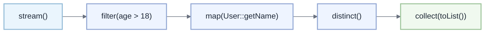

# Stream API

### 1. Какие преимущества даёт использование Stream API

Stream API (Java 8+) предоставляет декларативный (declarative — описывающий «что», а не «как»), функциональный стиль обработки коллекций и других источников данных. Основные преимущества:
- **Декларативность и читаемость**: вы описываете *что* нужно сделать (`filter`, `map`, `collect`), а не *как* это делать через циклы и временные переменные.
- **Композиция** (composition — соединение простых операций в сложную цепочку): операции легко объединяются в цепочки (pipeline — конвейер последовательных этапов обработки), образуя выразительный конвейер обработки.
- **Ленивость** (lazy evaluation — вычисление откладывается до момента необходимости): промежуточные операции не выполняются до вызова терминальной, что позволяет оптимизировать вычисления и избегать лишней работы.
- **Параллелизм «из коробки»**: достаточно заменить `stream()` на `parallelStream()`, чтобы задействовать несколько ядер (при корректном использовании).
- **Меньше побочных эффектов и ошибок**: функциональный стиль поощряет иммутабельность (immutability — неизменяемость данных) и чистые функции (pure functions — функция без побочных эффектов, результат зависит только от аргументов).
- **Внутренняя итерация** (internal iteration — библиотека сама управляет обходом): JVM/библиотека сама решает, как обходить данные, что открывает возможности для оптимизаций.


### 2. В чём разница между intermediate и terminal операциями

- **Intermediate (промежуточные) операции** — возвращают новый `Stream` и являются **ленивыми**: они не выполняются сразу, а лишь добавляют шаг в конвейер. Примеры: `filter`, `map`, `flatMap`, `distinct`, `sorted`, `limit`, `skip`, `peek`.
- **Terminal (терминальные) операции** — запускают выполнение всего конвейера и возвращают результат (или `void`). После терминальной операции стрим считается использованным и не может быть переиспользован. Примеры: `collect`, `forEach`, `reduce`, `count`, `anyMatch`, `findFirst`, `toList`.




### 3. Что делает операция filter()

`filter(Predicate<T>)` — промежуточная операция, которая оставляет в стриме только те элементы, для которых переданный предикат вернул `true`. Остальные элементы отбрасываются. Пример: `stream.filter(x -> x > 0)` оставит только положительные числа.


### 4. Что делает операция map()

`map(Function<T, R>)` — промежуточная операция, которая **преобразует** каждый элемент стрима с помощью переданной функции. Количество элементов не меняется, но меняется их тип/значение. Пример: `stream.map(String::length)` превратит поток строк в поток их длин.

```java
List<String> names = List.of("Иван", "Мария", "Алексей");

// преобразование типов: String -> Integer (длина)
List<Integer> lengths = names.stream()
        .map(String::length)
        .collect(Collectors.toList());
// [4, 5, 7]

// типичный сценарий: маппинг полей объекта
List<Long> ids = users.stream()
        .map(User::getId)
        .collect(Collectors.toList());

// с преобразованием и фильтрацией в одном конвейере
List<String> result = names.stream()
        .filter(n -> n.length() > 4)
        .map(String::toUpperCase)
        .collect(Collectors.toList());
// ["МАРИЯ", "АЛЕКСЕЙ"]
```


### 5. Что делает операция collect()

`collect(Collector<T, A, R>)` — терминальная операция, которая **собирает** элементы стрима в итоговую структуру (список, множество, мапу, строку и т.д.) с помощью `Collector`. Это одна из самых мощных и часто используемых терминальных операций. Пример: `stream.collect(Collectors.toList())`.


### 6. Что такое Collector и какие есть встроенные Collectors

**Collector** — это интерфейс, описывающий стратегию сведения потока элементов в итоговый результат. Он определяет четыре компонента: supplier (создание контейнера), accumulator (добавление элемента), combiner (объединение частичных результатов, важно для параллельных стримов) и finisher (финальное преобразование).

Встроенные коллекторы в `Collectors`:
- **`toList()`, `toSet()`, `toMap()`** — сбор в стандартные коллекции.
- **`toCollection()`** — сбор в конкретную реализацию коллекции.
- **`joining()`** — объединение строк (с разделителем, префиксом, суффиксом).
- **`groupingBy()`** — группировка по ключу (возвращает `Map`).
- **`partitioningBy()`** — разделение на две группы по булеву предикату.
- **`counting()`, `summingInt()`, `averagingDouble()`** — агрегатные функции.
- **`mapping()`, `filtering()`** — вложенные преобразования.
- **`reducing()`** — обобщённая редукция.


**Downstream-коллекторы (вложенные коллекторы):**

Методы `groupingBy` и `partitioningBy` становятся по-настоящему мощными при использовании вложенных коллекторов, которые обрабатывают элементы внутри каждой группы.

```java
List<Employee> employees = ...;

// Группировка по департаменту + подсчёт суммы зарплат
Map<String, Double> deptSalaries = employees.stream()
    .collect(Collectors.groupingBy(
        Employee::getDepartment,
        Collectors.summingDouble(Employee::getSalary)
    ));

// Группировка по городу + список имён (mapping)
Map<String, List<String>> cityNames = employees.stream()
    .collect(Collectors.groupingBy(
        Employee::getCity,
        Collectors.mapping(Employee::getName, Collectors.toList())
    ));

// Разделение на совершеннолетних/несовершеннолетних + подсчёт
Map<Boolean, Long> agePartition = employees.stream()
    .collect(Collectors.partitioningBy(
        e -> e.getAge() >= 18,
        Collectors.counting()
    ));

// Группировка + сортировка в каждой группе (collectingAndThen)
Map<String, List<String>> sortedByName = employees.stream()
    .collect(Collectors.groupingBy(
        Employee::getDepartment,
        Collectors.collectingAndThen(
            Collectors.mapping(Employee::getName, Collectors.toList()),
            list -> { list.sort(Comparator.naturalOrder()); return list; }
        )
    ));
```

### 7. Что делает операция flatMap()

`flatMap(Function<T, Stream<R>>)` — промежуточная операция, которая **разворачивает** каждый элемент в отдельный стрим и затем «сплющивает» все эти стримы в один общий поток. Она полезна, когда каждый элемент порождает 0, 1 или несколько элементов результата. Пример: `streamOfLists.flatMap(List::stream)` превратит поток списков в плоский поток их элементов.

```java
// разворачивание вложенных списков
List<List<Integer>> nested = List.of(
        List.of(1, 2, 3),
        List.of(4, 5),
        List.of(6)
);

List<Integer> flat = nested.stream()
        .flatMap(List::stream)
        .collect(Collectors.toList());
// [1, 2, 3, 4, 5, 6]

// каждый элемент порождает несколько результатов:
List<String> words = List.of("hello", "world");

List<String> chars = words.stream()
        .flatMap(word -> word.chars()
                .mapToObj(c -> String.valueOf((char) c)))
        .collect(Collectors.toList());
// [h, e, l, l, o, w, o, r, l, d]

// типичный сценарий: из объекта — коллекцию связанных сущностей
List<Order> orders = ...;
List<OrderItem> allItems = orders.stream()
        .flatMap(order -> order.getItems().stream())
        .filter(item -> item.getPrice() > 100)
        .collect(Collectors.toList());
```


### 8. В чём разница между map() и flatMap()

- **`map()`** — преобразование «один к одному»: каждый элемент заменяется ровно одним элементом. Результат — `Stream<R>`, где `R` — тип результата функции. Если функция возвращает коллекцию, вы получите `Stream<List<R>>`.
- **`flatMap()`** — преобразование «один ко многим»: функция возвращает `Stream<R>` для каждого элемента, и все эти стримы объединяются в один плоский `Stream<R>`. Используется для разворачивания вложенных структур.

Ключевое отличие: `map` не меняет «глубину» вложенности, `flatMap` — устраняет её.

```java
// map: каждый заказ -> его ID (один к одному)
List<Long> orderIds = orders.stream()
        .map(Order::getId)
        .collect(Collectors.toList());
// [101, 102, 103]

// flatMap: каждый заказ -> все его позиции (один ко многим)
List<OrderItem> allItems = orders.stream()
        .flatMap(order -> order.getItems().stream())
        .collect(Collectors.toList());
// [item1, item2, item3, item4]  — плоский список из всех заказов
```


### 9. Что такое параллельные стримы

**Параллельный стрим** — это стрим, операции которого могут выполняться **одновременно на нескольких потоках**. Он разбивает источник данных на части (splitting), обрабатывает их параллельно и затем объединяет результаты (combining). Параллельные стримы используют общий `ForkJoinPool.commonPool()` по умолчанию.


### 10. Когда использовать parallel streams

Параллельные стримы стоит использовать, когда **все** следующие условия выполнены:
- Задача **CPU-bound** (вычисления, а не ожидание I/O).
- Данных **достаточно много**, чтобы накладные расходы на разбиение и объединение окупились (обычно десятки тысяч элементов и больше).
- Источник данных **легко разбивается** на независимые части (массивы, `ArrayList`, `IntStream.range` — хорошо; `LinkedList`, `Stream.iterate` — плохо).
- Операции **не имеют состояния** и **не зависят от порядка** (stateless, associative).
- Нет общего изменяемого состояния (иначе нужна синхронизация, которая убьёт выигрыш).

В остальных случаях последовательный стрим проще, предсказуемее и часто быстрее.


### 11. Как создать parallel stream

Несколько способов:
- Из коллекции: `collection.parallelStream()`.
- Из существующего стрима: `stream.parallel()` (преобразует последовательный стрим в параллельный).
- Из массива: `Arrays.stream(array).parallel()`.
- Из диапазона: `IntStream.range(0, n).parallel()`.

```java
List<Integer> numbers = List.of(1, 2, 3, 4, 5, 6, 7, 8, 9, 10);

// из коллекции
int sum1 = numbers.parallelStream()
        .filter(n -> n % 2 == 0)
        .map(n -> n * n)
        .sum();
// 4 + 16 + 36 + 64 + 100 = 220

// из диапазона (типичный CPU-bound сценарий)
int sum2 = IntStream.rangeClosed(1, 1_000_000)
        .parallel()
        .filter(n -> n % 2 == 0)
        .sum();

// из массива
int[] arr = {2, 4, 6, 8};
int sum3 = Arrays.stream(arr).parallel()
        .map(n -> n * 2)
        .sum();
// 4 + 8 + 12 + 16 = 40
```


### 12. Какие потенциальные проблемы могут быть с параллельными стримами

- **Накладные расходы**: разбиение, планирование и объединение результатов могут быть дороже, чем сама работа, особенно на малых данных.
- **Неверные результаты при наличии состояния/побочных эффектов**: изменение общих переменных без синхронизации приводит к гонкам данных.
- **Зависимость от порядка**: операции вроде `findFirst`, `limit`, `forEachOrdered` в параллельном режиме работают медленнее и могут давать неожиданные результаты.
- **Истощение commonPool**: параллельные стримы делят общий `ForkJoinPool` с другими задачами (например, `CompletableFuture`), что может привести к взаимным блокировкам, если внутри стрима выполняется блокирующий код.
- **Плохое разбиение источника**: `LinkedList`, `Stream.iterate`, `BufferedReader.lines()` разбиваются плохо, параллелизм не даёт выигрыша.
- **Не все операции параллелятся эффективно**: `sorted`, `distinct`, `limit` требуют координации между потоками.


- **`sorted()` и `distinct()` в параллельном стриме работают крайне неэффективно**: эти stateful-операции требуют полной буферизации всех элементов и синхронизации между потоками перед продолжением конвейера. Если в параллельном стриме есть `sorted` или `distinct` — часто быстрее выполнить последовательный стрим с сортировкой.

### 13. Что такое ForkJoinPool и как он связан с parallel streams

`ForkJoinPool` — это специализированный пул потоков, реализующий алгоритм **work-stealing**: задачи рекурсивно делятся на подзадачи (`fork`), а затем их результаты объединяются (`join`). Каждый рабочий поток имеет свою очередь задач и, когда освобождается, «крадёт» задачи у других потоков, обеспечивая эффективную загрузку всех ядер.

Параллельные стримы **по умолчанию** выполняются в **`ForkJoinPool.commonPool()`**, размер которого обычно равен `Runtime.getRuntime().availableProcessors() - 1`. Этот же пул используется для асинхронных методов `CompletableFuture` (без явного `Executor`), что создаёт риск взаимного влияния.

```java
// Использование ForkJoinPool
ForkJoinPool pool = new ForkJoinPool(4); // 4 потока

// Рекурсивное разбиение задачи
class SumTask extends RecursiveTask<Long> {
    private final long[] array;
    private final int start, end;

    public Long compute() {
        int length = end - start;
        if (length < 1000) { // Базовый случай: прямой подсчёт
            long sum = 0;
            for (int i = start; i < end; i++) sum += array[i];
            return sum;
        }
        // Рекурсивное разбиение
        int mid = start + length / 2;
        SumTask left = new SumTask(array, start, mid);
        SumTask right = new SumTask(array, mid, end);
        left.fork(); // Запускаем левую подзадачу
        long rightResult = right.compute(); // Вычисляем правую
        long leftResult = left.join(); // Ждём левую
        return leftResult + rightResult;
    }
}

long result = pool.invoke(new SumTask(array, 0, array.length));
```


### 14. Можно ли изменять состояние внешних переменных в Stream операциях

Технически — да, если переменная не `final` или не effectively final (для лямбд это требование компилятора), но **нельзя** изменять локальные переменные из лямбд напрямую. Можно изменять поля объектов или элементы массивов, на которые ссылаются effectively final переменные.

**Однако это не рекомендуется**: изменение внешнего состояния из стрима — это **побочный эффект (side effect)**, который нарушает функциональную парадигму, делает код непредсказуемым в параллельном режиме и может привести к гонкам данных и неверным результатам.


### 15. Что такое побочные эффекты (side effects) в Stream

**Побочный эффект** — это любое действие в операции стрима, которое изменяет состояние **вне** самого стрима: запись в внешнюю переменную/коллекцию, логирование, изменение полей объектов, вызов внешних сервисов с изменением состояния и т.п. В функциональном стиле операции должны быть **чистыми функциями**: результат зависит только от входных данных и не изменяет ничего снаружи.


### 16. Почему следует избегать побочных эффектов в Stream

- **Непредсказуемость в параллельном режиме**: несколько потоков могут одновременно изменять общее состояние, что приводит к гонкам данных, потерянным обновлениям и неверным результатам.
- **Нарушение ленивости**: промежуточные операции могут не выполняться вовсе (если терминальная операция с коротким замыканием), поэтому побочные эффекты в них могут не произойти или произойти неожиданное число раз.
- **Сложность отладки и тестирования**: код с побочными эффектами труднее понимать и тестировать.
- **Нарушение идемпотентности**: повторный запуск стрима (если бы это было возможно) дал бы другой результат.

Правильный подход — собирать результат в терминальной операции (`collect`, `reduce`) и уже потом выполнять действия с побочными эффектами.


### 17. Что делает операция reduce()

`reduce()` — терминальная операция, которая **сводит** все элементы стрима к одному значению с помощью бинарной функции (аккумулятора). Есть три формы:
- **`reduce(BinaryOperator<T>)`**: без начального значения, возвращает `Optional<T>` (пустой, если стрим пуст).
- **`reduce(T identity, BinaryOperator<T>)`**: с начальным значением (identity), возвращает `T`.
- **`reduce(U identity, BiFunction<U,T,U> accumulator, BinaryOperator<U> combiner)`**: трёхаргументная форма для параллельных стримов и смены типа.

Пример: `stream.reduce(0, Integer::sum)` — сумма элементов.


### 18. В чём разница между reduce() и collect()

- **`reduce()`** предназначен для **иммутабельной редукции** к одному значению (число, строка, объект) с помощью ассоциативной бинарной функции. Он не предназначен для изменения контейнера на месте (mutating).
- **`collect()`** предназначен для **мутабельной редукции**: он использует изменяемый контейнер (например, `ArrayList`), в который накапливает элементы. `collect` более гибок, эффективен для сборки коллекций и поддерживает сложные стратегии через `Collector` (группировка, разбиение, вложенные коллекторы).

Кратко: `reduce` — для свёртки значений, `collect` — для накопления в контейнер.


### 19. Что такое операция peek() и когда её использовать

`peek(Consumer<T>)` — промежуточная операция, которая выполняет переданное действие над каждым элементом стрима, **не изменяя** сами элементы, и возвращает тот же стрим. Она предназначена **для отладки**: посмотреть, что проходит через конвейер на определённом этапе.

**Не следует** использовать `peek` для выполнения бизнес-логики или побочных эффектов, которые должны повлиять на результат: из-за ленивости и оптимизаций (например, short-circuiting или вырезания неиспользуемых шагов) `peek` может не выполниться для всех элементов или не выполниться вовсе.


### 20. Можно ли повторно использовать Stream

**Нет**. Стрим — это **одноразовый** объект: после вызова терминальной операции он считается использованным, и повторное использование приводит к `IllegalStateException: stream has already been operated upon or closed`. Чтобы обработать данные повторно, нужно создать новый стрим из источника.


### 21. Что такое lazy evaluation в Stream

**Ленивое вычисление** означает, что промежуточные операции (`filter`, `map`, `sorted` и т.д.) **не выполняются** в момент их вызова. Они лишь строят описание конвейера. Реальное выполнение начинается только при вызове **терминальной** операции. Более того, элементы обрабатываются **по одному** через всю цепочку (если это возможно), а не «сначала весь filter, потом весь map» — это позволяет избегать создания промежуточных коллекций и оптимизировать работу (особенно с `limit` и short-circuiting).


### 22. Когда начинается выполнение операций в Stream

Выполнение конвейера начинается **только при вызове терминальной операции** (`collect`, `forEach`, `reduce`, `count`, `anyMatch`, `findFirst` и т.д.). До этого момента никакие промежуточные операции фактически не выполняются. Это и есть проявление ленивости.


### 23. Что делают операции distinct(), sorted(), limit(), skip()

- **`distinct()`** — промежуточная операция, удаляющая дубликаты (сравнение через `equals()`/`hashCode()`). Сохраняет порядок первого появления.
- **`sorted()`** — промежуточная операция, сортирующая элементы в естественном порядке или с помощью переданного `Comparator`. Это **stateful** операция: для сортировки нужно собрать все элементы, что ломает «поточность» обработки.
- **`limit(n)`** — промежуточная операция, ограничивающая стрим первыми `n` элементами. Поддерживает short-circuiting: после получения `n` элементов обработка прекращается.
- **`skip(n)`** — промежуточная операция, пропускающая первые `n` элементов и возвращающая остальные.


### 24. Как работает короткое замыкание (short-circuiting) в Stream

**Short-circuiting** — это свойство некоторых операций **прекращать обработку** досрочно, как только результат становится известен, не дожидаясь обработки всех элементов. Это возможно благодаря ленивости: элементы обрабатываются по одному, и как только условие выполнено, конвейер останавливается.

Примеры short-circuiting операций:
- **Терминальные**: `anyMatch`, `allMatch`, `noneMatch`, `findFirst`, `findAny`.
- **Промежуточные**: `limit` (может остановить бесконечный стрим), `takeWhile` (Java 9+).

Пример: `Stream.iterate(1, i -> i + 1).anyMatch(i -> i > 100)` завершится быстро, хотя стрим бесконечный.


### 25. Что такое операции anyMatch(), allMatch(), noneMatch()

Это терминальные операции, проверяющие предикат над элементами и возвращающие `boolean`. Все они поддерживают **short-circuiting**:
- **`anyMatch(Predicate)`** — `true`, если **хотя бы один** элемент удовлетворяет предикату. Останавливается на первом совпадении.
- **`allMatch(Predicate)`** — `true`, если **все** элементы удовлетворяют предикату. Останавливается на первом несовпадении.
- **`noneMatch(Predicate)`** — `true`, если **ни один** элемент не удовлетворяет предикату. Останавливается на первом совпадении.


### 26. Что делают операции findFirst() и findAny()

Обе — терминальные операции, возвращающие `Optional<T>` с элементом стрима (или пустой `Optional`, если стрим пуст):
- **`findFirst()`** — возвращает **первый** элемент стрима (в порядке encounter order). В параллельном стриме требует координации и может быть медленнее, но гарантирует детерминированный результат.
- **`findAny()`** — возвращает **любой** элемент стрима. В параллельном стриме может вернуть любой из обработанных элементов, что позволяет избежать координации и работать быстрее. В последовательном стриме обычно возвращает первый.

Обе поддерживают short-circuiting.


### 27. Как собрать Stream в Map

Через `Collectors.toMap(keyMapper, valueMapper)`:
```java
Map<String, Integer> map = stream.collect(
    Collectors.toMap(
        Person::getName,      // ключ
        Person::getAge        // значение
    )
);
```
Есть перегрузка с `mergeFunction` (для разрешения коллизий) и `mapSupplier` (для выбора реализации `Map`, например `LinkedHashMap::new`).


### 28. Что делать при коллизиях ключей при сборке в Map

По умолчанию `Collectors.toMap` при коллизии ключей выбрасывает `IllegalStateException: Duplicate key`. Варианты решения:
1.  **Указать merge-функцию** — третьим аргументом, которая решает, какое значение оставить:
    ```java
    Collectors.toMap(Person::getName, Person::getAge, (a, b) -> a)
    ```
    Можно выбрать первое (`(a, b) -> a`), последнее (`(a, b) -> b`), сложить (`Integer::sum`) и т.д.
2.  **Использовать `groupingBy`** — если нужно сгруппировать значения в коллекцию по ключу:
    ```java
    Collectors.groupingBy(Person::getName, Collectors.mapping(Person::getAge, Collectors.toList()))
    ```
3.  **Указать supplier** — четвёртым аргументом, чтобы выбрать реализацию `Map` (например, `LinkedHashMap::new` для сохранения порядка).


### 29. Как работать с Optional в Stream

`Optional` и Stream хорошо сочетаются:
- **`findFirst()`/`findAny()`/`max()`/`min()`/`reduce()` без identity** возвращают `Optional<T>` — это безопасный способ представить «возможно, отсутствующий» результат.
- **`Optional.stream()`** (Java 9+) — превращает `Optional` в стрим из 0 или 1 элемента, что удобно для `flatMap`:
    ```java
    stream.flatMap(opt -> opt.stream())
    ```
- **`Optional.map()`/`filter()`** — для цепочек преобразований внутри `Optional`.
- **`orElse()`/`orElseGet()`/`orElseThrow()`** — для извлечения значения с fallback.

Пример: `stream.max(Comparator.naturalOrder()).orElse(0)` — безопасное получение максимума или значения по умолчанию.


### 30. Что такое примитивные стримы (Primitive Streams) и зачем они нужны

Java предоставляет специализированные интерфейсы для работы с примитивами: `IntStream`, `LongStream`, `DoubleStream`.

**Зачем они нужны:**

Главная причина — **производительность**. Использование обычного `Stream<Integer>` приводит к постоянной упаковке (boxing) и распаковке (unboxing) примитивов в объекты-обёртки, что создаёт лишнюю нагрузку на GC и тратит память.

**Основные операции:**
- `mapToInt()`, `mapToLong()`, `mapToDouble()` — преобразование объект-стрима в примитивный.
- `boxed()` — обратное преобразование примитивного стрима в объект-стрим (`Stream<Integer>`).
- `sum()`, `average()`, `max()`, `min()` — специфичные терминальные операции (возвращают примитив, не `Optional`).
- `range(int startInclusive, int endExclusive)` и `rangeClosed()` — генерация последовательностей.

```java
List<User> users = List.of(new User(25), new User(30), new User(35));

// Плохо: Stream<Integer> с boxing/unboxing на каждом элементе
int sum1 = users.stream()
    .map(User::getAge)
    .reduce(0, Integer::sum);

// Хорошо: IntStream без накладных расходов
int sum2 = users.stream()
    .mapToInt(User::getAge)
    .sum();

// Генерация последовательности и обратное преобразование
List<Integer> numbers = IntStream.rangeClosed(1, 5)
    .boxed()  // Stream<Integer>
    .collect(Collectors.toList());

// doubleStream с округлением
double avg = users.stream()
    .mapToInt(User::getAge)
    .average()
    .orElse(0.0);
```

**Компромиссы:**
- `Stream<Integer>` — универсально (можно миксовать с объектами), но boxing/unboxing на каждом элементе.
- `IntStream` — быстро (без boxing), но менее гибок (не все операции есть, например нет `distinct` до Java 8, `sorted` ограничен).
- Для больших коллекций примитивов (миллионы элементов) `IntStream` даёт измеримый выигрыш по памяти и скорости.

**Лучшая практика:**
- Для арифметических операций по примитивам — всегда `mapToInt`/`mapToLong` + `sum`/`average`.
- Для генерации последовательностей — `IntStream.range`/`rangeClosed`.
- Для смешанных операций (объекты + примитивы) — `Stream` + `boxed` только где нужно.

**Вопросы интервьюера:**
- «Зачем `boxed()`?» — чтобы вернуть в объектный стрим для операций, которые есть только в `Stream` (например, `map` на объект).
- «В чём разница `sum()` в `IntStream` и `reduce(0, Integer::sum)` в `Stream<Integer>`?» — `IntStream.sum()` возвращает `int` (примитив), `reduce` возвращает `Integer` (объект, boxing).

### 31. Как реализовать собственный Collector

Интерфейс `Collector<T, A, R>` состоит из 4-х основных компонентов (и опционального 5-го — `characteristics`):

1. **`supplier()`** — создаёт пустой изменяемый контейнер для накопления (например, `ArrayList::new`).
2. **`accumulator()`** — функция, добавляющая элемент стрима в контейнер.
3. **`combiner()`** — функция для объединения двух контейнеров (критично для `parallelStream`).
4. **`finisher()`** — финальное преобразование контейнера в итоговый результат (например, создание `unmodifiableList`).

**Пример: сборка в неизменяемый список (аналог `Collectors.toUnmodifiableList()` из Java 10):**

```java
public static <T> Collector<T, ?, List<T>> toImmutableList() {
    return Collector.of(
        ArrayList::new,                   // supplier
        List::add,                        // accumulator
        (left, right) -> {                // combiner
            left.addAll(right);
            return left;
        },
        Collections::unmodifiableList     // finisher
    );
}

// Использование:
List<String> result = stream.collect(toImmutableList());
```

**Пример: кастомный `joining` с ограничением длины:**

```java
public static Collector<CharSequence, ?, String> joiningLimited(String delimiter, int maxLen) {
    return Collector.of(
        () -> new StringBuilder(),
        (sb, seq) -> {
            if (sb.length() > 0) sb.append(delimiter);
            sb.append(seq);
        },
        (left, right) -> {
            if (right.length() > 0) {
                if (left.length() > 0) left.append(delimiter);
                left.append(right);
            }
            return left;
        },
        sb -> sb.length() > maxLen ? sb.substring(0, maxLen) + "..." : sb.toString()
    );
}
```

Знание этого механизма показывает глубокое понимание того, как работают `collect`, `reduce` и параллельная обработка под капотом.

**Компромиссы:**
- Встроенные коллекторы (`Collectors.toList()`, `groupingBy`) — проще, но менее гибки.
- Кастомный коллектор — полная гибкость, но сложнее писать и отлаживать.
- Для параллельных стримов `combiner` — критичен: без него результат будет неверным.

**Лучшая практика:**
- Сначала проверить, покрывает ли задача встроенные коллекторы.
- Если нет — использовать `Collector.of()` с 4 компонентами.
- Для параллельных стримов обязательно проверять, что `combiner` корректно объединяет частичные результаты.

**Вопросы интервьюера:**
- «Почему `combiner` важен только для параллельных стримов?» — в последовательном стриме один контейнер обрабатывает все элементы, а в параллельном — каждый поток имеет свой контейнер, и их нужно объединить.
- «Можно ли пропустить `finisher`?» — да, если контейнер уже является итоговым результатом (например, `ArrayList` без `unmodifiableList`).

### 32. Новые возможности Stream API в Java 9 и новее

- **`Stream.ofNullable(T t)`** (Java 9): создаёт стрим из одного элемента, если он не `null`, или пустой стрим, если `null`. Идеально заменяет громоздкие `if (obj != null) obj.stream() : Stream.empty()`.
- **`takeWhile(Predicate)`** (Java 9): принимает элементы, пока предикат истинен, затем **останавливает** стрим. Продвинутый short-circuiting для упорядоченных стримов.
- **`dropWhile(Predicate)`** (Java 9): отбрасывает элементы, пока предикат истинен, а затем возвращает все остальные (включая те, что не удовлетворяют предикату).
- **`iterate(seed, hasNext, next)`** (Java 9): перегруженная версия `iterate`, позволяющая задать условие остановки. Безопасная альтернатива бесконечным стримам с `limit`.
- **`Stream.toUnmodifiableList()`** (Java 10+): терминальная операция, возвращающая `List` без создания промежуточного `ArrayList`.
- **`Stream.toList()`** (Java 16+): аналог `toUnmodifiableList()`, но как метод `Stream`.

```java
// ofNullable: безопасно обрабатываем потенциально null-поле
List<String> tags = user.getTags().stream()
    .flatMap(tag -> Stream.ofNullable(tag.getName()))
    .collect(Collectors.toList());

// takeWhile: берём элементы, пока они меньше 5 (для упорядоченного стрима)
List<Integer> smallNumbers = Stream.of(1, 2, 3, 6, 7, 2)
    .takeWhile(n -> n < 5)
    .collect(Collectors.toList());  // [1, 2, 3] — останавливается на 6

// dropWhile: отбрасываем, пока меньше 5, затем возвращаем всё
List<Integer> rest = Stream.of(1, 2, 3, 6, 7, 2)
    .dropWhile(n -> n < 5)
    .collect(Collectors.toList());  // [6, 7, 2] — отбрасывает 1,2,3

// iterate с условием остановки
List<Integer> powers = Stream.iterate(
        1,
        n -> n <= 1024,
        n -> n * 2
    ).collect(Collectors.toList());  // [1, 2, 4, 8, ..., 1024]
```

**Компромиссы:**
- `takeWhile` против `filter`: `takeWhile` останавливает стрим на первом несовпадении (short-circuit), `filter` проходит все элементы. Для упорядоченных стримов `takeWhile` быстрее.
- `dropWhile` против `filter`: `dropWhile` отбрасывает только «преамбулу» (пока предикат истинен), затем возвращает всё. `filter` отбрасывает все несовпадения.
- `iterate` с условием (Java 9) против `iterate` + `limit`: первый безопаснее (не нужно считать длину заранее).

**Лучшая практика:**
- `ofNullable` вместо `if (x != null)` перед `.stream()`.
- `takeWhile` для упорядоченных стримов вместо `filter` (short-circuit).
- `iterate` с условием остановки для конечных последовательностей.

**Вопросы интервьюера:**
- «В чём разница `takeWhile` и `filter`?» — `takeWhile` останавливается на первом `false`, `filter` проходит все элементы. `takeWhile` — short-circuit.
- «Зачем `ofNullable`?» — чтобы не писать `if (obj != null) obj.stream() : Stream.empty()`.
