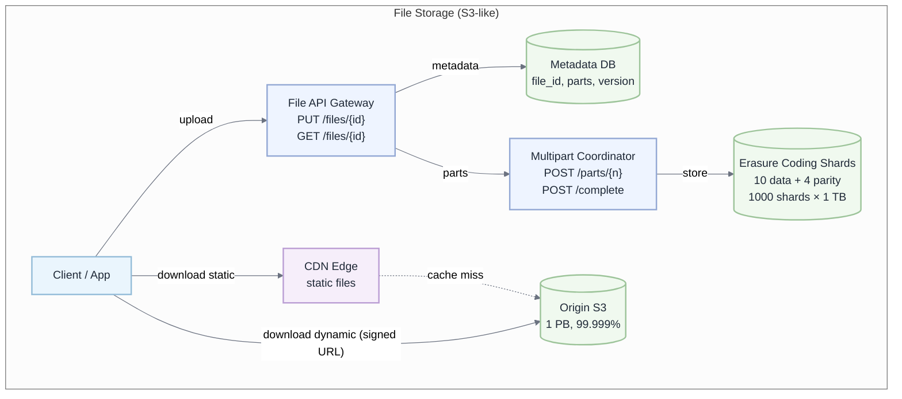
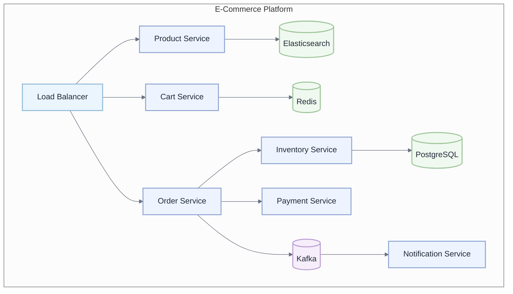
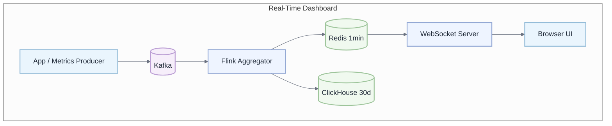
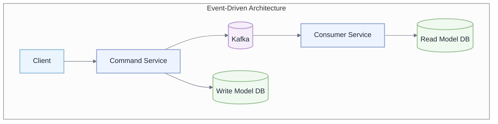
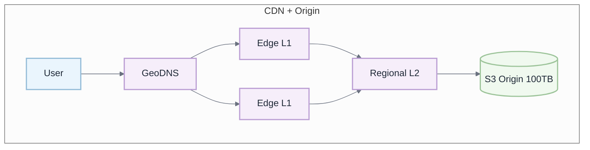

# System Design

### 1. Как спроектировать URL Shortener (URL-коротыш — сервис, превращающий длинную ссылку в короткую, как TinyURL или Bitly)

- **API**: `POST /shorten {url}` → `{shortUrl: "abc123"}`, `GET /r/abc123` → редирект на исходный URL.
- **Схема**: `short_codes (code PK, url, created_at, clicks)` — `code` (короткий код) первичный ключ, `clicks` — счётчик переходов.
- **Генерация кода**: **Base62** (алфавит a-z, A-Z, 0-9 — 62 символов) из `auto-increment` (автоинкремент — счётчик в БД) или **snowflake** (схема ID от Twitter: время + машинный ID + счётчик, даёт уникальные 64-битные ID без центральной последовательности). **Коллизии** (столкновения — два разных URL получили один код): **retry** (повтор генерации) — редки при длине 6+ символов (пространство 62⁶ ≈ 57 млрд).
- **Кэширование**: **Redis** `code → url` (TTL = 30 дней) по паттерну **Cache-Aside** (кэширование сбоку — приложение само читает кэш и наполняет его, см. §6).
- **Масштабирование**: система **read-heavy** (преобладает чтение — 99% запросов GET) → **replica** (реплика — копия БД для чтения) + **CDN** (Content Delivery Network — сеть доставки контента, кэширует редиректы ближе к пользователю). **Write** (запись) → один мастер.
- **Follow-up** (дополнительные требования, которые интервьюер бросает после основного решения): **analytics** (аналитика переходов: clicks, гео, referrer — с какой страницы пришли) → **Kafka** → **ClickHouse** (OLAP-хранилище для аналитики, см. §8).

### 2. Как спроектировать Rate Limiter (ограничитель частоты запросов — защищает API от перегрузки и атак)

- **Подход**: **Token Bucket** (корзина с токенами — см. §9) или **Sliding Window** (скользящее окно — см. §9).
- **Хранение**: **Redis** — `INCR` + `EXPIRE` для fixed window (фиксированное окно), **sorted set** (упорядоченное множество) для sliding window.
- **Распределённый**: **Redis** (все ноды проверяют один общий счётчик — иначе каждая нода даст свой лимит).
- **Правила**: **per-user** (на пользователя: 100 req/min), **per-IP** (на IP: 1000 req/min), **per-endpoint** (на эндпоинт: 10 req/s для дорогих операций).
- **Ответ**: HTTP **429 Too Many Requests** + заголовок `Retry-After` (через сколько секунд повторить).
- **В Spring**: библиотека **Bucket4j** + **Redis** (для распределённого лимита).

### 3. Как спроектировать News Feed (лента новостей — как Twitter, Facebook)

- **Проблема**: **fan-out** (развёртка — рассылка поста во все ленты фоловеров): у пользователя 1M фоловеров → 1M записей в чужие ленты на каждый пост.
- **Подход**: **Hybrid fan-out** (гибридная развёртка — комбинирование двух стратегий по размеру аудитории):
  - **Low-follower** (< 10K фоловеров): **write-time fan-out** (развёртка при записи — пост сразу пишется в ленты всех фоловеров). Чтение быстрое, запись дорогая, но аудитория мала.
  - **High-follower** (> 10K): **read-time fan-out** (развёртка при чтении — при запросе ленты на лету объединить посты всех high-follower). Запись дешёвая, чтение дороже, но таких пользователей мало.
- **Хранение**: **PostgreSQL** (ленты), **Redis** (кэш последних постов), **Elasticsearch** (поиск по постам).
- **Масштабирование**: **sharding** (шардирование — разбиение данных на шарды) по `user_id` (каждый шард = часть пользователей).
- **Follow-up**: **recommendation** (рекомендации — ML-модель подбирает релевантные посты) → **batch** (пакетная пересчитка ночью) + **real-time** (обновление через Kafka).

### 4. Как спроектировать Chat System (чат — как WhatsApp, Telegram)

- **Real-time** (реальное время — мгновенная доставка без перезагрузки): **WebSocket** (двусторонний протокол поверх TCP) или **SSE** (Server-Sent Events — односторонний поток с сервера) для one-way (односторонней доставки).
- **Масштабирование**: система **stateful** (с состоянием — соединения привязаны к конкретной ноде) → **sticky sessions** (липкие сессии — load balancer направляет одного пользователя всегда на одну ноду) или **message broker** (брокер сообщений — Kafka/NATS) для рассылки по нодам.
- **Доставка**: **at-least-once** (хотя бы один раз — сообщение может прийти дублем, но не потеряется) + **ack** (acknowledgement — подтверждение от клиента, что сообщение получено). **Idempotency** (идемпотентность — повторная доставка не меняет состояние) по `message_id`.
- **История**: **PostgreSQL** (шардирование по `conversation_id` — ID диалога), **S3** (объектное хранилище для медиа — фото, видео).
- **Offline** (пользователь не в сети): **message queue** (очередь сообщений) на сервере (Kafka) → доставить при онлайне.
- **Follow-up**: **group chat** (групповой чат — fan-out на N участников), **read receipts** (отметки о прочтении), **typing indicators** (индикатор «печатает…»).

### 5. Общие принципы проектирования: как оценить нагрузку и выбрать архитектуру

- Сначала **оцени нагрузку** (QPS — запросов в секунду, размер данных, скорость роста) до выбора архитектуры.
- Выбери архитектуру (**monolith** — монолит, один сервис vs **microservices** — микросервисы, набор мелких сервисов) под нагрузку, а не заранее.
- Кэширование на каждом уровне (CDN → Redis → БД).
- Асинхронность для некритичных операций (email, push-уведомления) — не блокировать основной ответ.
- Sharding (шардирование), когда одна БД не вытягивает объём или скорость.

### 6. Паттерны масштабирования: горизонтальное масштабирование, шардирование, consistent hashing

**Horizontal Scaling (горизонтальное масштабирование — добавление нод вместо апгрейда одной):**
- Добавить ноды (серверы, поды) вместо **vertical scaling** (вертикальное масштабирование — апгрейд одной машины: больше CPU/RAM).
- **Stateless** (без состояния — сервис не хранит данные между запросами) сервисы: любой запрос может попасть на любую ноду (load balancer распределяет **round-robin** — по очереди).
- **Stateful** (с состоянием — сессии, соединения привязаны к ноде): **sticky sessions** (липкие сессии) или **externalized state** (вынос состояния наружу — в Redis, чтобы любая нода могла его прочитать).

**Sharding (шардирование — горизонтальное партиционирование БД):**
- Разделить данные на **N шардов** (каждый шард = отдельная инстанс БД).
- **Shard key** (ключ шардирования — поле, по которому данные распределяются по шардам): `user_id`, `order_id`, `tenant_id`. Выбор ключа критичен — от него зависит равномерность.
- Стратегии выбора: **hash** (хеш ключа по модулю N — равномерное распределение), **range** (диапазоны — user_id 0-9999 на шард 0, 10000-19999 на шард 1), **geographic** (по региону — данные пользователей из EU на EU-шардах).

```sql
-- Sharding по user_id:
-- Shard 0: users 0-9999
-- Shard 1: users 10000-19999
-- ...
-- Router: user_id % N_shards → shard_id
```

**Проблемы шардирования:**
- **Cross-shard query** (перекрёзный запрос — запрос, затрагивающий данные нескольких шардов): медленно (N запросов + объединение результатов). Решение: выбирать shard key так, чтобы большинство запросов попадало в один шард.
- **Rebalancing** (ребалансировка — перераспределение данных при добавлении/удалении шарда): нужно перенести данные. Варианты: **downtime** (остановка) или **dual-write** (двойная запись — пишём в старый и новый шард одновременно, потом отключаем старый).
- **Hot spot** (горячая точка — один шард получает непропорционально больше нагрузки): например, VIP-пользователь с 1M постов. Решение: **sub-sharding** (субшардирование — вторичное разбиение горячего шарда).

**Consistent Hashing (консистентное хеширование — алгоритм распределения ключей по кольцу нод):**
- **Проблема**: обычный hash (`key % N`) → при добавлении ноды N→N+1 перераспределяется почти весь диапазон (N/(N+1) данных) — каждый ключ меняет `key % N`.
- **Решение**: представить хеш-пространство как **кольцо** (0 … 2³²). Ноды размещаются на кольце по их хешу. Ключ → следующая нода по кольцу (по часовой). При добавлении ноды перераспределяется только сегмент между новой и предыдущей нодой (~1/N).
- **Replicas** (реплики): каждый ключ дублируется на K последующих нодах по кольцу — отказ одной ноды не теряет данные.
- **Примеры систем**: **Cassandra**, **DynamoDB**, **Memcached**.

```
Кольцо (0 → 2^32 → 0):
  Node A (hash=100)
  Node B (hash=500)
  Node C (hash=900)

Ключ hash=300 → Node B (следующая по кольцу от 300)
Ключ hash=1000 → Node A (обход кольца через 0)
```

**Когда что:**
- **Stateless API**: horizontal scaling (load balancer + N нод) — достаточно.
- **БД**: sharding (по user_id/tenant_id) + **read replicas** (реплики для чтения) для разгрузки мастера.
- **Кэш/хранилище** (Cassandra, Memcached): consistent hashing — перераспределение при масштабировании минимальное.

### 7. Доступность: SLA/SLO, мультирегиональность, disaster recovery

**SLA (Service Level Agreement — соглашение об уровне сервиса)** — публичный контракт с клиентом. Например, 99.9% uptime = до 43.8 минут простоя в месяц. Нарушение SLA → финансовые штрафы.
**SLO (Service Level Objective — внутренняя цель по уровню сервиса)** — более строгая внутренняя цель, например 99.95% = 21.9 мин/мес. Смысл: работать к SLO, чтобы не дойти до SLA.
**Error Budget (бюджет ошибок)** = 100% − SLO. «Сколько простоя/ошибок нам разрешено в месяц». Бюджет исчерпан → мораторий на новые фичи, фокус на надёжность.

**Multi-Region Deployment (развёртывание в нескольких регионах мира):**
- **Active-Active** (активный-активный): оба региона принимают трафик одновременно. Глобальный load balancer + **DNS anycast** (анкаст — один IP-адрес, обслуживаемый несколькими нодами в разных местах, запрос идёт в ближайшую). Синхронизация данных в real-time через **bidirectional replication** (двусторонняя репликация — данные копируются в обе стороны).
- **Active-Passive** (активный-пассивный): один регион активен, второй — **hot standby** (горячий резерв — полностью развёрнут и синхронизирован, но не принимает трафик). **Failover** (переключение — автоматический перевод трафика на резервный регион) при отказе активного (5–30 мин).
- Active-Active лучше (нет downtime при failover), но сложнее: конфликты репликации (два региона одновременно пишут одну запись), latency между регионами (50–200 мс).

**Disaster Recovery (DR — восстановление после катастрофы):**
- **RTO (Recovery Time Objective — целевое время восстановления)**: сколько времени система может быть недоступна после сбоя. Например, RTO = 15 мин → через 15 мин после сбоя система должна работать.
- **RPO (Recovery Point Objective — целевая точка восстановления)**: сколько данных можно потерять. RPO = 1 мин → при восстановлении данные будут не старше 1 минуты.
- **Уровни DR**:
  - **Level 1 — бэкапы**: RTO = часы (нужно восстановить из бэкапа), RPO = периодичность бэкапов (часы).
  - **Level 2 — hot standby**: RTO = 15 мин (резерв развёрнут, нужен только failover), RPO = 1 мин (асинхронная репликация).
  - **Level 3 — active-active multi-region**: RTO ≈ 0 (трафик автоматически уходит в другой регион), RPO ≈ 0 (синхронная репликация).

**Синхронизация данных между регионами:**
- **Синхронная** (strong consistency — сильная консистентность, все реплики подтверждают запись до ответа): медленно (до 50–200 мс задержка между регионами), но надёжно — данные не теряются.
- **Асинхронная** (eventual consistency — конечная консистентность: данные «сходятся» через некоторое время): быстро, но есть окно, когда реплики расходятся. Для разрешения конфликтов: **CRDT** (Conflict-free Replicated Data Types — структуры данных, где операции коммутативны и ассоциативны, конфликты разрешаются автоматически) или **last-write-wins** (последняя запись выигрывает — по timestamp).

**Best practice:**
- Active-Passive для большинства систем (дешевле, проще оперировать, нет конфликтов репликации).
- Active-Active для критичных систем (финансы, healthcare), где downtime = большие деньги.
- RTO/RPO определяются бизнесом (сколько готовы платить за простой), а не техникой.

### 8. Компромиссы (trade-offs): latency vs throughput, теоремы PACELC и CAP

**Latency vs Throughput (задержка против пропускной способности):**
- **Latency** (задержка — время отклика одного запроса): измеряется в процентах — p50 (медиана), p95 (95% запросов быстрее), p99 (99% запросов быстрее). p99 важнее p50 для SLA.
- **Throughput** (пропускная способность — сколько запросов система обрабатывает в секунду): QPS (queries per second) или RPS (requests per second).
- **Trade-off** (компромисс — улучшение одного параметра ухудшает другой): быстрая обработка одного запроса (низкая latency) → меньше параллельных запросов (низкий throughput). И наоборот.
- **Пример**: синхронная валидация (каждый запрос ждёт проверки — low latency, low throughput) vs асинхронная очередь (запрос сразу принят, проверка идёт фоном — high throughput, но пользователь не знает результат сразу — high latency).

**PACELC Theorem (теорема PACELC — расширение CAP, учитывающее задержку даже без разбиения сети):**
- **CAP** (теорема CAP): при **Partition** (разбиение сети — некоторые ноды не видят другие) выбор между **Consistency** (консистентность) и **Availability** (доступность).
- **PACELC**: при Partition → выбирать Availability или Consistency; **Else** (в остальном, когда сеть цела) → выбирать **Latency** (задержка) или **Consistency**.
- **Смысл**: даже в здоровой сети есть trade-off между скоростью ответа и свежестью данных.

| Система | При Partition | Else (сеть цела) |
|---|---|---|
| **PostgreSQL** (synchronous replication — синхронная репликация) | **C** (консистентность — нет ответа, пока не подтвердили все реплики) | **C** (консистентность, но высокая latency из-за ожидания реплик) |
| **Cassandra** | **A** (доступность — отвечает даже с устаревшими данными) | **L** (низкая latency, eventual consistency) |
| **etcd** (алгоритм **Raft** — протокол консенсуса, требуется majority) | **C** (консистентность, но unavailable, если потеряно majority нод) | **C** (консистентность) |
| **Kafka** | **A** (доступность — данные на одной реплике, другие могут быть потеряны) | **L** (низкая latency, async replication — асинхронная репликация) |

**CAP Theorem (теорема CAP — формализация выбора при разбиении сети):**
- **C (Consistency — консистентность)**: все реплики одинаковы всегда (strong consistency — каждый читает последние записанные данные).
- **A (Availability — доступность)**: каждый запрос получает ответ (даже если данные устарели).
- **P (Partition — разбиение)**: сеть разделена (неизбежно в распределённых системах — оптоволокно рвётся, ноды гаснут, межрегиональные линки обрываются).
- **При P**: нельзя иметь и C, и A одновременно. Выбрать одно.

**Когда что:**
- **C** (консистентность): финансы (баланс должен быть точным), инвентарь (нельзя продать больше, чем есть).
- **A** (доступность): social feed (пользователь должен видеть что-то, даже устаревшее), catalog (товары доступны всегда).
- **PACELC Else=L**: системы, оптимизированные под скорость (Kafka, Cassandra) — в здоровой сети жертвуют свежестью данных ради latency.
- **PACELC Else=C**: системы, оптимизированные под точность (PostgreSQL, etcd) — даже в здоровой сети ждут подтверждения реплик.

### 9. Load balancing (балансировка нагрузки — распределение запросов по нодам): round-robin, least connections, consistent hashing

**Round-Robin (по очереди):**
- Запросы распределяются циклически: request 1 → Node A, request 2 → Node B, request 3 → Node C, request 4 → Node A, …
- **Плюс**: просто, равномерное распределение (если ноды одинаковые).
- **Минус**: не учитывает реальную нагрузку — быстрая нода получает столько же запросов, сколько медленная (медленная становится бутылочным горлышком).

**Least Connections (наименьшее число соединений):**
- Новый запрос направляется на ноду с минимальным числом активных соединений.
- **Плюс**: учитывает нагрузку — быстрая нода, быстрее обрабатывающая, берёт больше запросов (у неё меньше «зависших»).
- **Минус**: нужно знать состояние нод в реальном времени (health check, метрики) — сложнее в реализации.

**Consistent Hashing (консистентное хеширование — см. §2):**
- Ключ (например, `user_id`) → нода по кольцу.
- **Плюс**: минимум перераспределения при добавлении/удалении ноды (только 1/N ключей).
- **Минус**: hot spot (горячая точка), если распределение ключей не равномерное.

**Weighted Round-Robin (взвешенный по очереди):**
- Ноды с разной мощностью (CPU, RAM) получают разный вес.
- Node A (вес 2): 2 запроса, Node B (вес 1): 1 запрос → A обрабатывает вдвое больше.

**В Kubernetes:**
- **Service** (ClusterIP — виртуальный IP внутри кластера): round-robin по подам (container instances).
- **Ingress** (входная точка кластера — Nginx, Traefik): round-robin, least connections, **IP hash** (по IP клиента — sticky sessions).
- **Service Mesh** (сетевая «ткань» — слой сетевых прокси между сервисами, например Istio): round-robin, least connections, **ring hash** (хеш-кольцо, аналог consistent hashing), **random**.

**Health Check (проверка здоровья ноды):**
- **Active** (активная — load balancer сам опрашивает ноду): HTTP GET /health, проверка TCP-соединения.
- **Passive** (пассивная — load balancer следит за результатами реальных запросов): ошибки 5xx, timeout, reset соединения.
- При отказе: нода исключается из пула до восстановления (заданный interval + retries).

### 10. Стратегии кэширования: cache-aside, write-through, write-behind, cache stampede

**Cache-Aside (кэширование сбоку — приложение само управляет кэшем):**
1. **Чтение**: проверить кэш → нет (miss) → прочитать из БД → записать в кэш → вернуть.
2. **Запись**: записать в БД → **удалить** из кэша (не обновлять — иначе race condition: два потока одновременно пишут, и кэш может остаться в неконсистентном состоянии).

```java
// Чтение:
User user = cache.get("user:" + id);
if (user == null) {
    user = db.findById(id);
    cache.put("user:" + id, user, Duration.ofMinutes(30));
}
return user;

// Запись:
db.update(user);
cache.delete("user:" + id); // delete, а не put — чтобы не было race condition
```

**Write-Through (запись через кэш — кэш и БД обновляются одновременно):**
- Запись идёт одновременно в кэш и БД (через cache manager — компонент, который координирует).
- **Плюс**: чтение всегда актуально (кэш никогда не отстаёт от БД).
- **Минус**: медленная запись (два записи — в кэш и в БД).

**Write-Behind / Write-Back (запись «назад» — БД обновляется асинхронно):**
- Запись идёт только в кэш; БД обновляется асинхронно, позже (batch-ом).
- **Плюс**: быстрая запись (только кэш).
- **Минус**: потеря данных при отказе кэша до flush (сброса накопленных изменений в БД).

**Cache Stampede (скачок кэша — «толпа» запросов одновременно уходит в БД):**
- **Проблема**: «горячий» ключ (высокая частота чтения) истекает → N параллельных запросов одновременно видят miss → все идут в БД с одним и тем же тяжёлым запросом → БД получает всплеск нагрузки.
- **Решения**:
  - **Lock / Single-flight** (один запрос в БД, остальные ждут): только один поток читает из БД, остальные блокируются до результата.
  - **TTL jitter** (джиттер — добавление случайного offsets к TTL): ключи истекают в разное время (30 мин ± 5 мин), а не синхронно.
  - **Soft TTL** (мягкий TTL): формально ключ «истёк», но при чтении возвращается старый значение, а в фоне асинхронно обновляется (не блокирует читателя).

```java
// Single-flight: один запрос в БД, остальные ждут
User user = cache.get("user:" + id);
if (user == null) {
    user = singleFlight.execute("user:" + id, () -> {
        User dbUser = db.findById(id);
        cache.put("user:" + id, dbUser, Duration.ofMinutes(30));
        return dbUser;
    });
}
return user;
```

**Сравнение стратегий:**

| | Cache-Aside | Write-Through | Write-Behind |
|---|---|---|---|
| **Чтение** | Кэш → БД (при miss) | Кэш (всегда актуально) | Кэш |
| **Запись** | БД → delete кэша | Кэш + БД одновременно | Только кэш (БД позже) |
| **Сложность** | Низкая | Средняя | Высокая |
| **Консистентность** | Eventual (до delete) | Strong (синхронно) | Eventual (до flush) |
| **Потеря данных** | Нет | Нет | Да (при отказе кэша) |

**Best practice:**
- **Cache-Aside** для большинства сценариев — просто, достаточно, стандарт в Spring Cache.
- **Write-Through** для критичных данных (финансы, инвентарь), где reading stale data недопустимо.
- **Write-Behind** для высокой нагрузки (social feed, analytics), где скорость записи важнее мгновенной доступности.
- **Single-flight + TTL jitter** — обязательная защита от stampede для любых «горячих» ключей.

### 11. Очереди сообщений: Kafka vs RabbitMQ vs Pulsar

**Kafka (распределённый лог-ориентированный брокер):**
- **Log-based** (лог-ориентированный — сообщения хранятся в append-only log, потребители читают по offset, а не удаляют): partition (партиция — раздел лога, внутри которого порядок сохраняется) по теме.
- **Throughput** (пропускная способность): очень высокая (1M+ сообщений/с).
- **Retention** (хранение — как долго сообщения хранятся после прочтения): по умолчанию 7 дней → **replay** (повторное прочтение — потребитель может перечитать сообщения с любого offset).
- **Use case** (типичное применение): **event streaming** (потоковая обработка событий), **log aggregation** (сбор логов), **CDC** (Change Data Capture — захват изменений в БД через WAL — write-ahead log).
- **Минус**: высокая latency (batching — сообщения отправляются пачками для throughput), не подходит для real-time RPC (запрос-ответ).

**RabbitMQ (классический message broker на основе очередей):**
- **Queue-based** (очередной — сообщение доставляется одному consumer (потребителю) и удаляется после ack): message → consumer, удаление после подтверждения.
- **Throughput**: средний (100K msg/s).
- **Routing** (маршрутизация — как сообщение доставляется нужной очереди): **exchange** (обменник — компонент, принимающий сообщения и распределяющий по очередям) с типами: **direct** (точное совпадение роутинг-ключа), **topic** (паттерн, как `order.*`), **fanout** (во все очереди), **headers** (по заголовкам).
- **Use case**: **task queues** (очереди задач — асинхронная обработка), **RPC** (удалённый вызов — запрос-ответ через очередь), **real-time notifications** (уведомления).
- **Минус**: нет replay (сообщение удалено после ack), меньше throughput.

**Pulsar (гибридный брокер от Apache, создан Yahoo):**
- **Log-based** (как Kafka) + **queue-based** (как RabbitMQ) — поддерживает обе модели.
- **Throughput**: высокая (сравнимо с Kafka).
- **Storage** (хранилище): разделено на compute и storage слои (**bookkeeper** — распределённое журналируемое хранилище) → масштабируемость storage независимо от compute.
- **Use case**: нужно и Kafka, и RabbitMQ в одном (event streaming + task queues).
- **Минус**: моложе (меньше экосистема, меньше community), сложнее оперировать (bookkeeper — отдельный компонент).

**Сравнение:**

| | Kafka | RabbitMQ | Pulsar |
|---|---|---|---|
| **Модель** | Log (partition) | Queue (exchange) | Log + Queue (гибрид) |
| **Throughput** | 1M+ msg/s | 100K msg/s | 500K+ msg/s |
| **Latency** | Высокая (batching) | Низкая | Низкая |
| **Replay** | Да (retention 7 дней) | Нет | Да |
| **Routing** | Topic (partition) | Exchange (гибкий) | Topic (гибкий) |
| **Use case** | Event streaming, CDC | Task queues, RPC | Гибрид |
| **Экосистема** | Огромная | Огромная | Растёт |

**Когда что:**
- **Kafka**: event streaming, log aggregation, CDC, большие объёмы, нужен replay.
- **RabbitMQ**: task queues, RPC, real-time notifications, гибкая маршрутизация, средний объём.
- **Pulsar**: нужен гибрид (и стриминг, и очереди), масштабирование storage отдельно от compute.

### 12. Выбор базы данных: OLTP vs OLAP, NewSQL, NoSQL

**OLTP (Online Transaction Processing — обработка онлайн-транзакций):**
- Много коротких транзакций (INSERT, UPDATE, DELETE) — операции CRUD (создание, чтение, обновление, удаление).
- **Нормализация** (нормальная форма — устранение дублирования данных, 3NF — третья нормальная форма: нет транзитивных зависимостей), индексы, **ACID** (Atomicity — атомарность, Consistency — консистентность, Isolation — изоляция, Durability — долговечность транзакций).
- Примеры: **PostgreSQL**, **MySQL**, **Oracle**.
- Use case: CRM, e-commerce, banking — любые системы с транзакциями.

**OLAP (Online Analytical Processing — обработка онлайн-анализа):**
- Мало сложных запросов (SELECT с JOIN, GROUP BY, агрегации) — аналитика по большим объёмам.
- **Денормализация** (намеренное дублирование данных для скорости чтения): **star schema** (звёздная схема — факт-таблица в центре, размерные таблицы вокруг), **snowflake schema** (снежинка — размерные таблицы дополнительно нормализованы).
- **Columnar storage** (столбцовое хранилище — данные хранятся по столбцам, а не по строкам): при агрегации по одному столбцу читается только этот столбец, а не вся строка → быстрее.
- Примеры: **ClickHouse**, **Redshift**, **Snowflake**, **BigQuery**.
- Use case: аналитика, отчёты, BI (Business Intelligence — инструменты бизнес-аналитики).

**NewSQL (новый SQL — гибридные БД):**
- Гибрид: ACID (как OLTP) + горизонтальное масштабирование (как NoSQL).
- Примеры: **CockroachDB**, **Spanner** (Google), **YugabyteDB**, **TiDB**.
- Use case: финансы (ACID + масштаб), IoT (масштаб + ACID).

**NoSQL (нет фиксированной схемы — не реляционные БД):**
- **Document** (документная — хранит JSON-документы, гибкая схема): **MongoDB** — контент, каталог.
- **Key-Value** (ключ-значение — просто, быстро): **Redis**, **DynamoDB** — кэш, сессии.
- **Columnar** (столбцовая — оптимизирована для агрегаций): **Cassandra**, **HBase** — большие объёмы, аналитика.
- **Graph** (графовая — хранит связи между объектами): **Neo4j** — social network, рекомендации.

**Сравнение:**

| | OLTP | OLAP | NewSQL | NoSQL |
|---|---|---|---|---|
| **Транзакции** | ACID | Нет (или слабые) | ACID | Зависит |
| **Масштабирование** | Вертикальное | Вертикальное | Горизонтальное | Горизонтальное |
| **Схема** | Фиксированная (нормализованная) | Денормализованная | Фиксированная | Гибкая |
| **Запросы** | Простые (по PK) | Сложные (JOIN, GROUP BY) | Простые + SQL | Зависит |
| **Пример** | PostgreSQL | ClickHouse | CockroachDB | MongoDB |

**Когда что:**
- **OLTP**: транзакции (заказы, платежи, инвентарь) — когда важна ACID и скорость одиночных операций.
- **OLAP**: аналитика (отчёты, BI, ML) — когда нужны сложные запросы по большим объёмам.
- **NewSQL**: нужен и ACID, и горизонтальное масштабирование (финансы, IoT).
- **NoSQL**: гибкая схема (контент, каталог), высокая нагрузка (кэш, сессии), когда реляционная модель не нужна.

**Гибрид (самый частый паттерн в production):**
- **OLTP** (PostgreSQL) для транзакций + **OLAP** (ClickHouse) для аналитики.
- **CDC** (Change Data Capture — захват изменений): PostgreSQL → Kafka → ClickHouse (асинхронная синхронизация — изменения в OLTP-БД автоматически попадают в OLAP).

### 13. Rate limiting (ограничение частоты запросов): token bucket, sliding window, distributed

**Fixed Window (фиксированное окно):**
- Счётчик запросов за фиксированный интервал (например, 1 минута). При превышении лимита — 429.
- **Проблема**: **burst** (всплеск) на границе окон: 50 запросов в последнюю секунду окна 1 + 50 запросов в первую секунду окна 2 = 100 запросов за 2 секунды, хотя лимит 100/мин.

**Sliding Window Log (скользящее окно с журналом):**
- Хранить timestamp каждого запроса.
- Подсчёт: сколько запросов в последние N секунд (скользящее окно — интервал сдвигается плавно, а не скачками).
- **Плюс**: точно (нет burst на границе).
- **Минус**: много памяти (N timestamp на пользователя).

**Sliding Window Counter (скользящее окно со счётчиком — гибрид):**
- Фиксированное окно + взвешенный учёт предыдущего окна.
- **Пример**: лимит 100/мин. Сейчас: 60 запросов в текущем окне, 40 в предыдущем. Пропорция: 40 × (остаток предыдущего окна / 60с) + 60 = 40 × 0.5 + 60 = 80. Осталось: 20.
- **Плюс**: мало памяти (2 счётчика), точнее чем fixed window.

**Token Bucket (корзина с токенами):**
- Корзина ёмкостью N токенов. Токены добавляются со скоростью R (например, 100/мин = 1.67/с).
- Запрос: снять 1 токен. Нет токенов → отклонить (429).
- **Плюс**: разрешает burst (до N токенов сразу), ограничивает среднюю скорость.
- **Минус**: burst может перегрузить систему (если N большой).

```java
// Token Bucket (Bucket4j):
Bucket bucket = Bucket.builder()
    .addLimit(Bandwidth.classic(100, Period.ofMinutes(1)))  // 100 req/min
    .build();
if (bucket.tryConsume(1)) {
    // обработка запроса
} else {
    // 429 Too Many Requests
}
```

**Distributed Rate Limiting (распределённое ограничение — все ноды проверяют один общий лимит):**
- **Redis**: все ноды проверяют один общий счётчик (INCR + EXPIRE для fixed window).
- **Lua script**: атомарная проверка + инкремент в одном скрипте (без race condition — Redis выполняет скрипт атомарно, без переключения на другие команды).

```lua
-- Redis Lua (sliding window):
local key = KEYS[1]
local now = tonumber(ARGV[1])
local window = tonumber(ARGV[2])
local limit = tonumber(ARGV[3])

-- Удалить старые записи (вне окна)
redis.call('ZREMRANGEBYSCORE', key, 0, now - window)
local count = redis.call('ZCARD', key)
if count < limit then
    redis.call('ZADD', key, now, now .. math.random())
    redis.call('PEXPIRE', key, window)
    return 1 -- разрешено
else
    return 0 -- отказано
end
```

**В Kubernetes:**
- **Istio**: rate limiting на уровне service mesh (Envoy filter — прокси Istio).
- **API Gateway** (Kong, APISIX): rate limiting plugin (Redis-based).
- **Приложение**: Bucket4j + Redis (distributed).

### 14. Как провести design interview (интервью по проектированию): структура ответа, что оценивают

**Структура ответа (30–45 мин):**

**1. Уточнение требований (5 мин):**
- **Функциональные**: что система должна уметь (CRUD, поиск, real-time).
- **Нефункциональные**: QPS (запросов в секунду), latency (задержка), volume (объём данных), availability (доступность — % времени), consistency (консистентность — свежесть данных).
- **Ограничения**: бюджет, размер команды, deadlines (сроки).
- **Пример вопроса**: «Сколько пользователей? Ожидаемый QPS? Какой допустимый latency? Нужна ли strong consistency?»

**2. Высокоуровневая архитектура (5–10 мин):**
- **Схема**: клиент → CDN → load balancer → API → БД/кэш/очередь.
- **Компоненты**: какие сервисы, какие БД, какие кэши, какие очереди.
- **Не углубляться в детали** — это следующий шаг.

**3. Data Model (модель данных — 5 мин):**
- Таблицы/коллекции, ключи.
- Связи (JOIN, foreign keys — внешние ключи).
- Индексы (какие колонки индексировать, почему).

**4. API Design (проектирование API — 5 мин):**
- Эндпоинты (REST, GraphQL, gRPC).
- Формат данных (JSON, Protobuf).
- Постраничивание (pagination — разбиение ответа на страницы), фильтрация, сортировка.

**5. Масштабирование (5–10 мин):**
- Горизонтальное (stateless + load balancer).
- Кэширование (Redis, CDN).
- Sharding (если одна БД не вытягивает).
- Асинхронность (Kafka, очереди) для некритичных операций.

**6. Bottlenecks (узкие места) и trade-offs (5 мин):**
- Где узкое место? (БД, сеть, CPU, память).
- Какие компромиссы? (latency vs consistency, cost vs performance).
- Как мониторить? (metrics — метрики, alerts — алерты).

**7. Follow-up (дополнительные вопросы — остаток времени):**
- «А если нагрузка вырастет в 10 раз?»
- «А если БД упала?»
- «А если нужна strong consistency?»
- «А как безопасность?»

**Что оценивают:**
- **Умение уточнять требования** (не угадывать — задавать вопросы).
- **Логика архитектурных решений** (не заученные схемы, а обоснование выбора).
- **Понимание trade-offs** (нет идеального решения — всегда компромисс).
- **Знание инструментов** (Kafka, Redis, PostgreSQL) и **когда что использовать**.
- **Коммуникация** (ясно, по существу, без воды).

**Типовые ошибки:**
- Начинать рисовать схему без уточнения требований.
- Забывать нефункциональные требования (QPS, latency, availability).
- Выбирать микросервисы по моде (а не по нагрузке — монолит часто проще и быстрее на старте).
- Не говорить про bottlenecks и trade-offs (показывает, что не думает о масштабируемости).
- Заученная схема (не адаптируется к конкретным требованиям — интервьюер это видит сразу).


### 15. Как спроектировать Rate Limiter

**Требования:** ограничить запросы по user/IP/endpoint, 1M req/sec, distributed (N нод), strong consistency лимита.

**Разбор:**
1. **Алгоритм**: **Token Bucket** (разрешает burst до N, ограничивает среднюю скорость R) — лучший баланс простоты и точности. Sliding Window Counter — если burst недопустим.
2. **Storage**: **Redis** (единый общий счётчик на все ноды — иначе каждая нода даст свой лимит). Lua-скрипт для атомарности (check + increment в одном скрипте, §9).
3. **Ключ**: `rate:{userId}:{endpoint}` или `rate:{ip}` — разные правила per-user/per-IP/per-endpoint.
4. **Ответ при превышении**: HTTP **429 Too Many Requests** + заголовок `Retry-After: 5` (через сколько секунд повторить).
5. **Без Redis (degradation)**: локальный Bucket4j на ноде — лимит делится на N нод (грубо, но работает).

**Код (Redis Lua + Spring):**
```java
// Distributed rate limiter
@RedisHash(keyPrefix = "rate")
public class RateLimitService {
    public boolean allow(String key, int limit, Duration window) {
        Long allowed = redis.execute(SCRIPT, List.of(key),
            String.valueOf(System.currentTimeMillis()),
            String.valueOf(window.toMillis()),
            String.valueOf(limit));
        return allowed == 1L;
    }
}
```

**Bottlenecks:**
- Redis — единая точка: нужен **cluster** (sharding по ключу) + **replica** для чтения.
- Hot key (один пользователь шлёт 100K req/s): **local cache** (Caffeine) для hot users + Redis для остальных.
- **Fallback**: при падении Redis — local rate limit (degradation, а не отказ).

**Trade-offs:**
- **Точность vs скорость**: Lua-скрипт в Redis = атомарно, но один сетевой ронд на запрос. Local bucket = быстрее, но нет strong consistency.
- **Burst vs лимит**: Token Bucket разрешает burst до N — если система не выдерживает burst, уменьшить N.

**Follow-up:**
- «А если нужен лимит на команду (100 req/s на 100 endpoint'ов)?» → иерархические buckets (parent + children).
- «А как отследить, кто нарушает лимит?» → **analytics**: Kafka → ClickHouse (кто, когда, сколько).

### 16. Как спроектировать распределённый кэш (Redis cluster)

**Требования:** 10 TB данных, 1M req/sec, 99.99% availability, strong consistency для hot keys.

**Архитектура:**
1. **Redis Cluster** (sharding по slot — 16384 slots, каждый slot → 3 реплики): 
   - **Master** (запись) + **2 Replica** (чтение, failover).
   - **Consistent hashing** по ключу (slot = hash(key) % 16384) — минимум перераспределения при добавлении ноды.
2. **Тиринг кэша**:
   - **L1**: **Caffeine** (local cache, JVM heap) — hot keys, 1000 entries, 1 мин TTL.
   - **L2**: **Redis Cluster** — тёплые ключи, 1 час TTL.
   - **L3**: **PostgreSQL** — источник правды.
3. **Стратегия**: **Cache-Aside** (§6) — приложение само читает кэш и наполняет. **Single-flight** для stampede (один запрос в БД, остальные ждут).
4. **Eviction**: **LRU** (Least Recently Used — вытесняется самый давно не использовавшийся) — подходит для read-heavy.

**Код (Spring Cache + Caffeine + Redis):**
```java
@Caching(cacheNames = "user")
@Service
public class UserService {
    @Cacheable(key = "#id")
    public User getById(Long id) {
        return repo.findById(id).orElseThrow();
    }
    
    @CacheEvict(key = "#user.id")
    public void update(User user) {
        repo.save(user);
    }
}
```

**Bottlenecks:**
- **Hot key** (один ключ читается 1M req/s): **replicas** (чтение на разных репликах) + **local cache** (Caffeine на каждой ноде).
- **Memory pressure**: TTL + LRU eviction. **RDB** (snapshot) + **AOF** (append-only file) для persistence.
- **Network**: Redis Cluster — каждый запрос = сетевой ронд. **Pipeline** (батч запросов) для bulk операций.

**Trade-offs:**
- **Consistency vs speed**: strong consistency (синхронная репликация) = медленно, eventual (асинхронная) = быстро, но есть окно расхождения.
- **Cost vs availability**: 3 реплики = 99.99%, но дорого. 2 реплики = 99.9%, дешевле.

**Follow-up:**
- «А как инвалидировать кэш при обновлении?» → **Cache-Aside delete** (delete, а не update — чтобы не было race condition) + **pub/sub** (Redis publish → все ноды очищают local cache).
- «А если Redis упал?» → **failover** (автоматически, < 30 сек) + **local cache** (деградация до L1).

### 17. Как спроектировать Search Engine

**Требования:** 100M документов, full-text search, 100 ms latency, ranking по relevance.

**Архитектура:**
1. **Indexing**:
   - **Inverted index** (обратный индекс — mapping: term → list of document IDs).
   - **Analyzer** (токенизация, lowercasing, stemming, stop words).
   - **Sharding** по document_id (каждый shard = часть документов).
2. **Query**:
   - **Query parser** (синтаксис: `title:java AND body:concurrency`).
   - **Term lookup** в inverted index → **intersection** (AND) или **union** (OR) document lists.
   - **Ranking**: **TF-IDF** (Term Frequency — Inverse Document Frequency — частота термина в документе × редкость термина в корпусе) или **BM25** (улучшенный TF-IDF).
3. **Storage**:
   - **Elasticsearch** (популярный, гибкий, Lucene-based) или **OpenSearch** (форк Elasticsearch, Apache 2.0).
   - **PostgreSQL** (для source of truth) + **CDC** (Kafka → Elasticsearch) для асинхронной синхронизации.

**Код (Elasticsearch + Spring Data):**
```java
@Document(indexName = "articles")
public class Article {
    @Id private String id;
    @Field(type = FieldType.Text, analyzer = "standard")
    private String title;
    @Field(type = FieldType.Text, analyzer = "standard")
    private String body;
}

// Search
SearchHits<Article> hits = esClient.search(s -> s
    .index("articles")
    .query(q -> q.multiMatch(m -> m
        .query(query)
        .fields("title^2", "body")))  // title weight = 2
    .size(10), Article.class);
```

**Bottlenecks:**
- **Indexing throughput**: **bulk indexing** (пачки по 1000 документов) + **batch** (ночью — полная пересинхронизация).
- **Query latency**: **shard count** (много shards = параллельный поиск, но overhead). **Replica count** (чтение на репликах).
- **Memory**: inverted index в RAM (Lucene) — 100M документов = ~50 GB RAM (оптимизация: **compression**, **fielddata** off).

**Trade-offs:**
- **Freshness vs speed**: синхронный indexing (медленно, но актуально) vs асинхронный (быстро, но окно устаревания 1-5 сек).
- **Precision vs recall**: точный match (precision) vs fuzzy match (recall). **Typo tolerance** (Did you mean?) — дороже, но удобнее.

**Follow-up:**
- «А как добавить autocomplete?» → **prefix query** (`title:java*`) + **suggestion API** (Elasticsearch) — top-10 по частоте.
- «А как faceted search (фильтры по категориям)?» → **aggregations** (Elasticsearch) — count по категориям, brand, price range.

### 18. Как спроектировать Notification System

**Требования:** push-уведомления (mobile, email, in-app), 10M пользователей, real-time (< 1 сек), at-least-once доставка.

**Архитектура:**
1. **Event-driven** (событийная — уведомления генерируются как события):
   - **Producer**: бизнес-логика (order created, payment failed) → **Kafka** (topic: `notifications`).
   - **Consumer**: **Notification Service** (read от Kafka, fan-out по каналам).
2. **Channels** (каналы доставки):
   - **Push**: **FCM** (Firebase Cloud Messaging) для Android, **APNs** (Apple Push Notification service) для iOS.
   - **Email**: **SES** (Amazon Simple Email Service) или **SendGrid** — async (очередь, не блокирует основной ответ).
   - **In-app**: **WebSocket** или **SSE** (Server-Sent Events) — real-time, если клиент online.
3. **Delivery guarantee**:
   - **At-least-once**: Kafka (consumer ack после доставки) + **idempotency** (повторная доставка не создаёт дубль — по `notification_id`).
   - **Retry**: при ошибке доставки → **exponential backoff** (1 сек, 2 сек, 4 сек, ... max 1 час).
   - **DLQ** (Dead Letter Queue — очередь отравленных сообщений): после 5 неудачных попыток → DLQ (ручная обработка).

**Код (Kafka + FCM):**
```java
@KafkaListener(topics = "notifications")
public void onNotification(NotificationEvent event) {
    for (String deviceId : event.getDeviceIds()) {
        fcmClient.send(new Message()
            .setToken(deviceId)
            .setNotification(new Notification()
                .setTitle(event.getTitle())
                .setBody(event.getBody())));
    }
}
```

**Bottlenecks:**
- **Fan-out**: один событие → 10M устройств (push). **Batching** (FCM позволяет batch до 1000 устройств в одном запросе).
- **Rate limit**: FCM/APNs имеют rate limit (100K req/min). **Throttling** + **queue** (Kafka) для пиков.
- **Offline users**: push-сервер хранит устройства до next online. **TTL** (30 дней) — потом удаляем.

**Trade-offs:**
- **Real-time vs cost**: push = быстро, но дорого (FCM бесплатен, APNs — нет). Email = дешевле, но медленно (минуты).
- **At-least-once vs exactly-once**: at-least-once = проще (retry), exactly-once = сложнее (transactional outbox).

**Follow-up:**
- «А как отследить, какие уведомления доставлены?» → **analytics**: FCM/APNs возвращают `message_id`, сохраняем в PostgreSQL (click-through rate).
- «А как отключить уведомления?» → **user preferences** (PostgreSQL: `user_id, channel, enabled`) + **unsubscribe token**.

### 19. Как спроектировать File Storage (S3-like)

**Требования:** 1 PB данных, 100K req/sec, 99.999% durability, multipart upload.

**Архитектура:**
1. **Storage**:
   - **Sharding** по file_id (каждый shard = 1 TB, 1000 shards = 1 PB).
   - **Erasure coding** (кодинг с восстановлением — вместо 3 реплик: 10 блоков данных + 4 parity, потерю 4 блоков можно восстановить) — дешевле, чем replication.
   - **Example**: Ceph, MinIO, AWS S3 (внутри — erasure coding).
2. **API**:
   - **PUT /files/{id}** — upload (single или multipart).
   - **GET /files/{id}** — download (CDN для static files).
   - **DELETE /files/{id}** — delete (soft delete — метка, hard delete через 30 дней).
   - **Multipart upload**: `POST /files/{id}/upload` → `POST /files/{id}/parts/{n}` → `POST /files/{id}/complete` — для файлов > 5 GB.
3. **CDN**:
   - **Static files** (изображения, видео) → **CDN** (кэш ближе к пользователю, origin = S3).
   - **Dynamic files** (документы с правами доступа) → **origin** (S3) + **signed URL** (временная ссылка с токеном, TTL = 1 час).

**Код (AWS S3 + Spring):**
```java
// Upload
s3Client.putObject(new PutObjectRequest()
    .withBucketName("my-bucket")
    .withKey("file.pdf")
    .withInputStream(new FileInputStream("file.pdf")));

// Download (presigned URL)
URL url = s3Client.generatePresignedUrl(new GeneratePresignedUrlRequest()
    .withBucketName("my-bucket")
    .withKey("file.pdf")
    .withExpiration(new Date(System.currentTimeMillis() + 3600 * 1000)));
```

**Схема (multipart upload + CDN + origin):**


**Bottlenecks:**
- **Hot spot**: один shard получает 100K req/s (hot file). **Sharding** по content hash (распределяем нагрузку).
- **Multipart upload**: 1000 parts × 100 MB = 100 GB. **Parallel upload** (10 parts одновременно) + **retry** при ошибке part.
- **Durability**: erasure coding (10+4) — потеря 4 дисков не теряет данные. **Snapshot** (ночной бэкап метаданных).

**Trade-offs:**
- **Cost vs speed**: erasure coding (дёшево, но медленно) vs 3 реплики (дорого, но быстро). S3 Standard = 3 реплики, S3 IA (Infrequent Access) = erasure coding.
- **Durability vs cost**: 99.999% (5 девятки) = дорого, 99.99% (4 девятки) = дешевле.

**Follow-up:**
- «А как versioning?» → **S3 versioning** (каждый PUT = новая версия, GET ?versionId=xxx). **Lifecycle policy** (через 90 дней → Glacier, через 1 год → delete).
- «А как encryption?» → **SSE** (Server-Side Encryption) — AES-256, ключ в KMS. **Client-side encryption** — ключ у клиента (zero knowledge).

### 20. Как спроектировать Recommendation System

**Требования:** 10M пользователей, 100M товаров, real-time персонализация, A/B testing.

**Архитектура:**
1. **Collaborative Filtering** (коллаборативная фильтрация — «пользователи, похожие на тебя, покупали X»):
   - **User-based**: найти пользователей с похожим профилем (cosine similarity) → рекомендовать их покупки.
   - **Item-based**: найти товары, похожие на те, что покупал пользователь → рекомендовать.
   - **Problem**: cold start (новый пользователь/товар без данных). **Hybrid** (content-based + collaborative).
2. **Content-Based Filtering** (контентная фильтрация — «тебе понравился X, попробуй Y (похожие теги)»):
   - **Feature extraction**: теги, категория, автор, рейтинг.
   - **Similarity**: cosine similarity по feature vector.
3. **Deep Learning** (нейросети — для больших объёмов):
   - **Ne Collaborative Filtering** (Matrix Factorization — SVD, ALS).
   - **Sequence models** (RNN, Transformer — предсказать следующий товар по истории).
4. **Serving**:
   - **Batch** (ночная пересчёт рекомендаций) → **Redis** (user_id → top-50 товаров).
   - **Real-time** (обновление при клике/покупке) → **Kafka** (event: `user_clicked`) → **Flink** (streaming ML) → Redis.

**Код (Redis + batch):**
```java
// Batch recommendation (ночью)
@Scheduled(cron = "0 0 2 * * *")
public void recomputeRecommendations() {
    for (User user : users) {
        List<Item> recs = recommend(user);  // ML model
        redis.lpush("recs:" + user.getId(), recs.stream().map(Item::getId).toArray(String[]::new));
    }
}

// Real-time (при клике)
@KafkaListener(topics = "user_events")
public void onUserClick(UserClickEvent event) {
    List<Item> recs = mlModel.recommend(event.getUserId());  // fast inference
    redis.lpush("recs:" + event.getUserId(), recs.stream().map(Item::getId).toArray(String[]::new));
}
```

**Bottlenecks:**
- **Cold start**: новый пользователь → **content-based** (по demographic data) + **popular items** (top-100 по продажам).
- **Scalability**: 10M пользователей × 100M товаров = 10^15 пар. **Approximate nearest neighbor** (ANN — HNSW, Faiss) для быстрого поиска похожих.
- **Freshness**: batch (ночь) = устаревшие рекомендации. **Real-time** (Kafka + Flink) = актуально, но дорого.

**Trade-offs:**
- **Precision vs diversity**: точные рекомендации (только похожие) vs разнообразные (разные категории). **MMR** (Maximal Marginal Relevance) — баланс.
- **Batch vs real-time**: batch = дешевле, но устаревшее. Real-time = актуально, но дорого (ML inference на каждом событие).

**Follow-up:**
- «А как A/B testing?» → **traffic split** (50% пользователей — модель A, 50% — модель B) + **metrics** (CTR, conversion) → статистический тест.
- «А как объяснить рекомендации?» → **explainability** (LIME, SHAP) — «мы рекомендуем X, потому что вы купили Y».


### 21. Как спроектировать URL Shortener (расширенный)

**Требования:** 1B коротких ссылок, 1M req/sec (GET), 100K req/sec (POST), analytics.

**Архитектура:**
1. **Code generation**:
   - **Base62** (a-z, A-Z, 0-9) из **snowflake ID** (64 бит: время + machine_id + sequence).
   - **Collision**: редки (62^7 = 3.5 трлн), но есть → **retry** (пересчёт).
2. **Storage**:
   - **Sharding** по code (каждый shard = 100M ссылок, 10 shards = 1B).
   - **PostgreSQL** (source of truth) + **Redis** (кэш hot links, TTL = 30 дней).
   - **Table**: `short_codes (code PK, url, created_at, clicks, expires_at)`.
3. **Redirect**:
   - **GET /r/{code}** → **301** (permanent) или **302** (temporary) редирект на `url`.
   - **CDN** (кэш редиректов — 301 кэшируется навсегда, 302 — 1 час).
4. **Analytics**:
   - **Click counter**: `INCR clicks:{code}` (Redis, async → PostgreSQL ночью).
   - **Metadata**: гео, referrer, device → **Kafka** → **ClickHouse** (OLAP).

**Код (Spring + Redis + Kafka):**
```java
@RestController
public class ShortUrlController {
    @PostMapping("/shorten")
    public ShortUrl create(@RequestBody CreateRequest req) {
        String code = base62.encode(snowflake.nextId());
        repo.save(new ShortUrl(code, req.getUrl()));
        redis.set("url:" + code, req.getUrl(), Duration.ofDays(30));
        return new ShortUrl("https://tiny.url/" + code);
    }
    
    @GetMapping("/r/{code}")
    public ResponseEntity<Void> redirect(@PathVariable String code) {
        String url = redis.get("url:" + code);
        if (url == null) url = repo.findByCode(code).getUrl();
        redis.incr("clicks:" + code);
        kafka.send(new ClickEvent(code, request.getRemoteAddr(), request.getHeader("Referer")));
        return ResponseEntity.status(301).header("Location", url).build();
    }
}
```

**Bottlenecks:**
- **Hot link** (один code = 1M req/sec): **replicas** (чтение на разных репликах Redis) + **local cache** (Caffeine на каждой ноде).
- **Write throughput**: 100K req/sec (POST) — **batch insert** (пачки по 100) + **connection pool** (HikariCP, 50 connections).
- **Analytics**: Kafka (1M msg/sec) + ClickHouse (columnar, aggregation) — не грузим OLTP-БД.

**Trade-offs:**
- **301 vs 302**: 301 = кэшируется навсегда (быстро, но если URL изменился — кэш устарел). 302 = не кэшируется (актуально, но медленно).
- **Snowflake vs UUID**: Snowflake = 64 бит (короткий code), UUID = 128 бит (длинный code, больше коллизий).

**Follow-up:**
- «А как custom alias?» → `POST /shorten?alias=my-link` → `url:my-link` (unique constraint).
- «А как expiration?» → `expires_at` (PostgreSQL) + **cron job** (ночь: delete expired) + **TTL** (Redis).

### 22. Как спроектировать E-Commerce Platform

**Требования:** 10M пользователей, 100K req/sec (пик: Black Friday), 99.99% availability, ACID для заказов.

**Архитектура:**
1. **Frontend**:
   - **CDN** (static: CSS, JS, images) + **WebSocket** (real-time: корзина, уведомления).
2. **Backend** (микросервисы):
   - **Product Service** (каталог: 10M товаров, PostgreSQL + Elasticsearch для поиска).
   - **Cart Service** (корзина: Redis, TTL = 1 час, stateless).
   - **Order Service** (заказы: PostgreSQL, ACID, **saga** для distributed transactions).
   - **Payment Service** (платежи: external API (Stripe, PayPal), idempotency по `payment_id`).
   - **Inventory Service** (инвентарь: PostgreSQL, **pessimistic locking** для предотвращения oversell).
   - **Notification Service** (уведомления: Kafka → FCM/Email).
3. **Data**:
   - **PostgreSQL** (OLTP: заказы, инвентарь, пользователи) — sharding по `user_id` (10 shards).
   - **Redis** (кэш: корзина, сессии, hot products).
   - **Elasticsearch** (поиск по каталогу: full-text, facets).
   - **Kafka** (event streaming: order created, payment completed).

**Критичный паттерн — Inventory (предотвращение oversell):**
```java
// Pessimistic locking (SELECT FOR UPDATE)
@Lock(LockMode.PESSIMISTIC_WRITE)
@Query("SELECT i FROM Inventory i WHERE i.skuId = :skuId")
Inventory findBySkuForUpdate(@Param("skuId") String skuId);

@Transactional
public void reserveStock(String skuId, int qty) {
    Inventory inv = repo.findBySkuForUpdate(skuId);
    if (inv.getQuantity() < qty) throw new OutOfStockException();
    inv.setQuantity(inv.getQuantity() - qty);
    repo.save(inv);
}
```

**Схема (saga + микросервисы):**


**Distributed transaction (saga):**
1. **Order Service**: create order (status: `PENDING`).
2. **Inventory Service**: reserve stock (success → `RESERVED`, fail → `ROLLBACK`).
3. **Payment Service**: process payment (success → `PAID`, fail → `COMPENSATE`: release stock, cancel order).
4. **Event**: `order.completed` → Kafka → Notification Service.

**Bottlenecks:**
- **Black Friday** (10× нагрузка): **auto-scaling** (Kubernetes HPA — добавить поды), **rate limiting** (Bucket4j + Redis), **CDN** (кэш каталога).
- **Payment API** (external, 1 сек latency): **async** (очередь Kafka, не блокирует основной ответ) + **timeout** (5 сек) + **retry** (3 раза, exponential backoff).
- **Hot product** (один товар = 10K req/sec): **local cache** (Caffeine) + **Redis** (replicas).

**Trade-offs:**
- **ACID vs availability**: strong consistency (PostgreSQL, sync replication) = медленно, но надёжно. Eventual consistency (Kafka, async) = быстро, но окно расхождения.
- **Monolith vs microservices**: monolith = проще (1 deploy), microservices = масштабируемость (каждый сервис отдельно). Для e-commerce — microservices (10K req/sec на каталог, 1K на заказы).

**Follow-up:**
- «А как возвраты?» → **refund saga** (reverse: cancel order, release stock, refund payment).
- «А как loyalty program?» → **points** (PostgreSQL: `user_id, points, balance`) + **Kafka** (event: `order.completed` → +10% points).

### 23. Как спроектировать Real-Time Dashboard

**Требования:** 10K пользователей online, 1M metrics/sec, latency < 1 сек, historical data (30 дней).

**Архитектура:**
1. **Data ingestion**:
   - **Metrics**: приложение → **Kafka** (topic: `metrics`, 1M msg/sec).
   - **Consumer**: **Flink** (streaming processing) → агрегация (1-сек окно) → **Redis** (последние 1 мин) + **ClickHouse** (historical, 30 дней).
2. **Serving**:
   - **Real-time**: **WebSocket** (или **SSE**) — клиент подписывается на `metrics:dashboard_id`, сервер пушит каждые 1 сек (из Redis).
   - **Historical**: **REST API** (`GET /metrics?from=...&to=...`) → ClickHouse (OLAP, aggregation).
3. **Frontend**:
   - **Chart.js** / **Recharts** (React) — отрисовка графиков.
   - **Auto-refresh**: WebSocket push (real-time) + REST poll (historical, раз в 5 сек).

**Код (WebSocket + Redis + Flink):**
```java
// Flink (агрегация 1-сек окно)
DataStream<Metric> metrics = env.addSource(kafkaSource);
DataStream<AggregatedMetric> aggregated = metrics
    .keyBy(Metric::getDashboardId)
    .timeWindow(Time.seconds(1))
    .process(new AvgAggregator());

// WebSocket (push)
@ServerEndpoint("/ws/metrics/{dashboardId}")
public class MetricsEndpoint {
    @OnOpen
    public void onOpen(Session session, @PathParam String dashboardId) {
        scheduler.scheduleAtFixedRate(() -> {
            String data = redis.get("metrics:" + dashboardId);
            session.getAsyncRemote().sendText(data);
        }, 0, 1, TimeUnit.SECONDS);
    }
}
```

**Схема (Real-Time Dashboard):**


**Bottlenecks:**
- **1M metrics/sec**: Kafka (1M msg/sec) + Flink (streaming, parallel) + ClickHouse (columnar, fast aggregation).
- **10K WebSocket connections**: **stateful** (соединения привязаны к ноде) → **sticky sessions** (load balancer) или **message broker** (Kafka → все ноды пушат).
- **ClickHouse**: 30 дней × 1M metrics/sec = 260 млрд строк. **Partitioning** по date + **TTL** (auto-drop > 30 дней).

**Trade-offs:**
- **Real-time vs cost**: WebSocket (real-time, дорого — 10K connections) vs SSE (дешевле, но unidirectional) vs polling (дешевле всего, но latency = interval).
- **Freshness vs accuracy**: 1-сек окно (быстро, но неточное) vs 10-сек окно (точно, но устаревшее).

**Follow-up:**
- «А как алерты?» → **Flink** (rule: `avg(cpu) > 90%` → Kafka → Notification Service).
- «А как drill-down?» → **REST API** (ClickHouse: `SELECT * FROM metrics WHERE user_id = ? AND time > ?`).

### 24. Как спроектировать API Gateway

**Требования:** 10M req/sec, multi-tenant (1000 клиентов), rate limiting, auth, logging.

**Архитектура:**
1. **Routing**:
   - **Path-based**: `/api/users/*` → User Service, `/api/orders/*` → Order Service.
   - **Host-based**: `api.tenant1.com` → Tenant1 Service (multi-tenant).
   - **Header-based**: `X-Service: orders` → Order Service.
2. **Auth**:
   - **JWT** (JSON Web Token) — проверка на каждом запросе (stateless, scale).
   - **OAuth2** (authorization code flow) — для 3rd-party clients.
   - **API key** — для simple integration (less secure).
3. **Rate limiting**:
   - **Per-tenant**: 1000 req/min (Redis, Lua script).
   - **Per-endpoint**: 100 req/s для дорогих операций.
   - **Response**: 429 + `Retry-After`.
4. **Logging**:
   - **Structured logging** (JSON: `request_id`, `tenant_id`, `path`, `status`, `latency`).
   - **Kafka** → **Loki** (log aggregation) + **Prometheus** (metrics).
5. **Circuit breaker**:
   - **Resilience4j** (Java) — если Order Service падает (5 ошибок подряд) → circuit OPEN (10 сек) → HALF-OPEN (1 запрос) → CLOSED (успех).

**Код (Spring Cloud Gateway):**
```java
@Bean
public RouteLocator routes(RouteLocatorBuilder builder) {
    return builder.routes()
        .route("users", r -> r.path("/api/users/**")
            .filters(f -> f.rewritePath("/api/users/(?<seg>.*)", "/users/$\{seg}")
                .rateLimit(c -> c
                    .rateLimitGateway().redisRateLimiter())
                .circuitBreaker(c -> c
                    .name("userServiceCB")
                    .fallbackUri("forward:/fallback/users")))
            .uri("lb://user-service"))
        .build();
}
```

**Bottlenecks:**
- **10M req/sec**: **stateless** (каждый запрос независимо) + **horizontal scaling** (100 нод × 100K req/sec).
- **Auth overhead**: JWT verification (RSA 2048) = 1 ms. **Cache** (public key в Caffeine) + **batch** (если много запросов от одного клиента).
- **Logging**: 10M req/sec × 1 KB = 10 GB/sec. **Sampling** (10% логов) + **Kafka** (async, не блокирует запрос).

**Trade-offs:**
- **JWT vs session**: JWT = stateless (scale, но нет revoke), session = stateful (можно revoke, но нужен Redis).
- **Sync vs async auth**: sync (JWT check на каждом запросе) = безопасно, но медленно. Async (cache) = быстро, но окно устаревания.

**Follow-up:**
- «А как versioning?» → `/api/v1/users` vs `/api/v2/users` (path-based) или `Accept: application/vnd.api.v2+json` (header-based).
- «А как canary release?» → **traffic split** (10% запросов → v2, 90% → v1) + **metrics** (latency, error rate) → auto-rollback при 5xx > 1%.

### 25. Как спроектировать Multi-Tenant SaaS

**Требования:** 1000 клиентов (tenants), 10M пользователей, изоляция данных, per-tenant pricing.

**Архитектура:**
1. **Изоляция данных** (3 модели):
   - **Shared database, shared schema**: одна БД, все tenants в одних таблицах (колонка `tenant_id`). **Просто** (1 БД), **небезопасно** (один запрос = все данные).
   - **Shared database, separate schema**: одна БД, у каждого tenant своя schema (`tenant1.users`, `tenant2.users`). **Средне** (1 БД, N schemas), **безопаснее**.
   - **Separate database**: у каждого tenant своя БД. **Дорого** (N БД), **максимально безопасно**.
2. **Routing**:
   - **Tenant resolution**: из JWT (`tenant_id`) или из domain (`tenant1.saas.com`).
   - **Data access**: `TenantContext` (ThreadLocal) — все запросы к БД фильтруются по `tenant_id`.
3. **Per-tenant pricing**:
   - **Plan** (PostgreSQL: `tenant_id, plan, max_users, max_storage`).
   - **Metering**: Kafka (event: `user_login`, `storage_used`) → Flink (агрегация) → PostgreSQL (usage).
   - **Billing**: monthly (cron job) → Stripe API (charge).

**Код (TenantContext + JPA):**
```java
@Component
public class TenantContext {
    private static final ThreadLocal<String> TENANT = new ThreadLocal<>();
    public static void set(String tenant) { TENANT.set(tenant); }
    public static String get() { return TENANT.get(); }
}

// JPA (auto-filter по tenant_id)
@TypeDef(name = "tenant", typeClass = TenantType.class)
@Entity
public class User {
    @Id private Long id;
    @Column(name = "tenant_id", updatable = false)
    private String tenantId;  // auto-set из TenantContext
    private String email;
}
```

**Bottlenecks:**
- **Cross-tenant query** (агрегация по всем tenants): **OLAP** (ClickHouse, separate DB) — не грузим OLTP-БД.
- **Hot tenant** (один tenant = 50% нагрузки): **sharding** (выделить в отдельную БД) + **rate limiting** (per-tenant).
- **Tenant onboarding**: создать schema/БД + настроить permissions + seed data. **Provisioning** (auto, 5 мин).

**Trade-offs:**
- **Изоляция vs cost**: separate DB (максимально безопасно, дорого) vs shared DB (дёшево, но risk). Для enterprise — separate DB, для SMB — shared DB.
- **Multi-region vs latency**: tenant в EU → EU region (low latency), tenant в US → US region. **Geographic routing** (DNS anycast).

**Follow-up:**
- «А как tenant migration?» → **dual-write** (пишем в старую и новую БД) + **cutover** (переключение) + **rollback** (если ошибка).
- «А как tenant self-service?» → **admin portal** (REST API: create user, change plan, view usage) + **RBAC** (role-based access control).

### 26. Как спроектировать Event-Driven Architecture

**Требования:** 10 микросервисов, 1M events/sec, eventual consistency, replay.

**Архитектура:**
1. **Event sourcing** (хранение событий, а не состояния):
   - **Event**: `OrderCreated {order_id, user_id, total, timestamp}`.
   - **Store**: **Kafka** (append-only log, retention 30 дней) → **replay** (пересчитать состояние из событий).
   - **Projection** (материализованное представление): Order Service (current state) + Analytics Service (aggregates).
2. **CQRS** (Command Query Responsibility Segregation):
   - **Command** (write): `POST /orders` → Order Service → Kafka (event: `OrderCreated`).
   - **Query** (read): `GET /orders/{id}` → Order Read Model (PostgreSQL, updated by event consumer).
   - **Benefit**: read и write масштабироваться отдельно.
3. **Saga** (distributed transaction):
   - **Choreography** (децентрализованная): каждый сервис публикует событие, следующий сервис подписывается.
   - **Orchestration** (централизованная): Saga Orchestrator (coordinator) управляет последовательностью.
4. **Idempotency**:
   - **Event ID**: каждый event имеет `event_id` (UUID).
   - **Consumer**: `INSERT INTO processed_events (event_id) ON CONFLICT DO NOTHING` — повторная доставка не обрабатывается.

**Код (Kafka + CQRS):**
```java
// Command (write)
@PostMapping("/orders")
public ResponseEntity<Order> createOrder(@RequestBody CreateOrderRequest req) {
    String orderId = UUID.randomUUID().toString();
    Order order = new Order(orderId, req.getUserId(), req.getTotal());
    orderRepo.save(order);  // PostgreSQL
    kafka.send(new OrderCreatedEvent(orderId, req.getUserId(), req.getTotal()));
    return ResponseEntity.ok(order);
}

// Query (read)
@KafkaListener(topics = "order-events")
public void onOrderCreated(OrderCreatedEvent event) {
    orderReadModel.upsert(event.getOrderId(), event);  // separate read model
}
```

**Схема (Event-Driven + CQRS):**


**Bottlenecks:**
- **1M events/sec**: Kafka (1M msg/sec) + **partitioning** (100 partitions, 10 consumers per partition).
- **Eventual consistency**: окно устаревания (1-5 сек). **Read your writes** (сразу после write — читаем из write model, не из read model).
- **Replay**: пересчитать состояние из 30 дней событий = 260 млрд events. **Batch** (ночь) + **parallel** (100 partitions).

**Trade-offs:**
- **Event sourcing vs traditional**: event sourcing = аудит (все события хранятся), replay (пересчёт состояния), но сложно (no UPDATE, no JOIN).
- **CQRS vs traditional**: CQRS = read/write отдельно (масштабируемость), но сложнее (2 модели, sync).

**Follow-up:**
- «А как отладить?» → **event log** (Kafka: все события, с timestamp) + **tracing** (Jaeger, distributed tracing).
- «А как rollback?» → **compensating event** (`OrderCancelled`) — не отменяем событие, а публикуем компенсирующее.

### 27. Как спроектировать Data Pipeline (ETL)

**Требования:** 1 TB данных/день, 10 источников (PostgreSQL, API, files), 3 цели (ClickHouse, S3, ML model).

**Архитектура:**
1. **Ingestion** (сбор):
   - **CDC** (Change Data Capture): PostgreSQL → **Debezium** (читает WAL) → Kafka (event: `row_changed`).
   - **API polling**: cron job (каждые 5 мин) → REST API → Kafka.
   - **File upload**: S3 (new file) → **SQS** (queue) → consumer.
2. **Processing** (обработка):
   - **Batch** (Spark): 1 TB/день → **partition** (по date, 100 partitions) → **transform** (clean, normalize, join) → **write** (ClickHouse).
   - **Streaming** (Flink): real-time events → **window** (1-мин агрегация) → **write** (Redis).
3. **Loading** (загрузка):
   - **ClickHouse**: `INSERT INTO TABLE ... SELECT * FROM ...` (batch, 100K rows/sec).
   - **S3**: Parquet file (columnar, compression) → `s3://data-warehouse/{date}/`.
   - **ML model**: feature store (S3) → training job (night, 1 час).

**Код (Spark + Kafka):**
```java
// Spark (batch ETL)
SparkSession spark = SparkSession.builder().appName("ETL").getOrCreate();
Dataset<Row> raw = spark.read().format("kafka")
    .option("kafka.bootstrap.servers", "kafka:9092")
    .option("subscribe", "db-changes")
    .option("startingOffsets", "latest")
    .load();

Dataset<Row> cleaned = raw
    .filter(col("action").equalTo("INSERT"))
    .withColumn("timestamp", col("timestamp").cast("timestamp"));

cleaned.write().format("jdbc")
    .option("url", "jdbc:clickhouse://clickhouse:8123/default")
    .option("dbtable", "events")
    .option("batchsize", "100000")
    .save();
```

**Bottlenecks:**
- **1 TB/день**: **partitioning** (по date, 100 partitions) + **parallel** (100 Spark executors × 10 GB).
- **Late data** (опоздавшие события): **watermark** (Flink: `event_time < now - 10 min` = late, обрабатываем отдельно).
- **Schema drift** (изменилась схема источника): **schema registry** (Avro, Kafka) + **versioning** (старые схемы сохраняются).

**Trade-offs:**
- **Batch vs streaming**: batch (дешевле, но latency = час) vs streaming (дорого, но real-time). Для analytics — batch, для real-time dashboard — streaming.
- **Lambda vs Kappa**: Lambda (batch + streaming, 2 пайплайна) vs Kappa (только streaming, 1 пайплайн — replay из Kafka). Kappa проще, но replay дорого.

**Follow-up:**
- «А как мониторинг?» → **Airflow** (DAG, cron) + **SLA** (если pipeline не завершился за 2 часа → alert).
- «А как data quality?» → **Great Expectations** (assertions: `NOT NULL`, `UNIQUE`, `RANGE`) + **data contract** (схема источника задокументирована).

### 28. Как спроектировать Microservice Communication

**Требования:** 10 микросервисов, synchronous (REST/gRPC) + asynchronous (Kafka), 99.9% availability.

**Архитектура:**
1. **Synchronous** (запрос-ответ, < 100 ms):
   - **REST** (JSON, HTTP/2): для external API (mobile, web).
   - **gRPC** (Protobuf, HTTP/2): для internal (microservices → microservices, быстрее, streaming).
   - **Service discovery**: **Kubernetes Service** (DNS) или **Consul** / **Eureka** (registry).
2. **Asynchronous** (события, eventual consistency):
   - **Kafka** (event streaming): `order.created`, `payment.completed`.
   - **Outbox pattern** (atomicity): business data + event в одной транзакции (PostgreSQL) → **CDC** (Debezium) → Kafka.
3. **Resilience**:
   - **Timeout**: 5 сек (REST), 2 сек (gRPC).
   - **Retry**: 3 раза, exponential backoff (1 сек, 2 сек, 4 сек), **circuit breaker** (Resilience4j: 5 ошибок → OPEN 10 сек).
   - **Bulkhead**: изоляция ресурсов (отдельный thread pool для каждого downstream service).

**Код (gRPC + Kafka + Outbox):**
```java
// gRPC (internal)
@GrpcClient("order-service")
private OrderServiceGrpc.OrderServiceBlockingStub orderStub;

public Order getOrder(String orderId) {
    return orderStub.getOrder(GetOrderRequest.newBuilder()
        .setOrderId(orderId).build());
}

// Kafka (async)
@Transactional
public void createOrder(CreateOrderRequest req) {
    Order order = orderRepo.save(new Order(req));
    outboxRepo.save(new OutboxEvent("order.created", order.getId()));  // atomic
}

// Outbox → Kafka (Debezium)
@KafkaListener(topics = "outbox")
public void onOutboxEvent(OutboxEvent event) {
    kafka.send(new OrderCreatedEvent(event.getOrderId()));
}
```

**Bottlenecks:**
- **Synchronous call chain**: A → B → C (3 сервиса, 3 сетевых ронда) = 300 ms latency. **Fan-out** (A → B, C параллельно) = 100 ms.
- **Kafka throughput**: 1M msg/sec → **partitioning** (100 partitions) + **batching** (producer: `batch.size=10000`).
- **Service mesh overhead**: Envoy sidecar = +5 ms latency на запрос. **Istio** (mTLS, retries, circuit breaker) — worth it для 10+ сервисов.

**Trade-offs:**
- **REST vs gRPC**: REST (просто, JSON, универсально) vs gRPC (быстро, Protobuf, streaming). Для internal — gRPC, для external — REST.
- **Sync vs async**: sync (просто, но coupling) vs async (отвязано, но eventual consistency). Для критичных (payment) — sync, для некритичных (notification) — async.

**Follow-up:**
- «А как distributed tracing?» → **OpenTelemetry** (trace_id, span) + **Jaeger** (visualization). Каждый запрос = trace, каждый сервис = span.
- «А как service-to-service auth?» → **mTLS** (Istio, automatic) или **JWT** (short-lived token, signed by service).

### 29. Как спроектировать Disaster Recovery

**Требования:** 99.99% availability (52 мин/год), RTO = 5 мин, RPO = 0 (потеря данных недопустима).

**Архитектура:**
1. **Multi-region** (2 региона: EU + US):
   - **Active-Active**: оба региона принимают трафик (50/50). **DNS anycast** (CloudFlare, AWS Route 53) — запрос идёт в ближайший регион.
   - **Data sync**: **bidirectional replication** (PostgreSQL: `pglogical`, `BDR`) — данные копируются в обе стороны (конфликты: last-write-wins по timestamp).
2. **Failover**:
   - **Health check**: мониторинг (Prometheus) — если EU регион падает (5 ошибок подряд) → **DNS failover** (Route 53: health check → redirect to US).
   - **RTO = 5 мин**: DNS TTL = 60 сек, health check interval = 30 сек, auto-failover = 2 мин.
3. **Backup**:
   - **PostgreSQL**: **WAL archiving** (Continuous Archival Storage — WAL в S3) + **PITR** (Point-In-Time Recovery — восстановление до любого момента).
   - **Redis**: **RDB** (snapshot, каждые 5 мин) + **AOF** (append-only file, every sec).
   - **Kafka**: **replication factor = 3** (каждый partition на 3 нодах, 2 региона).

**Код (PostgreSQL + pglogical):**
```sql
-- Node 1 (EU): create replication set
SELECT pglogical.create_node(dsn => 'postgres://eu-db:5432');
SELECT pglogical.create_replication_set(set_name => 'all_tables');
SELECT pglogical.add_all_tables(set_name => 'all_tables');

-- Node 2 (US): replicate from EU
SELECT pglogical.create_node(dsn => 'postgres://us-db:5432');
SELECT pglogical.create_replication_set(set_name => 'all_tables');
SELECT pglogical.add_all_tables(set_name => 'all_tables');
SELECT pglogical.create_subscription(
    subscription_name => 'eu_to_us',
    provider_dsn => 'postgres://eu-db:5432',
    sets => ('all_tables')
);
```

**Bottlenecks:**
- **Cross-region latency**: EU ↔ US = 80-150 ms. **Sync replication** (PostgreSQL: `synchronous_commit = on`) = +100 ms на каждый commit. **Async** (eventual consistency) = быстро, но окно расхождения.
- **Conflict resolution**: два региона одновременно пишут одну запись → **last-write-wins** (по timestamp) или **CRDT** (Conflict-free Replicated Data Types — для counters, sets).
- **Failover test**: каждые 3 месяца — **game day** (намеренно гасим EU регион, проверяем failover).

**Trade-offs:**
- **Active-Active vs Active-Passive**: Active-Active (нет downtime при failover, но конфликты репликации) vs Active-Passive (проще, но downtime при failover = RTO).
- **Sync vs async replication**: sync (RPO = 0, но медленно) vs async (RPO = 1 сек, но быстро). Для финансов — sync, для social feed — async.

**Follow-up:**
- «А как data consistency после failover?» → **reconciliation job** (ночь: сравнить EU и US, синхронизировать расхождения).
- «А как cost optimization?» → **Active-Passive** (дешевле: 1 активный регион, 1 hot standby) vs **Active-Active** (дорого: 2 активных региона).

### 30. Как спроектировать OAuth2 / Authorization Server

**Требования:** 10K req/sec (token issuance), 1M клиентов (apps), multi-tenant, PKCE (mobile).

**Архитектура:**
1. **Authorization Code Flow** (для web, mobile):
   - **Client** → `/authorize` (redirect на authorization server) → **User login** → **Consent screen** (какие permissions) → **Callback** (code) → **Client** → `/token` (code → access_token + refresh_token).
   - **PKCE** (Proof Key for Code Exchange): для mobile (no client_secret) — `code_verifier` (client) + `code_challenge` (hash, sent to /authorize) → /token проверяет.
2. **Token**:
   - **Access token**: JWT (24 часа), `sub` (user_id), `scope` (permissions), `tenant_id`.
   - **Refresh token**: opaque (180 дней), stored in Redis (can be revoked).
3. **Token validation**:
   - **Stateless**: JWT verification (public key) — каждый сервис проверяет сам (no centralized check).
   - **Stateful**: introspection endpoint (`/introspect`) — centralized check (Redis, 1 ms).
4. **Multi-tenant**:
   - **tenant_id** in JWT → each tenant has own `client_id`, `client_secret`, `redirect_uri`.
   - **RBAC** (role-based access control): `role: admin`, `role: user` → permissions.

**Код (Spring Authorization Server):**
```java
@Bean
public AuthorizationServerConfigurer authorizationServerConfig(JwtDecoder decoder) {
    return (authServer) -> {
        authServer.oidc(oidc -> oidc
            .clientRegistrationEndpoint(clientReg -> clientReg
                .clientId("app1")
                .clientSecret("{noop}secret")
                .authorizationGrantTypes(AuthorizationGrantType.AUTHORIZATION_CODE,
                    AuthorizationGrantType.REFRESH_TOKEN)
                .scopes("openid", "profile", "email")
                .redirectUris("https://app1.com/callback")));
    };
}
```

**Bottlenecks:**
- **10K req/sec (token issuance)**: **stateless** (JWT, no DB lookup) + **cache** (public key в Caffeine, 1 час TTL).
- **1M clients**: **client registry** (PostgreSQL: `client_id, client_secret, redirect_uri, scopes`) + **cache** (Redis, hot clients).
- **Token validation**: 10K req/sec × JWT verification (RSA 2048, 1 ms) = 10K ms/sec. **Cache** (JWT decode, 1 сек TTL) + **batch** (если много запросов от одного клиента).

**Trade-offs:**
- **JWT vs opaque token**: JWT (stateless, scale, но нет revoke) vs opaque (stateful, можно revoke, но нужен Redis).
- **Authorization Code vs Implicit**: Authorization Code (безопасно, PKCE) vs Implicit (проще, но устарело — только для SPA).

**Follow-up:**
- «А как refresh token rotation?» → каждый refresh = новый refresh_token (старый revoke). **Reuse detection**: если старый refresh_token использован → револьвнуть все токены (возможный компрометация).
- «А как scope enforcement?» → `scope: read:orders, write:orders` → each service проверяет scope (JWT claim) → deny if missing.

### 31. Как спроектировать Logging & Monitoring Stack

**Требования:** 100 сервисов, 10 GB logs/sec, 1M metrics/sec, 99.9% availability.

**Архитектура:**
1. **Logging**:
   - **Structured logging** (JSON): `timestamp`, `level`, `service`, `request_id`, `message`, `context`.
   - **MDC** (Mapped Diagnostic Context): `request_id` (trace_id) + `user_id` + `tenant_id`.
   - **Collection**: **Fluent Bit** (lightweight agent) → **Kafka** (topic: `logs`, 10 GB/sec) → **Loki** (log aggregation, label-based indexing).
2. **Metrics**:
   - **Prometheus** (pull model): каждый сервис экспортирует `/metrics` (Port 9090), Prometheus скрапит каждые 15 сек.
   - **Grafana** (visualization): dashboards (latency, error rate, throughput), alerts (Prometheus → PagerDuty).
   - **Metrics types**: **counter** (total requests), **gauge** (current connections), **histogram** (latency distribution, p50/p95/p99), **summary** (quantiles).
3. **Tracing**:
   - **OpenTelemetry** (instrumentation): `trace_id`, `span_id`, `service_name`, `operation`.
   - **Jaeger** (storage, visualization): distributed tracing (A → B → C, latency per span).
4. **Alerting**:
   - **Prometheus rules**: `error_rate > 5%` (5 мин) → **PagerDuty** (P1, phone call).
   - **Grafana alerts**: `latency p99 > 500ms` (10 мин) → **Slack** (P2, message).

**Код (OpenTelemetry + Prometheus):**
```java
// OpenTelemetry (tracing)
@Traced
public Order createOrder(CreateOrderRequest req) {
    Span span = tracer.spanBuilder("createOrder").startSpan();
    try (scope = span.makeCurrent()) {
        Order order = orderRepo.save(new Order(req));
        span.setAttribute("order.id", order.getId());
        return order;
    } catch (Exception e) {
        span.recordException(e);
        throw e;
    } finally {
        span.end();
    }
}

// Prometheus (metrics)
@Timed(value = "order.create.duration", percentiles = true)
public Order createOrder(CreateOrderRequest req) {
    // ...
}
```

**Bottlenecks:**
- **10 GB logs/sec**: Kafka (10 GB/sec) + **partitioning** (100 partitions) + **compression** (LZ4, 10:1). **Loki**: label-based indexing (только labels, не full-text) — дешевле, чем Elasticsearch.
- **1M metrics/sec**: Prometheus (1M time series) + **sharding** (Mimir, Thanos) — 1 Prometheus не вытянет 1M series. **Recording rules** (pre-aggregation) для уменьшения cardinality.
- **Grafana**: 10K users, 100 dashboards. **Query optimization**: pre-aggregation (recording rules), **data retention** (30 дней raw, 1 год 5-мин aggregate).

**Trade-offs:**
- **Loki vs Elasticsearch**: Loki (дешевле, label-based, но нет full-text search) vs Elasticsearch (дорого, full-text, но масштабируется). Для 10 GB/sec — Loki.
- **Prometheus vs InfluxDB**: Prometheus (pull, time series, но нет retention) vs InfluxDB (push, time series, retention). Для monitoring — Prometheus.

**Follow-up:**
- «А как correlation?» → **trace_id** (OpenTelemetry) — один trace через все сервисы. **MDC** (request_id) — log correlation.
- «А как SLO?» → **SLI** (Service Level Indicator: `error_rate = 5xx / total_requests`), **SLO** (Service Level Objective: `error_rate < 0.1%`), **Error Budget** (100% - SLO = 0.1% — сколько ошибок разрешено в месяц).

### 32. Как спроектировать Feature Store (ML)

**Требования:** 10K features, 1M training examples/день, real-time inference (< 10 ms), offline + online.

**Архитектура:**
1. **Offline store** (training):
   - **S3** (Parquet files): `features/{feature_name}/{date}/data.parquet`.
   - **Feature definition**: `feature_name`, `entity_id` (user_id, item_id), `timestamp`, `value`.
   - **Training**: Spark (batch, 1M examples) → feature join (entity_id + timestamp) → ML model.
2. **Online store** (inference):
   - **Redis** (key-value): `feature:{name}:{entity_id}` → `value` (TTL = 1 час).
   - **Real-time update**: Kafka (event: `user_clicked`) → Flink (compute feature) → Redis.
   - **Inference**: `GET feature:{name}:{entity_id}` (1 ms) → model → prediction.
3. **Feature pipeline**:
   - **Batch** (ночь): PostgreSQL (raw data) → Spark (transform) → S3 (offline) + Redis (online).
   - **Streaming** (real-time): Kafka (events) → Flink (aggregate, 1-мин окно) → Redis (online).

**Код (S3 + Redis + Flink):**
```java
// Offline (S3 + Spark)
Dataset<Row> features = spark.read().parquet("s3a://features/click_rate/");
Dataset<Row> joined = features.join(users, "user_id");
joined.write().parquet("s3a://training/2024-01-15/");

// Online (Flink + Redis)
DataStream<ClickEvent> clicks = env.addSource(kafkaSource);
DataStream<Feature> features = clicks
    .keyBy(ClickEvent::getUserId)
    .timeWindow(Time.minutes(1))
    .process(new ClickRateAggregator());

// Redis (inference)
@KafkaListener(topics = "features")
public void onFeature(Feature feature) {
    redis.set("feature:" + feature.getName() + ":" + feature.getEntityId(),
        feature.getValue(), Duration.ofHours(1));
}
```

**Bottlenecks:**
- **10K features × 1M entities = 10^10 keys**: **sharding** (Redis cluster, 100 shards) + **compression** (float32, не float64).
- **Real-time inference (< 10 ms)**: **local cache** (Caffeine, hot features) + **Redis** (replicas) + **batch** (если много features — 1 GET = 100 features, pipeline).
- **Training data drift**: features в training (ночь) vs inference (день) — **data drift** (распределение изменилось). **Monitoring**: PSI (Population Stability Index) — если PSI > 0.2 → alert.

**Trade-offs:**
- **Batch vs streaming**: batch (дешевле, но latency = час) vs streaming (дорого, но real-time). Для fraud detection — streaming, для recommendation — batch.
- **Online vs offline store**: online (Redis, быстро, но дорого) vs offline (S3, дешево, но медленно). Hybrid: hot features в Redis, cold features в S3.

**Follow-up:**
- «А как feature versioning?» → `feature_name:v1`, `feature_name:v2` — старые версии сохраняются (reproducibility).
- «А как model serving?» → **TorchServe** / **SageMaker** (model endpoint, auto-scaling) + **A/B testing** (50% traffic → model A, 50% → model B).

### 33. Как спроектировать Fraud Detection System

**Требования:** 1M transactions/sec, real-time (< 100 ms), 99% precision, 95% recall.

**Архитектура:**
1. **Rule-based** (правила — быстрые, точные):
   - **Velocity**: `> 10 transactions/min` → suspicious.
   - **Geography**: `transaction in 2 countries in 1 hour` → suspicious.
   - **Amount**: `> 10K USD` → manual review.
   - **Engine**: **Drools** (Java, rule engine) или **Flink** (streaming rules).
2. **ML-based** (модели — гибкие, обучаемые):
   - **Features**: user profile (age, location, history), transaction (amount, merchant, time), device (IP, browser).
   - **Model**: **XGBoost** (gradient boosting, 10 ms inference) или **Neural Network** (deep learning, 50 ms inference).
   - **Serving**: **TorchServe** (model endpoint) + **feature store** (Redis).
3. **Hybrid** (правила + ML):
   - **Rule engine** (10 ms): быстрые правила (velocity, geography) → if suspicious → ML.
   - **ML model** (50 ms): detailed analysis → fraud score (0-100).
   - **Decision**: `score > 80` → block, `50-80` → manual review, `< 50` → allow.

**Код (Flink + XGBoost):**
```java
// Flink (streaming rules)
DataStream<Transaction> txns = env.addSource(kafkaSource);
DataStream<FraudAlert> alerts = txns
    .keyBy(Transaction::getUserId)
    .timeWindow(Time.minutes(1))
    .process(new VelocityRule(10))  // > 10 txns/min
    .addSink(new FraudAlertSink());

// XGBoost (inference)
@KafkaListener(topics = "transactions")
public void onTransaction(Transaction txn) {
    Feature[] features = featureStore.get(txn.getUserId(), txn.getMerchantId());
    float score = xgBoostModel.predict(features);  // 10 ms
    if (score > 0.8) {
        kafka.send(new FraudAlert(txn.getId(), score));
    }
}
```

**Bottlenecks:**
- **1M txns/sec**: Kafka (1M msg/sec) + **partitioning** (100 partitions) + **parallel** (100 Flink tasks).
- **Feature computation**: 10K features × 1M txns/sec = 10^10 features/sec. **Feature store** (Redis, pre-computed) + **batch** (ночь: recompute all features).
- **Model retraining**: 1M examples/день → **Spark** (batch, 1 час) → **model registry** (MLflow) → **canary** (10% traffic → new model).

**Trade-offs:**
- **Precision vs recall**: precision (мало false positives) vs recall (мало false negatives). Для fraud — recall важнее (лучше false positive, чем пропущенный fraud).
- **Rule-based vs ML**: rules (просто, объяснимо, но негибко) vs ML (гибко, но black box). Hybrid: rules для obvious cases, ML для subtle patterns.

**Follow-up:**
- «А как explainability?» → **SHAP** (Shapley Additive exPlanations) — «мы заблокировали, потому что: velocity (0.3), geography (0.2), amount (0.1)».
- «А как adaptive rules?» → **AutoML** (automated rule mining) — Flink (detect new pattern) → rule proposal → human approval.

### 34. Как спроектировать CDN + Origin Architecture

**Требущества:** 100 TB static content, 10M req/sec, 99.99% availability, global (50 edge locations).

**Архитектура:**
1. **CDN** (Content Delivery Network):
   - **Edge locations** (50 по миру): ближайший к пользователю (GeoDNS — DNS возвращает IP ближайшего edge).
   - **Cache**: **L1** (edge, 1 TB) + **L2** (regional, 10 TB) + **Origin** (100 TB, S3).
   - **Cache key**: `URL` (path + query) → `content` + `headers` (Cache-Control, ETag).
2. **Origin**:
   - **S3** (100 TB, 11 девятки durability).
   - **Signed URL** (для private content): `GET /private/file.pdf?token=...` (TTL = 1 час).
3. **Invalidation**:
   - **TTL** (Time To Live): 30 дней (static), 1 час (dynamic).
   - **Purge** (ручная): `DELETE /cdn/file.pdf` → invalidation на всех edge (1-5 мин).
   - **Versioning**: `/v1/file.js` vs `/v2/file.js` — новый файл = новый URL (no purge).

**Код (CloudFront + S3):**
```java
// Upload (S3)
s3Client.putObject(new PutObjectRequest()
    .withBucketName("cdn-bucket")
    .withKey("app.js")
    .withMetadata(new ObjectMetadata().withContentDisposition("inline"));

// CDN (CloudFront)
// - Origin: S3 bucket
// - Cache policy: Cache-Control, Age
// - Distribution: 50 edge locations
// - Invalidation: cloudfront invalidate app.js

// Signed URL (private)
GeneratePresignedUrlRequest req = new GeneratePresignedUrlRequest("cdn-bucket", "private/file.pdf");
req.setExpiration(new Date(System.currentTimeMillis() + 3600 * 1000));
URL url = s3Client.generatePresignedUrl(req);
```

**Схема (CDN + Origin):**


**Bottlenecks:**
- **10M req/sec**: **CDN** (90% hit rate — 9M req/sec на edge, 1M на origin) + **S3** (1M req/sec, 11 девятки durability).
- **Hot object** (один файл = 10K req/sec): **edge cache** (L1, 1 TB) + **L2** (regional, 10 TB) + **local cache** (browser, HTTP cache).
- **Large file** (10 GB video): **range request** (`Range: bytes=0-1023`) — CDN кэширует ranges, не весь файл.

**Trade-offs:**
- **Cache vs freshness**: TTL 30 дней (быстро, но устаревшее) vs TTL 1 час (актуально, но медленно). **Versioning** (новый URL) — нет purge, но нужно обновить ссылки.
- **Cost vs performance**: CDN (дорого, но быстро) vs origin (дёшево, но медленно). **Tiered cache** (L1, L2, origin) — баланс.

**Follow-up:**
- «А как A/B testing?» → **CDN** (edge: 50% traffic → v1, 50% → v2) + **analytics** (metrics per version).
- «А как DDoS protection?» → **CDN** (rate limiting, IP blacklist) + **WAF** (Web Application Firewall) + **Anycast** (распределение трафика на 50 edge).
