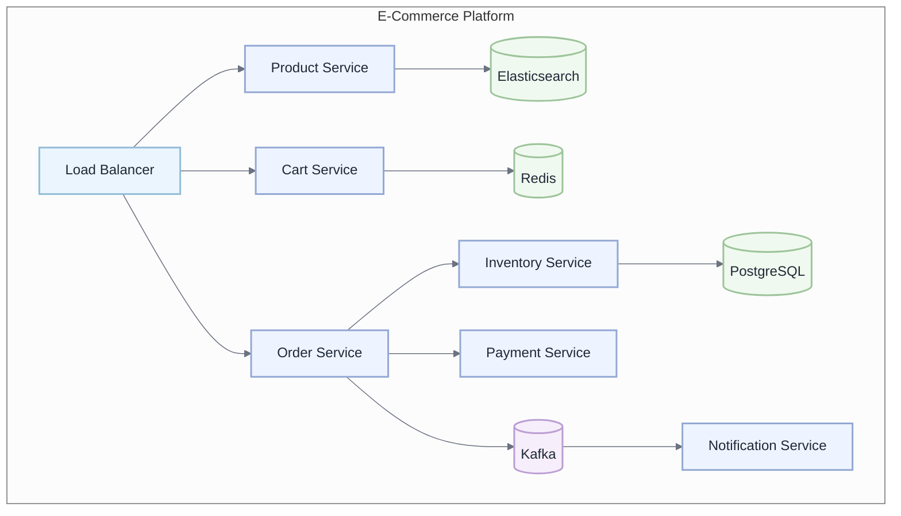
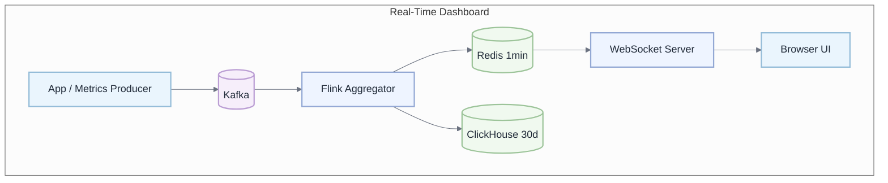
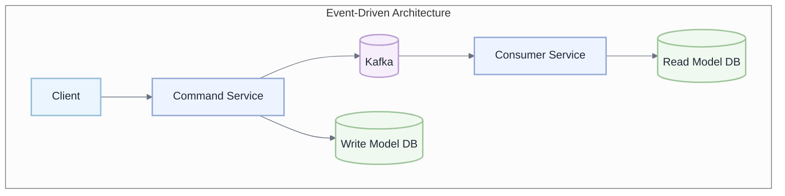
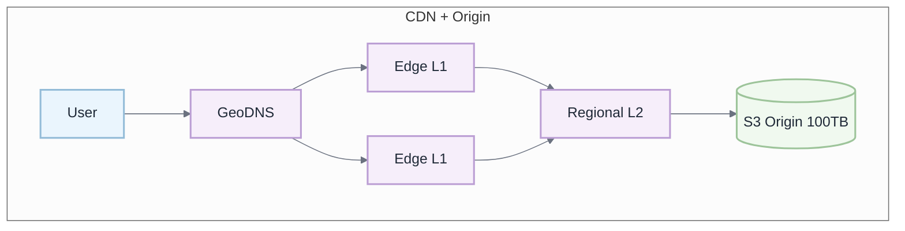

# System Design


# System Design


## Часть 1: Фундаментальные принципы

### 1. Общие принципы проектирования: как оценить нагрузку и выбрать архитектуру

Первое, что нужно сделать при проектировании любой системы, — оценить нагрузку: сколько запросов в секунду (QPS), каков объём данных, как быстро он растёт. Без этого невозможно выбрать архитектуру. Архитектуру (монолит или микросервисы) выбирают под нагрузку, а не наоборот — не потому что микросервисы «модные», а потому что один сервис не вытягивает.

Кэширование должно быть на каждом уровне: CDN (статика), Redis (горячие данные), БД (источник правды). Некритичные операции (рассылка писем, push-уведомления) выполняются асинхронно — через Kafka или очередь, чтобы не блокировать основной ответ. Шардирование (разбиение данных на части) применяется, когда одна БД не справляется с объёмом или скоростью.

**Компромиссы:**
- Монолит — просто (один деплой, одна БД, отладка в одном процессе), но не масштабируется горизонтально.
- Микросервисы — масштабируемость (каждый сервис деплоится отдельно), но сложность: N баз данных, N деплоев, распределённая трассировка.
- Кэширование на каждом уровне — быстрее, но данные могут устареть на долю секунды (конечная консистентность).

**Лучшая практика:**
- Начинать с монолита; переходить на микросервисы только когда нагрузка требует (более 10K запросов/с на один модуль).
- Кэширование: CDN (статика) → Redis (горячие данные) → БД (источник правды).
- Асинхронность: email / push / уведомления — через Kafka, не блокируя основной ответ.

**Вопросы интервьюера:**
- «Монолит или микросервисы?» — монолит на старте, микросервисы при более 10K запросов/с или более 10 разработчиков.
- «Как оценить QPS?» — 10K пользователей × 10 запросов/мин × пиковый коэффициент 5 = 8300 ≈ 10K запросов/с.


### 2. Компромиссы: задержка против пропускной способности, теоремы CAP и PACELC

**Задержка против пропускной способности**

Задержка (latency) — время отклика одного запроса. Измеряется в перцентилях: p50 (медиана), p95 (95% запросов быстрее), p99 (99% запросов быстрее). Для SLA важнее p99, а не p50 — если 99% запросов быстрее 500 мс, но 1% дольше 5 секунд, пользователи это заметят.

Пропускная способность (throughput) — сколько запросов система обрабатывает в секунду (QPS или RPS).

Компромисс: быстрая обработка одного запроса (низкая задержка) означает меньше параллельных запросов (низкая пропускная способность). И наоборот. Пример: синхронная валидация (каждый запрос ждёт проверки — низкая задержка, низкая пропускная) против асинхронной очереди (запрос сразу принят, проверка идёт фоном — высокая пропускная, но пользователь не знает результат сразу).

**Теорема CAP**

При разбиении сети (некоторые узлы не видят другие — оптоволокно рвётся, узлы гаснут, межрегиональные линки обрываются) нельзя одновременно обеспечить и консистентность, и доступность. Нужно выбрать одно:

- **C (консистентность)**: все реплики одинаковы всегда — каждый читает последние записанные данные.
- **A (доступность)**: каждый запрос получает ответ — даже если данные устарели.

**Теорема PACELC** — расширение CAP, учитывающее задержку даже без разбиения сети: при разбиении выбирать доступность или консистентность; в остальном (сеть цела) — выбирать скорость ответа или консистентность. Даже в здоровой сети есть компромисс между скоростью и свежестью данных.

| Система | При разбиении | В здоровой сети |
|---|---|---|
| **PostgreSQL** (синхронная репликация) | **C** — нет ответа, пока не подтвердили все реплики | **C** — высокая задержка из-за ожидания реплик |
| **Cassandra** | **A** — отвечает даже с устаревшими данными | **L** — низкая задержка, конечная консистентность |
| **etcd** (алгоритм Raft, требуется большинство) | **C** — недоступна, если потеряно большинство узлов | **C** — консистентность |
| **Kafka** | **A** — данные на одной реплике, другие могут быть потеряны | **L** — низкая задержка, асинхронная репликация |

**Когда что:**
- **C**: финансы (баланс должен быть точным), инвентарь (нельзя продать больше, чем есть).
- **A**: лента новостей (пользователь должен видеть что-то, даже устаревшее), каталог товаров (товары доступны всегда).
- **PACELC Else=L**: Kafka, Cassandra — в здоровой сети жертвуют свежестью ради скорости.
- **PACELC Else=C**: PostgreSQL, etcd — даже в здоровой сети ждут подтверждения реплик.

**Компромиссы:**
- Задержка против пропускной способности: быстрая обработка одного запроса → меньше параллельных запросов. И наоборот.
- CAP: при разбиении — выбрать консистентность (нет ответа, пока не подтвердили все реплики) или доступность (отвечаем с устаревшими данными).
- PACELC Else=L: жертвуем свежестью ради скорости. Else=C: жертвуем скоростью ради точности.

**Лучшая практика:**
- Финансы / инвентарь → **C** (PostgreSQL, синхронная репликация).
- Лента / каталог → **A** (Cassandra, конечная консистентность).
- Для SLA — p99 (не p50): 99% запросов быстрее X мс.

**Вопросы интервьюера:**
- «CAP: что выбрать для заказа?» — **C** (нельзя продать больше, чем есть; лучше нет ответа, чем устаревший инвентарь).
- «PACELC Else — что значит?» — даже в здоровой сети компромисс: Kafka (L — быстро, конечная) vs PostgreSQL (C — точно, медленно).


### 3. Паттерны масштабирования: горизонтальное масштабирование, шардирование, консистентное хеширование

**Горизонтальное масштабирование**

Добавление узлов (серверов, подов) вместо апгрейда одной машины (вертикальное масштабирование: больше CPU/памяти). Безсостоянные сервисы (не хранят данные между запросами) масштабируются просто: балансировщик распределяет запросы по очереди. Сервисы с состоянием (сессии, соединения привязаны к узлу) требуют либо «липких сессий» (балансировщик направляет одного пользователя всегда на один узел), либо выноса состояния наружу (в Redis, чтобы любой узел мог его прочитать).

**Шардирование**

Разбиение данных на N шардов, каждый из которых — отдельная инстанс базы данных. Ключ шардирования (поле, по которому данные распределяются): `user_id`, `order_id`, `tenant_id`. Выбор ключа критичен — от него зависит равномерность нагрузки.

Стратегии распределения:
- **Хеш**: `key % N` — равномерное распределение.
- **Диапазон**: user_id 0–9999 на шард 0, 10000–19999 на шард 1.
- **Географическая**: данные пользователей из EU на EU-шардах.

```sql
-- Шардирование по user_id:
-- Шард 0: users 0-9999
-- Шард 1: users 10000-19999
-- Маршрутизатор: user_id % N_shards → shard_id
```

Проблемы:
- **Перекрёстный запрос** (затрагивает данные нескольких шардов): медленно (N запросов + объединение). Решение: выбирать ключ так, чтобы большинство запросов попадало в один шард.
- **Ребалансировка** (при добавлении/удалении шарда): нужно перенести данные. Варианты: остановка системы или двойная запись (пишем в старый и новый шард одновременно, потом отключаем старый).
- **Горячая точка** (один шард получает непропорционально больше нагрузки): например, VIP-пользователь с 1M постов. Решение: вторичное разбиение горячего шарда.

**Консистентное хеширование**

Проблема обычного хеширования: при добавлении узла N→N+1 перераспределяется почти весь диапазон данных (каждый ключ меняет `key % N`).

Решение: представить хеш-пространство как кольцо (0 … 2³²). Узлы размещаются на кольце по их хешу. Ключ направляется на следующий узел по кольцу (по часовой). При добавлении узла перераспределяется только сегмент между новой и предыдущей узловой (~1/N данных). Каждый ключ дублируется на K последующих узлах — отказ одного узла не теряет данные.

Примеры систем: Cassandra, DynamoDB, Memcached.

```
Кольцо (0 → 2^32 → 0):
  Узел A (хеш=100)
  Узел B (хеш=500)
  Узел C (хеш=900)

Ключ хеш=300 → Узел B (следующий по кольцу от 300)
Ключ хеш=1000 → Узел A (обход кольца через 0)
```

**Когда что:**
- Безсостоянные API: горизонтальное масштабирование (балансировщик + N узлов) — достаточно.
- БД: шардирование (по user_id/tenant_id) + реплики для чтения — для разгрузки мастера.
- Кэш / хранилище (Cassandra, Memcached): консистентное хеширование — минимум перераспределения при масштабировании.

**Компромиссы:**
- Горизонтальное масштабирование — масштабируется бесконечно, но нужно бессостояние или вынос состояния наружу.
- Шардирование — горизонтальное масштабирование БД, но перекрёстный запрос медленный (N запросов + объединение).
- Консистентное хеширование — минимум перераспределения при масштабировании (1/N), но горячая точка, если ключи не равномерные.

**Лучшая практика:**
- Безсостоянные API: горизонтальное масштабирование (балансировщик + N узлов).
- БД: шардирование по user_id/tenant_id + реплики для чтения.
- Кэш / хранилище: консистентное хеширование.

**Вопросы интервьюера:**
- «Перекрёстный запрос — как оптимизировать?» — выбирать ключ шардирования так, чтобы большинство запросов попадало в один шард.
- «Ребалансировка — как?» — двойная запись (пишем в старый и новый шард одновременно, потом отключаем старый).


### 4. Балансировка нагрузки: по очереди, по числу соединений, хеш-кольцо

**По очереди (Round-Robin)**

Запросы распределяются циклически: первый → узел A, второй → узел B, третий → узел C, четвёртый → узел A и т.д. Просто и равномерно — если узлы одинаковые. Минус: не учитывает реальную нагрузку — быстрая узлова получает столько же запросов, сколько медленная, и медленная становится узким местом.

**По числу активных соединений (Least Connections)**

Новый запрос направляется на узел с минимальным числом активных соединений. Учитывает нагрузку: быстрая узлова, быстрее обрабатывающая, берёт больше запросов (у неё меньше «зависших»). Минус: нужно знать состояние узлов в реальном времени (проверка здоровья, метрики) — сложнее в реализации.

**Хеш-кольцо (Consistent Hashing)**

Ключ (например, `user_id`) направляется на узел по кольцу (см. Q3). Минимум перераспределения при добавлении/удалении узла (только 1/N ключей). Минус: горячая точка, если распределение ключей не равномерное.

**Взвешенный по очереди (Weighted Round-Robin)**

Узлы с разной мощностью (CPU, память) получают разный вес. Узел A (вес 2) получает вдвое больше запросов, чем узел B (вес 1).

**В Kubernetes:**
- **Service** (виртуальный IP внутри кластера): по очереди по подам.
- **Ingress** (входная точка кластера — Nginx, Traefik): по очереди, по числу соединений, хеш по IP клиента (липкие сессии).
- **Service Mesh** (слой сетевых прокси между сервисами, например Istio): по очереди, по числу соединений, хеш-кольцо, случайно.

**Проверка здоровья узлов:**
- **Активная**: балансировщик сам опрашивает узел — HTTP GET /health, проверка TCP-соединения.
- **Пассивная**: балансировщик следит за результатами реальных запросов — ошибки 5xx, таймаут, сброс соединения.
- При отказе: узел исключается из пула до восстановления (заданный интервал + повторы).

**Компромиссы:**
- По очереди — просто, равномерно (если узлы одинаковые), но не учитывает реальную нагрузку.
- По числению соединений — учитывает нагрузку, но нужно знать состояние узлов в реальном времени.
- Хеш-кольцо — минимум перераспределения, но горячая точка, если ключи не равномерные.

**Лучшая практика:**
- Kubernetes Service: по очереди по подам.
- Ingress (Nginx, Traefik): по очереди, по числению соединений, хеш по IP (липкие сессии).
- Проверка здоровья: активная (HTTP GET /health) + пассивная (5xx, таймаут, сброс).

**Вопросы интервьюера:**
- «Липкие сессии — зачем?» — сервисы с состоянием (соединения привязаны к узлу): WebSocket, аутентификация по сессии.
- «Проверка здоровья: активная vs пассивная?» — активная: балансировщик сам опрашивает; пассивная: следит за реальными запросами (5xx, таймаут).


### 5. Доступность: SLA/SLO, мультирегиональность, восстановление после катастрофы

**SLA** (соглашение об уровне сервиса) — публичный контракт с клиентом. Например, 99.9% доступности = до 43.8 минут простоя в месяц. Нарушение SLA → финансовые штрафы. **SLO** (внутренняя цель) — более строгая внутренняя цель, например 99.95% = 21.9 мин/мес. Смысл: работать к SLO, чтобы не дойти до SLA. **Бюджет ошибок** = 100% − SLO — сколько простоя/ошибок разрешено в месяц. Бюджет исчерпан → мораторий на новые фичи, фокус на надёжность.

**Мультирегиональное развёртывание:**

- **Активный-активный**: оба региона принимают трафик одновременно. Глобальный балансировщик + DNS anycast (один IP-адрес, обслуживаемый несколькими узлами в разных местах, запрос идёт в ближайший). Синхронизация данных в реальном времени через двустороннюю репликацию (данные копируются в обе стороны).
- **Активный-пассивный**: один регион активен, второй — горячий резерв (полностью развёрнут и синхронизирован, но не принимает трафик). Автоматическое переключение при отказе активного (5–30 мин).
- Активный-активный лучше (нет простоя при переключении), но сложнее: конфликты репликации (два региона одновременно пишут одну запись), задержка между регионами (50–200 мс).

**Восстановление после катастрофы:**

- **RTO** (целевое время восстановления): сколько времени система может быть недоступна после сбоя. RTO = 15 мин → через 15 мин после сбоя система должна работать.
- **RPO** (целевая точка восстановления): сколько данных можно потерять. RPO = 1 мин → при восстановлении данные будут не старше 1 минуты.

Уровни восстановления:
- **Уровень 1 — бэкапы**: RTO = часы, RPO = периодичность бэкапов.
- **Уровень 2 — горячий резерв**: RTO = 15 мин, RPO = 1 мин (асинхронная репликация).
- **Уровень 3 — активный-активный мультирегиональный**: RTO ≈ 0, RPO ≈ 0 (синхронная репликация).

**Синхронизация данных между регионами:**
- **Синхронная** (сильная консистентность): все реплики подтверждают запись до ответа. Медленно (до 50–200 мс задержка между регионами), но данные не теряются.
- **Асинхронная** (конечная консистентность): данные «сходятся» через некоторое время. Быстро, но есть окно, когда реплики расходятся. Для разрешения конфликтов: CRDT (структуры данных, где операции коммутативны, конфликты разрешаются автоматически) или «последняя запись выигрывает» (по метке времени).

**Компромиссы:**
- Активный-активный — нет простоя при переключении, но конфликты репликации + задержка 50–200 мс.
- Активный-пассивный — дешевле, проще (нет конфликтов), но простой при переключении (RTO = 5–30 мин).
- Синхронная репликация — RPO = 0 (нет потери данных), но +100 мс на каждый commit. Асинхронная — RPO = 1 с, быстро.

**Лучшая практика:**
- Активный-пассивный для большинства систем (дешевле, проще оперировать).
- Активный-активный для критичных систем (финансы, здравоохранение) — где простой = большие деньги.
- RTO/RPO определяются бизнесом (сколько готовы платить за простой), а не техникой.

**Вопросы интервьюера:**
- «RTO vs RPO?» — RTO = время простоя (5 мин), RPO = потеря данных (1 мин). RTO = 5 мин + RPO = 0 → активный-активный + синхронная репликация.
- «Конфликты репликации — как решить?» — «последняя запись выигрывает» (по метке времени) или CRDT (для счётчиков, множеств).


## Часть 2: Базовые компоненты архитектуры

### 6. Выбор базы данных: OLTP, OLAP, NewSQL, NoSQL

**OLTP** (обработка онлайн-транзакций) — много коротких транзакций: вставка, обновление, удаление. Нормализованные таблицы (устранение дублирования, третья нормальная форма), индексы, свойства ACID (атомарность, консистентность, изоляция, долговечность). Примеры: PostgreSQL, MySQL, Oracle. Применение: CRM, электронная коммерция, банковские системы — любые системы с транзакциями.

**OLAP** (обработка онлайн-анализа) — мало, но сложных запросов: выборка с соединениями таблиц, группировка, агрегации. Денормализация (намеренное дублирование данных для скорости чтения): звёздная схема (факт-таблица в центре, размерные таблицы вокруг) или схема «снежинка» (размерные таблицы дополнительно нормализованы). Столбцовое хранилище: данные хранятся по столбцам, а не по строкам — при агрегации по одному столбцу читается только этот столбец. Примеры: ClickHouse, Redshift, Snowflake, BigQuery. Применение: аналитика, отчёты, бизнес-аналитика.

**NewSQL** (гибридные базы) — комбинация свойств OLTP (атомарность, консистентность, изоляция, долговечность) и горизонтального масштабирования NoSQL. Примеры: CockroachDB, Spanner (Google), YugabyteDB, TiDB. Применение: финансы (транзакции + масштаб), IoT (масштаб + транзакции).

**NoSQL** (не реляционные базы, без фиксированной схемы):
- Документная (хранит JSON-документы, гибкая схема): MongoDB — контент, каталог.
- Ключ-значение (просто, быстро): Redis, DynamoDB — кэш, сессии.
- Столбцовая (оптимизирована для агрегаций): Cassandra, HBase — большие объёмы, аналитика.
- Графовая (хранит связи между объектами): Neo4j — социальные сети, рекомендации.

| | OLTP | OLAP | NewSQL | NoSQL |
|---|---|---|---|---|
| Транзакции | ACID | Нет (или слабые) | ACID | Зависит |
| Масштабирование | Вертикальное | Вертикальное | Горизонтальное | Горизонтальное |
| Схема | Фиксированная (нормализованная) | Денормализованная | Фиксированная | Гибкая |
| Запросы | Простые (по первичному ключу) | Сложные (соединения, группировка) | Простые + SQL | Зависит |
| Пример | PostgreSQL | ClickHouse | CockroachDB | MongoDB |

**Когда что:**
- **OLTP**: транзакции (заказы, платежи, инвентарь) — важна атомарность и скорость одиночных операций.
- **OLAP**: аналитика (отчёты, ML) — нужны сложные запросы по большим объёмам.
- **NewSQL**: нужны и транзакции, и горизонтальное масштабирование (финансы, IoT).
- **NoSQL**: гибкая схема (контент, каталог), высокая нагрузка (кэш, сессии), когда реляционная модель не нужна.

**Гибрид (самый частый паттерн в продакшене):**
- OLTP (PostgreSQL) для транзакций + OLAP (ClickHouse) для аналитики.
- Захват изменений (CDC): PostgreSQL → Kafka → ClickHouse — изменения в OLTP-базе автоматически попадают в OLAP.

**Компромиссы:**
- OLTP (PostgreSQL) — ACID, нормализация, простые запросы. OLAP (ClickHouse) — денормализация, столбцовое хранилище, сложные агрегации.
- NewSQL (CockroachDB) — ACID + горизонтальное масштабирование, но моложе (меньше экосистема).
- NoSQL (MongoDB, Cassandra) — гибкая схема, высокая нагрузка, но нет ACID (или слабые транзакции).

**Лучшая практика:**
- OLTP + OLAP: PostgreSQL (транзакции) + ClickHouse (аналитика) + захват изменений (Debezium: PostgreSQL → Kafka → ClickHouse).
- NewSQL — для финансов / IoT (транзакции + масштаб).
- NoSQL — для кэша (Redis), контента (MongoDB), больших объёмов (Cassandra).

**Вопросы интервьюера:**
- «OLTP vs OLAP — когда что?» — OLTP: заказы, платежи, инвентарь. OLAP: отчёты, ML (сложные запросы по большим объёмам).
- «Захват изменений — как работает?» — Debezium читает журнал изменений PostgreSQL → Kafka → ClickHouse (асинхронная синхронизация).


### 7. Стратегии кэширования: кэширование сбоку, запись через кэш, запись с отсрочкой, скачок кэша

**Кэширование сбоку (Cache-Aside)** — приложение само управляет кэшем:
1. Чтение: проверить кэш → нет → прочитать из БД → записать в кэш → вернуть.
2. Запись: записать в БД → **удалить** из кэша (не обновлять — иначе два потока одновременно пишут, и кэш может остаться в неконсистентном состоянии).

```java
// Чтение:
User user = cache.get("user:" + id);
if (user == null) {
    user = db.findById(id);
    cache.put("user:" + id, user, Duration.ofMinutes(30));
}
return user;

// Запись:
db.update(user);
cache.delete("user:" + id); // удалить, а не обновить
```

**Запись через кэш (Write-Through)** — кэш и БД обновляются одновременно через координирующий компонент. Чтение всегда актуально (кэш никогда не отстаёт от БД). Минус: медленная запись (две записи — в кэш и в БД).

**Запись с отсрочкой (Write-Behind / Write-Back)** — запись идёт только в кэш; БД обновляется асинхронно, позже (пакетом). Быстрая запись, но потеря данных при отказе кэша до сброса накопленных изменений в БД.

**Скачок кэша (Cache Stampede)** — «горячий» ключ (высокая частота чтения) истекает → N параллельных запросов одновременно видят промах → все идут в БД с одним и тем же тяжёлым запросом → БД получает всплеск нагрузки.

Решения:
- **Один запрос в БД, остальные ждут** (один запрос): только один поток читает из БД, остальные блокируются до результата.
- **Случайное смещение срока жизни** (срок жизни jitter): ключи истекают в разное время (30 мин ± 5 мин), а не синхронно.
- **Мягкий срок жизни** (Soft срок жизни): формально ключ «истёк», но при чтении возвращается старое значение, а в фоне асинхронно обновляется (не блокирует читателя).

```java
// Single-flight: один запрос в БД, остальные ждут
User user = cache.get("user:" + id);
if (user == null) {
    user = singleFlight.execute("user:" + id, () -> {
        User dbUser = db.findById(id);
        cache.put("user:" + id, dbUser, Duration.ofMinutes(30));
        return dbUser;
    });
}
return user;
```

| | Кэширование сбоку | Запись через кэш | Запись с отсрочкой |
|---|---|---|---|
| Чтение | Кэш → БД (при промахе) | Кэш (всегда актуально) | Кэш |
| Запись | БД → удалить из кэша | Кэш + БД одновременно | Только кэш (БД позже) |
| Сложность | Низкая | Средняя | Высокая |
| Консистентность | Конечная (до удаления) | Сильная (синхронно) | Конечная (до сброса) |
| Потеря данных | Нет | Нет | Да (при отказе кэша) |

**Компромиссы:**
- Кэширование сбоку — просто, конечная консистентность (до удаления). Запись через кэш — сильная консистентность, но медленная запись.
- Запись с отсрочкой — быстрая запись (только кэш), но потеря данных при отказе кэша до сброса.
- Скачок кэша — «горячий» ключ истекает → N параллельных запросов в БД. Решение: один запрос + случайное смещение.

**Лучшая практика:**
- Кэширование сбоку — для большинства сценариев, стандарт в Spring Cache.
- Запись через кэш — для критичных данных (финансы, инвентарь), где чтение устаревших данных недопустимо.
- Один запрос + случайное смещение — обязательная защита от скачка для «горячих» ключей.

**Вопросы интервьюера:**
- «Скачок кэша — как решить?» — один запрос в БД, остальные ждут + случайное смещение (30 мин ± 5 мин).
- «Запись: удалить или обновить?» — удалить (не обновлять) — чтобы не было гонки (два потока одновременно пишут).


### 8. Очереди сообщений: Kafka, RabbitMQ, Pulsar

**Kafka** (распределённый лог-ориентированный брокер) — сообщения хранятся в приписываемом журнале, потребители читают по смещению (смещение), а не удаляют. Партиция (раздел лога, внутри которого порядок сохраняется) по теме. Пропускная способность очень высокая (1M+ сообщений/с). Хранение по умолчанию 7 дней → повторное прочтение: потребитель может перечитать сообщения с любого смещения. Применение: потоковая обработка событий, сбор логов, захват изменений в БД. Минус: высокая задержка (сообщения отправляются пачками для пропускной способности), не подходит для запрос-ответ в реальном времени.

**RabbitMQ** (классический брокер на основе очередей) — сообщение доставляется одному потребителю и удаляется после подтверждения. Пропускная способность средняя (100K сообщений/с). Маршрутизация через «обменник» (exchange) с типами: точное совпадение ключа, паттерн (например, `order.*`), рассылка во все очереди, по заголовкам. Применение: очереди задач (асинхронная обработка), удалённый вызов (запрос-ответ через очередь), уведомления. Минус: нет повторного прочтения (сообщение удалено после подтверждения), меньше пропускная способность.

**Pulsar** (гибридный брокер от Apache) — поддерживает и лог-модель (как Kafka), и очередную (как RabbitMQ). Пропускная способность высокая. Хранилище разделено на вычислительный и хранилищный слои (bookkeeper — распределённое журналируемое хранилище) → хранилище масштабируется независимо от вычислений. Применение: нужен и стриминг, и очереди. Минус: моложе (меньше экосистема), сложнее оперировать (bookkeeper — отдельный компонент).

| | Kafka | RabbitMQ | Pulsar |
|---|---|---|---|
| Модель | Журнал (партиция) | Очередь (обменник) | Журнал + очередь (гибрид) |
| Пропускная способность | 1M+ сообщ/с | 100K сообщ/с | 500K+ сообщ/с |
| Задержка | Высокая (пакеты) | Низкая | Низкая |
| Повторное прочтение | Да (хранение 7 дней) | Нет | Да |
| Маршрутизация | Тема (партиция) | Обменник (гибкий) | Тема (гибкий) |
| Применение | Стриминг, захват изменений | Очереди задач, RPC | Гибрид |
| Экосистема | Огромная | Огромная | Растёт |

**Когда что:**
- **Kafka**: потоковая обработка, сбор логов, захват изменений, большие объёмы, нужно повторное прочтение.
- **RabbitMQ**: очереди задач, удалённый вызов, уведомления, гибкая маршрутизация, средний объём.
- **Pulsar**: нужен гибрид (и стриминг, и очереди), масштабирование хранилища отдельно от вычислений.

**Компромиссы:**
- Kafka — очень высокая пропускная способность (1M+ сообщ/с), повторное прочтение, но высокая задержка (пакеты).
- RabbitMQ — гибкая маршрутизация, низкая задержка, но нет повторного прочтения, меньше пропускная способность.
- Pulsar — гибрид (журнал + очередь), но моложе (меньше экосистема), сложнее оперировать.

**Лучшая практика:**
- Kafka: стриминг, сбор логов, захват изменений, большие объёмы.
- RabbitMQ: очереди задач, RPC, уведомления, гибкая маршрутизация.
- Pulsar: гибрид, масштабирование хранилища отдельно от вычислений.

**Вопросы интервьюера:**
- «Kafka vs RabbitMQ — когда что?» — Kafka: стриминг, захват изменений, повторное прочтение. RabbitMQ: очереди задач, RPC, гибкая маршрутизация.
- «Повторное прочтение — зачем?» — Kafka: хранение 7 дней → потребитель может перечитать сообщения с любого смещения.


### 9. Ограничитель частоты запросов: алгоритмы и распределённая реализация

**Требования:** ограничить запросы по пользователю/IP/эндпоинт, 1M запросов/с, N узлов, сильная консистентность лимита.

**Алгоритмы:**

**Фиксированное окно** — счётчик запросов за фиксированный интервал (например, 1 минута). При превышении лимита — 429. Проблема: всплеск на границе окон: 50 запросов в последнюю секунду первого окна + 50 в первую секунду второго = 100 за 2 секунды, хотя лимит 100/мин.

**Скользящее окно с журналом** — хранится метка времени каждого запроса; подсчёт по последним N секунд. Точно (нет всплеска на границе), но много памяти (N меток на пользователя).

**Скользящее окно со счётчиком (гибрид)** — фиксированное окно + взвешенный учёт предыдущего окна. Пример: лимит 100/мин, сейчас 60 в текущем, 40 в предыдущем → 40 × 0.5 + 60 = 80, осталось 20. Мало памяти (2 счётчика), точнее фиксированного окна.

**Корзина с токенами** — ёмкость N токенов, пополнение со скоростью R (например, 100/мин ≈ 1.67/с). Запрос снимает 1 токен; нет токенов → 429. Разрешает всплеск до N, ограничивает среднюю скорость.

```java
// Корзина с токенами (Bucket4j):
Bucket bucket = Bucket.builder()
    .addLimit(Bandwidth.classic(100, Period.ofMinutes(1)))
    .build();
if (bucket.tryConsume(1)) {
    // обработка запроса
} else {
    // 429 Too Many Requests
}
```

**Распределённая реализация:**

Все узлы проверяют один общий счётчик в Redis (иначе каждый узел даст свой лимит). Для атомарности используется Lua-скрипт: проверка + инкремент в одном вызове.

```lua
-- Redis Lua (скользящее окно):
local key = KEYS[1]
local now = tonumber(ARGV[1])
local window = tonumber(ARGV[2])
local limit = tonumber(ARGV[3])

-- Удалить старые записи (вне окна)
redis.call('ZREMRANGEBYSCORE', key, 0, now - window)
local count = redis.call('ZCARD', key)
if count < limit then
    redis.call('ZADD', key, now, now .. math.random())
    redis.call('PEXPIRE', key, window)
    return 1 -- разрешено
else
    return 0 -- отказано
end
```

В Kubernetes: Istio (ограничение на уровне service mesh, Envoy filter), API Gateway (Kong, APISIX — плагин с Redis), на уровне приложения — Bucket4j + Redis.

**Компромиссы:**
- Точность против скорости: Lua-скрипт в Redis — атомарно, но один сетевой ронд на запрос. Локальная корзина — быстрее, но нет сильной консистентности.
- Всплеск против лимита: корзина с токенами разрешает всплеск до N. Если система не выдерживает всплеск — уменьшить N.
- Фиксированное окно — просто, но всплеск на границе. Скользящее окно — точно, но дороже.

**Лучшая практика:**
- Корзина с токенами — лучший баланс простоты и точности для большинства сценариев.
- Redis + Lua для распределённого лимита; ключ `rate:{userId}:{endpoint}`.
- Ответ при превышении: HTTP 429 + заголовок `Retry-After`.
- Без Redis (деградация): локальный Bucket4j на узел — лимит делится на N узлов.

**Вопросы интервьюера:**
- «А если нужен лимит на группу эндпоинтов?» — иерархические корзины (родительская + дочерние).
- «А как отследить, кто нарушает лимит?» — аналитика: Kafka → ClickHouse (кто, когда, сколько).

### 10. Сервис сокращения ссылок: генерация кода, кэширование, аналитика

**Требования:** 1B коротких ссылок, 1M запросов/с (GET), 100K запросов/с (POST), аналитика кликов.

**Архитектура:**

1. **Генерация кода:** Base62 (a-z, A-Z, 0-9) из Snowflake ID (64 бит: время + machine_id + sequence). Коллизии редки (62^7 ≈ 3.5 трлн), но возможны → повторный расчёт.
2. **Хранилище:** PostgreSQL (источник правды) + Redis (кэш горячих ссылок, срок жизни 30 дней). Таблица `short_codes (code PK, url, created_at, clicks, expires_at)`.
3. **Редирект:** `GET /r/{code}` → 301 (постоянный) или 302 (временный) редирект. CDN кэширует 301 навсегда, 302 — 1 час.
4. **Аналитика:** счётчик кликов `INCR clicks:{code}` (Redis, асинхронно → PostgreSQL ночью). Метаданные (гео, referrer, устройство) → Kafka → ClickHouse.

**Код (Spring + Redis + Kafka):**
```java
@RestController
public class ShortUrlController {
    @PostMapping("/shorten")
    public ShortUrl create(@RequestBody CreateRequest req) {
        String code = base62.encode(snowflake.nextId());
        repo.save(new ShortUrl(code, req.getUrl()));
        redis.set("url:" + code, req.getUrl(), Duration.ofDays(30));
        return new ShortUrl("https://tiny.url/" + code);
    }

    @GetMapping("/r/{code}")
    public ResponseEntity<Void> redirect(@PathVariable String code) {
        String url = redis.get("url:" + code);
        if (url == null) url = repo.findByCode(code).getUrl();
        redis.incr("clicks:" + code);
        kafka.send(new ClickEvent(code, request.getRemoteAddr(), request.getHeader("Referer")));
        return ResponseEntity.status(301).header("Location", url).build();
    }
}
```

**Узкие места:**
- Горячая ссылка (один code = 1M запросов/с): реплики Redis + локальный кэш Caffeine на каждом узле.
- Запись 100K/с (POST): пакетная вставка (пачки по 100) + пул соединений HikariCP (50 соединений).
- Аналитика: Kafka (1M сообщений/с) + ClickHouse (столбцовое хранилище) — не грузим OLTP-БД.

**Компромиссы:**
- 301 против 302: 301 кэшируется навсегда (быстро, но если URL изменился — кэш устарел). 302 не кэшируется (актуально, но медленнее).
- Snowflake против UUID: Snowflake — 64 бит (короткий код), UUID — 128 бит (длинный код, больше коллизий).
- Redis кэш: быстро, но потеря данных при отказе (не критично — пересчитываем из БД).

**Лучшая практика:**
- Snowflake ID + Base62 для генерации кодов.
- PostgreSQL для источника правды, Redis для кэша, CDN для редиректов.
- Аналитика — асинхронно через Kafka → ClickHouse, не блокируя основной ответ.

**Вопросы интервьюера:**
- «А как кастомные алиасы?» — `POST /shorten?alias=my-link` → unique constraint на `code`.
- «А как срок жизни?» — `expires_at` в PostgreSQL + ночной cron job (удаление истёкших) + TTL в Redis.

### 11. Чат-система: реальное время, доставка, история

**Требования:** 10M пользователей, доставка в реальном времени (< 1 сек), история сообщений, групповые чаты.

**Архитектура:**

- **Доставка в реальном времени:** WebSocket (двусторонний протокол поверх TCP) для bidirectional обмена, SSE (Server-Sent Events) для односторонней рассылки (уведомления, индикатор «печатает…»).
- **Гарантия доставки:** at-least-once (сообщение может прийти дублем, но не потеряется) + подтверждение (ack) от клиента. Идемпотентность по `message_id` — повторная доставка не меняет состояние.
- **Групповые чаты:** развёртка (fan-out) на N участников. При отправке в группу из 100 человек — 100 записей. Оптимизация: асинхронная развёртка через Kafka.
- **История:** PostgreSQL (шардирование по `conversation_id`), медиа (фото, видео) — S3.
- **Офлайн:** очередь сообщений на сервере (Kafka) → доставка при подключении.

**Узкие места:**
- Групповой чат: развёртка на 1M участников → асинхронная доставка через Kafka (не блокируем отправителя).
- Соединения привязаны к узлу → липкие сессии (балансировщик) или брокер (Kafka → все узлы).
- История: шардирование по `conversation_id` — большинство запросов (чтение одного диалога) попадает в один шард.

**Компромиссы:**
- WebSocket против SSE: WebSocket — двусторонний (дороже), SSE — односторонний (дешевле, но только сервер → клиент).
- At-least-once против exactly-once: at-least-once проще (повтор + идемпотентность), exactly-once сложнее (транзакционная отправочная очередь).
- Онлайн против офлайн: онлайн — мгновенная доставка, офлайн — очередь + доставка при подключении (задержка).

**Лучшая практика:**
- WebSocket для bidirectional обмена, SSE для уведомлений.
- At-least-once + идемпотентность по `message_id`.
- История в PostgreSQL (шардирование по диалогу), медиа в S3.

**Вопросы интервьюера:**
- «А как отметки о прочтении?» — отдельное событие `message.read` → Kafka → обновление состояния в БД.
- «А как индикатор «печатает…»?» — SSE или WebSocket: событие `typing.start` / `typing.stop` с таймаутом 5 сек.

### 12. Лента новостей: развёртка постов, кэширование, рекомендации

**Требования:** 100M пользователей, лента из постов, кэширование, рекомендации.

**Проблема развёртки:** у пользователя 1M подписчиков → 1M записей в чужие ленты на каждый пост. Запись становится дорогой.

**Гибридная развёртка** (по размеру аудитории):
- **Мало подписчиков** (< 10K): развёртка при записи — пост сразу пишется в ленты всех подписчиков. Чтение быстрое, запись дорогая, но аудитория мала.
- **Много подписчиков** (> 10K): развёртка при чтении — при запросе ленты на лету объединяются посты популярных авторов. Запись дешёвая, чтение дороже, но таких пользователей мало.

**Хранение:** PostgreSQL (ленты), Redis (кэш последних постов), Elasticsearch (поиск по постам).

**Масштабирование:** шардирование по `user_id` (каждый шард = часть пользователей). Большинство запросов (чтение своей ленты) попадает в один шард.

**Узкие места:**
- Развёртка при записи: 1M подписчиков → асинхронная запись через Kafka (не блокируем автора).
- Кэширование: Redis (последние 20 постов) + invalidation при новом посте.
- Рекомендации: пакетный пересчёт (ночь) + real-time обновление через Kafka.

**Компромиссы:**
- Развёртка при записи против при чтении: запись дороже, чтение дешевле — и наоборот.
- Кэширование: быстро, но данные устаревают (до 30 сек).
- Рекомендации: пакет (дешевле, но устаревшие) vs real-time (актуально, но дорого).

**Лучшая практика:**
- Гибридная развёртка: write-time для малых аудиторий, read-time для больших.
- Кэширование ленты в Redis (последние 20 постов) с инвалидацией при новом посте.
- Рекомендации: пакетный пересчёт (ночь) + real-time (Kafka → Flink → Redis).

**Вопросы интервьюера:**
- «А как рекомендации?» — коллаборативная фильтрация (ночь, пакет) + real-time (Kafka → Flink → Redis).
- «А как поиск по постам?» — Elasticsearch (полнотекстовый) + CDN для кэширования результатов.

## Часть 3: Классические системы

### 13. Платформа электронной коммерции: заказы, платежи, инвентарь

**Требования:** 10M пользователей, 100K запросов/с (пик: Black Friday), 99.99% доступность, ACID для заказов.

**Архитектура:**

1. **Фронтенд:** CDN (статика: CSS, JS, изображения) + WebSocket (real-time: корзина, уведомления).
2. **Бэкенд (микросервисы):**
   - Каталог: 10M товаров, PostgreSQL + Elasticsearch для поиска.
   - Корзина: Redis (срок жизни 1 час), безсостоянные.
   - Заказы: PostgreSQL, ACID, сага для распределённых транзакций.
   - Платежи: внешний API (Stripe, PayPal), идемпотентность по `payment_id`.
   - Инвентарь: PostgreSQL, пессимистическая блокировка для предотвращения перепродажи.
   - Уведомления: Kafka → FCM/Email.
3. **Данные:** PostgreSQL (OLTP: заказы, инвентарь, пользователи) — шардирование по `user_id` (10 шардов). Redis (кэш: корзина, сессии, горячие товары). Elasticsearch (поиск по каталогу). Kafka (события: заказ создан, платёж завершён).

**Критичный паттерн — инвентарь (предотвращение перепродажи):**
```java
// Пессимистическая блокировка (SELECT FOR UPDATE)
@Lock(LockMode.PESSIMISTIC_WRITE)
@Query("SELECT i FROM Inventory i WHERE i.skuId = :skuId")
Inventory findBySkuForUpdate(@Param("skuId") String skuId);

@Transactional
public void reserveStock(String skuId, int qty) {
    Inventory inv = repo.findBySkuForUpdate(skuId);
    if (inv.getQuantity() < qty) throw new OutOfStockException();
    inv.setQuantity(inv.getQuantity() - qty);
    repo.save(inv);
}
```

**Схема (сага + микросервисы):**


**Распределённая транзакция (сага):**
1. Сервис заказов: создать заказ (статус `PENDING`).
2. Сервис инвентаря: зарезервировать запас (успех → `RESERVED`, сбой → откат).
3. Сервис платежей: обработать платёж (успех → `PAID`, сбой → компенсация: освободить запас, отменить заказ).
4. Событие: `order.completed` → Kafka → сервис уведомлений.

**Узкие места:**
- Black Friday (10× нагрузка): автоскейлинг (Kubernetes HPA — добавить поды), ограничение частоты (Bucket4j + Redis), CDN (кэш каталога).
- Платёжный API (внешний, задержка 1 сек): асинхронно (очередь Kafka, не блокирует основной ответ) + таймаут (5 сек) + повтор (3 раза, экспоненциальная задержка).
- Горячий товар (один товар = 10K запросов/с): локальный кэш Caffeine + Redis (реплики).

**Компромиссы:**
- Сильная консистентность против доступности: PostgreSQL (синхронная репликация) — медленно, но надёжно. Kafka (асинхронная) — быстро, но окно расхождения.
- Монолит против микросервисов: монолит — проще (один деплой), микросервисы — масштабируемость (каждый сервис отдельно). Для e-commerce — микросервисы (10K запросов/с на каталог, 1K на заказы).
- Пессимистическая блокировка: надёжно (нет перепродажи), но блокировка строки (ожидание).

**Лучшая практика:**
- Сага (оркестрация) для распределённых транзакций заказа.
- Пессимистическая блокировка (SELECT FOR UPDATE) для инвентаря.
- Идемпотентность по `payment_id` для платежей.
- Асинхронные уведомления через Kafka.

**Вопросы интервьюера:**
- «А как возвраты?» — сага возврата (обратная: отменить заказ, освободить запас, вернуть деньги).
- «А как программа лояльности?» — баллы (PostgreSQL: `user_id, points, balance`) + Kafka (событие `order.completed` → начисление баллов).

### 14. Дашборд в реальном времени: метрики, агрегация, push

**Требования:** 10K пользователей онлайн, 1M метрик/сек, задержка < 1 сек, история 30 дней.

**Архитектура:**

1. **Сбор:** приложение → Kafka (тема `metrics`, 1M сообщений/с).
2. **Обработка:** Flink (потоковая обработка) → агрегация (окно 1 сек) → Redis (последние 1 мин) + ClickHouse (история, 30 дней).
3. **Подача:** WebSocket (или SSE) — клиент подписывается на `metrics:dashboard_id`, сервер пушит каждые 1 сек (из Redis). История: REST API → ClickHouse (OLAP, агрегация).
4. **Фронтенд:** Chart.js / Recharts (React) — отрисовка графиков. Auto-refresh: WebSocket push (real-time) + REST poll (история, раз в 5 сек).

**Код (Flink + WebSocket + Redis):**
```java
// Flink (агрегация, окно 1 сек)
DataStream<Metric> metrics = env.addSource(kafkaSource);
DataStream<AggregatedMetric> aggregated = metrics
    .keyBy(Metric::getDashboardId)
    .timeWindow(Time.seconds(1))
    .process(new AvgAggregator());

// WebSocket (push)
@ServerEndpoint("/ws/metrics/{dashboardId}")
public class MetricsEndpoint {
    @OnOpen
    public void onOpen(Session session, @PathParam String dashboardId) {
        scheduler.scheduleAtFixedRate(() -> {
            String data = redis.get("metrics:" + dashboardId);
            session.getAsyncRemote().sendText(data);
        }, 0, 1, TimeUnit.SECONDS);
    }
}
```

**Схема (дашборд в реальном времени):**


**Узкие места:**
- 1M метрик/с: Kafka (1M сообщений/с) + Flink (потоковая, параллельная обработка) + ClickHouse (столбцовое, быстрая агрегация).
- 10K WebSocket-соединений: с состоянием (соединения привязаны к узлу) → липкие сессии (балансировщик) или брокер (Kafka → все узлы пушат).
- ClickHouse: 30 дней × 1M метрик/с ≈ 260 млрд строк. Партиционирование по дате + автоматическое удаление старых данных (> 30 дней).

**Компромиссы:**
- Real-time против стоимости: WebSocket (real-time, дорого — 10K соединений) vs SSE (дешевле, но односторонний) vs polling (дешевле всего, но задержка = интервал).
- Свежесть против точности: окно 1 сек (быстро, но неточно) vs окно 10 сек (точно, но устаревшее).

**Лучшая практика:**
- Kafka → Flink → Redis (1 мин) + ClickHouse (30 дней) для хранения.
- WebSocket для real-time push, REST для истории.
- Партиционирование ClickHouse по дате + TTL для старых данных.

**Вопросы интервьюера:**
- «А как алерты?» — Flink (правило: `avg(cpu) > 90%` → Kafka → сервис уведомлений).
- «А как drill-down?» — REST API (ClickHouse: `SELECT * FROM metrics WHERE user_id = ? AND time > ?`).

### 15. Поисковый движок: индексация, запросы, ранжирование

**Требования:** 100M документов, полнотекстовый поиск, задержка 100 мс, ранжирование по релевантности.

**Архитектура:**

1. **Индексация:**
   - Обратный индекс: сопоставление термина → список идентификаторов документов.
   - Анализатор: токенизация, приведение к нижнему регистру, stemming, стоп-слова.
   - Шардирование по `document_id` (каждый шард = часть документов).
2. **Запрос:**
   - Парсер запроса (синтаксис: `title:java AND body:concurrency`).
   - Поиск термина в обратном индексе → пересечение (AND) или объединение (OR) списков документов.
   - Ранжирование: TF-IDF (частота термина в документе × редкость термина в корпусе) или BM25 (улучшенный TF-IDF).
3. **Хранилище:** Elasticsearch (популярный, гибкий, на базе Lucene) или OpenSearch (форк Elasticsearch, Apache 2.0). PostgreSQL (источник правды) + CDC (Kafka → Elasticsearch) для асинхронной синхронизации.

**Код (Elasticsearch + Spring Data):**
```java
@Document(indexName = "articles")
public class Article {
    @Id private String id;
    @Field(type = FieldType.Text, analyzer = "standard")
    private String title;
    @Field(type = FieldType.Text, analyzer = "standard")
    private String body;
}

// Поиск
SearchHits<Article> hits = esClient.search(s -> s
    .index("articles")
    .query(q -> q.multiMatch(m -> m
        .query(query)
        .fields("title^2", "body")))
    .size(10), Article.class);
```

**Узкие места:**
- Индексация: пакетная (пачки по 1000 документов) + ночная полная пересинхронизация.
- Задержка запроса: число шардов (много шардов = параллельный поиск, но overhead) + число реплик (чтение на репликах).
- Память: обратный индекс в RAM (Lucene) — 100M документов ≈ 50 GB RAM. Оптимизация: сжатие, отключение fielddata.

**Компромиссы:**
- Свежесть против скорости: синхронная индексация (медленно, но актуально) vs асинхронная (быстро, но окно устаревания 1-5 сек).
- Точность против полноты: точное совпадение (precision) vs нечёткое (recall). Терпимость к опечаткам (Did you mean?) — дороже, но удобнее.

**Лучшая практика:**
- Elasticsearch (или OpenSearch) для полнотекстового поиска.
- Асинхронная индексация через CDC (Kafka → Elasticsearch) — не блокирует OLTP.
- Ранжирование BM25 + весовые поля (title^2, body).

**Вопросы интервьюера:**
- «А как autocomplete?» — префиксный запрос (`title:java*`) + suggestion API (Elasticsearch) — top-10 по частоте.
- «А как faceted search (фильтры)?» — агрегации (Elasticsearch) — подсчёт по категориям, брендам, диапазону цен.

### 16. Система уведомлений: push, email, in-app

**Требования:** push-уведомления (mobile, email, in-app), 10M пользователей, real-time (< 1 сек), at-least-once доставка.

**Архитектура:**

1. **Событийная модель:** бизнес-логика (заказ создан, платёж не прошёл) → Kafka (тема `notifications`). Сервис уведомлений читает из Kafka, разворачивает по каналам.
2. **Каналы доставки:**
   - Push: FCM (Firebase Cloud Messaging) для Android, APNs (Apple Push Notification service) для iOS.
   - Email: SES (Amazon Simple Email Service) или SendGrid — асинхронно (очередь, не блокирует основной ответ).
   - In-app: WebSocket или SSE — real-time, если клиент онлайн.
3. **Гарантии доставки:**
   - At-least-once: Kafka (подтверждение после доставки) + идемпотентность (повторная доставка не создаёт дубль — по `notification_id`).
   - Повтор: при ошибке → экспоненциальная задержка (1 сек, 2 сек, 4 сек, … максимум 1 час).
   - Очередь отравленных сообщений: после 5 неудачных попыток → ручная обработка.

**Код (Kafka + FCM):**
```java
@KafkaListener(topics = "notifications")
public void onNotification(NotificationEvent event) {
    for (String deviceId : event.getDeviceIds()) {
        fcmClient.send(new Message()
            .setToken(deviceId)
            .setNotification(new Notification()
                .setTitle(event.getTitle())
                .setBody(event.getBody())));
    }
}
```

**Узкие места:**
- Развёртка: одно событие → 10M устройств (push). Пакетная доставка (FCM позволяет пакет до 1000 устройств в одном запросе).
- Ограничение частоты: FCM/APNs имеют лимит (100K запросов/мин). Троттлинг + очередь (Kafka) для пиков.
- Офлайн-пользователи: push-сервер хранит устройства до следующего подключения. Срок жизни 30 дней — потом удаляем.

**Компромиссы:**
- Real-time против стоимости: push — быстро, но дорого (FCM бесплатен, APNs — нет). Email — дешевле, но медленно (минуты).
- At-least-once против exactly-once: at-least-once — проще (повтор), exactly-once — сложнее (транзакционная отправочная очередь).

**Лучшая практика:**
- Событийная модель: Kafka как источник событий уведомлений.
- Пакетная доставка для push (FCM batch до 1000).
- Очередь отравленных сообщений для неудачных доставок.

**Вопросы интервьюера:**
- «А как отследить, какие уведомления доставлены?» — FCM/APNs возвращают `message_id`, сохраняем в PostgreSQL (click-through rate).
- «А как отключить уведомления?» — настройки пользователя (PostgreSQL: `user_id, channel, enabled`) + токен отписки.

### 17. Хранилище файлов: разделение, кодирование с восстановлением, CDN

**Требования:** 1 PB данных, 100K запросов/с, 99.999% долговечность, multipart upload.

**Архитектура:**

1. **Хранилище:**
   - Шардирование по `file_id` (каждый шард = 1 TB, 1000 шардов = 1 PB).
   - Кодирование с восстановлением (erasure coding): вместо 3 реплик — 10 блоков данных + 4 контрольных (потерю 4 блоков можно восстановить). Дешевле, чем репликация. Примеры: Ceph, MinIO, AWS S3.
2. **API:**
   - `PUT /files/{id}` — загрузка (single или multipart).
   - `GET /files/{id}` — скачивание (CDN для статических файлов).
   - `DELETE /files/{id}` — удаление (мягкое — метка, жёсткое через 30 дней).
   - Multipart upload: `POST /files/{id}/upload` → `POST /files/{id}/parts/{n}` → `POST /files/{id}/complete` — для файлов > 5 GB.
3. **CDN:**
   - Статические файлы (изображения, видео) → CDN (кэш ближе к пользователю, origin = S3).
   - Динамические файлы (документы с правами доступа) → origin (S3) + подписанная URL (временная ссылка с токеном, срок жизни 1 час).

**Код (AWS S3 + Spring):**
```java
// Загрузка
s3Client.putObject(new PutObjectRequest()
    .withBucketName("my-bucket")
    .withKey("file.pdf")
    .withInputStream(new FileInputStream("file.pdf")));

// Скачивание (подписанная URL)
URL url = s3Client.generatePresignedUrl(new GeneratePresignedUrlRequest()
    .withBucketName("my-bucket")
    .withKey("file.pdf")
    .withExpiration(new Date(System.currentTimeMillis() + 3600 * 1000)));
```

**Схема (multipart upload + CDN + origin):**


**Узкие места:**
- Горячая точка: один шард получает 100K запросов/с (горячий файл). Шардирование по хешу контента (распределяем нагрузку).
- Multipart upload: 1000 частей × 100 MB = 100 GB. Параллельная загрузка (10 частей одновременно) + повтор при ошибке части.
- Долговечность: erasure coding (10+4) — потеря 4 дисков не теряет данные. Ночной бэкап метаданных.

**Компромиссы:**
- Стоимость против скорости: erasure coding (дешевле, но медленнее) vs 3 реплики (дороже, но быстрее). S3 Standard = 3 реплики, S3 IA = erasure coding.
- Долговечность против стоимости: 99.999% (5 девяток) — дорого, 99.99% (4 девятки) — дешевле.

**Лучшая практика:**
- Erasure coding (10+4) для долговечности 99.999%.
- CDN для статических файлов, подписанные URL для динамических.
- Multipart upload для файлов > 5 GB.

**Вопросы интервьюера:**
- «А как версионирование?» — S3 Versioning (каждый PUT = новая версия, GET ?versionId=xxx). Политика жизненного цикла (через 90 дней → Glacier, через 1 год → удаление).
- «А как шифрование?» — SSE (Server-Side Encryption) — AES-256, ключ в KMS. Client-side encryption — ключ у клиента (zero knowledge).

### 18. Распределённый кэш: Redis Cluster, тиринг, инвалидация

**Требования:** 10 TB данных, 1M запросов/с, 99.99% доступность, сильная консистентность для горячих ключей.

**Архитектура:**

1. **Redis Cluster** (шардирование по слотам — 16384 слота, каждый слот → 3 реплики):
   - Мастер (запись) + 2 реплики (чтение, переключение).
   - Консистентное хеширование по ключу (slot = hash(key) % 16384) — минимум перераспределения при добавлении узлов.
2. **Тиринг кэша:**
   - L1: Caffeine (локальный кэш, JVM heap) — горячие ключи, 1000 записей, срок жизни 1 мин.
   - L2: Redis Cluster — тёплые ключи, срок жизни 1 час.
   - L3: PostgreSQL — источник правды.
3. **Стратегия:** Cache-Aside (см. Q7) — приложение само читает кэш и наполняет. Single-flight для скачка кэша (один запрос в БД, остальные ждут).
4. **Вытеснение:** LRU (Least Recently Used — вытесняется самый давно не использовавшийся) — подходит для read-heavy нагрузки.

**Код (Spring Cache + Caffeine + Redis):**
```java
@Caching(cacheNames = "user")
@Service
public class UserService {
    @Cacheable(key = "#id")
    public User getById(Long id) {
        return repo.findById(id).orElseThrow();
    }

    @CacheEvict(key = "#user.id")
    public void update(User user) {
        repo.save(user);
    }
}
```

**Узкие места:**
- Горячий ключ (один ключ читается 1M запросов/с): реплики (чтение на разных репликах) + локальный кэш Caffeine на каждом узле.
- Давление на память: срок жизни + LRU вытеснение. Снапшоты + журнал приписывания для персистентности.
- Сеть: Redis Cluster — каждый запрос = сетевой ронд. Пайплайн (батч запросов) для bulk-операций.

**Компромиссы:**
- Консистентность против скорости: сильная консистентность (синхронная репликация) — медленно, конечная (асинхронная) — быстро, но есть окно расхождения.
- Стоимость против доступности: 3 реплики = 99.99%, но дорого. 2 реплики = 99.9%, дешевле.
- Тиринг: L1 (быстро, но мало места) + L2 (больше, но сетевой ронд) — баланс.

**Лучшая практика:**
- Redis Cluster (16384 слота, 3 реплики) для распределённого кэша.
- Тиринг: Caffeine (L1) → Redis (L2) → PostgreSQL (L3).
- Cache-Aside + single-flight для горячих ключей.

**Вопросы интервьюера:**
- «А как инвалидировать кэш при обновлении?» — Cache-Aside delete (удалить, а не обновить — чтобы не было гонки) + pub/sub (Redis publish → все узлы очищают локальный кэш).
- «А если Redis упал?» — автоматическое переключение (< 30 сек) + деградация до L1 (локальный кэш).

## Часть 4: Продвинутые архитектуры

### 19. Событийная архитектура: CQRS, саги, идемпотентность

**Требования:** 10 микросервисов, 1M событий/с, конечная консистентность, повторное воспроизведение (replay).

**Архитектура:**

1. **Event Sourcing** (хранение событий, а не состояния):
   - Событие: `OrderCreated {order_id, user_id, total, timestamp}`.
   - Хранилище: Kafka (append-only log, хранение 30 дней) → replay (пересчёт состояния из событий).
   - Проекция (материализованное представление): сервис заказов (текущее состояние) + сервис аналитики (агрегаты).
2. **CQRS** (Command Query Responsibility Segregation):
   - Команда (запись): `POST /orders` → сервис заказов → Kafka (событие `OrderCreated`).
   - Запрос (чтение): `GET /orders/{id}` → модель чтения (PostgreSQL, обновляется потребителем событий).
   - Преимущество: чтение и запись масштабируются отдельно.
3. **Сага** (распределённая транзакция):
   - Хореография (децентрализованная): каждый сервис публикует событие, следующий подписывается.
   - Оркестрация (централизованная): оркестратор саги управляет последовательностью.
4. **Идемпотентность:**
   - Идентификатор события: каждое событие имеет `event_id` (UUID).
   - Потребитель: `INSERT INTO processed_events (event_id) ON CONFLICT DO NOTHING` — повторная доставка не обрабатывается.

**Код (Kafka + CQRS):**
```java
// Команда (запись)
@PostMapping("/orders")
public ResponseEntity<Order> createOrder(@RequestBody CreateOrderRequest req) {
    String orderId = UUID.randomUUID().toString();
    Order order = new Order(orderId, req.getUserId(), req.getTotal());
    orderRepo.save(order);
    kafka.send(new OrderCreatedEvent(orderId, req.getUserId(), req.getTotal()));
    return ResponseEntity.ok(order);
}

// Запрос (чтение)
@KafkaListener(topics = "order-events")
public void onOrderCreated(OrderCreatedEvent event) {
    orderReadModel.upsert(event.getOrderId(), event);
}
```

**Схема (событийная архитектура + CQRS):**


**Узкие места:**
- 1M событий/с: Kafka (1M сообщений/с) + партиционирование (100 партиций, 10 потребителей на партицию).
- Конечная консистентность: окно устаревания (1-5 сек). Read-your-writes: сразу после записи читаем из модели записи, не из модели чтения.
- Повторное воспроизведение: пересчёт состояния из 30 дней событий ≈ 260 млрд событий. Пакет (ночь) + параллельная обработка (100 партиций).

**Компромиссы:**
- Event Sourcing против традиционного: источник событий = аудит (все события хранятся), replay (пересчёт состояния), но сложно (нет UPDATE, нет JOIN).
- CQRS против традиционного: чтение/запись отдельно (масштабируемость), но сложнее (2 модели, синхронизация).
- Хореография против оркестрации: хореография — децентрализованная (проще, но сложнее отладка), оркестрация — централизованная (управляемо, но оркестратор — единая точка отказа).

**Лучшая практика:**
- Event Sourcing для аудита и replay, CQRS для разделения чтения и записи.
- Идемпотентность по `event_id` (ON CONFLICT DO NOTHING).
- Оркестрация саги для сложных сценариев (более 3 сервисов).

**Вопросы интервьюера:**
- «А как отладить?» — журнал событий (Kafka: все события с меткой времени) + трассировка (Jaeger, распределённая).
- «А как откат?» — компенсирующее событие (`OrderCancelled`) — не отменяем событие, а публикуем компенсирующее.

**Паттерн отправочной очереди в Spring Boot:**
Чтобы гарантировать атомарность записи в БД и публикации события, используется паттерн Transactional Outbox.
1. В той же `@Transactional`, где сохраняется бизнес-сущность, сохраняется запись в таблицу `outbox_events`.
2. Отдельный процесс (например, Debezium через CDC, читающий журнал предзаписи PostgreSQL, или простой Spring `@Scheduled` опросник) забирает события из этой таблицы и отправляет их в Kafka.
3. После успешной отправки в Kafka запись в `outbox_events` помечается как `processed` или удаляется.

Это гарантирует семантику Exactly-Once доставки на уровне приложения, устраняя проблему двойной записи.

### 20. Мультиарендный SaaS: изоляция, маршрутизация, тарификация

**Требования:** 1000 клиентов (аренд), 10M пользователей, изоляция данных, тарификация по аренд.

**Архитектура:**

1. **Изоляция данных** (3 модели):
   - Общая БД, общая схема: одна БД, все аренды в одних таблицах (колонка `tenant_id`). Просто (1 БД), небезопасно (один запрос = все данные).
   - Общая БД, отдельные схемы: одна БД, у каждого аренда своя схема (`tenant1.users`, `tenant2.users`). Средне (1 БД, N схем), безопаснее.
   - Отдельные БД: у каждого аренда своя БД. Дорого (N БД), максимально безопасно.
2. **Маршрутизация:**
   - Определение аренда: из JWT (`tenant_id`) или из домена (`tenant1.saas.com`).
   - Доступ к данным: `TenantContext` (ThreadLocal) — все запросы к БД фильтруются по `tenant_id`.
3. **Тарификация по арендам:**
   - План (PostgreSQL: `tenant_id, plan, max_users, max_storage`).
   - Измерение: Kafka (событие: `user_login`, `storage_used`) → Flink (агрегация) → PostgreSQL (использование).
   - Фактурирование: ежемесячный cron job → Stripe API (списание).

**Код (TenantContext + JPA):**
```java
@Component
public class TenantContext {
    private static final ThreadLocal<String> TENANT = new ThreadLocal<>();
    public static void set(String tenant) { TENANT.set(tenant); }
    public static String get() { return TENANT.get(); }
}

// JPA (автоматическая фильтрация по tenant_id)
@Entity
public class User {
    @Id private Long id;
    @Column(name = "tenant_id", updatable = false)
    private String tenantId;  // автоматически из TenantContext
    private String email;
}
```

**Узкие места:**
- Перекрёстный запрос (агрегация по всем арендам): OLAP (ClickHouse, отдельная БД) — не грузим OLTP-БД.
- Горячий аренд (один аренд = 50% нагрузки): шардирование (выделить в отдельную БД) + ограничение частоты (per-tenant).
- Онбординг аренда: создать схему/БД + настроить права + seed data. Автоматическое провижн (5 мин).

**Компромиссы:**
- Изоляция против стоимости: отдельные БД (максимально безопасно, дорого) vs общая БД (дёшево, но риск). Для корпоративных — отдельные БД, для SMB — общая.
- Мультирегиональность против задержки: аренд в EU → EU регион (низкая задержка), аренд в US → US регион. Географическая маршрутизация (DNS anycast).

**Лучшая практика:**
- Общая БД с колонкой `tenant_id` для SMB, отдельные БД для корпоративных.
- TenantContext (ThreadLocal) + JPA фильтрация по `tenant_id`.
- Тарификация: Kafka → Flink → PostgreSQL (измерение), Stripe API (фактурирование).

**Вопросы интервьюера:**
- «А как миграция аренда?» — двойная запись (пишем в старую и новую БД) + переключение + откат (если ошибка).
- «А как self-service для аренда?» — административный портал (REST API: создать пользователя, сменить план, посмотреть использование) + RBAC (role-based access control).

**Реализация в Hibernate / Spring Boot:**
Spring Boot предоставляет встроенную поддержку стратегий `SCHEMA` и `DISCRIMINATOR` через интерфейс `CurrentTenantIdentifierResolver`.

```java
@Component
public class TenantIdentifierResolver implements CurrentTenantIdentifierResolver {
    @Override
    public String resolveCurrentTenantIdentifier() {
        return TenantContext.getCurrentTenant();
    }
    @Override
    public boolean validateExistingCurrentSessions() { return true; }
}

@Configuration
public class HibernateConfig {
    @Bean
    public LocalContainerEntityManagerFactoryBean entityManagerFactory(
            DataSource dataSource, TenantIdentifierResolver tenantResolver) {
        LocalContainerEntityManagerFactoryBean emf = new LocalContainerEntityManagerFactoryBean();
        emf.setDataSource(dataSource);
        Properties jpaProperties = new Properties();
        jpaProperties.put("hibernate.multiTenancy", "SCHEMA");
        jpaProperties.put("hibernate.tenant_identifier_resolver", tenantResolver);
        emf.setJpaProperties(jpaProperties);
        return emf;
    }
}
```

Это избавляет от необходимости вручную прописывать `WHERE tenant_id = ?` в каждом запросе или управлять переключением схем через `SET search_path`, делегируя эту задачу фреймворку на уровне JDBC-соединения.

### 21. Пайплайн данных: сбор, обработка, загрузка

**Требования:** 1 TB данных/день, 10 источников (PostgreSQL, API, файлы), 3 цели (ClickHouse, S3, ML-модель).

**Архитектура:**

1. **Сбор:**
   - Захват изменений (CDC): PostgreSQL → Debezium (читает журнал предзаписи) → Kafka (событие `row_changed`).
   - Опрос API: cron job (каждые 5 мин) → REST API → Kafka.
   - Загрузка файлов: S3 (новый файл) → SQS (очередь) → потребитель.
2. **Обработка:**
   - Пакет (Spark): 1 TB/день → партиционирование (по дате, 100 партиций) → трансформация (очистка, нормализация, соединение) → запись (ClickHouse).
   - Потоковая (Flink): real-time события → окно (1-мин агрегация) → запись (Redis).
3. **Загрузка:**
   - ClickHouse: `INSERT INTO TABLE ... SELECT * FROM ...` (пакет, 100K строк/с).
   - S3: Parquet (столбцовое, сжатие) → `s3://data-warehouse/{date}/`.
   - ML-модель: feature store (S3) → задача обучения (ночь, 1 час).

**Код (Spark + Kafka):**
```java
// Spark (пакетный ETL)
SparkSession spark = SparkSession.builder().appName("ETL").getOrCreate();
Dataset<Row> raw = spark.read().format("kafka")
    .option("kafka.bootstrap.servers", "kafka:9092")
    .option("subscribe", "db-changes")
    .option("startingOffsets", "latest")
    .load();

Dataset<Row> cleaned = raw
    .filter(col("action").equalTo("INSERT"))
    .withColumn("timestamp", col("timestamp").cast("timestamp"));

cleaned.write().format("jdbc")
    .option("url", "jdbc:clickhouse://clickhouse:8123/default")
    .option("dbtable", "events")
    .option("batchsize", "100000")
    .save();
```

**Узкие места:**
- 1 TB/день: партиционирование (по дате, 100 партиций) + параллельная обработка (100 Spark executors × 10 GB).
- Опоздавшие события: watermark (Flink: `event_time < now - 10 мин` = опоздало, обрабатываем отдельно).
- Изменение схемы источника: schema registry (Avro, Kafka) + версионирование (старые схемы сохраняются).

**Компромиссы:**
- Пакет против потоковой: пакет (дешевле, но задержка = час) vs потоковая (дорого, но real-time). Для аналитики — пакет, для real-time дашборда — потоковая.
- Lambda против Kappa: Lambda (пакет + потоковая, 2 пайплайна) vs Kappa (только потоковая, 1 пайплайн — replay из Kafka). Kappa проще, но replay дороже.

**Лучшая практика:**
- CDC (Debezium) для сбора изменений из OLTP-БД.
- Пакетный ETL (Spark) для аналитики, потоковый (Flink) для real-time.
- Schema Registry (Avro) для управления схемами.

**Вопросы интервьюера:**
- «А как мониторинг?» — Airflow (ациклический граф, cron) + SLA (если пайплайн не завершился за 2 часа → алерт).
- «А как качество данных?» — Great Expectations (асерты: `NOT NULL`, `UNIQUE`, `RANGE`) + data contract (схема источника задокументирована).

### 22. Шлюз API: маршрутизация, аутентификация, ограничение частоты

**Требования:** 10M запросов/с, мультиарендный (1000 клиентов), ограничение частоты, аутентификация, логирование.

**Архитектура:**

1. **Маршрутизация:**
   - По пути: `/api/users/*` → сервис пользователей, `/api/orders/*` → сервис заказов.
   - По хосту: `api.tenant1.com` → сервис аренда 1 (мультиарендный).
   - По заголовку: `X-Service: orders` → сервис заказов.
2. **Аутентификация:**
   - JWT (JSON Web Token) — проверка на каждом запросе (безсостоянные, масштабируется).
   - OAuth2 (authorization code flow) — для сторонних клиентов.
   - API key — для простых интеграций (менее безопасно).
3. **Ограничение частоты:**
   - Per-tenant: 1000 запросов/мин (Redis, Lua-скрипт).
   - Per-endpoint: 100 запросов/с для дорогих операций.
   - Ответ: 429 + `Retry-After`.
4. **Логирование:**
   - Структурное логирование (JSON: `trace_id`, `tenant_id`, `path`, `status`, `latency`).
   - Kafka → Loki (агрегация логов) + Prometheus (метрики).
5. **Предохранитель:**
   - Resilience4j (Java) — если сервис заказов падает (5 ошибок подряд) → предохранитель OPEN (10 сек) → HALF-OPEN (1 запрос) → CLOSED (успех).

**Код (Spring Cloud Gateway):**
```java
@Bean
public RouteLocator routes(RouteLocatorBuilder builder) {
    return builder.routes()
        .route("users", r -> r.path("/api/users/**")
            .filters(f -> f.rewritePath("/api/users/(?<seg>.*)", "/users/$\{seg}")
                .rateLimit(c -> c
                    .rateLimitGateway().redisRateLimiter())
                .circuitBreaker(c -> c
                    .name("userServiceCB")
                    .fallbackUri("forward:/fallback/users")))
            .uri("lb://user-service"))
        .build();
}
```

**Узкие места:**
- 10M запросов/с: безсостоянные (каждый запрос независимо) + горизонтальное масштабирование (100 узлов × 100K запросов/с).
- Нагрузка аутентификации: проверка JWT (RSA 2048) = 1 мс. Кэш (публичный ключ в Caffeine) + пакетная обработка.
- Логирование: 10M запросов/с × 1 KB = 10 GB/с. Выборка (10% логов) + Kafka (асинхронно, не блокирует запрос).

**Компромиссы:**
- JWT против сессии: JWT — безсостоянные (масштабируется, но нет отзыва), сессия — с состоянием (можно отозвать, но нужен Redis).
- Синхронная против асинхронная аутентификация: синхронная (проверка JWT на каждом запросе) — безопасно, но медленно. Асинхронная (кэш) — быстро, но окно устаревания.

**Лучшая практика:**
- Spring Cloud Gateway с Redis Rate Limiter + Circuit Breaker (Resilience4j).
- JWT для безсостоянной аутентификации, OAuth2 для сторонних клиентов.
- Структурное логирование (JSON) + Kafka → Loki + Prometheus.

**Вопросы интервьюера:**
- «А как версионирование?» — `/api/v1/users` vs `/api/v2/users` (по пути) или `Accept: application/vnd.api.v2+json` (по заголовку).
- «А как канареечный релиз?» — разделение трафика (10% → v2, 90% → v1) + метрики (задержка, ошибка) → автоматический откат при 5xx > 1%.

### 23. Система рекомендаций: коллаборативная фильтрация, глубокие модели

**Требования:** 10M пользователей, 100M товаров, real-time персонализация, A/B-тестирование.

**Архитектура:**

1. **Коллаборативная фильтрация** («пользователи, похожие на тебя, покупали X»):
   - User-based: найти пользователей с похожим профилем (косинусная близость) → рекомендовать их покупки.
   - Item-based: найти товары, похожие на те, что покупал пользователь → рекомендовать.
   - Проблема: холодный старт (новый пользователь/товар без данных). Гибрид (контентная + коллаборативная).
2. **Контентная фильтрация** («тебе понравился X, попробуй Y (похожие теги)»):
   - Извлечение признаков: теги, категория, автор, рейтинг.
   - Близость: косинусная близость по вектору признаков.
3. **Глубокое обучение** (для больших объёмов):
   - Матричная факторизация (SVD, ALS).
   - Последовательные модели (RNN, Transformer — предсказать следующий товар по истории).
4. **Подача:**
   - Пакет (ночной пересчёт рекомендаций) → Redis (user_id → top-50 товаров).
   - Real-time (обновление при клике/покупке) → Kafka (событие: `user_clicked`) → Flink (потоковый ML) → Redis.

**Код (Redis + пакет):**
```java
// Пакетные рекомендации (ночью)
@Scheduled(cron = "0 0 2 * * *")
public void recomputeRecommendations() {
    for (User user : users) {
        List<Item> recs = recommend(user);
        redis.lpush("recs:" + user.getId(), recs.stream().map(Item::getId).toArray(String[]::new));
    }
}

// Real-time (при клике)
@KafkaListener(topics = "user_events")
public void onUserClick(UserClickEvent event) {
    List<Item> recs = mlModel.recommend(event.getUserId());
    redis.lpush("recs:" + event.getUserId(), recs.stream().map(Item::getId).toArray(String[]::new));
}
```

**Узкие места:**
- Холодный старт: новый пользователь → контентная фильтрация (по демографическим данным) + популярные товары (top-100 по продажам).
- Масштабируемость: 10M пользователей × 100M товаров = 10^15 пар. Приближённый поиск ближайших соседей (ANN — HNSW, Faiss) для быстрого поиска похожих.
- Свежесть: пакет (ночь) = устаревшие рекомендации. Real-time (Kafka + Flink) = актуально, но дорого.

**Компромиссы:**
- Точность против разнообразия: точные рекомендации (только похожие) vs разнообразные (разные категории). MMR (Maximal Marginal Relevance) — баланс.
- Пакет против real-time: пакет — дешевле, но устаревшее. Real-time — актуально, но дорого (ML inference на каждое событие).

**Лучшая практика:**
- Гибрид: коллаборативная + контентная для холодного старта.
- Пакетный пересчёт (ночь) + real-time (Kafka + Flink) для актуальности.
- ANN (HNSW, Faiss) для поиска похожих товаров.

**Вопросы интервьюера:**
- «А как A/B-тестирование?» — разделение трафика (50% пользователей — модель A, 50% — модель B) + метрики (CTR, конверсия) → статистический тест.
- «А как объяснить рекомендации?» — объяснимость (LIME, SHAP) — «мы рекомендуем X, потому что вы купили Y».

### 24. Система обнаружения мошенничества: правила, ML, гибрид

**Требования:** 1M транзакций/с, real-time (< 100 мс), точность 99%, полнота 95%.

**Архитектура:**

1. **Правила** (быстрые, точные):
   - Скорость: > 10 транзакций/мин → подозрительно.
   - География: транзакция в 2 странах за 1 час → подозрительно.
   - Сумма: > 10K USD → ручная проверка.
   - Движок: Drools (Java, rule engine) или Flink (потоковые правила).
2. **ML-модели** (гибкие, обучаемые):
   - Признаки: профиль пользователя (возраст, местоположение, история), транзакция (сумма, магазин, время), устройство (IP, браузер).
   - Модель: XGBoost (градиентный бустинг, inference 10 мс) или нейросеть (deep learning, inference 50 мс).
   - Подача: TorchServe (model endpoint) + feature store (Redis).
3. **Гибрид** (правила + ML):
   - Движок правил (10 мс): быстрые правила (скорость, география) → если подозрительно → ML.
   - ML-модель (50 мс): детальный анализ → оценка мошенничества (0-100).
   - Решение: оценка > 80 → блок, 50-80 → ручная проверка, < 50 → разрешить.

**Код (Flink + XGBoost):**
```java
// Flink (потоковые правила)
DataStream<Transaction> txns = env.addSource(kafkaSource);
DataStream<FraudAlert> alerts = txns
    .keyBy(Transaction::getUserId)
    .timeWindow(Time.minutes(1))
    .process(new VelocityRule(10))
    .addSink(new FraudAlertSink());

// XGBoost (inference)
@KafkaListener(topics = "transactions")
public void onTransaction(Transaction txn) {
    Feature[] features = featureStore.get(txn.getUserId(), txn.getMerchantId());
    float score = xgBoostModel.predict(features);
    if (score > 0.8) {
        kafka.send(new FraudAlert(txn.getId(), score));
    }
}
```

**Узкие места:**
- 1M транзакций/с: Kafka (1M сообщений/с) + партиционирование (100 партиций) + параллельная обработка (100 Flink tasks).
- Вычисление признаков: 10K признаков × 1M транзакций/с = 10^10 признаков/с. Feature store (Redis, предвычисленные) + пакет (ночь: пересчёт всех признаков).
- Переобучение модели: 1M примеров/день → Spark (пакет, 1 час) → модельный реестр (MLflow) → канареечный (10% трафика → новая модель).

**Компромиссы:**
- Точность против полноты: точность (мало ложных срабатываний) vs полнота (мало пропущенных). Для мошенничества — полнота важнее (лучше ложное срабатывание, чем пропущенное мошенничество).
- Правила против ML: правила (просто, объяснимо, но негибко) vs ML (гибко, но чёрный ящик). Гибрид: правила для очевидных случаев, ML для тонких паттернов.

**Лучшая практика:**
- Гибрид: быстрые правила (Drools/Flink) + ML (XGBoost) для детального анализа.
- Feature store (Redis) для предвычисленных признаков.
- Канареечный деплой для новых моделей.

**Вопросы интервьюера:**
- «А как объяснимость?» — SHAP (Shapley Additive exPlanations) — «мы заблокировали, потому что: скорость (0.3), география (0.2), сумма (0.1)».
- «А как адаптивные правила?» — AutoML (автоматическое выявление правил) — Flink (обнаружить новый паттерн) → предложение правила → одобрение человеком.

### 25. Хранилище признаков для ML: offline, online, пайплайн

**Требования:** 10K признаков, 1M обучающих примеров/день, real-time inference (< 10 мс), offline + online.

**Архитектура:**

1. **Offline-хранилище** (обучение):
   - S3 (Parquet-файлы): `features/{feature_name}/{date}/data.parquet`.
   - Определение признака: `feature_name`, `entity_id` (user_id, item_id), `timestamp`, `value`.
   - Обучение: Spark (пакет, 1M примеров) → соединение признаков (entity_id + timestamp) → ML-модель.
2. **Online-хранилище** (inference):
   - Redis (ключ-значение): `feature:{name}:{entity_id}` → `value` (срок жизни 1 час).
   - Real-time обновление: Kafka (событие: `user_clicked`) → Flink (вычисление признака) → Redis.
   - Inference: `GET feature:{name}:{entity_id}` (1 мс) → модель → предсказание.
3. **Пайплайн признаков:**
   - Пакет (ночь): PostgreSQL (сырые данные) → Spark (трансформация) → S3 (offline) + Redis (online).
   - Потоковая (real-time): Kafka (события) → Flink (агрегация, 1-мин окно) → Redis (online).

**Код (S3 + Redis + Flink):**
```java
// Offline (S3 + Spark)
Dataset<Row> features = spark.read().parquet("s3a://features/click_rate/");
Dataset<Row> joined = features.join(users, "user_id");
joined.write().parquet("s3a://training/2024-01-15/");

// Online (Flink + Redis)
DataStream<ClickEvent> clicks = env.addSource(kafkaSource);
DataStream<Feature> features = clicks
    .keyBy(ClickEvent::getUserId)
    .timeWindow(Time.minutes(1))
    .process(new ClickRateAggregator());

// Redis (inference)
@KafkaListener(topics = "features")
public void onFeature(Feature feature) {
    redis.set("feature:" + feature.getName() + ":" + feature.getEntityId(),
        feature.getValue(), Duration.ofHours(1));
}
```

**Узкие места:**
- 10K признаков × 1M сущностей = 10^10 ключей: шардирование (Redis cluster, 100 шардов) + сжатие (float32, не float64).
- Real-time inference (< 10 мс): локальный кэш (Caffeine, горячие признаки) + Redis (реплики) + пайплайн (если много признаков — 1 GET = 100 признаков).
- Смещение обучающих данных: признаки в обучении (ночь) vs inference (день) — смещение данных (распределение изменилось). Мониторинг: PSI (Population Stability Index) — если PSI > 0.2 → алерт.

**Компромиссы:**
- Пакет против потоковой: пакет (дешевле, но задержка = час) vs потоковая (дорого, но real-time). Для обнаружения мошенничества — потоковая, для рекомендаций — пакет.
- Online против offline: online (Redis, быстро, но дорого) vs offline (S3, дёшево, но медленно). Гибрид: горячие признаки в Redis, холодные в S3.

**Лучшая практика:**
- S3 (Parquet) для offline-хранилища, Redis для online-хранилища.
- Пакетный пайплайн (Spark) + потоковый (Flink) для обновления признаков.
- Версионирование признаков (`feature_name:v1`, `feature_name:v2`) для воспроизводимости.

**Вопросы интервьюера:**
- «А как версионирование признаков?» — `feature_name:v1`, `feature_name:v2` — старые версии сохраняются (воспроизводимость).
- «А как подача модели?» — TorchServe / SageMaker (model endpoint, автоскейлинг) + A/B-тестирование (50% трафика → модель A, 50% → модель B).

### 26. Стек логирования и мониторинга: логи, метрики, трассировка

**Требования:** 100 сервисов, 10 GB логов/с, 1M метрик/с, 99.9% доступность.

**Архитектура:**

1. **Логирование:**
   - Структурное логирование (JSON): `timestamp`, `level`, `service`, `trace_id`, `message`, `context`.
   - MDC (Mapped Diagnostic Context): `trace_id` + `user_id` + `tenant_id`.
   - Сбор: Fluent Bit (лёгкий агент) → Kafka (тема `logs`, 10 GB/с) → Loki (агрегация логов, индексация по меткам).
2. **Метрики:**
   - Prometheus (pull-модель): каждый сервис экспортирует `/metrics` (порт 9090), Prometheus скрапит каждые 15 сек.
   - Grafana (визуализация): дашборды (задержка, ошибка, пропускная способность), алерты (Prometheus → PagerDuty).
   - Типы метрик: counter (счётчик), gauge (текущее значение), histogram (распределение задержки, p50/p95/p99), summary (квантили).
3. **Трассировка:**
   - OpenTelemetry (инструментация): `trace_id`, `span_id`, `service_name`, `operation`.
   - Jaeger (хранение, визуализация): распределённая трассировка (A → B → C, задержка на каждый span).
4. **Алертинг:**
   - Правила Prometheus: `error_rate > 5%` (5 мин) → PagerDuty (P1, телефонный звонок).
   - Алерты Grafana: `latency p99 > 500ms` (10 мин) → Slack (P2, сообщение).

**Код (OpenTelemetry + Prometheus):**
```java
// OpenTelemetry (трассировка)
@Traced
public Order createOrder(CreateOrderRequest req) {
    Span span = tracer.spanBuilder("createOrder").startSpan();
    try (Scope scope = span.makeCurrent()) {
        Order order = orderRepo.save(new Order(req));
        span.setAttribute("order.id", order.getId());
        return order;
    } catch (Exception e) {
        span.recordException(e);
        throw e;
    } finally {
        span.end();
    }
}

// Prometheus (метрики)
@Timed(value = "order.create.duration", percentiles = true)
public Order createOrder(CreateOrderRequest req) {
    // ...
}
```

**Узкие места:**
- 10 GB логов/с: Kafka (10 GB/с) + партиционирование (100 партиций) + сжатие (LZ4, 10:1). Loki: индексация по меткам (только метки, не full-text) — дешевле, чем Elasticsearch.
- 1M метрик/с: Prometheus (1M time series) + шардирование (Mimir, Thanos) — 1 Prometheus не вытянет 1M series. Recording rules (предварительная агрегация) для уменьшения кардинальности.
- Grafana: 10K пользователей, 100 дашбордов. Оптимизация запросов: предварительная агрегация (recording rules), срок хранения (30 дней raw, 1 год 5-мин агрегаты).

**Компромиссы:**
- Loki против Elasticsearch: Loki (дешевле, индексация по меткам, но нет full-text search) vs Elasticsearch (дорого, full-text, но масштабируется). Для 10 GB/с — Loki.
- Prometheus против InfluxDB: Prometheus (pull, time series, но нет retention) vs InfluxDB (push, time series, retention). Для мониторинга — Prometheus.

**Лучшая практика:**
- OpenTelemetry для трассировки, Prometheus для метрик, Loki для логов.
- Структурное логирование (JSON) + MDC для корреляции.
- Алертинг: Prometheus rules → PagerDuty (P1) + Grafana → Slack (P2).

**Вопросы интервьюера:**
- «А как корреляция?» — `trace_id` (OpenTelemetry) — один trace через все сервисы. MDC (`trace_id`) — корреляция логов.
- «А как SLO?» — SLI (Service Level Indicator: `error_rate = 5xx / total_requests`), SLO (Service Level Objective: `error_rate < 0.1%`), Error Budget (100% - SLO = 0.1% — сколько ошибок разрешено в месяц).

### 27. Восстановление после катастрофы: мультирегиональность, переключение

**Требования:** 99.99% доступность (52 мин/год), RTO = 5 мин, RPO = 0 (потеря данных недопустима).

**Архитектура:**

1. **Мультирегиональность** (2 региона: EU + US):
   - Активный-активный: оба региона принимают трафик (50/50). DNS anycast (CloudFlare, AWS Route 53) — запрос идёт в ближайший регион.
   - Синхронизация данных: двусторонняя репликация (PostgreSQL: `pglogical`, `BDR`) — данные копируются в обе стороны (конфликты: «последняя запись выигрывает» по метке времени).
2. **Переключение:**
   - Проверка здоровья: мониторинг (Prometheus) — если EU регион падает (5 ошибок подряд) → DNS-переключение (Route 53: проверка здоровья → redirect в US).
   - RTO = 5 мин: TTL DNS = 60 сек, интервал проверки здоровья = 30 сек, автоматическое переключение = 2 мин.
3. **Бэкапы:**
   - PostgreSQL: архивирование журнала предзаписи (Continuous Archival Storage — журнал в S3) + восстановление до произвольного момента (Point-In-Time Recovery).
   - Redis: снапшоты (каждые 5 мин) + журнал приписывания (append-only file, каждые 10 сек).
   - Kafka: replication factor = 3 (каждая партиция на 3 узлах, 2 региона).

**Код (PostgreSQL + pglogical):**
```sql
-- Узел 1 (EU): создать репликационный набор
SELECT pglogical.create_node(dsn => 'postgres://eu-db:5432');
SELECT pglogical.create_replication_set(set_name => 'all_tables');
SELECT pglogical.add_all_tables(set_name => 'all_tables');

-- Узел 2 (US): реплицировать из EU
SELECT pglogical.create_node(dsn => 'postgres://us-db:5432');
SELECT pglogical.create_replication_set(set_name => 'all_tables');
SELECT pglogical.add_all_tables(set_name => 'all_tables');
SELECT pglogical.create_subscription(
    subscription_name => 'eu_to_us',
    provider_dsn => 'postgres://eu-db:5432',
    sets => ('all_tables')
);
```

**Узкие места:**
- Межрегиональная задержка: EU ↔ US = 80-150 мс. Синхронная репликация (PostgreSQL: `synchronous_commit = on`) = +100 мс на каждый commit. Асинхронная (конечная консистентность) = быстро, но окно расхождения.
- Разрешение конфликтов: два региона одновременно пишут одну запись → «последняя запись выигрывает» (по метке времени) или CRDT (Conflict-free Replicated Data Types — для счётчиков, множеств).
- Тест переключения: каждые 3 месяца — игровое упражнение (намеренно гасим EU регион, проверяем переключение).

**Компромиссы:**
- Активный-активный против активного-пассивного: активный-активный (нет простоя при переключении, но конфликты репликации) vs активный-пассивный (проще, но простой при переключении = RTO).
- Синхронная против асинхронная репликация: синхронная (RPO = 0, но медленно) vs асинхронная (RPO = 1 сек, но быстро). Для финансов — синхронная, для ленты новостей — асинхронная.

**Лучшая практика:**
- Активный-пассивный для большинства систем (дешевле, проще).
- Синхронная репликация для RPO = 0 (финансы).
- Тестирование переключения каждые 3 месяца.

**Вопросы интервьюера:**
- «А как консистентность данных после переключения?» — reconcile job (ночь: сравнить EU и US, синхронизировать расхождения).
- «А как оптимизация стоимости?» — активный-пассивный (дешевле: 1 активный регион, 1 горячий резерв) vs активный-активный (дорого: 2 активных региона).

### 28. Сервер авторизации: OAuth2, токены, мультиарендность

**Требования:** 10K запросов/с (выдача токенов), 1M клиентов (приложений), мультиарендный, PKCE (mobile).

**Архитектура:**

1. **Authorization Code Flow** (для web, mobile):
   - Клиент → `/authorize` (редирект на сервер авторизации) → вход пользователя → экран согласия (какие разрешения) → callback (код) → клиент → `/token` (код → access_token + refresh_token).
   - PKCE (Proof Key for Code Exchange): для mobile (без client_secret) — `code_verifier` (клиент) + `code_challenge` (хеш, отправляется в /authorize) → /token проверяет.
2. **Токены:**
   - Access token: JWT (24 часа), `sub` (user_id), `scope` (разрешения), `tenant_id`.
   - Refresh token: непрозрачный (180 дней), хранится в Redis (можно отозвать).
3. **Проверка токенов:**
   - Безсостоянная: проверка JWT (публичный ключ) — каждый сервис проверяет сам (без централизованной проверки).
   - Состоянная: endpoint интроспекции (`/introspect`) — централизованная проверка (Redis, 1 мс).
4. **Мультиарендность:**
   - `tenant_id` в JWT → каждый аренд имеет свой `client_id`, `client_secret`, `redirect_uri`.
   - RBAC (role-based access control): `role: admin`, `role: user` → разрешения.

**Код (Spring Authorization Server):**
```java
@Bean
public AuthorizationServerConfigurer authorizationServerConfig(JwtDecoder decoder) {
    return (authServer) -> {
        authServer.oidc(oidc -> oidc
            .clientRegistrationEndpoint(clientReg -> clientReg
                .clientId("app1")
                .clientSecret("{noop}secret")
                .authorizationGrantTypes(AuthorizationGrantType.AUTHORIZATION_CODE,
                    AuthorizationGrantType.REFRESH_TOKEN)
                .scopes("openid", "profile", "email")
                .redirectUris("https://app1.com/callback")));
    };
}
```

**Узкие места:**
- 10K запросов/с (выдача токенов): безсостоянные (JWT, без обращения к БД) + кэш (публичный ключ в Caffeine, срок жизни 1 час).
- 1M клиентов: реестр клиентов (PostgreSQL: `client_id, client_secret, redirect_uri, scopes`) + кэш (Redis, горячие клиенты).
- Проверка токенов: 10K запросов/с × проверка JWT (RSA 2048, 1 мс) = 10K мс/с. Кэш (расшифровка JWT, срок жизни 1 сек) + пакетная обработка.

**Компромиссы:**
- JWT против непрозрачного токена: JWT (безсостоянные, масштабируется, но нет отзыва) vs непрозрачный (с состоянием, можно отозвать, но нужен Redis).
- Authorization Code против Implicit: Authorization Code (безопасно, PKCE) vs Implicit (проще, но устарело — только для SPA).

**Лучшая практика:**
- Authorization Code Flow + PKCE для web и mobile.
- JWT для access token (24 часа), непрозрачный refresh token в Redis (180 дней, отзыв).
- Безсостоянная проверка JWT на каждом сервисе + кэш публичного ключа.

**Вопросы интервьюера:**
- «А как ротация refresh token?» — каждый refresh = новый refresh_token (старый отозван). Обнаружение повторного использования: если старый refresh_token использован → отозвать все токены (возможная компрометация).
- «А как принуждение scope?» — `scope: read:orders, write:orders` → каждый сервис проверяет scope (claim JWT) → отказ при отсутствии.

### 29. CDN и источник: края, иерархическое кэширование, инвалидация

**Требования:** 100 TB статического контента, 10M запросов/с, 99.99% доступность, глобально (50 краевых узлов).

**Архитектура:**

1. **CDN** (Content Delivery Network):
   - Краевые узлы (50 по миру): ближайший к пользователю (GeoDNS — DNS возвращает IP ближайшего края).
   - Кэш: L1 (край, 1 TB) + L2 (региональный, 10 TB) + Origin (100 TB, S3).
   - Ключ кэша: `URL` (path + query) → `content` + `headers` (Cache-Control, ETag).
2. **Источник:**
   - S3 (100 TB, 11 девяток долговечности).
   - Подписанная URL (для приватного контента): `GET /private/file.pdf?token=...` (срок жизни 1 час).
3. **Инвалидация:**
   - Срок жизни (Time To Live): 30 дней (статика), 1 час (динамика).
   - Purge (ручная): `DELETE /cdn/file.pdf` → инвалидация на всех краях (1-5 мин).
   - Версионирование: `/v1/file.js` vs `/v2/file.js` — новый файл = новый URL (без purge).

**Код (CloudFront + S3):**
```java
// Загрузка (S3)
s3Client.putObject(new PutObjectRequest()
    .withBucketName("cdn-bucket")
    .withKey("app.js")
    .withMetadata(new ObjectMetadata().withContentDisposition("inline")));

// CDN (CloudFront)
// - Origin: S3 bucket
// - Cache policy: Cache-Control, Age
// - Distribution: 50 краевых узлов
// - Invalidation: cloudfront invalidate app.js

// Подписанная URL (приватный)
GeneratePresignedUrlRequest req = new GeneratePresignedUrlRequest("cdn-bucket", "private/file.pdf");
req.setExpiration(new Date(System.currentTimeMillis() + 3600 * 1000));
URL url = s3Client.generatePresignedUrl(req);
```

**Схема (CDN + источник):**


**Узкие места:**
- 10M запросов/с: CDN (90% hit rate — 9M запросов/с на краях, 1M на origin) + S3 (1M запросов/с, 11 девяток долговечности).
- Горячий объект (один файл = 10K запросов/с): краевой кэш (L1, 1 TB) + L2 (региональный, 10 TB) + локальный кэш (браузер, HTTP cache).
- Большой файл (10 GB видео): диапазонный запрос (`Range: bytes=0-1023`) — CDN кэширует диапазоны, не весь файл.

**Компромиссы:**
- Кэш против свежести: срок жизни 30 дней (быстро, но устаревшее) vs срок жизни 1 час (актуально, но медленнее). Версионирование (новый URL) — без purge, но нужно обновить ссылки.
- Стоимость против производительности: CDN (дорого, но быстро) vs origin (дёшево, но медленно). Тиринг кэша (L1, L2, origin) — баланс.

**Лучшая практика:**
- Тиринг кэша: L1 (край) → L2 (региональный) → Origin (S3).
- Версионирование файлов (новый URL) вместо purge.
- Подписанные URL для приватного контента.

**Вопросы интервьюера:**
- «А как A/B-тестирование?» — CDN (край: 50% трафика → v1, 50% → v2) + аналитика (метрики по версиям).
- «А как защита от DDoS?» — CDN (ограничение частоты, IP-чёрный список) + WAF (Web Application Firewall) + Anycast (распределение трафика на 50 краёв).

### 30. Общение микросервисов: синхронное, асинхронное, устойчивость

**Требования:** 10 микросервисов, синхронное (REST/gRPC) + асинхронное (Kafka), 99.9% доступность.

**Архитектура:**

1. **Синхронное** (запрос-ответ, < 100 мс):
   - REST (JSON, HTTP/2): для внешних API (mobile, web).
   - gRPC (Protobuf, HTTP/2): для внутренних (микросервис → микросервис, быстрее, streaming).
   - Поиск сервисов: Kubernetes Service (DNS) или Consul / Eureka (реестр).
2. **Асинхронное** (события, конечная консистентность):
   - Kafka (потоковая обработка событий): `order.created`, `payment.completed`.
   - Паттерн отправочной очереди (атомарность): бизнес-данные + событие в одной транзакции (PostgreSQL) → CDC (Debezium) → Kafka.
3. **Устойчивость:**
   - Таймаут: 5 сек (REST), 2 сек (gRPC).
   - Повтор: 3 раза, экспоненциальная задержка (1 сек, 2 сек, 4 сек), предохранитель (Resilience4j: 5 ошибок → OPEN 10 сек).
   - Bulkhead: изоляция ресурсов (отдельный пул потоков для каждого downstream-сервиса).

**Код (gRPC + Kafka + отправочная очередь):**
```java
// gRPC (внутренний)
@GrpcClient("order-service")
private OrderServiceGrpc.OrderServiceBlockingStub orderStub;

public Order getOrder(String orderId) {
    return orderStub.getOrder(GetOrderRequest.newBuilder()
        .setOrderId(orderId).build());
}

// Kafka (асинхронное)
@Transactional
public void createOrder(CreateOrderRequest req) {
    Order order = orderRepo.save(new Order(req));
    outboxRepo.save(new OutboxEvent("order.created", order.getId()));
}

// Отправочная очередь → Kafka (Debezium)
@KafkaListener(topics = "outbox")
public void onOutboxEvent(OutboxEvent event) {
    kafka.send(new OrderCreatedEvent(event.getOrderId()));
}
```

**Узкие места:**
- Синхронная цепочка вызовов: A → B → C (3 сервиса, 3 сетевых ронда) = 300 мс задержка. Fan-out (A → B, C параллельно) = 100 мс.
- Пропускная способность Kafka: 1M сообщений/с → партиционирование (100 партиций) + пакетная отправка (продюсер: `batch.size=10000`).
- Overhead service mesh: Envoy sidecar = +5 мс задержки на запрос. Istio (mTLS, повторы, предохранитель) — оправдано для 10+ сервисов.

**Компромиссы:**
- REST против gRPC: REST (просто, JSON, универсально) vs gRPC (быстро, Protobuf, streaming). Для внутренних — gRPC, для внешних — REST.
- Синхронное против асинхронное: синхронное (просто, но связанность) vs асинхронное (отвязано, но конечная консистентность). Для критичных (платежи) — синхронное, для некритичных (уведомления) — асинхронное.

**Лучшая практика:**
- gRPC для внутренних вызовов, REST для внешних API.
- Паттерн отправочной очереди для атомарности (бизнес-данные + событие).
- Предохранитель (Resilience4j) + таймаут + повтор для устойчивости.

**Вопросы интервьюера:**
- «А как распределённая трассировка?» — OpenTelemetry (`trace_id`, span) + Jaeger (визуализация). Каждый запрос = trace, каждый сервис = span.
- «А как межсервисная аутентификация?» — mTLS (Istio, автоматическая) или JWT (короткоживущий токен, подписанный сервисом).

## Приложение: Как провести интервью по проектированию

### 31. Как провести интервью по проектированию: структура, критерии, типичные ошибки

**Структура ответа (30–45 мин):**

**1. Уточнение требований (5 мин):**
- Функциональные: что система должна уметь (CRUD, поиск, real-time).
- Нехункциональные: QPS (запросов в секунду), задержка, объём данных, доступность (% времени), консистентность (свежесть данных).
- Ограничения: бюджет, размер команды, сроки.
- Пример вопроса: «Сколько пользователей? Ожидаемый QPS? Какой допустимый latency? Нужна ли сильная консистентность?»

**2. Высокоуровневая архитектура (5–10 мин):**
- Схема: клиент → CDN → балансировщик → API → БД/кэш/очередь.
- Компоненты: какие сервисы, какие БД, какие кэши, какие очереди.
- Не углубляться в детали — это следующий шаг.

**3. Модель данных (5 мин):**
- Таблицы/коллекции, ключи.
- Связи (JOIN, внешние ключи).
- Индексы (какие колонки индексировать, почему).

**4. Проектирование API (5 мин):**
- Эндпоинты (REST, GraphQL, gRPC).
- Формат данных (JSON, Protobuf).
- Пагинация, фильтрация, сортировка.

**5. Масштабирование (5–10 мин):**
- Горизонтальное (безсостоянные + балансировщик).
- Кэширование (Redis, CDN).
- Шардирование (если одна БД не вытягивает).
- Асинхронность (Kafka, очереди) для некритичных операций.

**6. Узкие места и компромиссы (5 мин):**
- Где узкое место? (БД, сеть, CPU, память).
- Какие компромиссы? (задержка vs консистентность, стоимость vs производительность).
- Как мониторить? (метрики, алерты).

**7. Дополнительные вопросы (остаток времени):**
- «А если нагрузка вырастет в 10 раз?»
- «А если БД упала?»
- «А если нужна сильная консистентность?»
- «А как безопасность?»

**Что оценивают:**
- Умение уточнять требования (не угадывать — задавать вопросы).
- Логика архитектурных решений (не заученные схемы, а обоснование выбора).
- Понимание компромиссов (нет идеального решения — всегда компромисс).
- Знание инструментов (Kafka, Redis, PostgreSQL) и когда что использовать.
- Коммуникация (ясно, по существу, без воды).

**Типовые ошибки:**
- Начинать рисовать схему без уточнения требований.
- Забывать нефункциональные требования (QPS, задержка, доступность).
- Выбирать микросервисы по моде (а не по нагрузке — монолит часто проще и быстрее на старте).
- Не говорить про узкие места и компромиссы (показывает, что не думает о масштабируемости).
- Заученная схема (не адаптируется к конкретным требованиям — интервьюер это видит сразу).
