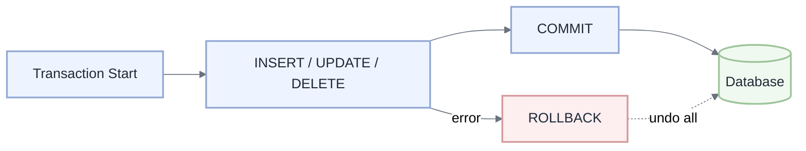

# Транзакции

### 1. Расшифруйте каждую букву ACID

ACID — это набор требований к транзакционным системам, обеспечивающий надежность обработки данных. Аббревиатура расшифровывается так:

- **Atomicity (Атомарность)** — транзакция выполняется как единое целое: либо все её операции применяются, либо ни одна. Промежуточных состояний не существует.
- **Consistency (Согласованность)** — транзакция переводит базу данных из одного корректного состояния в другое, не нарушая установленных правил и ограничений.
- **Isolation (Изоляция)** — результаты параллельно выполняющихся транзакций не влияют друг на друга до момента их завершения. Каждая транзакция «видит» согласованный снимок данных.
- **Durability (Долговечность / Устойчивость)** — изменения, подтвержденные (закоммиченные) транзакцией, сохраняются навсегда, даже в случае сбоя системы.




### 2. Какие уровни изоляции транзакций существуют

Стандарт SQL:1992 определяет четыре уровня изоляции, упорядоченных от самого слабого к самому строгому:

1.  **Read Uncommitted**
2.  **Read Committed**
3.  **Repeatable Read**
4.  **Serializable**

Каждый следующий уровень предотвращает все больше аномалий, но ценой снижения производительности и параллелизма.

```sql
-- PostgreSQL: смена уровня изоляции
BEGIN TRANSACTION ISOLATION LEVEL REPEATABLE READ;
SELECT balance FROM accounts WHERE id = 1;
-- ... операции ...
COMMIT;

-- MySQL (InnoDB): смена уровня изоляции
SET TRANSACTION ISOLATION LEVEL SERIALIZABLE;
START TRANSACTION;
-- ... операции ...
COMMIT;

-- Spring: уровень изоляции в @Transactional
@Transactional(isolation = Isolation.REPEATABLE_READ)
public void transfer(long fromId, long toId, BigDecimal amount) { ... }
```


### 3. Что такое Read Uncommitted

Самый слабый уровень изоляции. Он **разрешает «грязное чтение» (dirty read)**: одна транзакция может видеть изменения, сделанные другой транзакцией, которые ещё **не были закоммичены**. На этом уровне также возможны неповторяющееся и фантомное чтение.


### 4. Что такое Read Committed

Уровень, при котором транзакция видит **только закоммиченные** данные. Запрос `SELECT` видит снимок базы данных на момент **начала своего выполнения**. Это предотвращает «грязное чтение», но **разрешает неповторяющееся чтение**: если выполнить один и тот же `SELECT` дважды в рамках одной транзакции, можно получить разные результаты, если между ними другая транзакция закоммитила изменения.


### 5. Что такое Repeatable Read

Уровень, при котором все запросы в рамках одной транзакции видят **один и тот же снимок данных**, зафиксированный на момент выполнения **первого** запроса в этой транзакции. Это гарантирует, что повторное чтение той же строки вернет те же данные (предотвращает неповторяющееся чтение). Однако стандарт SQL допускает на этом уровне **фантомное чтение**.


### 6. Что такое Serializable

Самый строгий уровень изоляции. Он гарантирует, что результат параллельного выполнения транзакций будет **эквивалентен** результату их **последовательного** выполнения в некотором порядке. Предотвращает все аномалии, включая фантомное чтение. Если СУБД обнаруживает конфликт, одна из транзакций может быть откачена с ошибкой сериализации (`serialization_failure`).


### 7. Что такое грязное чтение (Dirty Read)

Аномалия, при которой транзакция читает данные, измененные другой транзакцией, которая **ещё не завершилась (не закоммитила или не откатилась)**. Если эта другая транзакция впоследствии откатится, прочитанные первой транзакцией данные окажутся «несуществующими».


### 8. Что такое неповторяющееся чтение (Non-Repeatable Read)

Аномалия, при которой транзакция читает одну и ту же строку дважды, и между этими чтениями другая транзакция **изменяет или удаляет** эту строку и коммитит свои изменения. В результате повторное чтение возвращает **другие данные** (или строка исчезает).


### 9. Что такое фантомное чтение (Phantom Read)

Аномалия, при которой транзакция выполняет запрос с условием, возвращающий набор строк, а затем **повторяет** тот же запрос, и между ними другая транзакция **вставляет или удаляет** строки, удовлетворяющие этому условию, и коммитит изменения. В результате повторный запрос возвращает **другой набор строк** (появляются или исчезают «фантомы»).


### 10. Что такое потерянное обновление (Lost Update)

Аномалия, возникающая при конкурентном обновлении одних и тех же данных. Две транзакции читают одно и то же значение, обе на его основе вычисляют новое и обе записывают свой результат. Обновление, записанное последним, **«затирает»** результат первого, и изменения первой транзакции теряются. Строго говоря, это аномалия **записи** (write-write conflict), а не чтения, и она не всегда явно упоминается в матрице уровней изоляции.


### 11. Какой уровень изоляции по умолчанию в PostgreSQL

В PostgreSQL уровень изоляции по умолчанию — **Read Committed**. При этом PostgreSQL внутренне реализует только три уровня: `Read Uncommitted` ведет себя как `Read Committed`. `Repeatable Read` в PostgreSQL также предотвращает фантомное чтение, что является более сильной гарантией, чем требует стандарт.

**Важный нюанс PostgreSQL:** благодаря архитектуре **MVCC** (Multi-Version Concurrency Control) уровень `Repeatable Read` на практике предотвращает и **фантомное чтение**. Транзакция работает со строгим **снимком (snapshot)** данных на момент своего первого запроса. Любые строки, вставленные другими транзакциями после начала снимка, просто **невидимы** для текущей транзакции — это нарушает строгий стандарт SQL:1992, но даёт более сильные гарантии на практике.


### 12. Какой уровень изоляции по умолчанию в MySQL

В MySQL (для движка InnoDB) уровень изоляции по умолчанию — **Repeatable Read**. Он обеспечивает высокую согласованность и подходит для критичных данных, требующих соответствия ACID.


### 13. Что такое Propagation в Spring

**Propagation (распространение транзакций)** — это настройка в Spring, которая определяет, как транзакционное поведение метода соотносится с уже существующей транзакцией. Она отвечает на вопрос: «Что делать, если метод, помеченный `@Transactional`, вызывается, когда транзакция уже активна?» — присоединиться к ней, создать новую, приостановить текущую и т.д..

> 🔗 Подробнее про механику Spring AOP (прокси, self-invocation, атрибуты `@Transactional`, rollback) — см. `spring-boot.md` § «Транзакции и AOP».


### 14. Что делает Propagation.NESTED

`Propagation.NESTED` означает, что если текущая транзакция существует, метод выполняется во **вложенной транзакции**. Это не независимая транзакция, а точка сохранения (savepoint) внутри внешней транзакции. Если вложенная транзакция завершается ошибкой, откат происходит только до этой точки сохранения, и внешняя транзакция может продолжить выполнение. Если внешней транзакции нет, поведение аналогично `REQUIRED`.


### 15. В чём разница между REQUIRED и REQUIRES_NEW

- **`REQUIRED`** (по умолчанию): если транзакция уже существует, метод **присоединяется** к ней. Если нет — создается новая. Откат в вызывающем методе откатит и вложенный вызов, так как это одна транзакция.
- **`REQUIRES_NEW`**: всегда создает **новую, независимую** транзакцию. Если текущая транзакция существует, она **приостанавливается** на время выполнения нового метода. Откат или коммит в новой транзакции не влияет на внешнюю транзакцию (и наоборот).

```java
@Service
public class OrderService {

    @Transactional // REQUIRED: присоединяется к внешней транзакции
    public void createOrder(Order order) {
        orderRepo.save(order);
        auditService.log("Order created"); // Та же транзакция
    }
}

@Service
public class AuditService {

    @Transactional(propagation = Propagation.REQUIRES_NEW)
    public void log(String message) {
        // Новая независимая транзакция
        // Если здесь будет ошибка — только этот log откатится,
        // а внешняя транзакция createOrder продолжится
        auditRepo.save(new AuditLog(message));
    }
}
```


### 16. Что такое аннотация @Transactional

`@Transactional` — это декларативная аннотация Spring, которая оборачивает выполнение метода в транзакцию. Spring через AOP-прокси автоматически открывает транзакцию перед вызовом метода и выполняет `commit` или `rollback` после его завершения, избавляя разработчика от ручного управления транзакциями.


### 17. На каком уровне можно использовать @Transactional

Аннотацию `@Transactional` можно применять на двух уровнях:
- **На уровне класса**: тогда она действует как настройка по умолчанию для всех публичных методов этого класса.
- **На уровне метода**: настройка для конкретного метода, которая переопределяет настройки класса.

Важно: аннотация работает только на **публичных** методах, вызываемых **извне** через Spring-прокси.


### 18. Что такое rollback в транзакциях

**Rollback (откат)** — это операция, которая **отменяет все изменения**, сделанные в рамках текущей транзакции, и возвращает базу данных к состоянию, которое было до её начала. Все незакоммиченные изменения отбрасываются, блокировки снимаются.


### 19. Какие исключения по умолчанию вызывают rollback

По умолчанию Spring инициирует откат транзакции только при возникновении **непроверяемых (unchecked)** исключений, то есть тех, что являются экземплярами или наследниками `RuntimeException`, а также при `Error`. **Проверяемые (checked)** исключения (например, `IOException`) по умолчанию **не вызывают** откат.


### 20. Как настроить rollback для checked exceptions

Чтобы транзакция откатывалась при возникновении проверяемого исключения, необходимо явно указать это в атрибуте `rollbackFor` аннотации `@Transactional`:

```java
@Transactional(rollbackFor = IOException.class)
public void someMethod() throws IOException { ... }
```
Можно указать несколько классов исключений или использовать `rollbackFor = Exception.class`, чтобы откатывать транзакцию при **любом** исключении.


### 21. Что такое readonly транзакция

`readOnly = true` — это атрибут `@Transactional`, который сообщает Spring, что транзакция будет **только для чтения**. Это служит оптимизацией: Spring может передать этот флаг в базовый уровень (например, JDBC), чтобы СУБД могла применить внутренние оптимизации для read-only операций. Также это служит защитой: некоторые СУБД могут отклонить операции записи в такой транзакции. На уровне JPA Hibernate также может использовать этот флаг для оптимизации (например, не выполнять dirty checking).

```java
@Service
public class ReportService {

    // Read-only: оптимизация + защита от случайной записи
    @Transactional(readOnly = true, isolation = Isolation.REPEATABLE_READ)
    public List<Order> getOrdersByDate(LocalDate date) {
        return orderRepo.findByOrderDate(date);
    }

    // Write: полноценная транзакция с rollback
    @Transactional(rollbackFor = Exception.class)
    public void cancelOrder(Long orderId) {
        Order order = orderRepo.findById(orderId)
            .orElseThrow(() -> new OrderNotFoundException(orderId));
        order.setStatus(OrderStatus.CANCELLED);
        orderRepo.save(order);
        // Если здесь ошибка — весь метод откатится
    }
}
```


### 22. Что произойдёт при вызове @Transactional метода из другого метода того же класса

В этом случае **транзакционное поведение не применится**. Spring по умолчанию использует прокси-режим (proxy mode), при котором транзакционная логика (открытие/закрытие транзакции) встроена в **внешний прокси-объект**. Когда вы вызываете метод изнутри того же класса через `this` (self-invocation), вызов происходит **в обход прокси**, напрямую у целевого объекта. Прокси не участвует, и аннотация `@Transactional` игнорируется — метод выполнится **без транзакции**. Это одна из самых распространенных причин «неработы» `@Transactional` в Spring.

### 23. Как предотвратить аномалию Lost Update: Optimistic vs Pessimistic Locking

**Lost Update** (вопрос 10) возникает, когда две транзакции читают одни и те же данные, модифицируют их и записывают, затирая изменения друг друга. Решается двумя стратегиями блокировок:

**1. Оптимистичная блокировка (Optimistic Locking)**

- **Как работает:** Не блокирует строку в БД. Добавляет поле версии (`@Version` в JPA). При `UPDATE` в `WHERE` добавляется условие `version = старая_версия`. Если версия изменилась (другая транзакция успела обновить), `UPDATE` затронет 0 строк, и ORM выбросит `OptimisticLockException`.
- **Когда использовать:** При **низкой** конкуренции за данные (чтений много, записей мало). Не держит блокировки БД, масштабируется лучше.
- **Пример (JPA):**

```java
@Entity
public class Account {
    @Id
    private Long id;
    private BigDecimal balance;

    @Version  // JPA автоматически управляет версией
    private Long version;
}
```

```sql
-- JPA сгенерирует такой UPDATE:
UPDATE accounts SET balance = ?, version = ? WHERE id = ? AND version = ?
-- Если версия изменилась → 0 строк → OptimisticLockException
```

**2. Пессимистичная блокировка (Pessimistic Locking)**

- **Как работает:** Явно блокирует строку на уровне БД с помощью `SELECT ... FOR UPDATE` (в JPA: `LockModeType.PESSIMISTIC_WRITE`). Другие транзакции, пытающиеся изменить или заблокировать эту строку, **ждут** (или получают timeout).
- **Когда использовать:** При **высокой** конкуренции за одни и те же данные (например, списание баланса с популярного счёта), когда цена отката и повторной попытки (retry) выше, чем цена ожидания.
- **Пример (JPA):**

```java
@Query("SELECT a FROM Account a WHERE a.id = :id")
@Lock(LockModeType.PESSIMISTIC_WRITE)
Account findByIdForUpdate(@Param("id") Long id);
```

```sql
-- Сгенерированный SQL:
SELECT * FROM accounts WHERE id = ? FOR UPDATE;
-- Строка заблокирована до COMMIT/ROLLBACK текущей транзакции
```

**Trade-offs:**
- **Optimistic**: дешевле при низкой конкуренции, не блокирует БД, но требует логики retry при конфликте (и возможно повторного чтения данных).
- **Pessimistic**: гарантирует порядок и исключает конфликт, но снижает параллелизм и может привести к deadlock'ам (если блокировки берутся в разном порядке).

**Follow-up (что спросит интервьюер):**
- «Как выбрать между Optimistic и Pessimistic?» → Оптимистичная — при низкой конкуренции (много чтений, мало записей), пессимистичная — при высокой конкуренции (много записей на одни и те же строки).
- «Что произойдёт при конфликте в Optimistic Locking?» → `UPDATE` затронет 0 строк → `OptimisticLockException` → приложение должно повторить операцию (retry с экспоненциальным backoff).
- «Как избежать deadlock при Pessimistic Locking?» → Всегда блокировать строки в **одном и том же порядке** (например, по `id` ASC).
- «Какой уровень изоляции нужен для Pessimistic Locking?» → `Read Committed` достаточно (блокировка гарантирует эксклюзивность), `Repeatable Read` не нужен (блокировка решает проблему).

### 24. Как обеспечить согласованность данных в микросервисах (Distributed Transactions)

Классический **2PC (Two-Phase Commit / XA)** в современных high-load системах используется редко из-за:
- **Блокировок ресурсов** на время подготовки (prepare phase) — если один участник медленный, все ждут.
- **Низкой доступности** — если один участник упал, вся система зависает в неопределённом состоянии.
- **Сложности** — координатор становится single point of failure.

Современные подходы:

**1. Паттерн Saga**

Длинная транзакция разбивается на последовательность **локальных** транзакций. Каждая следующая запускается после успеха предыдущей. При ошибке выполняются **компенсирующие транзакции** (compensating transactions), которые отменяют эффекты предыдущих шагов.

- **Choreography (Хореография):** Сервисы общаются через **события** (Kafka/NATS). Каждый сервис слушает событие и делает свой шаг. Минус: сложно отследить общий статус (нет центрального координатора).
- **Orchestration (Оркестрация):** Есть **центральный координатор** (Saga Orchestrator), который командует сервисам, что делать, и вызывает компенсацию при сбое. Плюс: проще отслеживать статус, минус: координатор — single point of failure.

**Пример Saga (заказ):**
1. `OrderService` создаёт заказ (локальная транзакция).
2. `PaymentService` списывает оплату (локальная транзакция).
3. `InventoryService` резервирует товар (локальная транзакция).
4. Если шаг 3 провалился → компенсирующие: `PaymentService` возвращает оплату, `OrderService` отменяет заказ.

**2. Паттерн Transactional Outbox (самый надёжный для event-driven)**

**Проблема (Dual Write Problem):** сохранить сущность в БД **и** отправить событие в Kafka **атомарно** невозможно — это две разные системы, локальная ACID-транзакция их не покрывает.

**Решение:**
- В той же **локальной** транзакции, где сохраняется бизнес-сущность, сохраняется запись о событии в специальную таблицу `outbox` **в той же БД**.
- Отдельный процесс (Change Data Capture через **Debezium** или polling-воркер) читает таблицу `outbox` и **гарантированно** доставляет события в Kafka.
- **Гарантия:** атомарность гарантируется локальной ACID-транзакцией одной БД (сущность + outbox записываются вместе).

```sql
-- Таблица outbox (в той же БД, что и бизнес-данные)
CREATE TABLE outbox (
    id BIGINT PRIMARY KEY,
    event_type VARCHAR(255) NOT NULL,
    payload JSONB NOT NULL,
    created_at TIMESTAMP DEFAULT NOW(),
    processed_at TIMESTAMP  -- NULL = не отправлено
);

-- В одной транзакции:
BEGIN;
INSERT INTO orders (id, status) VALUES (1, 'CREATED');
INSERT INTO outbox (event_type, payload) VALUES ('ORDER_CREATED', '{"id": 1}');
COMMIT;
-- Если COMMIT не сработал — оба INSERT откатятся (атомарность)
```

**Debezium** (CDC) читает WAL (Write-Ahead Log) PostgreSQL и автоматически доставляет изменения из `outbox` в Kafka — без polling'а, с минимальной задержкой.

**Trade-offs:**
- **2PC (XA)**: сильная согласованность, но низкая доступность и масштабируемость (блокировки, координатор SPOF).
- **Saga**: высокая доступность (нет блокировок между сервисами), но **eventual consistency** (данные могут быть несогласованными на время выполнения компенсирующих транзакций).
- **Transactional Outbox**: надёжная доставка событий, но **eventual consistency** (событие может запаздывать на секунды/минуты).

**Follow-up (что спросит интервьюер):**
- «Почему не 2PC в микросервисах?» → Блокировки ресурсов, низкая доступность (если один участник упал — все ждут), координатор SPOF. В high-load системах это недопустимо.
- «Choreography vs Orchestration — что выбрать?» → Choreography — для простых случаев (мало сервисов, простая логика), Orchestration — для сложных (много сервисов, нужен контроль статуса, компенсация).
- «Transactional Outbox vs прямой publish в Kafka?» → Outbox гарантирует атомарность (сущность + событие в одной транзакции), прямой publish не гарантирует (если Kafka недоступен — событие потеряно).
- «Какая консистентность у Saga/Outbox?» → **Eventual consistency** (данные согласуются не сразу, а через некоторое время). Для большинства бизнес-сценариев это приемлемо (заказ может быть в состоянии «оплата списана, товар не зарезервирован» на несколько секунд).


